# GeoSound database tables (for the ERD)

Every table of the database as it is on Supabase (snapshot of 2026-11-09,
[`drawio/erd/supabase-schema.json`](drawio/erd/supabase-schema.json), made by `scripts/diagrams/db-snapshot.py`).
The tables come from `services/<svc>/prisma/schema.prisma`, the chat memory tables of `services/ai/app/chatbot/memory.py`
and the LangGraph checkpointer. ERD: [`drawio/erd-geosound.xml`](drawio/erd-geosound.xml).

**The database has 75 tables:**

- **34 GeoSound tables**, in the schemas of the services (section 1): `app_auth` 3, `tour` 16, `notification` 2,
  `moderation` 1, `media` 1, `ai` 5, `ai_chat` 6. They are on page 1 of the ERD.
- **41 Supabase platform tables**, made and managed by Supabase itself: `auth` 27 (Supabase Auth), `storage` 10,
  `realtime` 3, `vault` 1. GeoSound never reads or writes them. They are on page 2 of the ERD. Do not mix up Supabase's
  `auth.users` with GeoSound's accounts in `app_auth.users`.

- One Postgres database (Supabase), **one schema per service**: `app_auth` (Prisma file comment says `auth`; the
  deployed schema is `app_auth`), `tour`, `notification`, `moderation`, `media`, `ai`, `ai_chat`. A service only reads
  and writes its own schema.
- **FK** = real foreign key inside one schema. **Soft ref** = an id of another service's row (or of a row that may be
  deleted) with no foreign key. Services exchange data through RabbitMQ events and HTTP, never through joins.
- Ids are UUID strings (`@default(uuid())`) unless stated. `created_at` / `updated_at` are timestamps.
- Not in Postgres: Redis keys (Auth OTP challenges and revoked sessions, gateway chat rate limit) and the browser
  IndexedDB `geosound-offline` (stores `packages`, `assets`) of the offline download.

## 1. Summary

| Schema | Table | Purpose | UC |
|---|---|---|---|
| app_auth | `users` | Accounts (tourist, contributor, admin), status, author profile | UC01, UC18, UC21 |
| app_auth | `sessions` | One row per signed-in device | UC23 |
| app_auth | `author_follows` | Who follows which author | UC18 |
| tour | `tours` | Tours, lifecycle status, rating summary, moderation and passcode fields | UC09, UC14, UC15, UC19 |
| tour | `places` | Stops of a tour | UC10, UC15 |
| tour | `route_configs` | Route path, trigger zones, navigation audio (1-1 with a tour) | UC11 |
| tour | `tour_languages` | Languages of a tour and TTS voice | UC12 |
| tour | `place_translations` | Text (and TTS URL) of a stop per language | UC12 |
| tour | `forbidden_zones` | Polygons where a stop may not be placed (seed data) | UC10 |
| tour | `tour_ratings` | One rating per account and tour | UC05 |
| tour | `tour_reports` | One community report per account and tour | UC06, UC20 |
| tour | `tour_access_grants` | Unlocks of a restricted tour per tester | UC14 |
| tour | `tour_unlock_attempts` | Wrong passcode attempts (rate limit) | UC14 |
| tour | `tour_daily_stats` | Daily counters per tour and language | UC17 |
| tour | `tour_activity_marks` | Dedup marks for the counters | UC17 |
| tour | `itineraries` | Personal itineraries | UC07 |
| tour | `itinerary_items` | Snapshot of a stop inside an itinerary | UC07, UC08 |
| tour | `tour_review_actions` | Admin review decisions | UC19 |
| tour | `admin_actions` | Append-only log of every admin action | UC19, UC20, UC21, UC22 |
| notification | `in_app_notifications` | In-app notifications | UC16, UC21 |
| notification | `notifications` | Early placeholder table, not used by the code | — |
| moderation | `moderation_cases` | One AI review case per place / tour revision | UC15 |
| media | `audio_assets` | Declared for TTS audio, not used by the code yet | UC12 |
| ai | `index_meta` | Embedding model of the chatbot index | UC24 |
| ai | `tour_index` | Indexed revision and state per tour | UC24 |
| ai | `nodes` | Knowledge graph nodes (tour, place, city, type, topic) | UC24 |
| ai | `edges` | Knowledge graph edges | UC24 |
| ai | `chunks` | Text chunks with a 384-dim embedding (pgvector) | UC24 |
| ai_chat | `chat_sessions` | Chat sessions | UC24 |
| ai_chat | `chat_messages` | Message metadata (time, citations) | UC24 |
| ai_chat | `checkpoints` | Conversation state per session (LangGraph library) | UC24 |
| ai_chat | `checkpoint_blobs` | Large state values, including the message text (LangGraph library) | UC24 |
| ai_chat | `checkpoint_writes` | Pending writes of a chat turn (LangGraph library) | UC24 |
| ai_chat | `checkpoint_migrations` | Schema version of the LangGraph tables | UC24 |

## 2. ERD (Mermaid)

Solid lines are foreign keys; dotted lines are soft references (across services or without FK).

```mermaid
erDiagram
  users ||--o{ sessions : "has"
  users ||--o{ author_follows : "follows (follower_id)"
  users ||--o{ author_follows : "is followed (author_id)"

  tours ||--o{ places : "has"
  tours ||--o| route_configs : "has"
  tours ||--o{ tour_languages : "has"
  places ||--o{ place_translations : "has"
  tours ||--o{ tour_ratings : "has"
  tours ||--o{ tour_reports : "has"
  tours ||--o{ tour_access_grants : "has"
  tours ||--o{ tour_unlock_attempts : "has"
  tours ||--o{ tour_daily_stats : "has"
  tours ||--o{ tour_activity_marks : "has"
  itineraries ||--o{ itinerary_items : "has"

  users ||..o{ tours : "author_id"
  users ||..o{ itineraries : "owner_id"
  users ||..o{ tour_ratings : "user_id"
  users ||..o{ tour_reports : "reporter_id"
  users ||..o{ tour_access_grants : "user_id"
  places ||..o{ itinerary_items : "place_id (snapshot)"
  tours ||..o{ tour_review_actions : "tour_id"
  users ||..o{ admin_actions : "admin_id / target_id"
  tours ||..o{ admin_actions : "target_id"
  users ||..o{ in_app_notifications : "user_id"
  tours ||..o{ in_app_notifications : "tour_id"
  tours ||..o{ moderation_cases : "subject_id / tour_id"
  places ||..o{ moderation_cases : "subject_id"
  tours ||..o| tour_index : "tour_id"

  nodes ||--o{ edges : "src"
  nodes ||--o{ edges : "dst"
  nodes ||--o{ chunks : "has"
  chat_sessions ||--o{ chat_messages : "has"
  chat_sessions ||..o{ checkpoints : "thread_id"
  chat_sessions ||..o{ checkpoint_blobs : "thread_id"
  chat_sessions ||..o{ checkpoint_writes : "thread_id"
```



## 3. Schema `app_auth` (Auth service)

### `users`

| Column | Type | Null | Default | Notes |
|---|---|---|---|---|
| `id` | uuid (text) | no | uuid | PK |
| `email` | text | no | | unique |
| `password_hash` | text | no | | bcrypt |
| `full_name` | text | no | | |
| `role` | text | no | `tourist` | `tourist` \| `contributor` \| `admin` |
| `status` | text | no | `active` | `active` \| `suspended` \| `banned` (UC21) |
| `ban_reason` | text | yes | | reason of the current suspension or ban |
| `suspended_until` | timestamp | yes | | end of a suspension; in the past = active again |
| `failed_attempts` | int | no | 0 | consecutive wrong passwords |
| `locked_until` | timestamp | yes | | sign-in locked until (5 wrong passwords, 15 min) |
| `bio` | text | yes | | author introduction, max 500 (UC18) |
| `avatar_url` | text | yes | | Media upload URL (UC18) |
| `created_at`, `updated_at` | timestamp | no | now | |

### `sessions`

| Column | Type | Null | Default | Notes |
|---|---|---|---|---|
| `id` | uuid | no | uuid | PK, the `sid` claim of the access token |
| `user_id` | uuid | no | | FK → `users.id`, on delete cascade |
| `device_id` | text | yes | | random id kept by the client |
| `device_name` | text | no | | parsed from the User-Agent |
| `user_agent` | text | yes | | |
| `ip_address` | text | yes | | last seen, never shown in full |
| `location` | text | yes | | not filled yet (no IP location) |
| `refresh_hash` | text | no | | sha-256 of the current refresh token |
| `created_at`, `last_active_at` | timestamptz | no | now | |
| `expires_at` | timestamptz | no | | idle / absolute limit |
| `revoked_at` | timestamptz | yes | | |
| `revoke_reason` | text | yes | | `user`, `user_all`, `password_reset`, `password_change`, `banned`, `suspended`, `limit`, `reuse`, `expired` |

Indexes: `(user_id)`, `(user_id, device_id)`, `(revoked_at)`, `(expires_at)`.

### `author_follows`

| Column | Type | Null | Notes |
|---|---|---|---|
| `id` | uuid | no | PK |
| `follower_id` | uuid | no | FK → `users.id`, cascade |
| `author_id` | uuid | no | FK → `users.id`, cascade |
| `created_at` | timestamptz | no | |

Unique `(follower_id, author_id)`; index `(author_id)`.

## 4. Schema `tour` (Tour service)

### `tours`

| Column | Type | Null | Default | Notes |
|---|---|---|---|---|
| `id` | uuid | no | uuid | PK |
| `title` | text | no | | |
| `description` | text | no | `''` | |
| `cover_image_url` | text | yes | | |
| `original_language` | text | no | | e.g. `vi` |
| `type` | text | no | `walking` | tour type (geo rule limits per type) |
| `status` | text | no | `draft` | `draft`, `ai_checking`, `ai_warning`, `pending_review`, `public`, `rejected`, `changes_requested`, `restricted`, `hidden` |
| `author_id` | uuid | no | | soft ref → `auth.users.id` |
| `city` | text | yes | | |
| `duration` | int | yes | | minutes |
| `average_rating` | float | no | 0 | updated with every rating change (UC05) |
| `rating_count` | int | no | 0 | |
| `moderation_reasons` | json | no | `[]` | AI / geo reasons of the last result (UC15) |
| `moderation_revision` | text | yes | | revision sent in `tour.submitted` |
| `review_reason` | text | yes | | last admin reject / change request reason (UC19) |
| `report_flagged_at` | timestamp | yes | | set when 5 accounts reported within 7 days (UC06) |
| `open_report_count` | int | no | 0 | open reports (UC20 queue order) |
| `review_queued_at` | timestamp | yes | | entered the admin queue (UC22 review time) |
| `passcode_hash` | text | yes | | scrypt hash, never returned (UC14) |
| `passcode_version` | int | no | 0 | bumped on passcode change / off |
| `passcode_set_at` | timestamp | yes | | |
| `created_at`, `updated_at` | timestamp | no | now | `updated_at` = moderation and catalog revision |

Indexes: `(author_id)`, `(status)`, `(status, city)`.

### `places`

| Column | Type | Null | Default | Notes |
|---|---|---|---|---|
| `id` | uuid | no | uuid | PK |
| `tour_id` | uuid | no | | FK → `tours.id`, cascade |
| `name` | text | no | | |
| `type` | text | no | `other` | |
| `description` | text | no | | |
| `lat`, `lng` | float | no | | |
| `sequence` | int | no | 0 | order in the tour |
| `images` | json | no | `[]` | `[{ url, caption }]` |
| `audio_url` | text | yes | | recorded audio |
| `audio_source` | text | no | `tts` | `human` \| `tts` |
| `moderation_status` | text | no | `approved` | `checking`, `approved`, `warning`, `rejected` (UC15) |
| `moderation_reasons` | json | no | `[]` | |
| `moderation_revision` | text | yes | | revision sent in `place.submitted` |
| `created_at`, `updated_at` | timestamp | no | now | |

Index `(tour_id, sequence)`.

### `route_configs` (1-1 with `tours`)

| Column | Type | Null | Default | Notes |
|---|---|---|---|---|
| `id` | uuid | no | uuid | PK |
| `tour_id` | uuid | no | | unique, FK → `tours.id`, cascade |
| `path` | json | no | `[]` | `[{ lat, lng }]` |
| `triggers` | json | no | `[]` | `[{ placeId, zone, priority, nextHint }]`, zone = circle or polygon |
| `nav_audios` | json | no | `[]` | `[{ id, label, audioUrl, zone }]` |
| `created_at`, `updated_at` | timestamp | no | now | |

### `tour_languages`

| Column | Type | Null | Default | Notes |
|---|---|---|---|---|
| `id` | uuid | no | uuid | PK |
| `tour_id` | uuid | no | | FK → `tours.id`, cascade |
| `language_code` | text | no | | |
| `is_source` | bool | no | false | original language |
| `tts_voice_gender` | text | yes | | `male` \| `female` |
| `tts_voice_region` | text | yes | | |
| `created_at`, `updated_at` | timestamp | no | now | |

Unique `(tour_id, language_code)`.

### `place_translations`

| Column | Type | Null | Default | Notes |
|---|---|---|---|---|
| `id` | uuid | no | uuid | PK |
| `place_id` | uuid | no | | FK → `places.id`, cascade |
| `language_code` | text | no | | |
| `text` | text | no | | |
| `text_source` | text | no | `machine` | `source` \| `machine` \| `edited` |
| `tts_url` | text | yes | | placeholder `tts://...` today (no server TTS) |
| `tts_prerendered` | bool | no | false | |
| `created_at`, `updated_at` | timestamp | no | now | |

Unique `(place_id, language_code)`; index `(language_code)`.

### `forbidden_zones`

| Column | Type | Null | Default | Notes |
|---|---|---|---|---|
| `id` | uuid | no | uuid | PK |
| `name` | text | no | | |
| `type` | text | no | `other` | `military`, `school`, `hospital`, `consulate`, `other` |
| `geometry` | json | no | | GeoJSON Polygon `[lng, lat]` |
| `active` | bool | no | true | |
| `created_at`, `updated_at` | timestamp | no | now | |

Index `(active)`. No relation: checked against every saved stop.

### `tour_ratings`

| Column | Type | Null | Notes |
|---|---|---|---|
| `id` | uuid | no | PK |
| `tour_id` | uuid | no | FK → `tours.id`, cascade |
| `user_id` | uuid | no | soft ref → `auth.users.id` |
| `user_name` | text | no | reviewer name at rating time |
| `stars` | int | no | 1..5 |
| `comment` | text | yes | max 1000 |
| `created_at`, `updated_at` | timestamp | no | |

Unique `(tour_id, user_id)`; indexes `(tour_id, created_at)`, `(user_id)`.

### `tour_reports`

| Column | Type | Null | Default | Notes |
|---|---|---|---|---|
| `id` | uuid | no | uuid | PK |
| `tour_id` | uuid | no | | FK → `tours.id`, cascade |
| `reporter_id` | uuid | no | | soft ref → `auth.users.id`, never shown to the author |
| `reason` | text | no | | `false_info`, `offensive`, `spam`, `copyright`, `other` |
| `note` | text | yes | | max 500, required for `other` |
| `status` | text | no | `open` | `open` \| `dismissed` \| `actioned` |
| `created_at` | timestamp | no | now | |

Unique `(tour_id, reporter_id)`; indexes `(tour_id, status, created_at)`, `(created_at)`.

### `tour_access_grants`

| Column | Type | Null | Notes |
|---|---|---|---|
| `id` | uuid | no | PK |
| `tour_id` | uuid | no | FK → `tours.id`, cascade |
| `user_id` | uuid | no | soft ref → `auth.users.id` |
| `passcode_version` | int | no | valid only while equal to `tours.passcode_version` |
| `created_at` | timestamp | no | |

Unique `(tour_id, user_id)`; index `(user_id)`.

### `tour_unlock_attempts`

| Column | Type | Null | Notes |
|---|---|---|---|
| `id` | uuid | no | PK |
| `tour_id` | uuid | no | FK → `tours.id`, cascade |
| `user_id` | uuid | no | soft ref → `auth.users.id` |
| `created_at` | timestamp | no | 5 wrong attempts per 15 minutes |

Index `(tour_id, user_id, created_at)`.

### `tour_daily_stats`

| Column | Type | Null | Default | Notes |
|---|---|---|---|---|
| `tour_id` | uuid | no | | PK part, FK → `tours.id`, cascade |
| `day` | date | no | | PK part (UTC day) |
| `language` | text | no | | PK part |
| `views`, `plays`, `completions`, `downloads` | int | no | 0 | |

PK `(tour_id, day, language)`.

### `tour_activity_marks`

| Column | Type | Null | Notes |
|---|---|---|---|
| `tour_id` | uuid | no | PK part, FK → `tours.id`, cascade |
| `actor_key` | text | no | PK part, sha-256 of salt + account or device id |
| `action` | text | no | PK part: `view`, `play`, `complete`, `download` |
| `language` | text | no | PK part |
| `day` | date | no | PK part |
| `created_at` | timestamp | no | purged after 40 days |

PK `(tour_id, actor_key, action, language, day)`; indexes `(actor_key, day)`, `(day)`.

### `itineraries`

| Column | Type | Null | Notes |
|---|---|---|---|
| `id` | uuid | no | PK |
| `owner_id` | uuid | no | soft ref → `auth.users.id` |
| `name` | text | no | max 120 |
| `share_token` | text | yes | unique, public share link |
| `created_at`, `updated_at` | timestamp | no | |

Index `(owner_id)`.

### `itinerary_items`

| Column | Type | Null | Default | Notes |
|---|---|---|---|---|
| `id` | uuid | no | uuid | PK |
| `itinerary_id` | uuid | no | | FK → `itineraries.id`, cascade |
| `place_id` | uuid | no | | soft ref → `places.id` (origin) |
| `tour_id` | uuid | no | | soft ref → `tours.id` |
| `name`, `type` | text | no | `type` = `other` | snapshot |
| `lat`, `lng` | float | no | | snapshot |
| `images` | json | no | `[]` | snapshot |
| `radius_meters` | int | no | 50 | trigger circle (UC08) |
| `source_language` | text | no | | |
| `available_languages` | json | no | `[]` | |
| `audio_by_lang` | json | no | `{}` | `{ lang: { text, audioUrl, audioSource } }` |
| `sequence` | int | no | 0 | |
| `created_at` | timestamp | no | now | |

Index `(itinerary_id, sequence)`.

### `tour_review_actions`

| Column | Type | Null | Notes |
|---|---|---|---|
| `id` | uuid | no | PK |
| `tour_id` | uuid | no | soft ref (log survives tour deletion) |
| `admin_id` | uuid | no | soft ref → `auth.users.id` |
| `action` | text | no | `approve`, `reject`, `request_changes` |
| `reason` | text | yes | |
| `from_status` | text | no | `ai_warning` \| `pending_review` |
| `created_at` | timestamp | no | |

Indexes `(tour_id, created_at)`, `(created_at)`.

### `admin_actions` (append-only)

| Column | Type | Null | Default | Notes |
|---|---|---|---|---|
| `id` | uuid | no | uuid | PK |
| `admin_id` | uuid | no | | soft ref → `auth.users.id` |
| `action` | text | no | | `approve_tour`, `reject_tour`, `request_tour_changes`, `hide_tour`, `restore_tour`, `dismiss_reports`, `warn_user`, `suspend_user`, `ban_user`, `restore_user` |
| `target_type` | text | no | | `tour` \| `user` |
| `target_id` | uuid | no | | soft ref |
| `reason` | text | yes | | |
| `data` | json | no | `{}` | e.g. `{ fromStatus, queuedAt }`, `{ until }` |
| `source_key` | text | yes | | unique; set for rows fed by `account.moderated` |
| `created_at` | timestamp | no | now | |

Indexes `(target_type, target_id, created_at)`, `(created_at)`, `(admin_id, created_at)`, `(action, created_at)`.

## 5. Schema `notification` (Notification service)

### `in_app_notifications`

| Column | Type | Null | Default | Notes |
|---|---|---|---|---|
| `id` | uuid | no | uuid | PK |
| `user_id` | uuid | no | | soft ref → `auth.users.id` (recipient) |
| `type` | text | no | | event name, e.g. `tour.rejected`, `account.moderated` |
| `tour_id` | uuid | yes | | soft ref → `tour.tours.id` |
| `title` | text | no | | Vietnamese sentence |
| `body` | text | yes | | reason |
| `data` | json | no | `{}` | whitelisted extras (reasons, count, flagged) |
| `read_at` | timestamp | yes | | |
| `created_at` | timestamp | no | now | |
| `source_key` | text | no | | unique: a redelivered event adds no row |

Indexes `(user_id, created_at)`, `(user_id, read_at)`, `(user_id, tour_id, created_at)`.

### `notifications` (unused placeholder)

`id` uuid PK, `userId` text, `type` text, `message` text, `read` bool (false), `createdAt` timestamp. Columns are
not snake_case mapped. No code reads or writes it; keep it out of the ERD or mark it as legacy.

## 6. Schema `moderation` (Moderation service)

### `moderation_cases`

| Column | Type | Null | Default | Notes |
|---|---|---|---|---|
| `id` | uuid | no | uuid | PK |
| `subject_type` | text | no | | `place` \| `tour` |
| `subject_id` | uuid | no | | soft ref → `tour.places.id` or `tour.tours.id` |
| `tour_id` | uuid | yes | | soft ref → `tour.tours.id` |
| `revision` | text | no | | Tour `updatedAt`, echoed back in results |
| `status` | text | no | `pending` | `pending`, `reviewing`, `done`, `ai_failed`, `failed_permanent` |
| `verdict` | text | yes | | `Pass` \| `Warning` \| `Reject` |
| `severity` | float | yes | | 0..1 |
| `reasons` | json | no | `[]` | `[{ field, category, message, source, severity? }]` |
| `attempts` | int | no | 0 | |
| `model` | text | yes | | e.g. `gemini-2.5-flash` |
| `images_checked` | int | no | 0 | |
| `last_error` | text | yes | | |
| `payload` | json | no | | original event, used by the retry sweeper |
| `published_at`, `checked_at` | timestamp | yes | | |
| `created_at`, `updated_at` | timestamp | no | now | |

Unique `(subject_type, subject_id, revision)`; index `(status, updated_at)`.

## 7. Schema `media` (Media service)

### `audio_assets` (declared, not used yet)

`id` uuid PK, `tourId` text, `lang` text, `s3Url` text, `kind` text (`tts` \| `human`, default `tts`), `createdAt`
timestamp. Reserved for server-side TTS, which is not built; uploaded files are stored as files, not rows.

## 8. Schemas `ai` and `ai_chat` (AI service, chatbot UC24)

### `ai.index_meta`

| Column | Type | Notes |
|---|---|---|
| `id` | smallint | PK, always 1 |
| `embedding_model` | text | `multilingual-e5-small` |
| `dimension` | int | 384 |
| `updated_at` | timestamptz | |

### `ai.tour_index`

| Column | Type | Notes |
|---|---|---|
| `tour_id` | text | PK, soft ref → `tour.tours.id` |
| `revision` | timestamptz | indexed revision (from `tour.published`) |
| `state` | text | index state |
| `updated_at` | timestamptz | |

### `ai.nodes`

| Column | Type | Notes |
|---|---|---|
| `id` | text | PK, e.g. `tour:<id>`, `place:<id>`, `city:<name>` |
| `kind` | text | `tour`, `place`, `city`, `type`, `topic` |
| `name` | text | |
| `props` | json | |
| `tour_id` | text | null for shared nodes (city, type, topic) |
| `revision` | timestamptz | |
| `topics_pending` | bool | |
| `lat`, `lng` | float | places only |

Index `(tour_id)`.

### `ai.edges`

| Column | Type | Notes |
|---|---|---|
| `src` | text | PK part, FK → `nodes.id`, cascade |
| `dst` | text | PK part, FK → `nodes.id`, cascade |
| `kind` | text | PK part (relation name) |
| `props` | json | |

Index `(dst, kind)`.

### `ai.chunks`

| Column | Type | Notes |
|---|---|---|
| `id` | text | PK |
| `node_id` | text | FK → `nodes.id`, cascade |
| `tour_id` | text | soft ref → `tour.tours.id` |
| `lang` | text | |
| `source` | text | which field the text comes from |
| `text` | text | |
| `embedding` | `vector(384)` | pgvector |

Index `(tour_id)`.

### `ai_chat.chat_sessions` and `ai_chat.chat_messages`

| Table | Column | Type | Notes |
|---|---|---|---|
| `chat_sessions` | `session_id` | text | PK |
| `chat_sessions` | `last_active_at` | timestamptz | indexed |
| `chat_messages` | `session_id` | text | PK part, FK → `chat_sessions`, cascade |
| `chat_messages` | `message_id` | text | PK part |
| `chat_messages` | `role` | text | `user` \| `assistant` |
| `chat_messages` | `at` | timestamptz | |
| `chat_messages` | `citations` | jsonb | `[{ kind, id, title, tour_id? }]` |

Created only when `CHAT_MEMORY_BACKEND=postgres`. The message text itself is kept by the LangGraph checkpointer in the
four tables below.

### `ai_chat` LangGraph checkpointer tables (made and migrated by the library)

`AsyncPostgresSaver.setup()` creates them in the same schema (`SET search_path TO ai_chat`). `thread_id` is the chat
`session_id` (soft ref → `chat_sessions.session_id`, no FK). Never edit them by hand.

| Table | Columns | Key |
|---|---|---|
| `checkpoints` | `thread_id` text, `checkpoint_ns` text (default `''`), `checkpoint_id` text, `parent_checkpoint_id` text?, `type` text?, `checkpoint` jsonb, `metadata` jsonb (default `{}`) | PK `(thread_id, checkpoint_ns, checkpoint_id)` |
| `checkpoint_blobs` | `thread_id` text, `checkpoint_ns` text, `channel` text, `version` text, `type` text, `blob` bytea? | PK `(thread_id, checkpoint_ns, channel, version)` |
| `checkpoint_writes` | `thread_id` text, `checkpoint_ns` text, `checkpoint_id` text, `task_id` text, `idx` int, `channel` text, `type` text?, `blob` bytea, `task_path` text (default `''`) | PK `(thread_id, checkpoint_ns, checkpoint_id, task_id, idx)` |
| `checkpoint_migrations` | `v` int | PK `(v)` |

## 9. Supabase platform schemas (not used by GeoSound)

Made by Supabase for its own products; listed for completeness (full columns in the snapshot and on page 2 of the ERD).

| Schema | Tables |
|---|---|
| `auth` (27) | `audit_log_entries`, `custom_oauth_providers`, `flow_state`, `identities`, `instances`, `mfa_amr_claims`, `mfa_challenges`, `mfa_factors`, `mfa_recovery_code_sets`, `mfa_recovery_codes`, `oauth_authorizations`, `oauth_client_states`, `oauth_clients`, `oauth_consents`, `one_time_tokens`, `refresh_tokens`, `saml_providers`, `saml_relay_states`, `schema_migrations`, `scim_tokens`, `scim_users`, `sessions`, `sso_domains`, `sso_providers`, `users`, `webauthn_challenges`, `webauthn_credentials` |
| `storage` (10) | `bucket_lifecycle_states`, `buckets`, `buckets_analytics`, `buckets_vectors`, `lifecycle_abandoned_artifacts`, `migrations`, `objects`, `s3_multipart_uploads`, `s3_multipart_uploads_parts`, `vector_indexes` |
| `realtime` (3) | `messages`, `schema_migrations`, `subscription` |
| `vault` (1) | `secrets` |

To refresh the snapshot and the ERD after a schema change:

```
docker compose exec -T ai python - < scripts/diagrams/db-snapshot.py > docs/02-design/drawio/erd/supabase-schema.json
node scripts/diagrams/erd-xml.mjs docs/02-design/drawio/erd-geosound.xml
```

The ERD script stops with an error when the database has a schema it does not draw, or when the number of drawn tables
differs from the snapshot.
