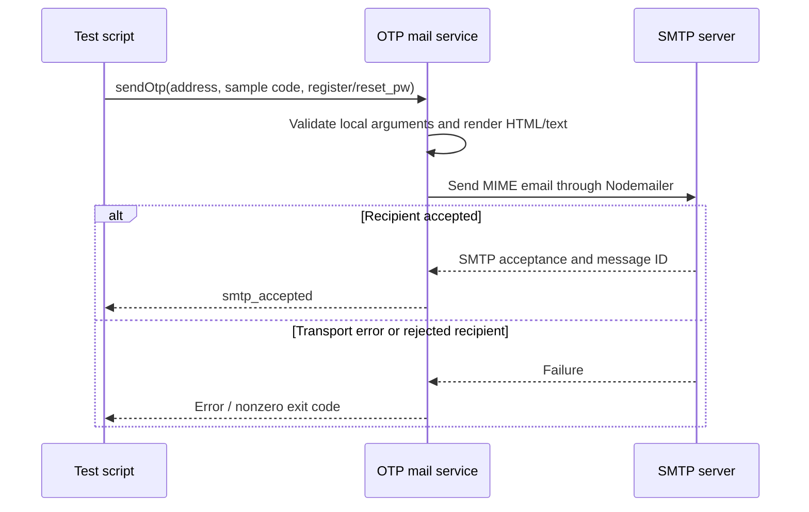

# OTP email templates and SMTP verification

> Updated 2026-10-24 after team direction: focus on email templates and sending
> tests first. The earlier event-contract proposal is deferred. The team lead
> will supply event names and payloads later; none are defined in this change.
> ERD follow-up (2026-10-24): the supplied general ERD is now included as a
> reference. Reset templates use its `reset_pw` purpose, with a `reset` alias
> for the existing Auth code.

## Existing model and ownership

The user-supplied [general ERD](drawio/erd-general.drawio) is saved as decoded
draw.io XML, preserving the supplied model. It is a logical model, not a schema
migration or a definition of broker payloads.

| ERD reference | Implication for the current email module |
| --- | --- |
| `USERS.email` | Use the recipient address supplied by the caller; do not query another service's tables. |
| `OTP_CODES.code` | Render the supplied code as text; current Auth generates six digits. |
| `OTP_CODES.purpose: register\|reset_pw` | Use these two template names; keep `reset` as a compatibility alias for Auth. |
| `OTP_CODES.expires_at (2 phút)` | Display two minutes by default (120 seconds); actual validity stays with Auth. |
| `OTP_CODES.otp_id`, `user_id`, `created_at` | OTP identity, ownership and storage are outside the template/SMTP module. |
| `NOTIFICATIONS` | UC16 in-app/push records; do not use this table to store OTP codes or email delivery outcomes. |

The ERD's `NOTIFICATIONS` fields are `notification_id`, `recipient_user_id`,
nullable `tour_id`, `type` (six unspecified enum values), `reason`,
`delivery: in_app|push`, `is_read`, and `created_at`. It does not define email
as a value of `delivery`. No new notification type or channel is invented here.

There are existing differences between the supplied model and runtime code:
Auth's Prisma schema has no `OTP_CODES` table; Auth stores pending registration
and OTP challenges in Redis and creates the user only after verification. Auth
also currently uses `reset` rather than `reset_pw`. Notification's Prisma model
is still a smaller placeholder than the ERD's `NOTIFICATIONS` entity.

This change aligns the templates without modifying those other components.
Auth owns OTP creation, lifetime, verification and account updates. Its storage
implementation and the ERD's user/OTP lifecycle need reconciliation by the Auth
owner separately. SMTP/template tests require neither an existing user nor a
database. Nothing in Auth or the worker is rewired.

## Templates

| Purpose | Subject | Content |
| --- | --- | --- |
| `register` | Mã OTP đăng ký GeoSound | Account verification and registration instructions |
| `reset_pw` | Mã OTP đặt lại mật khẩu GeoSound | Password reset instructions |

Both templates include GeoSound branding, a selectable six-digit code, lifetime,
a warning not to share the code, and guidance for unsolicited messages. They
include HTML using tables and inline CSS plus a plain-text alternative. No
external fonts, images or tracking requests are needed.

The local API follows Auth's existing `sendOtp(to, code, purpose)` method shape;
both `reset_pw` and the existing `reset` value select the reset template. Set
`ttlSeconds` when constructing the service (120 by default, matching the current
Auth default). This value is display text, not an independent validity check;
Auth remains responsible for expiry. When the real asynchronous input is supplied,
use its authoritative expiry rather than starting a new two-minute lifetime at
delivery. That integration is deferred. There is no event schema, routing key,
request ID, queue or broker dependency in this API.

## Current test sequence

## Verification and review artifacts

See [the service guide](../../services/notification/README.md) for exact commands.

- `email:preview` produces register/reset HTML and text files locally without
  sending email. Generated files are ignored by Git.
- `npm test --workspace=@geosound/notification` checks validation, content,
  SMTP configuration and failures. Loopback integration tests send both templates
  through Nodemailer to a temporary SMTP sink bound to `127.0.0.1`, capture and
  decode MIME, and verify its HTML/text. No external email is sent.
- `email:test` is an explicit manual SMTP smoke test to an address you provide.
  Subjects start with `[TEST]`; the sample `001234` is not an Auth challenge.
  Output reports `smtp_accepted` with a message ID, or `failed` with a nonzero
  exit code. Check Inbox/Spam separately to prove mailbox receipt.

SMTP acceptance is not proof of inbox delivery. No external mailbox test is
claimed by the automated suite. Do not log SMTP credentials or real OTPs.

## Deferred work

The team lead supplies the actual events/payloads before broker integration.
Consumer setup, retries, duplicate handling, asynchronous expiry checks and UC16
are outside this template-first change. No provisional event contract needs
approval to review the templates and local SMTP test results.

## Contributor email lookup (#258)

Tour events (`tour.ai_rejected`, `tour.approved`, `tour.rejected`, `tour.changes_requested`, `tour.hidden`, ...)
carry `contributorId` but no `contributorEmail`. When the email is missing, Notification asks Auth:

- `GET http://auth:3001/internal/users/:id/contact` with header `x-internal-token` = `INTERNAL_SERVICE_TOKEN`
  returns `{ id, email, fullName }` (no hash, role or status). Unknown user: 404.
- Auth refuses the route when the token is not configured or the request comes through the gateway
  (`x-forwarded-for`), so it is reachable only inside the Docker network. Token compare is constant time.
- Notification uses `AUTH_SERVICE_URL` and `INTERNAL_SERVICE_TOKEN` (both in the root `.env`), a 3 s timeout
  and no redirects. A failed or empty lookup is logged and the email is skipped; the worker never throws for it.
