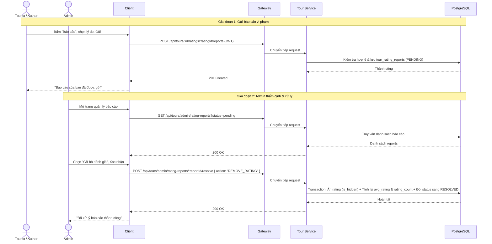

# UC05 – Báo cáo và xử lý khiếu nại đánh giá tour

| Trường | Nội dung |
|---|---|
| **Use Case Number** | UC05 |
| **Use Case Name** | Báo cáo và xử lý khiếu nại đánh giá tour |
| **Actor(s)** | • Người báo cáo: Khách du lịch (Tourist đã đăng nhập), Tác giả tour (Author) • Người kiểm duyệt: Quản trị viên hệ thống (Admin) |
| **Priority** | P1 |
| **Maturity** | Implemented |
| **Summary** | Người dùng đã đăng nhập (Tourist hoặc Author của tour) báo cáo một nhận xét/đánh giá vi phạm tiêu chuẩn cộng đồng (spam, ngôn từ xúc phạm, thông tin sai lệch). Báo cáo được đưa vào hàng đợi kiểm duyệt của Quản trị viên (Admin). Admin thẩm định và phán quyết gỡ bỏ nhận xét vi phạm hoặc bác bỏ báo cáo. Tác giả tour không có quyền tự xóa hoặc ẩn nhận xét của khách để đảm bảo tính khách quan. |

## Basic Course of Events

### Giai đoạn 1: Actor gửi báo cáo vi phạm

| # | Actor Action | System Response |
|---|---|---|
| 1 | Tourist mở mục **"Đánh giá"** trên chi tiết tour (`/tour/:tourId#ratings`) và bấm nút **"Báo cáo"** (biểu tượng cờ) trên một nhận xét của người khác. *A1, E1, E2* | Client mở hộp thoại modal "Báo cáo đánh giá vi phạm" (lý do mặc định: Spam / Quảng cáo). |
| 2 | Actor chọn lý do vi phạm từ danh mục có sẵn (Spam/Quảng cáo, Ngôn từ thù ghét/Xúc phạm, Thông tin sai lệch/Lạc đề, Khác) và nhập mô tả bổ sung (không bắt buộc, tối đa 500 ký tự). | |
| 3 | Actor nhấn **"Gửi báo cáo"**. | Client gọi `POST /api/tours/:tourId/ratings/:ratingId/reports` với `{ reasonType, description }` (`reasonType`: `SPAM`, `OFFENSIVE`, `MISLEADING`, `OTHER`). Server nhận `:ratingId` là id của đánh giá hoặc id người viết đánh giá. |
| 4 | | Server kiểm tra: Actor đã đăng nhập, lý do hợp lệ và mô tả tối đa 500 ký tự (400 `validation_error`), tour đang `public`, đánh giá tồn tại và chưa bị gỡ, không tự báo cáo chính mình, tài khoản chưa từng báo cáo đánh giá này. *E1, E2, E3, E4* |
| 5 | | Server lưu bản ghi mới vào `tour_rating_reports` với trạng thái `PENDING`. Nếu tổng số lượt báo cáo `PENDING` của bài đánh giá đạt ngưỡng cảnh báo ($N \ge 3$), hệ thống tự động gắn cờ `is_flagged = true`. Đánh giá bị gắn cờ vẫn hiển thị công khai và vẫn được tính điểm. Trả về 201 Created `{ report, pendingCount, isFlagged }`. |
| 6 | | Client đóng modal và hiển thị thông báo: *"Báo cáo của bạn đã được gửi và đang chờ quản trị viên xem xét."* Nếu lỗi, thông báo lỗi của server hiện ngay trong modal. |

### Giai đoạn 2: Admin thẩm định và giải quyết khiếu nại

| # | Actor Action | System Response |
|---|---|---|
| 7 | Admin mở trang **"Khiếu nại đánh giá"** trong khu quản trị (`/admin/reports/ratings`). *A2, E5* | Client gọi `GET /api/tours/admin/rating-reports?status=pending&page=1&limit=20` và hiển thị mỗi báo cáo một thẻ: tên tour, nhãn *"Cờ cảnh báo (N báo cáo)"* khi đánh giá bị gắn cờ, nhãn *"Khiếu nại từ Tác giả"*, tên người viết, số sao, nhận xét, lý do và mô tả. Thứ tự: đánh giá bị gắn cờ trước, rồi khiếu nại của tác giả, rồi mới nhất. |
| 8 | Admin bấm **"Gỡ bỏ đánh giá"** hoặc **"Bác bỏ báo cáo"** trên một thẻ, nhập **"Ghi chú xử lý (không bắt buộc)"** (tối đa 500 ký tự) trong hộp thoại xác nhận và bấm **"Xác nhận"**. | |
| 9 | | Client gọi `POST /api/tours/admin/rating-reports/:reportId/resolve` với `{ action, adminNote }` (`action` là `REMOVE_RATING` hoặc `DISMISS`). |
| 10 | | Server xử lý trong một Transaction: • **Nếu `DISMISS` (Bác bỏ):** Mọi báo cáo `PENDING` của đánh giá chuyển sang `DISMISSED`, đặt lại `is_flagged = false`. Đánh giá vẫn giữ nguyên hiển thị. • **Nếu `REMOVE_RATING` (Gỡ bỏ):** Đặt `is_hidden = true` (dòng `tour_ratings` được giữ lại); trừ đánh giá khỏi `tours.average_rating` và `tours.rating_count` bằng một câu SQL atomic (giống luồng xóa đánh giá); mọi báo cáo `PENDING` của đánh giá chuyển sang `RESOLVED`. Đánh giá đã bị gỡ trước đó thì không trừ điểm lần nữa. • Cả hai trường hợp lưu `admin_note` và `resolved_by` vào các báo cáo đó; trả 200 `{ report, status, summary }`. |
| 11 | | Client thông báo *"Đã xử lý báo cáo thành công"* và cập nhật lại danh sách hàng đợi. |
| 12 | | Use case kết thúc tại đây. |

## Alternative Path

**A1. Tác giả tour (Author) gửi khiếu nại đánh giá ác ý (Author Dispute).**

| # | Actor Action | System Response |
|---|---|---|
| A1.1 | Author mở mục **"Đánh giá"** trên chi tiết tour của mình (`/tour/:tourId#ratings`), thấy nhận xét có dấu hiệu bôi nhọ, sai sự thật và nhấn nút **"Khiếu nại"** (biểu tượng cờ) trên nhận xét đó. | Client mở hộp thoại "Khiếu nại đánh giá". |
| A1.2 | Author chọn lý do và nhập **"Giải trình chi tiết (không bắt buộc)"**. | Khi người báo cáo là tác giả của tour, server lưu `reporter_role = 'AUTHOR'` (ngược lại `TOURIST`); hàng đợi của Admin hiện nhãn "Khiếu nại từ Tác giả" và xếp các khiếu nại này ngay sau các đánh giá bị gắn cờ. Tiếp tục thực hiện theo các bước 3–11 của luồng chính. |

**A2. Admin lọc và xem lịch sử các báo cáo đã xử lý.**
* Admin chuyển tab **"Chờ duyệt"**, **"Đã gỡ bỏ"**, **"Đã bác bỏ"** (`status` = `pending`, `resolved`, `dismissed`) trên `/admin/reports/ratings` để tra cứu lại các quyết định trước đó (kèm "Ghi chú xử lý"). Thẻ ở hai tab sau không có nút xử lý.

## Exception Path

- **E1. Chưa đăng nhập:** Khách vãng lai bấm "Báo cáo" → Client hiển thị thông báo *"Vui lòng đăng nhập để thực hiện báo cáo vi phạm"* và điều hướng tới `/login?next=...#ratings` (UC01). API trả về 401 Unauthorized nếu thiếu JWT.
- **E2. Tự báo cáo đánh giá của chính mình:** Client ẩn nút "Báo cáo" trên bài đánh giá của chính user đang đăng nhập. Nếu cố tình gửi API trực tiếp, server trả 400 `cannot_report_own_rating` (*"Bạn không thể tự báo cáo đánh giá của chính mình"*).
- **E3. Báo cáo trùng lặp (Duplicate Report):** Tài khoản đã từng báo cáo đánh giá này (ở bất kỳ trạng thái nào) mà gửi lại → Server trả 409 `report_already_submitted`; client hiện *"Bạn đã gửi báo cáo cho đánh giá này rồi"* trong hộp thoại.
- **E4. Đánh giá hoặc báo cáo không tồn tại:** Tour không còn `public` → 404 `tour_not_found`; đánh giá đã bị chủ xóa hoặc đã bị Admin gỡ → 404 `rating_not_found` (*"Không tìm thấy đánh giá này"*); Admin xử lý một `reportId` không tồn tại → 404 `rating_report_not_found`. Xử lý lại một báo cáo của đánh giá đã bị gỡ vẫn trả 200 và không trừ điểm lần nữa.
- **E5. Không đủ quyền quản trị:** Tài khoản không có role `admin` gọi API danh sách hoặc xử lý báo cáo → Server trả 403 (`{ error: "Forbidden" }`); không có token → 401.

## Extension Points

- UC01 – Xác thực tài khoản (đăng nhập để gửi báo cáo hoặc truy cập quyền Admin).
- Đánh giá và nhận xét tour (chấm sao, nhận xét, sửa / xóa đánh giá của mình; thiết kế: [uc05-ratings.md](../../02-design/uc05-ratings.md)): nút báo cáo nằm trên từng nhận xét; điểm trung bình được tính lại khi gỡ bỏ đánh giá.
- UC17 – Thống kê tour (loại trừ các nhận xét đã bị Admin gỡ bỏ).

## Triggers

- Tourist hoặc Author phát hiện nhận xét có nội dung thô tục, spam quảng cáo, xúc phạm hoặc sai sự thật.
- Admin định kỳ truy cập dashboard kiểm duyệt để xử lý hàng đợi báo cáo vi phạm.

## Assumptions

- Trong phạm vi đồ án môn học, hệ thống **không sử dụng các dịch vụ kiểm duyệt AI/LLM đám mây bên thứ ba**; việc lọc và quản lý nội dung dựa trên **Rule-based (khóa duy nhất, ngưỡng cảnh báo)** kết hợp quy trình kiểm duyệt thủ công của Admin.
- Tác giả tour (Author) không có quyền tự xóa hay ẩn nhận xét của khách để đảm bảo tính minh bạch, khách quan của hệ thống đánh giá.

## Preconditions

- Tour ở trạng thái `public` và bài đánh giá mục tiêu đang hiển thị công khai (`is_hidden = false`).
- Người gửi báo cáo đã đăng nhập tài khoản hợp lệ (UC01).

## Post Conditions

- Bản ghi báo cáo `tour_rating_reports` được lưu trữ với trạng thái rõ ràng (`PENDING`, `RESOLVED`, hoặc `DISMISSED`).
- Nếu Admin chọn gỡ bỏ: nhận xét bị ẩn (`is_hidden = true`) khỏi danh sách công khai, phân bố sao và thống kê của tác giả; `tours.average_rating` và `tours.rating_count` khớp với dữ liệu còn lại.
- Nếu Admin bác bỏ: nhận xét giữ nguyên hiển thị; trạng thái báo cáo đóng lại.

## Reference: Business Rules

| # | Quy tắc |
|---|---|
| R1 | Báo cáo vi phạm bắt buộc phải đăng nhập tài khoản (Tourist hoặc Author). Khách vãng lai chỉ được xem đánh giá. |
| R2 | Quyền phán quyết độc quyền của Admin: Author chỉ được gửi đơn khiếu nại, tuyệt đối không có quyền tự xóa hoặc ẩn nhận xét của khách trên tour của mình. |
| R3 | Người dùng không được phép tự báo cáo bài đánh giá của chính mình. |
| R4 | Chống spam report: Mỗi tài khoản chỉ được gửi tối đa 1 báo cáo cho mỗi bài đánh giá, kể cả khi báo cáo cũ đã được xử lý (khóa duy nhất `tour_id, rating_user_id, reporter_id`). |
| R5 | Ngưỡng cảnh báo tự động (Soft-flag): Khi một bài nhận xét nhận từ 3 báo cáo `PENDING` trở lên từ các tài khoản khác nhau, hệ thống tự động đặt cờ `is_flagged = true` để Admin ưu tiên xử lý. |
| R6 | Tính toàn vẹn dữ liệu: Khi Admin phê duyệt gỡ bỏ đánh giá vi phạm, điểm trung bình `average_rating` và số lượt `rating_count` của tour phải được cập nhật lại nguyên tử (atomic SQL transaction) giống cơ chế xóa trong UC05. |
| R7 | Đánh giá đã bị Admin gỡ bỏ không còn được tính: nếu chủ đánh giá chấm lại, bài mới thay thế bài đã gỡ và được tính một lần; nếu chủ đánh giá xóa, server trả 404 và không trừ lại điểm. Thống kê của tác giả (UC17) không hiển thị nhận xét đã bị gỡ. |

## Hiện thực trong hệ thống

- **Dịch vụ:**
  - Client: Nút/Menu báo cáo trong `RatingsSection.jsx`; Hộp thoại `ReportRatingDialog.jsx`; Trang quản trị `AdminRatingReportsPage.jsx` (mục "Khiếu nại đánh giá" của `AdminNav`); API helper `client/src/lib/rating-reports.js`.
  - Gateway: Chuyển `/api/tours/*` sang dịch vụ Tour (gồm `/api/tours/admin/rating-reports`).
  - Tour Service: Kiểm tra quy tắc, lưu báo cáo, cập nhật cờ cảnh báo và xử lý transaction gỡ bỏ/tính lại điểm số.
- **API (qua gateway):**
  - `POST /api/tours/:tourId/ratings/:ratingId/reports` (đã đăng nhập; body `{ reasonType, description? }`; 201 `{ report, pendingCount, isFlagged }`)
  - `GET /api/tours/admin/rating-reports?status=pending&page=1&limit=20` (Role: Admin; `limit` tối đa 50; trả `{ items, page, limit, total, status }`)
  - `POST /api/tours/admin/rating-reports/:reportId/resolve` (Role: Admin; body: `{ action: "REMOVE_RATING" | "DISMISS", adminNote?: string }`, ghi chú tối đa 500 ký tự; 200 `{ report, status, summary }`)
- **Sự kiện (RabbitMQ):** không có.
- **Dữ liệu (Prisma / PostgreSQL):**
  - Bảng mới `tour.tour_rating_reports`: `id`, `tour_id`, `rating_id` (FK `tour_ratings.id`, xóa theo đánh giá), `rating_user_id`, `reporter_id`, `reporter_role`, `reason_type`, `description`, `status`, `admin_note`, `resolved_by`, `created_at`, `updated_at` (Unique constraint: `[tour_id, rating_user_id, reporter_id]`).
  - Bảng `tour.tour_ratings` (bổ sung): `is_flagged` (Boolean, default `false`), `is_hidden` (Boolean, default `false`).

## Sequence Diagram

## Boundary

- Chi tiết tour `/tour/:tourId`, mục **Đánh giá** (`#ratings`): nút "Báo cáo" (Tourist) hoặc "Khiếu nại" (tác giả tour) trên từng nhận xét của người khác và hộp thoại modal chọn lý do, nhập mô tả.
- Trang quản trị `/admin/reports/ratings` ("Khiếu nại đánh giá"): danh sách thẻ báo cáo (20 báo cáo đầu), tab trạng thái, nút "Gỡ bỏ đánh giá" / "Bác bỏ báo cáo" và hộp thoại xác nhận có ghi chú.

## Activity Diagram

[UC05-activity.xml](../../02-design/drawio/activity/UC05-activity.xml) (draw.io: File → Import from → Device). Nguồn: [specs/UC05.json](../../02-design/drawio/activity/specs/UC05.json).
