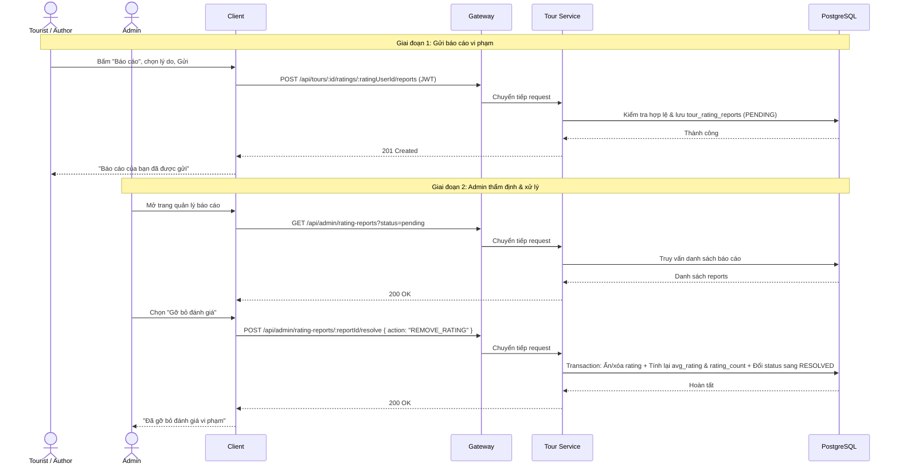

# UC05 – Báo cáo và xử lý khiếu nại đánh giá tour

| Trường | Nội dung |
|---|---|
| **Use Case Number** | UC05 |
| **Use Case Name** | Báo cáo và xử lý khiếu nại đánh giá tour |
| **Actor(s)** | • Người báo cáo: Khách du lịch (Tourist đã đăng nhập), Tác giả tour (Author) • Người kiểm duyệt: Quản trị viên hệ thống (Admin) |
| **Priority** | P1 |
| **Maturity** | Proposed / Designed |
| **Summary** | Người dùng đã đăng nhập (Tourist hoặc Author của tour) báo cáo một nhận xét/đánh giá vi phạm tiêu chuẩn cộng đồng (spam, ngôn từ xúc phạm, thông tin sai lệch). Báo cáo được đưa vào hàng đợi kiểm duyệt của Quản trị viên (Admin). Admin thẩm định và phán quyết gỡ bỏ nhận xét vi phạm hoặc bác bỏ báo cáo. Tác giả tour không có quyền tự xóa hoặc ẩn nhận xét của khách để đảm bảo tính khách quan. |

## Basic Course of Events

### Giai đoạn 1: Actor gửi báo cáo vi phạm

| # | Actor Action | System Response |
|---|---|---|
| 1 | Tourist hoặc Author mở mục **"Đánh giá"** trên chi tiết tour (`/tour/:tourId#ratings`), bấm vào biểu tượng tùy chọn trên một nhận xét của người khác và chọn **"Báo cáo vi phạm"**. | Client mở hộp thoại modal "Báo cáo đánh giá vi phạm". |
| 2 | Actor chọn lý do vi phạm từ danh mục có sẵn (Spam/Quảng cáo, Ngôn từ thù ghét/Xúc phạm, Thông tin sai lệch/Lạc đề, Khác) và nhập mô tả bổ sung (không bắt buộc, tối đa 500 ký tự). | |
| 3 | Actor nhấn **"Gửi báo cáo"**. | Client kiểm tra hợp lệ và gọi `POST /api/tours/:tourId/ratings/:ratingUserId/reports`. |
| 4 | | Server kiểm tra quyền: Actor đã đăng nhập, rating tồn tại, không tự báo cáo chính mình, chưa gửi báo cáo `PENDING` nào cho rating này trước đó. *E1, E2, E3, E4* |
| 5 | | Server lưu bản ghi mới vào `tour_rating_reports` với trạng thái `PENDING`. Nếu tổng số lượt báo cáo `PENDING` của bài đánh giá đạt ngưỡng cảnh báo ($N \ge 3$), hệ thống tự động gắn cờ `is_flagged = true`. Trả về mã 201 Created. |
| 6 | | Client đóng modal và hiển thị thông báo: *"Báo cáo của bạn đã được gửi và đang chờ quản trị viên xem xét."* |

### Giai đoạn 2: Admin thẩm định và giải quyết khiếu nại

| # | Actor Action | System Response |
|---|---|---|
| 7 | Admin đăng nhập vào trang Quản trị kiểm duyệt (`/admin/reports/ratings`). | Client gọi `GET /api/admin/rating-reports?status=pending` hiển thị danh sách các đánh giá bị báo cáo kèm số lượt report, lý do, nội dung đánh giá và thông tin tour. |
| 8 | Admin chọn xem chi tiết một trường hợp khiếu nại và đưa ra quyết định: **"Gỡ bỏ đánh giá"** hoặc **"Bác bỏ báo cáo"**. | |
| 9 | | Client gọi `POST /api/admin/rating-reports/:reportId/resolve` kèm hành động (`REMOVE_RATING` hoặc `DISMISS`) và ghi chú xử lý. |
| 10 | | Server xử lý trong một Transaction: • **Nếu `DISMISS` (Bác bỏ):** Cập nhật trạng thái các báo cáo liên quan sang `DISMISSED`, đặt lại `is_flagged = false`. Đánh giá vẫn giữ nguyên hiển thị. • **Nếu `REMOVE_RATING` (Gỡ bỏ):** Đánh dấu `is_hidden = true` (hoặc xóa dòng `tour_ratings`); tính lại `tours.average_rating` và `tours.rating_count` bằng SQL atomic (giống luồng xóa A2 của UC05); cập nhật các báo cáo liên quan sang `RESOLVED`. |
| 11 | | Client thông báo *"Đã xử lý báo cáo thành công"* và cập nhật lại danh sách hàng đợi. |
| 12 | | Use case kết thúc tại đây. |

## Alternative Path

**A1. Tác giả tour (Author) gửi khiếu nại đánh giá ác ý (Author Dispute).**

| # | Actor Action | System Response |
|---|---|---|
| A1.1 | Author mở trang quản lý tour của mình (`/my-tours/:tourId`) hoặc mục Đánh giá của tour, thấy nhận xét có dấu hiệu bôi nhọ, sai sự thật và nhấn **"Khiếu nại đánh giá"**. | |
| A1.2 | Author chọn lý do và nhập giải trình chi tiết. | Hệ thống gắn nhãn phân loại báo cáo ưu tiên (`reporter_role = 'AUTHOR'`) để Admin nhận diện và ưu tiên xử lý trên hàng đợi. Tiếp tục thực hiện theo các bước 3–11 của luồng chính. |

**A2. Admin lọc và xem lịch sử các báo cáo đã xử lý.**
* Admin chuyển tab bộ lọc trạng thái (`PENDING`, `RESOLVED`, `DISMISSED`) trên `/admin/reports/ratings` để tra cứu lại các quyết định kiểm duyệt trước đó.

## Exception Path

- **E1. Chưa đăng nhập:** Khách vãng lai bấm "Báo cáo" → Client hiển thị thông báo *"Vui lòng đăng nhập để thực hiện báo cáo vi phạm"* và điều hướng tới `/login?next=...#ratings` (UC01). API trả về 401 Unauthorized nếu thiếu JWT.
- **E2. Tự báo cáo đánh giá của chính mình:** Client ẩn nút Báo cáo trên bài đánh giá của chính user đang đăng nhập. Nếu cố tình gửi API trực tiếp, server trả 400 `cannot_report_own_rating` (*"Bạn không thể tự báo cáo đánh giá của chính mình"*).
- **E3. Báo cáo trùng lặp (Duplicate Report):** Một tài khoản đã gửi báo cáo cho rating này và đang ở trạng thái chờ duyệt (`PENDING`), nếu cố gửi lại → Client chặn; Server trả 409 `report_already_submitted` (*"Bạn đã gửi báo cáo cho đánh giá này rồi"*).
- **E4. Đánh giá không tồn tại hoặc đã bị gỡ bỏ:** Người dùng tự xóa đánh giá hoặc Admin khác đã xử lý trước đó → Server trả 404 `rating_not_found`.
- **E5. Không đủ quyền quản trị:** Tài khoản không có role `ADMIN` gọi API xử lý báo cáo → Server trả 403 `forbidden`.

## Extension Points

- UC01 – Xác thực tài khoản (đăng nhập để gửi báo cáo hoặc truy cập quyền Admin).
- UC05 – Đánh giá và nhận xét tour (nút báo cáo tích hợp trên từng nhận xét; tính lại điểm trung bình khi gỡ bỏ đánh giá).
- UC17 – Thống kê tour (loại trừ các nhận xét đã bị Admin gỡ bỏ).

## Triggers

- Tourist hoặc Author phát hiện nhận xét có nội dung thô tục, spam quảng cáo, xúc phạm hoặc sai sự thật.
- Admin định kỳ truy cập dashboard kiểm duyệt để xử lý hàng đợi báo cáo vi phạm.

## Assumptions

- Trong phạm vi đồ án môn học, hệ thống **không sử dụng các dịch vụ kiểm duyệt AI/LLM đám mây bên thứ ba**; việc lọc và quản lý nội dung dựa trên **Rule-based (khóa duy nhất, ngưỡng cảnh báo)** kết hợp quy trình kiểm duyệt thủ công của Admin.
- Tác giả tour (Author) không có quyền tự xóa hay ẩn nhận xét của khách để đảm bảo tính minh bạch, khách quan của hệ thống đánh giá.

## Preconditions

- Tour ở trạng thái `public` và bài đánh giá mục tiêu đang hiển thị công khai (`is_hidden = false`).
- Người gửi báo cáo đã đăng nhập tài khoản hợp lệ (UC01).

## Post Conditions

- Bản ghi báo cáo `tour_rating_reports` được lưu trữ với trạng thái rõ ràng (`PENDING`, `RESOLVED`, hoặc `DISMISSED`).
- Nếu Admin chọn gỡ bỏ: nhận xét bị ẩn/xóa khỏi danh sách hiển thị công khai; `tours.average_rating` và `tours.rating_count` khớp với dữ liệu còn lại.
- Nếu Admin bác bỏ: nhận xét giữ nguyên hiển thị; trạng thái báo cáo đóng lại.

## Reference: Business Rules

| # | Quy tắc |
|---|---|
| R1 | Báo cáo vi phạm bắt buộc phải đăng nhập tài khoản (Tourist hoặc Author). Khách vãng lai chỉ được xem đánh giá. |
| R2 | Quyền phán quyết độc quyền của Admin: Author chỉ được gửi đơn khiếu nại, tuyệt đối không có quyền tự xóa hoặc ẩn nhận xét của khách trên tour của mình. |
| R3 | Người dùng không được phép tự báo cáo bài đánh giá của chính mình. |
| R4 | Chống spam report: Mỗi tài khoản chỉ được gửi tối đa 1 báo cáo cho mỗi bài đánh giá (khóa duy nhất `tour_id, rating_user_id, reporter_id`). |
| R5 | Ngưỡng cảnh báo tự động (Soft-flag): Khi một bài nhận xét nhận từ 3 báo cáo `PENDING` trở lên từ các tài khoản khác nhau, hệ thống tự động đặt cờ `is_flagged = true` để Admin ưu tiên xử lý. |
| R6 | Tính toàn vẹn dữ liệu: Khi Admin phê duyệt gỡ bỏ đánh giá vi phạm, điểm trung bình `average_rating` và số lượt `rating_count` của tour phải được cập nhật lại nguyên tử (atomic SQL transaction) giống cơ chế xóa trong UC05. |

## Hiện thực trong hệ thống (Đề xuất)

- **Dịch vụ:**
  - Client: Nút/Menu báo cáo trong `RatingsSection.jsx`; Hộp thoại `ReportDialog.jsx`; Trang quản trị `AdminRatingReportsPage.jsx`.
  - Gateway: Chuyển tiếp `/api/tours/:id/ratings/:userId/reports` và `/api/admin/rating-reports` sang dịch vụ Tour.
  - Tour Service: Kiểm tra quy tắc, lưu báo cáo, cập nhật cờ cảnh báo và xử lý transaction gỡ bỏ/tính lại điểm số.
- **API (qua gateway):**
  - `POST /api/tours/:tourId/ratings/:ratingUserId/reports` (201 Created)
  - `GET /api/admin/rating-reports?status=pending&page=1&limit=20` (Role: Admin)
  - `POST /api/admin/rating-reports/:reportId/resolve` (Role: Admin; body: `{ action: "REMOVE_RATING" | "DISMISS", adminNote?: string }`)
- **Dữ liệu (Prisma / PostgreSQL):**
  - Bảng mới `tour.tour_rating_reports`: `id`, `tour_id`, `rating_user_id`, `reporter_id`, `reporter_role`, `reason_type`, `description`, `status`, `admin_note`, `resolved_by`, `created_at`, `updated_at` (Unique constraint: `[tour_id, rating_user_id, reporter_id]`).
  - Bảng `tour.tour_ratings` (bổ sung): `is_flagged` (Boolean, default `false`), `is_hidden` (Boolean, default `false`).

## Sequence Diagram

## Boundary

- Chi tiết tour `/tour/:tourId`, mục **Đánh giá** (`#ratings`): Nút báo cáo trên từng nhận xét và hộp thoại modal nhập lý do báo cáo.
- Trang quản trị `/admin/reports/ratings`: Bảng danh sách hàng đợi báo cáo, bộ lọc trạng thái và nút thao tác phê duyệt/bác bỏ của Admin.

## Activity Diagram

[UC05-activity.xml](../../02-design/drawio/activity/UC05-activity.xml) (draw.io: File → Import from → Device). Nguồn: [specs/UC05.json](../../02-design/drawio/activity/specs/UC05.json).
