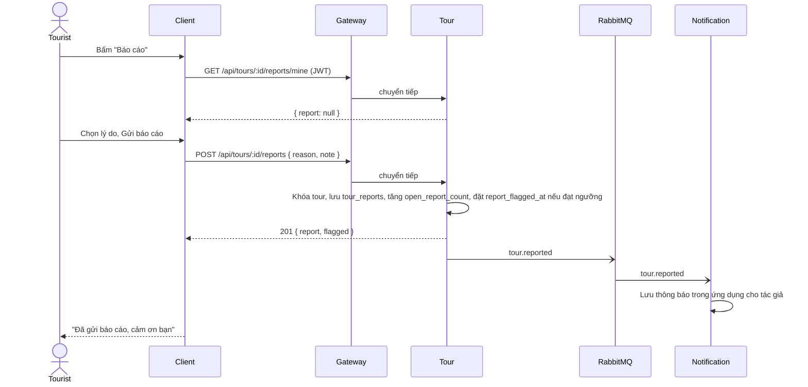

# UC06 – Báo cáo tour vi phạm

| Trường | Nội dung |
|---|---|
| **Use Case Number** | UC06 |
| **Use Case Name** | Báo cáo tour vi phạm |
| **Actor(s)** | Khách du lịch (Tourist, đã đăng nhập; mọi vai trò trừ tác giả của tour) |
| **Priority** | P1 |
| **Maturity** | Implemented |
| **Summary** | Người dùng đã đăng nhập báo cáo một tour công khai có nội dung sai lệch, phản cảm, spam hoặc vi phạm bản quyền bằng cách chọn lý do từ danh sách (Tầng 3 – Community report). Khi có báo cáo đang mở từ 5 tài khoản khác nhau trong 7 ngày, tour được gắn cờ vào hàng đợi báo cáo của Admin (UC20); tour vẫn công khai và nghe được. |

## Basic Course of Events

| # | Actor Action | System Response |
|---|---|---|
| 1 | Tourist bấm **"Báo cáo"** trên chi tiết tour (`/tour/:tourId`) hoặc trên thanh trên cùng của trình phát (`/tour/:tourId/play`). | |
| 2 | | Client gọi `GET /api/tours/:id/reports/mine`. Chưa báo cáo thì hiện form "Lý do báo cáo". *E1, E3, A1* |
| 3 | Tourist chọn một lý do: sai sự thật / phản cảm / spam / vi phạm bản quyền / khác, và nhập mô tả (bắt buộc khi chọn "khác"). *E2* | |
| 4 | Tourist nhấn **"Gửi báo cáo"**. | |
| 5 | | Client gọi `POST /api/tours/:id/reports`. Tour khóa dòng tour, lưu `tour_reports` (`status = open`), tăng `open_report_count`, đếm số tài khoản báo cáo đang mở trong 7 ngày qua. *A2* |
| 6 | | Sau khi commit, Tour phát `tour.reported` (không có id người báo cáo). Notification lưu một thông báo trong ứng dụng cho tác giả (UC16), không gửi email. |
| 7 | | Client hiện *"Đã gửi báo cáo, cảm ơn bạn"* và chuyển sang trạng thái "Bạn đã báo cáo tour này". |
| 8 | | Use case kết thúc tại đây. |

## Alternative Path

**A1. Đã báo cáo tour này trước đó.**

| # | Actor Action | System Response |
|---|---|---|
| A1.1 | | `GET .../reports/mine` trả báo cáo cũ: client hiện "Bạn đã báo cáo tour này", lý do đã chọn và "Quản trị viên sẽ xem xét báo cáo của bạn." thay cho form. |

**A2. Tour đạt ngưỡng báo cáo.**

| # | Actor Action | System Response |
|---|---|---|
| A2.1 | | Nếu báo cáo `open` từ **5 tài khoản khác nhau trong 7 ngày** (tính cả báo cáo mới), Tour đặt `tours.report_flagged_at = now()` (chỉ khi đang null). Phản hồi có `flagged: true`. |
| A2.2 | | Tour vào hàng đợi `/admin/reports` của Admin (UC20). Tour **không** bị ẩn tự động. |

## Exception Path

- **E1.** Chưa đăng nhập → hộp thoại *"Bạn cần đăng nhập để báo cáo tour này."* với nút "Đăng nhập để báo cáo" (UC01); API trả 401 nếu không có token.
- **E2.** Chưa chọn lý do → *"Vui lòng chọn lý do báo cáo"*; chọn "khác" mà không mô tả → *"Vui lòng mô tả lý do"* (server trả 400 `validation_error`).
- **E3.** Tác giả báo cáo tour của mình → *"Bạn không thể báo cáo tour của chính mình"* (403 `own_tour`).
- **E4.** Tour không `public` hoặc không tồn tại → 404 `tour_not_found`.
- **E5.** Gửi trùng (ví dụ hai tab cùng lúc) → 409 `already_reported`, client hiện trạng thái "đã báo cáo".
- **E6.** Mất mạng → *"Không thể kết nối, vui lòng thử lại"*. Lỗi phát `tour.reported` chỉ được ghi log, không làm hỏng yêu cầu.

## Extension Points

- UC01 – Xác thực tài khoản.
- UC16 – Thông báo trong ứng dụng cho tác giả.
- UC20 – Xử lý báo cáo và vi phạm tour.

## Triggers

Tourist phát hiện tour có nội dung không phù hợp.

## Assumptions

- Danh tính người báo cáo không bao giờ lộ cho tác giả (không có trong sự kiện, không có trong màn hình của tác giả).

## Preconditions

- Tour tồn tại và có `status = 'public'`.
- Tourist đã đăng nhập (UC01), không phải tác giả, và chưa báo cáo tour này.

## Post Conditions

- Một dòng `tour_reports` mới với `status = open`; `tours.open_report_count` tăng 1.
- Nếu đạt ngưỡng: `tours.report_flagged_at` được đặt; tour vẫn `public`.
- Sự kiện `tour.reported` đã phát (khi broker được bật); `tours.updated_at` không đổi.

## Reference: Business Rules

| # | Quy tắc |
|---|---|
| R1 | Cần đăng nhập (mọi vai trò); chỉ tour `public` được báo cáo |
| R2 | Mỗi tài khoản một báo cáo mỗi tour (khóa duy nhất `tour_id, reporter_id`), lần hai trả 409 `already_reported` |
| R3 | Lý do bắt buộc: `false_info`, `offensive`, `spam`, `copyright`, `other`; ghi chú tối đa 500 ký tự, bắt buộc với `other` |
| R4 | Tác giả không tự báo cáo tour của mình (403 `own_tour`) |
| R5 | Ngưỡng: báo cáo `open` từ 5 tài khoản khác nhau trong 7 ngày → gắn cờ `report_flagged_at`; không tự ẩn (tránh "report bomb") |
| R6 | Trạng thái báo cáo: `open` (mặc định), `dismissed`, `actioned` (do Admin đặt ở UC20); chỉ `open` được tính |
| R7 | Ghi bằng một transaction có `SELECT ... FOR UPDATE` trên dòng tour, nên báo cáo đồng thời không bỏ lỡ ngưỡng |
| R8 | `tour.reported` phát sau commit; lỗi phát chỉ ghi log |

## Hiện thực trong hệ thống

- **Dịch vụ:**
  - Client: nút và form báo cáo ở chi tiết tour và trình phát.
  - Gateway: chuyển `/api/tours` sang Tour.
  - Tour: kiểm tra quy tắc, lưu báo cáo, đếm ngưỡng, phát `tour.reported`.
  - Notification: nhận `tour.reported`, lưu thông báo trong ứng dụng cho tác giả, không gửi email.
- **Màn hình (client):** `/tour/:tourId` và `/tour/:tourId/play` (`client/src/features/tours/ReportTour.jsx`). API helper `client/src/lib/reports.js`. Không có nút báo cáo khi nghe offline (`/offline/:tourId/play`) hay bản truy cập hạn chế.
- **API (qua gateway):**
  - `POST /api/tours/:id/reports` → 201 `{ report, flagged }`
  - `GET /api/tours/:id/reports/mine` → `{ report | null }`
- **Sự kiện (RabbitMQ):** Tour phát `tour.reported` `{ tourId, count, reason?, flagged?, contributorId?, tourTitle?, at? }`; Notification tiêu thụ.
- **Dữ liệu:** `tour.tour_reports` (`tour_id`, `reporter_id`, `reason`, `note`, `status`, `created_at`); `tour.tours.report_flagged_at`, `tour.tours.open_report_count`.
- **Tài liệu thiết kế:** [uc06-reports.md](../../02-design/uc06-reports.md), [uc20-report-handling.md](../../02-design/uc20-report-handling.md).

## Author(s)

(điền sau)

## Date

Tạo: 2026-10-18 · Cập nhật theo hệ thống: 2026-11-08

## Activity Diagram

(bổ sung sau)

## Sequence Diagram

## Boundary

- Chi tiết tour `/tour/:tourId`: nút "Báo cáo", hộp thoại "Lý do báo cáo" (danh sách lý do, ô mô tả), trạng thái "Bạn đã báo cáo tour này".
- Trình phát `/tour/:tourId/play`: nút báo cáo trên thanh trên cùng.
- Hộp thoại yêu cầu đăng nhập (dẫn tới `/login`).
