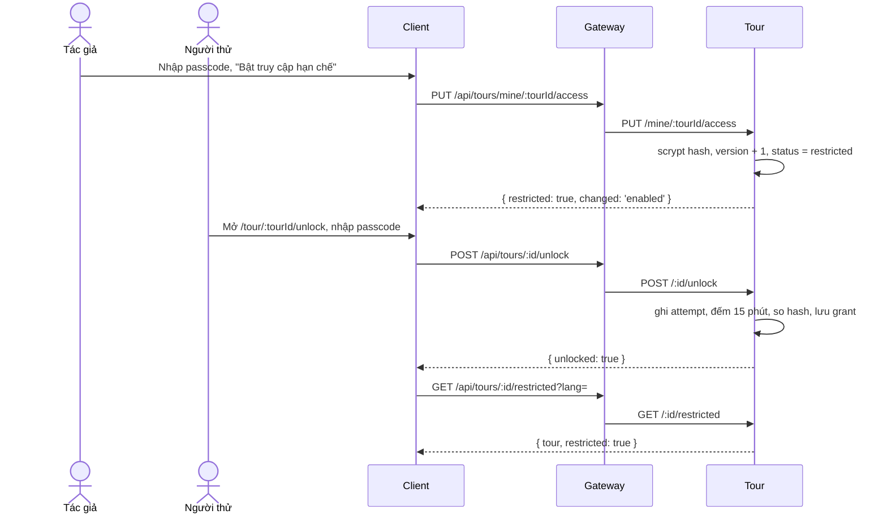

# UC14 – Cấu hình truy cập hạn chế bằng passcode

| Trường | Nội dung |
|---|---|
| **Use Case Number** | UC14 |
| **Use Case Name** | Cấu hình truy cập hạn chế bằng passcode |
| **Actor(s)** | Người đăng nội dung (Contributor, tác giả tour); Người thử (bất kỳ tài khoản đã đăng nhập) |
| **Priority** | P2 |
| **Maturity** | Implemented |
| **Summary** | Tác giả bật chế độ truy cập hạn chế với một passcode để một nhóm nhỏ thử tour mà công chúng chưa thấy, không cần Admin duyệt. Người thử đăng nhập, nhập passcode một lần và được xem, nghe tour (trực tuyến) cho tới khi tác giả đổi passcode hoặc tắt chế độ. |

## Basic Course of Events

| # | Actor Action | System Response |
|---|---|---|
| 1 | Tác giả mở bước Xuất bản (`/studio/tours/:id/publish`), khung **"Truy cập hạn chế"**. | |
| 2 | | Client gọi `GET /api/tours/mine/:tourId/access` → `{ restricted, passcodeSetAt, testers }`. Khung chỉ cho bật khi tour ở `draft`, `rejected` hoặc `changes_requested`. `RestrictedAccessPanel`, `getTourAccess()` → `TourAccessController.get()` → `GetTourAccess.execute()` → `PrismaTourAccessRepository.countGrants()` |
| 3 | Tác giả nhập passcode và nhấn **"Bật truy cập hạn chế"**. *E1, E2* | |
| 4 | | `PUT .../access { passcode }`: Tour kiểm passcode, lưu hash scrypt (salt ngẫu nhiên), tăng `passcode_version`, chuyển tour sang `restricted` trong một lệnh UPDATE có điều kiện; trả `changed: 'enabled'`. Không qua Admin. `validatePasscode()`, `setTourPasscode()` → `TourAccessController.set()` → `SetTourPasscode.execute()` → `normalizePasscode()`, `ScryptPasscodeHasher.hash()`, `PrismaTourAccessRepository.setPasscodeIf()` |
| 5 | | Khung hiện thời điểm bật, số người thử, đường dẫn chia sẻ `/tour/:tourId/unlock` và nút mở bản dành cho người thử. `unlockPath()`, `restrictedPath()` |
| 6 | Tác giả gửi đường dẫn và passcode cho nhóm thử. | |
| 7 | Người thử (đã đăng nhập) mở `/tour/:tourId/unlock`. | |
| 8 | | Client gọi `GET /api/tours/:id/access/mine`; đã mở khóa (hoặc là tác giả) → chuyển thẳng tới `/tour/:tourId/restricted`. *A2* `UnlockTourPage`, `getMyTourAccess()` → `TourAccessController.mine()` → `GetMyTourAccess.execute()` → `isGrantValid()` |
| 9 | Người thử nhập passcode. *E3, E4* | |
| 10 | | `POST /api/tours/:id/unlock`: Tour ghi một lần thử, đếm lần sai trong 15 phút, so hash, lưu `tour_access_grants` (theo tài khoản và phiên bản passcode), trả `{ unlocked: true }`. `unlockTour()` → `TourAccessController.unlock()` → `UnlockTour.execute()` → `PrismaTourAccessRepository.reserveAttempt()`, `ScryptPasscodeHasher.verify()`, `releaseAttempt()`, `saveGrant()` |
| 11 | | Client mở `/tour/:tourId/restricted` (`GET /api/tours/:id/restricted?lang=`): chi tiết tour có nhãn "Bản thử nghiệm (truy cập hạn chế)", nghe ở `/tour/:tourId/restricted/play`. `TourDetailPage` (`restricted`), `fetchRestrictedTour()` → `TourAccessController.detail()` → `GetRestrictedTour.execute()` → `buildTourDetailView()`; `PlayRestrictedRoute` |
| 12 | | Use case kết thúc. |

## Alternative Path

**A1. Đổi passcode hoặc tắt chế độ.**

| # | Actor Action | System Response |
|---|---|---|
| A1.1 | Tác giả nhập passcode mới và lưu. | |
| A1.2 | | `PUT .../access`: hash mới, `passcode_version + 1`, xóa mọi `tour_access_grants`; trả `changed: 'passcode'`. Người thử phải nhập mã mới. `SetTourPasscode.execute()` → `PrismaTourAccessRepository.setPasscodeIf()` |
| A1.3 | Tác giả chọn tắt chế độ, xác nhận ở hộp thoại. | |
| A1.4 | | `DELETE .../access`: tour về `draft`, xóa hash, `passcode_version + 1`, xóa grants và attempts. Người thử mất quyền truy cập. `disableTourAccess()` → `TourAccessController.disable()` → `DisableTourAccess.execute()` → `PrismaTourAccessRepository.clearPasscodeIf()` |

**A2. Người thử đã mở khóa trước đó** → không cần nhập lại, miễn là phiên bản passcode chưa đổi (`isGrantValid()`).

**A3. Sửa nội dung tour đang hạn chế** → tour giữ `restricted`, người thử thấy nội dung mới; không gửi sang kiểm duyệt, không phát sự kiện catalog (`Tour.applyEdits()`: `LIVE_STATUSES` chỉ có `public`). Kiểm duyệt từng điểm (`place.submitted`) vẫn chạy như tour nháp khi bật cờ.

**A4. Muốn công khai** → tác giả tắt chế độ (A1.3) rồi gửi duyệt (UC15).

## Exception Path

- **E1.** Passcode không hợp lệ → 400: "Vui lòng nhập mã truy cập", "Mã truy cập không được chứa khoảng trắng", "Mã truy cập phải từ 6 đến 32 ký tự" (client kiểm cùng quy tắc trước khi gửi). `validatePasscode()`, `normalizePasscode()`
- **E2.** Trạng thái không cho bật (`public`, `ai_checking`, `ai_warning`, `pending_review`, `hidden`, hoặc bị đổi đồng thời) → 409 `tour_not_restrictable`; không phải tác giả → 403 `not_tour_owner`; tắt khi chưa bật → 409 `tour_not_restricted`. `Tour.canRestrict()`, `TourNotRestrictableError`, `TourNotRestrictedError`
- **E3.** Sai passcode → 403 `wrong_passcode` ("Mã truy cập không đúng"). `WrongPasscodeError`
- **E4.** Sai quá 5 lần trong 15 phút → 429 `too_many_attempts` ("Bạn đã nhập sai quá nhiều lần, vui lòng thử lại sau 15 phút"), kể cả khi mã đúng. `UnlockTour.execute()`, `unlockWindowStart()`, `TooManyAttemptsError`
- **E5.** Tour không (còn) ở chế độ hạn chế, hoặc chưa mở khóa khi mở bản thử → 404; `TourDetailPage` chuyển người thử về trang nhập mã. `GetRestrictedTour.execute()`
- **E6.** Gửi duyệt / xuất bản tour đang hạn chế → 409 `tour_restricted` ("... hãy tắt chế độ này trước khi gửi duyệt"). `PublishTour.execute()`, `TourRestrictedError`

## Extension Points

- UC13 – Xem thử tour; UC15 – Gửi tour đi duyệt (sau khi tắt chế độ); UC04 – Nghe tour (trình phát dùng chung).

## Triggers

Tác giả muốn thử tour với nhóm nhỏ trước khi công khai.

## Assumptions

- Người thử có tài khoản (role bất kỳ) và nhận passcode từ tác giả qua kênh ngoài hệ thống.

## Preconditions

- Tour thuộc tác giả, ở `draft`, `rejected` hoặc `changes_requested`; tác giả đăng nhập với role `contributor`.

## Post Conditions

- Tour ở `restricted` với `passcode_hash`, `passcode_version`, `passcode_set_at`; mỗi người thử đã mở khóa có một dòng `tour_access_grants`. Tắt chế độ: tour về `draft`, không còn grant.

## Reference: Business Rules

- Không cần Admin duyệt vì tour không công khai.
- Tour `restricted` **không bao giờ** xuất hiện ở tìm kiếm, gần tôi / khám phá, đánh giá, báo cáo, và không gửi `tour.published` (chatbot không index).
- Passcode 6–32 ký tự sau khi trim, không khoảng trắng; chỉ lưu hash scrypt, không route nào trả lại passcode.
- Mở khóa cần đăng nhập (quyết định L3); grant giữ theo tài khoản, chỉ hợp lệ khi bằng `passcode_version` hiện tại.
- Giới hạn: tối đa 5 lần sai mỗi tài khoản và tour trong 15 phút (đếm trong DB, không dùng Redis).
- Bản thử không cho đánh giá, báo cáo, thêm vào lịch trình, tải offline; Admin ẩn (UC20) và duyệt (UC19) không áp dụng.

## Hiện thực trong hệ thống

- **Dịch vụ:** Client (khung Studio, màn mở khóa, chi tiết và trình phát bản thử); Tour (trạng thái, hash, grants, rate limit; `verifyJwt` dùng chung từ `shared/middleware`).
- **Màn hình (client):** `/studio/tours/:id/publish` (`features/studio/RestrictedAccessPanel.jsx`); `/tour/:tourId/unlock` (`features/tours/UnlockTourPage.jsx`); `/tour/:tourId/restricted` (`TourDetailPage restricted`); `/tour/:tourId/restricted/play` (`PlayRestrictedRoute`); API `client/src/lib/restricted-access.js`.
- **API (qua gateway):**
  - Tác giả: `GET|PUT|DELETE /api/tours/mine/:tourId/access`
  - Người thử: `POST /api/tours/:id/unlock`, `GET /api/tours/:id/access/mine`, `GET /api/tours/:id/restricted?lang=`
- **Dữ liệu:** `tour.tours` (`status = restricted`, `passcode_hash`, `passcode_version`, `passcode_set_at`); `tour.tour_access_grants` (unique `tour_id, user_id`, `passcode_version`); `tour.tour_unlock_attempts` (index `tour_id, user_id, created_at`).
- **Tài liệu thiết kế:** [uc14-restricted-access.md](../../02-design/uc14-restricted-access.md), [offline-download.md](../../02-design/offline-download.md).
- **Giới hạn đã biết:** hiện người thử không tải được bản truy cập hạn chế để nghe offline: route gói offline `GET /api/tours/:id/package` (`GetTourPackage`) chỉ đọc tour công khai (`findPublicById`) nên trả 404, và `TourDetailPage` ẩn `OfflineDownload` trên bản thử. Người thử chỉ nghe trực tuyến tại `/tour/:tourId/restricted/play`.
- **Mã nguồn chính:**

| Bước | Hàm / lớp | File |
|---|---|---|
| 1–5, A1 | `RestrictedAccessPanel` | `client/src/features/studio/RestrictedAccessPanel.jsx` |
| 2–11, A1 | `getTourAccess()`, `setTourPasscode()`, `disableTourAccess()`, `unlockTour()`, `getMyTourAccess()`, `fetchRestrictedTour()`, `validatePasscode()` | `client/src/lib/restricted-access.js` |
| 7–10 | `UnlockTourPage` | `client/src/features/tours/UnlockTourPage.jsx` |
| 11, E5 | `TourDetailPage` (`restricted`), `PlayRestrictedRoute` | `client/src/features/tours/TourDetailPage.jsx`, `client/src/App.jsx` |
| 2–11 | `buildTourAccessRouter()`, `TourAccessController` | `services/tour/src/interfaces/http/routes/tour-access-routes.js`, `controllers/tour-access-controller.js` |
| 4, 10 | `setPasscodeSchema`, `unlockSchema` | `services/tour/src/application/dtos/access-schemas.js` |
| 2–11, A1 | `GetTourAccess`, `SetTourPasscode`, `DisableTourAccess`, `UnlockTour`, `GetMyTourAccess`, `GetRestrictedTour` | `services/tour/src/application/use-cases/tour-access.js` |
| 4, 8, E4 | `normalizePasscode()`, `isGrantValid()`, `unlockWindowStart()` | `services/tour/src/domain/tour/restricted-access.js` |
| E2 | `Tour.canRestrict()`, `Tour.isRestricted()` | `services/tour/src/domain/entities/tour.js` |
| 4, 10 | `ScryptPasscodeHasher` (`hash`, `verify`) | `services/tour/src/infrastructure/security/scrypt-passcode-hasher.js` |
| 2–10, A1 | `PrismaTourAccessRepository` (`findAccess`, `setPasscodeIf`, `clearPasscodeIf`, `saveGrant`, `reserveAttempt`, `releaseAttempt`) | `services/tour/src/infrastructure/persistence/prisma-tour-access-repository.js` |
| 11 | `buildTourDetailView()` | `services/tour/src/application/use-cases/build-tour-detail.js` |
| E6 | `PublishTour.execute()` | `services/tour/src/application/use-cases/publish-tour.js` |

## Author(s)

(điền sau)

## Date

Tạo: 2026-10-18 · Cập nhật theo hệ thống: 2026-11-08

## Activity Diagram

(bổ sung sau)

## Sequence Diagram

## Boundary

Khung "Truy cập hạn chế" ở bước Xuất bản (`/studio/tours/:id/publish`) với hộp thoại xác nhận tắt; Màn nhập passcode (`/tour/:tourId/unlock`); Chi tiết bản thử (`/tour/:tourId/restricted`); Trình phát bản thử (`/tour/:tourId/restricted/play`).
