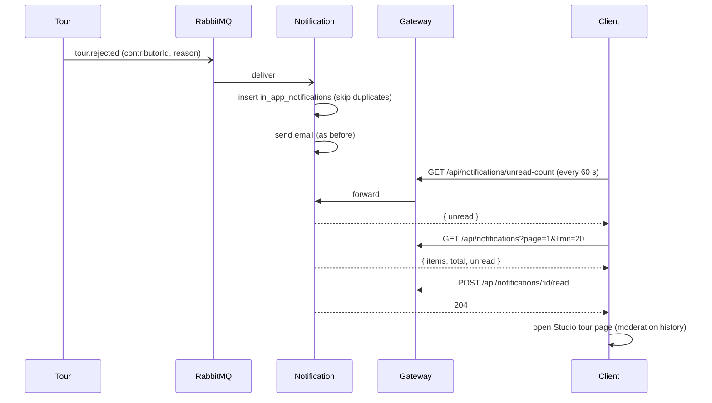

# UC16 – Theo dõi trạng thái và nhận thông báo kiểm duyệt

| Trường | Nội dung |
|---|---|
| **Use Case Number** | UC16 |
| **Use Case Name** | Theo dõi trạng thái và nhận thông báo kiểm duyệt |
| **Actor(s)** | Người đăng nội dung (Contributor); Hệ thống: Notification service |
| **Priority** | P1 |
| **Maturity** | Implemented |
| **Summary** | Contributor xem trạng thái từng tour trong Studio và nhận thông báo trong app (kèm lý do cụ thể) khi tour bị AI từ chối, được Admin duyệt / từ chối / yêu cầu sửa, bị ẩn hoặc bị khách báo cáo. Notification service nhận các sự kiện này từ RabbitMQ, lưu một thông báo cho tác giả (vẫn gửi email như trước) và phục vụ danh sách qua HTTP. Client hiển thị số chưa đọc và trung tâm thông báo. |

## Basic Course of Events

| # | Actor Action | System Response |
|---|---|---|
| 1 | | (Nền) Khi có sự kiện tour (`tour.ai_rejected`, `tour.approved`, `tour.rejected`, `tour.changes_requested`, `tour.hidden`, `tour.restored`, `tour.reported`), Notification lưu một dòng `in_app_notifications` cho `contributorId` với tiêu đề tiếng Việt và lý do, rồi gửi email cho tác giả (email trong sự kiện, nếu thiếu thì tra Auth theo `contributorId`). Mọi sự kiện trên đều có email, trừ `tour.reported` (chỉ có thông báo trong app). `handleEvent()`, `createStoreInAppNotification()`, `buildInAppNotification()`, `sourceKeyOf()`, `PrismaInAppNotificationRepository.createIfAbsent()`, `buildTourEmail()`, `createContributorLookup()` |
| 2 | | Client (đã đăng nhập) gọi `GET /api/notifications/unread-count` khi mở app, khi trang được focus và mỗi 60 giây; hiển thị huy hiệu số chưa đọc ("99+" khi trên 99). `UnreadCountProvider`, `getUnreadCount()` → `NotificationController`, `CountUnread.execute()` |
| 3 | Contributor mở **Thông báo** (`/notifications`). | Client gọi `GET /api/notifications?page=1&limit=20`; hiển thị danh sách mới nhất trước: tiêu đề, lý do, các lý do AI (với `tour.ai_rejected`), thời gian, dấu chưa đọc. *E1, E2* `NotificationsPage`, `listNotifications()` → `ListNotifications.execute()`, `toView()`; `NotificationItem` |
| 4 | Contributor lọc "Chưa đọc" hoặc nhấn "Xem thêm". *A1* | Client tải lại với `unread=true` hoặc trang kế tiếp. `listNotifications()` → `ListNotifications.execute()` |
| 5 | Contributor mở một thông báo. | Client gọi `POST /api/notifications/:id/read` (204), giảm huy hiệu và chuyển tới trang tour trong Studio với lịch sử kiểm duyệt (hoặc `/account` với thông báo tài khoản). *E3* `markNotificationRead()` → `MarkRead.execute()`, `PrismaInAppNotificationRepository.markRead()`; `notificationTarget()` |
| 6 | Contributor xem trạng thái tour trong Studio (`/studio`, `/studio/tours/:id`). | Hệ thống hiển thị nhãn trạng thái (Nháp, Đang kiểm duyệt AI, Cảnh báo AI, Chờ duyệt, Công khai, Bị từ chối, Cần chỉnh sửa, Truy cập hạn chế, Đang ẩn) và lịch sử thông báo của tour (`GET /api/notifications?tourId=…`, 20 mỗi trang). `StudioToursPage`, `statusMeta()`, `TourModerationHistory` |
| 7 | Contributor sửa tour và gửi duyệt lại nếu cần. *A2* | |
| 8 | | Use case kết thúc tại đây. |

## Alternative Path

**A1. Đánh dấu tất cả đã đọc** → khi còn thông báo chưa đọc, contributor nhấn "Đánh dấu tất cả đã đọc"; client gọi `POST /api/notifications/read-all`, nhận `{ updated }`, huy hiệu về 0. `markAllNotificationsRead()` → `MarkAllRead.execute()`, `PrismaInAppNotificationRepository.markAllRead()`

**A2. Mở tour để sửa và gửi lại** → từ trang tour trong Studio, contributor sửa (UC09 / UC10 / UC11) và gửi duyệt lại (UC15).

**A3. Thông báo tài khoản** → khi Admin cảnh báo / tạm khoá / cấm / khôi phục tài khoản (UC21, `account.moderated`), người dùng cũng nhận một thông báo trong app và một email; mở thông báo chuyển tới `/account`. `handleEvent()` (nhánh `account.moderated`), `buildAccountActionEmail()`

## Exception Path

- **E1.** Không có thông báo nào → *"Chưa có thông báo nào"*.
- **E2.** Mất kết nối → *"Không thể kết nối, vui lòng thử lại"*; huy hiệu giữ số cuối cùng đã biết.
- **E3.** Thông báo của người khác, không tồn tại hoặc id sai → 404 `notification_not_found` *"Không tìm thấy thông báo"*. `NotificationNotFoundError`
- **E4.** Tham số sai (ví dụ `limit` > 50, `tourId` không phải uuid) → 400 `validation_error` *"Tham số không hợp lệ"*.
- **E5.** Chưa đăng nhập, token sai hoặc phiên đã đăng xuất (UC23) → 401.

## Extension Points

- UC15 – Gửi tour đi duyệt; UC19 – Duyệt / từ chối tour; UC06 / UC20 – Báo cáo và xử lý báo cáo; UC21 – Xử lý tài khoản; UC09 / UC10 / UC11 – chỉnh sửa tour.

## Triggers

Tour của contributor đổi trạng thái do AI hoặc Admin, hoặc bị khách báo cáo.

## Assumptions

- RabbitMQ và Notification hoạt động; Notification có cổng HTTP riêng (3006) sau gateway.
- Sự kiện tour có `contributorId` (sự kiện thiếu `contributorId` không được lưu cho ai, email không đổi).

## Preconditions

- Contributor đã đăng nhập và có ít nhất một tour.

## Post Conditions

- Mỗi sự kiện tạo đúng một dòng `in_app_notifications` (gửi lại cùng sự kiện không tạo bản trùng).
- Thông báo đã mở có `read_at`; số chưa đọc được cập nhật.
- Contributor nắm được trạng thái và lý do; có thể sửa và gửi lại.

## Reference: Business Rules

- Người dùng chỉ đọc và đánh dấu thông báo của **chính mình**; mọi vai trò đã đăng nhập đều dùng được.
- Thông báo luôn kèm **lý do cụ thể** khi sự kiện có lý do (`body` tối đa 1000 ký tự; `data.reasons` tối đa 20 lý do AI).
- Không bao giờ lưu danh tính người báo cáo, email, id Admin hoặc khoá ngoài danh sách cho phép.
- Chống trùng: `source_key` duy nhất (`<event>:<tourId>:<sha256 payload>`), ghi bằng `skipDuplicates`.
- Lưu thông báo không bao giờ ném lỗi (lỗi chỉ ghi log, email vẫn gửi); dòng trong app được ghi **trước** email.
- Email: `tour.ai_rejected`, `tour.approved`, `tour.rejected`, `tour.changes_requested`, `tour.hidden`, `tour.restored` có email (kèm lý do khi có); `tour.reported` không có email. Người nhận là email trong sự kiện, nếu thiếu thì tra Auth theo `contributorId`; không tìm được thì bỏ qua email.
- Phân trang: `limit` 1..50, mặc định 20; `unread` trả về luôn là tổng chưa đọc của người dùng (không đổi theo bộ lọc).
- Không có web push: client hỏi số chưa đọc mỗi 60 giây.

## Hiện thực trong hệ thống

- **Dịch vụ:**
  - Tour: phát `tour.approved`, `tour.rejected`, `tour.changes_requested` (UC19), `tour.hidden`, `tour.restored` (UC20), `tour.reported` (UC06).
  - Moderation: phát `tour.ai_rejected` (UC15).
  - Notification: nhận sự kiện (queue `notification.events`), lưu thông báo trong app, gửi email cho tác giả (mọi sự kiện tour trừ `tour.reported`), phục vụ HTTP (cổng 3006); kiểm tra token bị thu hồi qua Redis như Media.
  - Gateway: chuyển `/api/notifications` tới Notification.
  - Client: huy hiệu chưa đọc, trung tâm thông báo, lịch sử kiểm duyệt của tour trong Studio.
- **Màn hình (client):** `/notifications` (`features/notifications/NotificationsPage.jsx`, `NotificationItem.jsx`), huy hiệu (`UnreadCount.jsx`, dùng chung qua `UnreadCountLayout`), `/studio` (`StudioToursPage.jsx`, nhãn trạng thái trên thẻ tour), `/studio/tours/:id` (`TourModerationHistory.jsx`).
- **API (qua gateway):**
  - `GET /api/notifications` (`page`, `limit`, `unread`, `tourId`)
  - `GET /api/notifications/unread-count`
  - `POST /api/notifications/:id/read`
  - `POST /api/notifications/read-all`
- **Sự kiện (RabbitMQ):** Notification tiêu thụ `tour.ai_rejected`, `tour.approved`, `tour.rejected`, `tour.changes_requested`, `tour.hidden`, `tour.restored`, `tour.reported`, `tts.render.completed`, `account.moderated`. Không phát sự kiện mới.
- **Dữ liệu:** `notification.in_app_notifications` (`user_id`, `type`, `tour_id`, `title`, `body`, `data`, `read_at`, `created_at`, `source_key` duy nhất; chỉ mục `(user_id, created_at)`, `(user_id, read_at)`, `(user_id, tour_id, created_at)`).
- **Mã nguồn chính:**

| Bước | Hàm / lớp | File |
|---|---|---|
| 1 | `handleEvent()` | `services/notification/src/notify.js` |
| 1 | `createStoreInAppNotification()` | `services/notification/src/application/store-in-app-notification.js` |
| 1 | `buildInAppNotification()`, `sourceKeyOf()`, `IN_APP_EVENTS` | `services/notification/src/domain/in-app-notification.js` |
| 1 | `buildTourEmail()` | `services/notification/src/services/tour-email-template.js` |
| 1 | `createContributorLookup()` | `services/notification/src/services/contributor-lookup.js` |
| 2–5, A1 | `ListNotifications`, `CountUnread`, `MarkRead`, `MarkAllRead` | `services/notification/src/application/notification-use-cases.js` |
| 2–5, A1 | `PrismaInAppNotificationRepository` | `services/notification/src/infrastructure/prisma-in-app-notification-repository.js` |
| 2–5, A1 | `buildNotificationRouter()`, `NotificationController` | `services/notification/src/interfaces/http/notification-routes.js`, `services/notification/src/interfaces/http/notification-controller.js` |
| 2–5, A1 | `listNotifications()`, `getUnreadCount()`, `markNotificationRead()`, `markAllNotificationsRead()`, `notificationTarget()` | `client/src/lib/notifications.js` |
| 2 | `UnreadCountProvider`, `UnreadCountLayout`, `useUnreadCount()` | `client/src/features/notifications/UnreadCount.jsx` |
| 3–5 | `NotificationsPage`, `NotificationItem` | `client/src/features/notifications/NotificationsPage.jsx`, `client/src/features/notifications/NotificationItem.jsx` |
| 6 | `TourModerationHistory` | `client/src/features/notifications/TourModerationHistory.jsx` |
| 6 | `StudioToursPage`, `statusMeta()` | `client/src/features/studio/StudioToursPage.jsx`, `client/src/lib/studio.js` |

- **Tài liệu thiết kế:** [uc16-notifications.md](../../02-design/uc16-notifications.md).
- **Giới hạn đã biết:** không có web push và không có thời gian thực (client hỏi định kỳ); không xoá được thông báo. `tts.render.completed` đã được ánh xạ nhưng hệ thống không dựng TTS ở máy chủ (client dùng giọng đọc của thiết bị), nên thông báo này không xuất hiện trong thực tế.

## Author(s)

(điền sau)

## Date

Tạo: 2026-10-18 · Cập nhật theo hệ thống: 2026-11-08

## Activity Diagram

(bổ sung sau)

## Sequence Diagram

## Boundary

- Trung tâm thông báo (`/notifications`): bộ lọc Tất cả / Chưa đọc, "Xem thêm", "Đánh dấu tất cả đã đọc".
- Huy hiệu số chưa đọc trên khung app và menu tài khoản.
- Studio (`/studio`): thẻ tour với nhãn trạng thái; trang tour (`/studio/tours/:id`): lịch sử kiểm duyệt.
