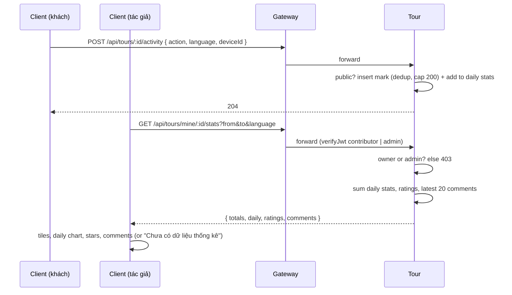

# UC17 – Xem thống kê và đánh giá tour

| Trường | Nội dung |
|---|---|
| **Use Case Number** | UC17 |
| **Use Case Name** | Xem thống kê và đánh giá tour |
| **Actor(s)** | Người đăng nội dung (Contributor); Khách du lịch (Tourist – nguồn dữ liệu, gián tiếp) |
| **Priority** | P1 |
| **Maturity** | Implemented |
| **Summary** | Tác giả (hoặc Admin) mở bước "Thống kê" của một tour trong Studio để xem lượt xem, lượt nghe, lượt hoàn thành, tỉ lệ hoàn thành, lượt tải offline, điểm đánh giá trung bình, phân bố sao và các nhận xét mới nhất, lọc theo khoảng thời gian và ngôn ngữ. Số liệu đến từ các "beacon" hoạt động mà app của khách gửi tới Tour service (khách ẩn danh cũng được đếm). |

## Basic Course of Events

| # | Actor Action | System Response |
|---|---|---|
| 1 | | (Nền) App của khách gửi `POST /api/tours/:id/activity` khi: mở chi tiết tour (`view`), bắt đầu điểm đầu tiên (`play`), nghe xong điểm cuối (`complete`), lưu gói offline (`download`). Tour đếm mỗi (tour, người, hành động, ngôn ngữ, ngày UTC) một lần và luôn trả 204. *A2* `recordTourActivity()`, `getDeviceId()` → `TourStatsController.record()`, `RecordTourActivity.execute()`, `actorKey()`, `PrismaTourStatsRepository.recordActivity()` |
| 2 | Contributor mở tour trong Studio và chọn bước **"Thống kê"** (`/studio/tours/:id/stats`). | |
| 3 | | Client gọi `GET /api/tours/mine/:id/stats` (mặc định 30 ngày gần nhất). Tour kiểm tra quyền (tác giả hoặc Admin) và tổng hợp số liệu. *E2, E3* `getTourStats()` → `TourStatsController.stats()`, `GetTourStats.execute()`, `resolvePeriod()`, `PrismaTourStatsRepository.dailyStats()`, `totalsOf()` |
| 4 | | Client hiển thị các ô: Lượt xem, Lượt nghe, Hoàn thành, Tỉ lệ hoàn thành, Tải về; biểu đồ theo ngày (chọn chỉ số, mỗi ngày một cột, ngày không có dữ liệu là 0) và bảng số liệu; khối đánh giá (trung bình, số lượt, phân bố 1–5 sao) và 20 nhận xét mới nhất. *E1* `TourStatsPage`; phân bố sao từ `PrismaTourRatingRepository.distribution()`, nhận xét từ `PrismaTourStatsRepository.latestComments()` |
| 5 | Contributor đổi khoảng thời gian hoặc ngôn ngữ. *A1* | Client gọi lại API với `from`, `to`, `language`; bộ lọc được giữ trên URL. `TourStatsPage`, `getTourStats()` |
| 6 | Contributor đọc nhận xét để biết điểm cần cải thiện. | |
| 7 | | Use case kết thúc tại đây. |

## Alternative Path

**A1. Lọc theo khoảng thời gian / ngôn ngữ** → chọn 7 / 30 / 90 ngày hoặc "Tuỳ chọn" (`from`, `to` dạng `YYYY-MM-DD`, UTC, tối đa 366 ngày) và một ngôn ngữ của tour; hệ thống hiển thị lại số liệu hoạt động theo bộ lọc. Đánh giá và nhận xét không lọc theo thời gian / ngôn ngữ.

**A2. Beacon không được đếm** → tour không `public`, id không tồn tại, hành động lặp lại trong cùng ngày UTC hoặc người đó đã vượt 200 lượt đếm trong ngày → vẫn trả 204, không đếm (không lộ trạng thái tour). `RecordTourActivity.execute()`, `PrismaTourStatsRepository.recordActivity()` (`DAILY_MARK_CAP`)

**A3. Admin xem thống kê** → Admin gọi cùng API cho tour bất kỳ.

## Exception Path

- **E1.** Tour chưa có dữ liệu (mọi số liệu bằng 0) → *"Chưa có dữ liệu thống kê"*.
- **E2.** Không phải tác giả và không phải Admin → 403 `not_tour_owner`; client hiển thị thông báo lỗi quyền. `GetTourStats.execute()`, `NotTourOwnerError`
- **E3.** Bộ lọc sai (`from` sau `to`, quá 366 ngày, ngày sai định dạng) → 400 `validation_error` (`statsQuerySchema`, `resolvePeriod()`); lỗi mạng → *"Không thể kết nối, vui lòng thử lại"* kèm nút "Thử lại".
- **E4.** Beacon thiếu cả token hợp lệ lẫn `deviceId`, hoặc body sai → 400 `validation_error` (client bỏ qua, không ảnh hưởng khách). `recordActivitySchema`

## Extension Points

- UC05 – Đánh giá & nhận xét tour (nguồn đánh giá); UC02 – Xem tour (`view`); UC04 – Nghe tour (`play`, `complete`); UC03 – Tải tour offline (`download`); UC09 / UC10 / UC11 – chỉnh sửa nội dung.

## Triggers

Contributor muốn đánh giá hiệu quả và cải thiện tour.

## Assumptions

- Tour đã công khai và có khách tương tác; app của khách gửi beacon (fire and forget).

## Preconditions

- Contributor đã đăng nhập (vai trò `contributor` hoặc `admin`); tour thuộc về contributor (trừ Admin). Tour có thể ở bất kỳ trạng thái nào khi xem thống kê.

## Post Conditions

- Contributor nắm được số liệu và phản hồi của tour. Xem thống kê không thay đổi dữ liệu.
- Mỗi beacon được đếm thêm một dòng `tour_activity_marks` và cộng vào `tour_daily_stats`; `tours.updated_at` không đổi.

## Reference: Business Rules

- Hành động: `view` = mở chi tiết tour, `play` = bắt đầu điểm đầu tiên, `complete` = kết thúc điểm cuối, `download` = lưu gói offline.
- Người thực hiện: tài khoản khi có access token hợp lệ, nếu không thì `deviceId` của thiết bị (8..100 ký tự); token sai / hết hạn quay về `deviceId`.
- Một lượt đếm cho mỗi (tour, người, hành động, ngôn ngữ, ngày UTC); ngày UTC kế tiếp đếm lại.
- Chỉ tour `public` được đếm; tối đa 200 lượt đếm mỗi người mỗi ngày UTC trên mọi tour.
- Không lưu IP, user agent, id tài khoản hay `deviceId`: `actorKey = sha256(salt + "u:"/"d:" + id)` (salt từ `STATS_ACTOR_SALT`).
- `completionRate` = completions / plays (0 khi chưa có lượt nghe, tối đa 1).
- `averageRating` / `ratingCount` lấy từ dòng tour (có thể gồm giá trị demo seed); `distribution` chỉ đếm các dòng đánh giá thật; nhận xét không bao giờ kèm id người đánh giá.
- Mark cũ hơn 40 ngày được xoá bởi job chạy mỗi giờ; số liệu theo ngày được giữ.
- Chỉ tác giả của tour (hoặc Admin) xem được thống kê.

## Hiện thực trong hệ thống

- **Dịch vụ:**
  - Client: gửi beacon từ chi tiết tour, trình phát và tải offline; màn Thống kê trong Studio.
  - Gateway: chuyển `/api/tours` tới Tour (giới hạn tần suất chung).
  - Tour: ghi beacon bằng một câu SQL (mark + cộng dồn trong cùng giao dịch), tổng hợp thống kê, đánh giá và nhận xét (UC05), job xoá mark cũ.
- **Màn hình (client):** `/studio/tours/:id/stats` (`features/studio/TourStatsPage.jsx`, bước "Thống kê" trong `StudioTourLayout.jsx`); beacon trong `features/tours/TourDetailPage.jsx`, `features/player/TourPlayerPage.jsx`, `lib/offline-download.js` (qua `lib/tour-stats.js`).
- **API (qua gateway):**
  - `POST /api/tours/:id/activity` (đăng nhập tuỳ chọn, body `{ action, language?, deviceId? }`, luôn 204)
  - `GET /api/tours/mine/:id/stats?from=&to=&language=` (tác giả hoặc Admin)
- **Sự kiện (RabbitMQ):** không có.
- **Dữ liệu:** `tour.tour_daily_stats` (khoá `tour_id, day, language`; `views`, `plays`, `completions`, `downloads`), `tour.tour_activity_marks` (khoá `tour_id, actor_key, action, language, day`), `tour.tour_ratings`, `tour.tours` (`average_rating`, `rating_count`).
- **Mã nguồn chính:**

| Bước | Hàm / lớp | File |
|---|---|---|
| 1 | `recordTourActivity()`, `getTourStats()` | `client/src/lib/tour-stats.js` |
| 1 | `getDeviceId()` | `client/src/lib/device-id.js` |
| 1 | beacon `view` / `play`, `complete` / `download` | `client/src/features/tours/TourDetailPage.jsx`, `client/src/features/player/TourPlayerPage.jsx`, `client/src/lib/offline-download.js` |
| 1, 3 | `buildTourStatsRouter()` (`/:id/activity`, `/mine/:id/stats`) | `services/tour/src/interfaces/http/routes/tour-stats-routes.js` |
| 1, 3 | `TourStatsController.record()`, `.stats()` | `services/tour/src/interfaces/http/controllers/tour-stats-controller.js` |
| 1, E3, E4 | `recordActivitySchema`, `statsQuerySchema` | `services/tour/src/application/dtos/stats-schemas.js` |
| 1, 3 | `RecordTourActivity`, `GetTourStats`, `PurgeActivityMarks` | `services/tour/src/application/use-cases/tour-stats.js` |
| 1, 3 | `actorKey()`, `resolvePeriod()`, `totalsOf()`, `DAILY_MARK_CAP`, `MARK_RETENTION_DAYS` | `services/tour/src/domain/entities/tour-stats.js` |
| 1, 3 | `PrismaTourStatsRepository.recordActivity()`, `.dailyStats()`, `.latestComments()`, `.purgeMarksBefore()` | `services/tour/src/infrastructure/persistence/prisma-tour-stats-repository.js` |
| 3 | `PrismaTourRatingRepository.distribution()` | `services/tour/src/infrastructure/persistence/prisma-tour-rating-repository.js` |
| 4–5 | `TourStatsPage` | `client/src/features/studio/TourStatsPage.jsx` |

- **Tài liệu thiết kế:** [uc17-tour-stats.md](../../02-design/uc17-tour-stats.md), [uc05-ratings.md](../../02-design/uc05-ratings.md).
- **Giới hạn đã biết:** không có số khách duy nhất theo khoảng thời gian (mark theo ngày và bị xoá sau 40 ngày), không có thời gian nghe theo từng điểm, không xuất dữ liệu, không thời gian thực.

## Author(s)

(điền sau)

## Date

Tạo: 2026-10-18 · Cập nhật theo hệ thống: 2026-11-08

## Activity Diagram

(bổ sung sau)

## Sequence Diagram

## Boundary

- Màn hình Thống kê tour trong Studio (`/studio/tours/:id/stats`): bộ lọc thời gian / ngôn ngữ, các ô số liệu, biểu đồ theo ngày và bảng, khối đánh giá và danh sách nhận xét.
