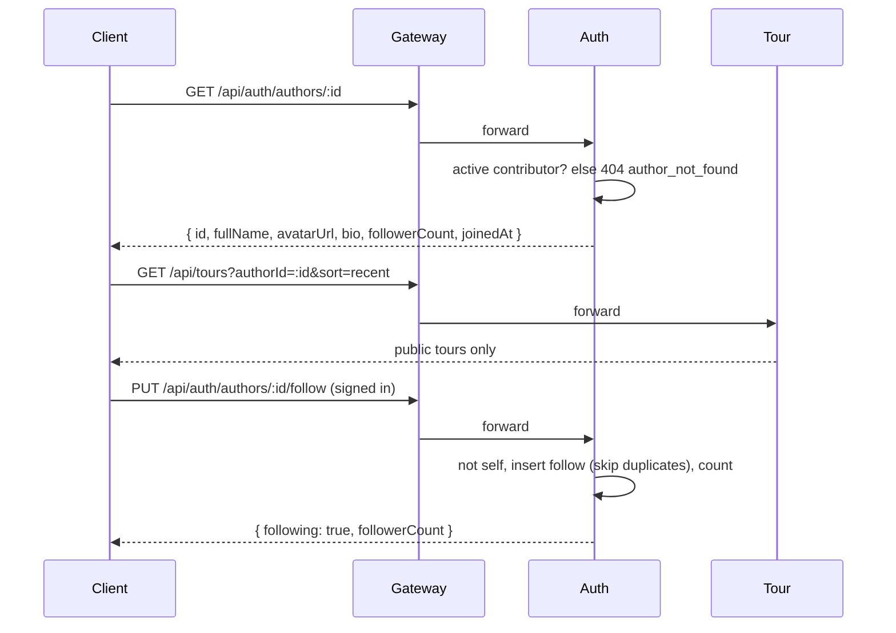

# UC18 – Trang tác giả công khai

| Trường | Nội dung |
|---|---|
| **Use Case Number** | UC18 |
| **Use Case Name** | Trang tác giả công khai |
| **Actor(s)** | Người đăng nội dung (Contributor); Khách du lịch (Tourist – người xem) |
| **Priority** | P2 |
| **Maturity** | Implemented |
| **Summary** | Mỗi contributor đang hoạt động có một trang tác giả công khai (`/authors/:id`) với ảnh đại diện, tên, giới thiệu, ngày tham gia, số người theo dõi và các tour **công khai** của mình. Ai cũng xem được trang; người đã đăng nhập có thể theo dõi / bỏ theo dõi tác giả và xem danh sách tác giả đang theo dõi. Mọi người dùng đã đăng nhập sửa được tên, giới thiệu và ảnh đại diện của mình. |

## Basic Course of Events

| # | Actor Action | System Response |
|---|---|---|
| 1 | Contributor mở **"Hồ sơ tác giả"** (`/account/profile`). *A1* | Client gọi `GET /api/auth/me/profile` và hiển thị tên, giới thiệu, ảnh đại diện. `ProfileEditPage`, `getMyProfile()` → `AuthorController.myProfile()`, `GetMyProfile.execute()` |
| 2 | Contributor sửa thông tin, có thể tải ảnh đại diện lên, rồi lưu. | Ảnh được tải qua `POST /api/media/uploads?kind=image`; client gọi `PATCH /api/auth/me/profile` với `fullName`, `bio`, `avatarUrl`. Auth kiểm tra và lưu. *E3* `uploadMedia()`, `validateProfile()`, `updateProfile()` → `AuthorController.updateProfile()`, `UpdateMyProfile.execute()`, `isValidAvatarUrl()` |
| 3 | Tourist mở trang tác giả (từ dòng tác giả ở chi tiết tour, từ danh sách "Đang theo dõi" hoặc từ menu tài khoản của chính tác giả). | Client gọi `GET /api/auth/authors/:id` và `GET /api/tours?authorId=:id&sort=recent`. *E1, E2* `AuthorPage`, `getAuthor()`, `listAuthorTours()` → `AuthorController.profile()`, `GetAuthorProfile.execute()`; Tour: `SearchTours.execute()`, `PrismaTourRepository.publicWhere()` |
| 4 | | Hệ thống hiển thị ảnh đại diện (chữ viết tắt khi không có ảnh), tên, giới thiệu, ngày tham gia, số người theo dõi và danh sách tour công khai mới nhất trước ("Xem thêm"). `AuthorPage`, `AuthorAvatar`, `PrismaFollowRepository.countFollowers()` |
| 5 | Tourist (đã đăng nhập) nhấn **"Theo dõi"**. *A2, A3* | Client gọi `PUT /api/auth/authors/:id/follow`; số người theo dõi đổi ngay và quay lại giá trị cũ nếu yêu cầu lỗi. Auth trả `{ following: true, followerCount }`. *E4* `setFollowing()` → `AuthorController.follow()`, `FollowAuthor.execute()`, `PrismaFollowRepository.follow()` |
| 6 | Tourist mở một tour từ danh sách. | Hệ thống mở chi tiết tour (UC02). |
| 7 | | Use case kết thúc tại đây. |

## Alternative Path

**A1. Người dùng không phải contributor sửa hồ sơ** → tourist / Admin cũng sửa được tên, giới thiệu, ảnh đại diện ở `/account/profile`, nhưng không có trang tác giả công khai.

**A2. Bỏ theo dõi** → nhấn "Đang theo dõi"; client gọi `DELETE /api/auth/authors/:id/follow`, Auth trả `{ following: false, followerCount }`. Luôn được phép, kể cả khi tác giả đã mất trang. `setFollowing()` → `AuthorController.unfollow()`, `UnfollowAuthor.execute()`, `PrismaFollowRepository.unfollow()`

**A3. Khách chưa đăng nhập nhấn "Theo dõi"** → client chuyển tới trang đăng nhập rồi quay lại trang tác giả.

**A4. Xem danh sách đang theo dõi** → người đã đăng nhập mở `/account/following`; client gọi `GET /api/auth/me/following` (mới theo dõi nhất trước, 20 mỗi trang). `FollowingPage`, `listFollowing()` → `AuthorController.following()`, `ListFollowing.execute()`, `PrismaFollowRepository.listFollowing()`

**A5. Tác giả xem trang của chính mình** → nút Theo dõi bị ẩn, thay bằng liên kết tới trình sửa hồ sơ.

## Exception Path

- **E1.** Tác giả chưa có tour công khai → danh sách tour trống (trang vẫn hiển thị).
- **E2.** Id không tồn tại, không phải contributor, tài khoản bị cấm hoặc đang bị tạm khoá → 404 `author_not_found` *"Không tìm thấy tác giả"*. `AuthorNotFoundError`, `followableAuthorWhere()`
- **E3.** Dữ liệu hồ sơ không hợp lệ (tên rỗng hoặc quá 120 ký tự, giới thiệu quá 500 ký tự, URL ảnh không được phép) → 400 `validation_error` kèm thông báo tiếng Việt theo trường; tài khoản không còn tồn tại → 404 `user_not_found`. `updateProfileSchema`, `isValidAvatarUrl()`, `UserNotFoundError`
- **E4.** Tự theo dõi chính mình → 400 `self_follow`; chưa đăng nhập → 401. `SelfFollowError`
- **E5.** Mất kết nối → *"Không thể kết nối, vui lòng thử lại"* kèm nút thử lại.

## Extension Points

- UC02 – Tìm & xem tour (mở tour từ trang tác giả, dòng tác giả ở chi tiết tour); UC01 – Xác thực tài khoản (để theo dõi, sửa hồ sơ); UC21 – Xử lý tài khoản (cấm / tạm khoá làm mất trang).

## Triggers

Người dùng muốn xem các tour của một tác giả hoặc theo dõi tác giả; contributor muốn giới thiệu bản thân.

## Assumptions

- Contributor có ít nhất một tour công khai (để trang có nội dung).

## Preconditions

- Trang tác giả: tài khoản có vai trò `contributor` và đang hoạt động (tạm khoá đã hết hạn tính là hoạt động).
- Theo dõi, danh sách theo dõi, sửa hồ sơ: người dùng đã đăng nhập.

## Post Conditions

- Sửa hồ sơ: `users.full_name`, `bio`, `avatar_url` được cập nhật; claim `name` trong access token đổi ở lần refresh kế tiếp.
- Theo dõi: có đúng một dòng `author_follows` cho cặp (người theo dõi, tác giả); bỏ theo dõi xoá dòng đó.
- Trang tác giả chỉ hiển thị các tour `public`.

## Reference: Business Rules

- Xem trang tác giả và tour của tác giả không cần đăng nhập; theo dõi, danh sách theo dõi và sửa hồ sơ cần đăng nhập.
- Chỉ contributor đang hoạt động có trang; chỉ tác giả có trang mới theo dõi được; không tự theo dõi.
- Theo dõi / bỏ theo dõi là idempotent (cặp duy nhất, ghi bằng `skipDuplicates`); số người theo dõi được đếm khi đọc.
- Ảnh đại diện: Auth chỉ lưu URL (tải lên qua Media). Chấp nhận URL `https://`, dạng `/api/media/files/images/...` của Media; từ chối `javascript:`, `data:`, `//host`, user info, khoảng trắng, `..`, quá 500 ký tự.
- Giới thiệu tối đa 500 ký tự; tên 1..120 ký tự. Gửi `null` / rỗng xoá giới thiệu và ảnh; không xoá được tên.
- Trang tác giả không bao giờ hiển thị email, vai trò, trạng thái hay dữ liệu đăng nhập.
- Không gửi thông báo cho người theo dõi khi tác giả xuất bản tour mới.

## Hiện thực trong hệ thống

- **Dịch vụ:**
  - Auth: hồ sơ tác giả, sửa hồ sơ, theo dõi / bỏ theo dõi, danh sách đang theo dõi.
  - Tour: tìm tour công khai lọc theo `authorId` (UC02).
  - Media: tải ảnh đại diện lên.
  - Gateway: `/api/auth` → Auth, `/api/tours` → Tour, `/api/media` → Media.
  - Client: trang tác giả, trình sửa hồ sơ, danh sách đang theo dõi.
- **Màn hình (client):** `/authors/:id` (`features/authors/AuthorPage.jsx`, `AuthorAvatar.jsx`), `/account/profile` (`ProfileEditPage.jsx`), `/account/following` (`FollowingPage.jsx`); liên kết từ `/tour/:tourId` và `/account`.
- **API (qua gateway):**
  - `GET /api/auth/authors/:id`
  - `GET /api/auth/authors/:id/follow`
  - `PUT /api/auth/authors/:id/follow`
  - `DELETE /api/auth/authors/:id/follow`
  - `GET /api/auth/me/following?page=&limit=`
  - `GET /api/auth/me/profile`
  - `PATCH /api/auth/me/profile`
  - `GET /api/tours?authorId=&sort=recent`
  - `POST /api/media/uploads?kind=image`
- **Sự kiện (RabbitMQ):** không có.
- **Dữ liệu (schema của Auth):** `users` (`bio`, `avatar_url`), `author_follows` (`follower_id`, `author_id`, `created_at`; duy nhất `(follower_id, author_id)`, chỉ mục `author_id`, xoá theo tài khoản).
- **Mã nguồn chính:**

| Bước | Hàm / lớp | File |
|---|---|---|
| 1–5, A2, A4 | `getAuthor()`, `listAuthorTours()`, `getFollowState()`, `setFollowing()`, `listFollowing()`, `getMyProfile()`, `validateProfile()`, `updateProfile()` | `client/src/lib/authors.js` |
| 2 | `uploadMedia()` | `client/src/lib/media.js` |
| 3–5, A5 | `AuthorPage`, `AuthorAvatar` | `client/src/features/authors/AuthorPage.jsx`, `client/src/features/authors/AuthorAvatar.jsx` |
| 1–2 | `ProfileEditPage` | `client/src/features/authors/ProfileEditPage.jsx` |
| A4 | `FollowingPage` | `client/src/features/authors/FollowingPage.jsx` |
| 1–5 | routes `/authors/:id`, `/authors/:id/follow`, `/me/following`, `/me/profile` | `services/auth/src/interfaces/http/routes/auth-routes.js` |
| 1–5 | `AuthorController` | `services/auth/src/interfaces/http/controllers/author-controller.js` |
| 1–5, A2, A4 | `GetAuthorProfile`, `GetFollowState`, `FollowAuthor`, `UnfollowAuthor`, `ListFollowing`, `UpdateMyProfile`, `GetMyProfile` | `services/auth/src/application/use-cases/author-page.js` |
| 2, E3 | `updateProfileSchema`, `followingQuerySchema` | `services/auth/src/application/dtos/schemas.js` |
| 2, E3 | `isValidAvatarUrl()` | `services/auth/src/domain/value-objects/avatar-url.js` |
| 4–5, E2 | `PrismaFollowRepository`, `followableAuthorWhere()` | `services/auth/src/infrastructure/persistence/prisma-follow-repository.js` |
| E2, E4 | `AuthorNotFoundError`, `SelfFollowError` | `services/auth/src/domain/errors/index.js` |
| 3 | `SearchTours` (`authorId`) | `services/tour/src/application/use-cases/search-tours.js` |
| 3 | `PrismaTourRepository.publicWhere()` | `services/tour/src/infrastructure/persistence/prisma-tour-repository.js` |

- **Tài liệu thiết kế:** [uc18-author-page.md](../../02-design/uc18-author-page.md).
- **Giới hạn đã biết:** không có danh sách người theo dõi của một tác giả, không có trang tác giả ẩn / riêng tư, không cắt ảnh đại diện, không thông báo cho người theo dõi.

## Author(s)

(điền sau)

## Date

Tạo: 2026-10-18 · Cập nhật theo hệ thống: 2026-11-08

## Activity Diagram

(bổ sung sau)

## Sequence Diagram

## Boundary

- Trang tác giả công khai (`/authors/:id`): ảnh, tên, giới thiệu, số người theo dõi, nút Theo dõi, danh sách tour.
- Trình sửa hồ sơ tác giả (`/account/profile`).
- Danh sách tác giả đang theo dõi (`/account/following`).
- Dòng tác giả ở chi tiết tour (`/tour/:tourId`) và mục "Hồ sơ tác giả" / trang của tôi trong `/account`.
