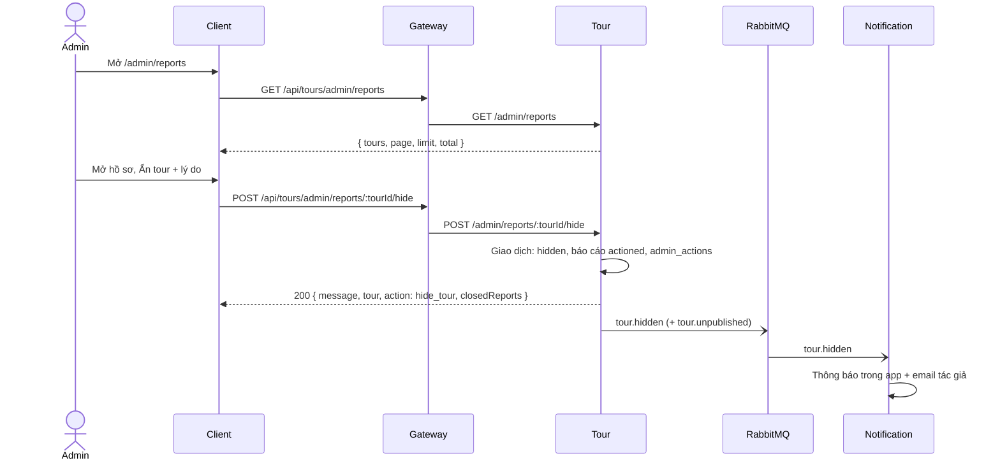

# UC20 – Xử lý báo cáo và vi phạm tour

| Trường | Nội dung |
|---|---|
| **Use Case Number** | UC20 |
| **Use Case Name** | Xử lý báo cáo và vi phạm tour |
| **Actor(s)** | Admin (Quản trị viên kiểm duyệt); Hệ thống: Tour service, Notification service |
| **Priority** | P1 |
| **Maturity** | Implemented |
| **Summary** | Admin xem hàng chờ các tour có báo cáo đang mở (nhiều báo cáo nhất lên đầu, tour bị gắn cờ ưu tiên), mở hồ sơ báo cáo của một tour, rồi ẩn tour vi phạm (tác giả được cảnh báo kèm lý do), bỏ qua báo cáo (không vi phạm) hoặc khôi phục tour đã bị ẩn (report bomb). Mọi quyết định được ghi log. |

## Basic Course of Events

| # | Actor Action | System Response |
|---|---|---|
| 1 | Admin mở trang **"Tour bị báo cáo"** (`/admin/reports`). | |
| 2 | | Tour service trả về các tour có `open_report_count > 0`, sắp theo số báo cáo mở giảm dần, rồi tour bị gắn cờ trước, rồi báo cáo mở cũ nhất trước. Mỗi dòng có tên, trạng thái, số báo cáo, cờ, thời điểm báo cáo gần nhất và số báo cáo theo từng lý do. Có phân trang (mặc định 20, tối đa 50). *E1, E2* `ListReportQueue.execute()` |
| 3 | Admin chọn một tour. | |
| 4 | | Hệ thống hiển thị hồ sơ (`/admin/reports/:tourId`): tóm tắt tour (trạng thái, thành phố, điểm đánh giá), liên kết tới trang tour công khai và trang tài khoản tác giả (UC21), các báo cáo mở (lý do, ghi chú, thời gian, id người báo cáo), số báo cáo đã bỏ qua / đã xử lý, lịch sử hành động admin. Các nút chỉ hiện khi API cho phép (`actions`). *E3* `GetReportDossier.execute()` |
| 5 | Admin chọn **Ẩn tour**, nhập lý do và xác nhận. *A1, A2, A3* | |
| 6 | | Trong một giao dịch: tour `public` → `hidden` (ghi có điều kiện), các báo cáo mở → `actioned`, `open_report_count` = 0, `report_flagged_at` = null, ghi một dòng `admin_actions` (`hide_tour`). *E4, E5* `HideReportedTour.execute()`, `PrismaAdminReportRepository.hideIf()` |
| 7 | | Sau khi commit, Tour phát `tour.hidden` (và `tour.unpublished` lý do `hidden` nếu bật cờ chatbot). Notification tạo thông báo trong app và gửi email cảnh báo kèm lý do cho tác giả (UC16). Use case kết thúc. `EventAdminReportPublisher.hidden()`, `handleEvent()` (Notification) |

## Alternative Path

**A1. Khôi phục tour bị ẩn (report bomb)** → chỉ từ `hidden`, lý do không bắt buộc. Tour về `public` ngay, không kiểm duyệt lại, không có kháng nghị. Các báo cáo giữ nguyên. Ghi `restore_tour`, phát `tour.restored` (và `tour.published` nếu bật cờ chatbot). Notification nhận `tour.restored`: lưu thông báo trong app "Tour … đã được hiển thị lại" và gửi email cho tác giả (`handleEvent()`, `buildInAppNotification()`, `buildTourEmail()`). `RestoreHiddenTour.execute()`, `PrismaAdminReportRepository.restoreIf()`, `EventAdminReportPublisher.restored()`

**A2. Bỏ qua báo cáo (không vi phạm)** → chỉ khi tour có báo cáo mở, lý do không bắt buộc. Báo cáo mở → `dismissed`, bộ đếm và cờ được xoá, trạng thái tour giữ nguyên, `tours.updated_at` không đổi. Ghi `dismiss_reports`, không phát sự kiện. `DismissTourReports.execute()`, `PrismaAdminReportRepository.dismissIf()`

**A3. Tác giả vi phạm nhiều lần** → từ hồ sơ, Admin mở trang tài khoản tác giả và chuyển sang **UC21 – Quản lý tài khoản vi phạm**.

## Exception Path

- **E1.** Không có tour bị báo cáo → danh sách rỗng.
- **E2.** Không có token hợp lệ → 401; không phải admin → 403; tham số `page` / `limit` sai → 400.
- **E3.** `tourId` không phải UUID → 400; tour không tồn tại → 404 `tour_not_found`.
- **E4.** Ẩn khi tour không ở `public` → 409 `tour_not_hideable`; khôi phục khi không ở `hidden` → 409 `tour_not_restorable`; bỏ qua khi không còn báo cáo mở → 409 `no_open_reports` (`TourNotHideableError`, `TourNotRestorableError`, `NoOpenReportsError`). Hai admin cùng thao tác: một người thắng, người kia nhận 409; client hiện thông báo và tải lại hồ sơ.
- **E5.** Ẩn thiếu lý do, hoặc lý do quá 1000 ký tự → 422.
- **E6.** Gửi sự kiện thất bại → chỉ ghi log, quyết định vẫn thành công (`ReportDecision.emit()`).

## Extension Points

- UC06 – Báo cáo tour (nguồn dữ liệu); UC16 – Theo dõi trạng thái & thông báo; UC21 – Quản lý tài khoản vi phạm; UC22 – Dashboard thống kê & log.

## Triggers

Khách gửi báo cáo cho một tour (UC06), làm `open_report_count` > 0; tour có báo cáo từ 5 tài khoản khác nhau trong 7 ngày được gắn cờ `report_flagged_at`.

## Assumptions

- Có báo cáo từ cộng đồng (UC06); lý do báo cáo thuộc `false_info`, `offensive`, `spam`, `copyright`, `other`.
- Notification tra email tác giả qua Auth; nếu tra cứu thất bại thì bỏ qua email.

## Preconditions

- Admin đã đăng nhập; có tour với báo cáo đang mở (hoặc tour đang `hidden` để khôi phục).

## Post Conditions

- Ẩn: tour `hidden`, báo cáo mở thành `actioned`, bộ đếm và cờ về 0 / null; tác giả có thông báo và email.
- Khôi phục: tour `public`; báo cáo không đổi.
- Bỏ qua: báo cáo mở thành `dismissed`, bộ đếm và cờ về 0 / null, trạng thái tour không đổi.
- Mỗi quyết định có đúng một dòng `admin_actions` (`data` có `fromStatus` / `status` và `reportCount`).

## Reference: Business Rules

- Phần xử lý của **Tầng 3 – Báo cáo cộng đồng**.
- Gắn cờ (UC06) **không ẩn tour tự động** và không đổi trạng thái; tour chỉ được đẩy lên đầu hàng chờ.
- Ẩn chỉ từ `public` và bắt buộc lý do (trim, 1..1000); khôi phục chỉ từ `hidden`; bỏ qua chỉ khi có báo cáo mở.
- Mỗi quyết định là **một giao dịch**; log `admin_actions` chỉ được thêm, không sửa, không xoá.
- Admin thấy id người báo cáo; tác giả không bao giờ thấy (không có trong sự kiện).
- Báo cáo tạo trong lúc ẩn tour có thể nằm trên tour đã ẩn như một báo cáo mở mới và bỏ qua được.

## Hiện thực trong hệ thống

- **Dịch vụ:**
  - Client: hàng chờ, hồ sơ, hộp thoại lý do.
  - Gateway: chuyển `/api/tours/...` sang Tour.
  - Tour: hàng chờ, hồ sơ, quyết định, log, sự kiện; `verifyJwt(['admin'])`.
  - Notification: thông báo và email khi ẩn.
  - AI (chatbot indexer): gỡ / thêm tour khỏi chỉ mục khi bật cờ.
- **Màn hình (client):** `/admin/reports` (`ReportedToursPage`), `/admin/reports/:tourId` (`ReportDossierPage`, `ReasonDialog`) trong `client/src/features/admin/`; API helper `client/src/lib/admin-reports.js`.
- **API (qua gateway):**
  - `GET /api/tours/admin/reports?page&limit`
  - `GET /api/tours/admin/reports/:tourId`
  - `POST /api/tours/admin/reports/:tourId/hide` `{ reason }`
  - `POST /api/tours/admin/reports/:tourId/restore` `{ reason? }`
  - `POST /api/tours/admin/reports/:tourId/dismiss` `{ reason? }`
- **Sự kiện (RabbitMQ):** publish `tour.hidden`, `tour.unpublished` (ẩn), `tour.restored`, `tour.published` (khôi phục); bỏ qua không phát gì. Không gửi khi cả hai cờ sự kiện đều tắt.
- **Dữ liệu (schema `tour`):** `tours.status`, `tours.open_report_count`, `tours.report_flagged_at`; `tour_reports.status` (`open` / `dismissed` / `actioned`); `admin_actions`.
- **Tài liệu thiết kế:** [uc20-report-handling.md](../../02-design/uc20-report-handling.md), [uc06-reports.md](../../02-design/uc06-reports.md), [uc16-notifications.md](../../02-design/uc16-notifications.md).
- **Mã nguồn chính:**

| Bước | Hàm / lớp | File |
|---|---|---|
| 1-2 | `ReportedToursPage`, `listReportedTours()` | `client/src/features/admin/ReportedToursPage.jsx`, `client/src/lib/admin-reports.js` |
| 3-4 | `ReportDossierPage`, `getReportDossier()` | `client/src/features/admin/ReportDossierPage.jsx`, `client/src/lib/admin-reports.js` |
| 5, A1, A2 | `hideReportedTour()`, `restoreReportedTour()`, `dismissTourReports()`, `ReasonDialog` | `client/src/lib/admin-reports.js`, `client/src/features/admin/ReasonDialog.jsx` |
| Route | `buildAdminReportRouter()` (mount `/admin/reports`) | `services/tour/src/interfaces/http/routes/admin-report-routes.js`, `services/tour/src/index.js` |
| Controller | `AdminReportController.queue/dossier/hide/restore/dismiss` | `services/tour/src/interfaces/http/controllers/admin-report-controller.js` |
| 2, 4 | `ListReportQueue`, `GetReportDossier` | `services/tour/src/application/use-cases/admin-reports.js` |
| 6, A1, A2 | `HideReportedTour`, `RestoreHiddenTour`, `DismissTourReports` (base `ReportDecision`) | `services/tour/src/application/use-cases/admin-reports.js` |
| 6, A1, A2 | `PrismaAdminReportRepository.hideIf/restoreIf/dismissIf()` | `services/tour/src/infrastructure/persistence/prisma-admin-report-repository.js` |
| 4 | `PrismaAdminActionRepository.listByTarget()` (lịch sử) | `services/tour/src/infrastructure/persistence/prisma-admin-action-repository.js` |
| 7, A1 | `EventAdminReportPublisher.hidden/restored()` | `services/tour/src/infrastructure/messaging/event-admin-report-publisher.js` |
| 7 | `handleEvent()`, `createStoreInAppNotification()`, `buildTourEmail()` | `services/notification/src/notify.js`, `services/notification/src/application/store-in-app-notification.js`, `services/notification/src/services/tour-email-template.js` |

## Author(s)

(điền sau)

## Date

Tạo: 2026-10-18 · Cập nhật theo hệ thống: 2026-11-08

## Activity Diagram

(bổ sung sau)

## Sequence Diagram

## Boundary

- Trang Tour bị báo cáo (`/admin/reports`).
- Trang Hồ sơ báo cáo của tour (`/admin/reports/:tourId`): báo cáo mở, lịch sử hành động.
- Hộp thoại Ẩn tour (lý do bắt buộc), Khôi phục, Bỏ qua báo cáo (lý do tùy chọn).
