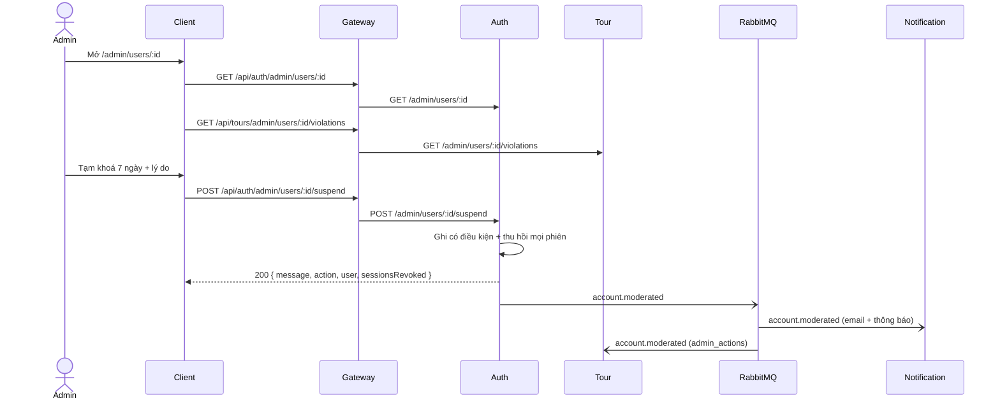

# UC21 – Quản lý tài khoản vi phạm

| Trường | Nội dung |
|---|---|
| **Use Case Number** | UC21 |
| **Use Case Name** | Quản lý tài khoản vi phạm |
| **Actor(s)** | Admin (Quản trị viên kiểm duyệt); Hệ thống: Auth service, Tour service, Notification service |
| **Priority** | P2 |
| **Maturity** | Implemented |
| **Summary** | Admin tìm một tài khoản, xem trạng thái, thiết bị đang đăng nhập và lịch sử vi phạm (tour bị ẩn / từ chối, báo cáo nhận được, hành động tài khoản trước đó), rồi cảnh báo, tạm khoá có thời hạn, cấm hẳn hoặc khôi phục tài khoản. Người bị khoá / cấm bị đăng xuất ngay trên mọi thiết bị và được báo qua email và thông báo trong app. |

## Basic Course of Events

| # | Actor Action | System Response |
|---|---|---|
| 1 | Admin mở trang **"Người dùng"** (`/admin/users`), tìm theo email hoặc họ tên, lọc theo vai trò / trạng thái. | |
| 2 | | Auth trả về danh sách tài khoản (mới nhất trước, mặc định 20, tối đa 50 mỗi trang) với `email`, `fullName`, `role`, `status` hiệu lực, `banReason`, `suspendedUntil`. *E2* |
| 3 | Admin chọn một tài khoản (`/admin/users/:id`). | |
| 4 | | Auth trả về thông tin tài khoản và các thiết bị đang đăng nhập; Tour trả về lịch sử vi phạm: số tour theo trạng thái, tour bị ẩn / bị từ chối (kèm lý do, liên kết hồ sơ UC20), số báo cáo nhận được (mở / bỏ qua / đã xử lý), 20 hành động tài khoản gần nhất. *E1* |
| 5 | Admin chọn **Cảnh báo**, **Tạm khoá** (1, 7, 30 ngày hoặc ngày kết thúc) hoặc **Cấm**, nhập lý do và xác nhận. *A1, A2* | |
| 6 | | Auth kiểm tra quy tắc, ghi trạng thái có điều kiện (`active` / `suspended` / `banned`, `ban_reason`, `suspended_until`). Khi tạm khoá hoặc cấm, Auth thu hồi mọi phiên (`revoke_reason` = `suspended` / `banned`, `sid` đánh dấu trong Redis). *E3, E4, E5, E6* |
| 7 | | Auth phát `account.moderated`. Notification gửi email và tạo thông báo trong app cho người dùng; Tour ghi một dòng `admin_actions` (`warn_user`, `suspend_user`, `ban_user`, `restore_user`) cho UC22. |
| 8 | | Client hiện thông báo thành công và tải lại trang. Use case kết thúc. |

## Alternative Path

**A1. Khôi phục tài khoản** → chỉ hiện khi tài khoản đang `suspended` hoặc `banned`; lý do không bắt buộc. Trạng thái về `active`, `ban_reason` và `suspended_until` bị xoá, phát `account.moderated` với `action: restore`.

**A2. Tạm khoá lại tài khoản đang bị tạm khoá** → ngày kết thúc mới thay ngày cũ; hoặc Admin cấm hẳn tài khoản đang tạm khoá.

**A3. Hết hạn tạm khoá** → không ghi lại dòng nào: khi đăng nhập / làm mới phiên và khi hiển thị, tài khoản có `suspended_until` đã qua được tính là `active`.

## Exception Path

- **E1.** Tài khoản không tồn tại → 404 `user_not_found` *"Không tìm thấy tài khoản"*. (Lịch sử vi phạm ở Tour trả về toàn số 0 cho id không biết.)
- **E2.** Không có token hợp lệ → 401; không phải admin → 403; tham số tìm kiếm sai → 400.
- **E3.** Admin thao tác lên chính mình → 403 `self_action`; lên admin khác → 403 `target_is_admin`. Client không hiện các nút này.
- **E4.** Cảnh báo / tạm khoá / cấm tài khoản đã bị cấm → 409 `account_already_banned`; khôi phục tài khoản đang hoạt động → 409 `account_not_restricted`.
- **E5.** Hai admin cùng thao tác → một người thắng, người kia nhận 409 `account_state_changed`.
- **E6.** Thiếu lý do, lý do quá 1000 ký tự, số ngày không phải 1 / 7 / 30, ngày kết thúc đã qua hoặc quá 365 ngày → 422 `validation_error`.
- **E7.** Đăng xuất hoặc gửi sự kiện thất bại → chỉ ghi log, hành động vẫn thành công.

## Extension Points

- UC01 – Xác thực tài khoản (đăng nhập bị chặn); UC20 – Xử lý báo cáo & vi phạm (A3); UC22 – Dashboard thống kê & log; UC23 – Thiết bị đang đăng nhập (thu hồi phiên).

## Triggers

Tác giả vi phạm nhiều lần (tour bị ẩn / từ chối, nhiều báo cáo); Admin cần xử lý tài khoản.

## Assumptions

- Tour chỉ ghi log hành động tài khoản khi broker được bật (`MODERATION_EVENTS_ENABLED` hoặc `CHATBOT_EVENTS_ENABLED`).
- Tài khoản admin được tạo thủ công trong cơ sở dữ liệu Auth.

## Preconditions

- Admin đã đăng nhập; tài khoản mục tiêu tồn tại và không phải admin.

## Post Conditions

- `users.status` là `active`, `suspended` hoặc `banned` (cảnh báo không đổi trạng thái); `ban_reason` / `suspended_until` cập nhật.
- Tạm khoá / cấm: mọi phiên bị thu hồi, người dùng bị đăng xuất ngay.
- Đã phát `account.moderated`; người dùng có email và thông báo trong app; Tour có một dòng `admin_actions` (target `user`).

## Reference: Business Rules

- Lý do bắt buộc cho cảnh báo, tạm khoá, cấm (trim, 1..1000); khôi phục có lý do tùy chọn.
- Tạm khoá: 1, 7 hoặc 30 ngày, hoặc `until` (ISO 8601 có giờ và múi giờ) trong tương lai, tối đa 365 ngày; chỉ một trong hai.
- Đăng nhập / làm mới khi bị tạm khoá → 403 `account_suspended` *"Tài khoản đang bị tạm khoá đến <giờ Việt Nam>"*; khi bị cấm → 403 `account_banned` (UC01 E3).
- Cảnh báo **không tự động leo thang** thành khoá; đếm cảnh báo xem ở log UC22.
- Không cấm chính mình, không tác động admin khác.
- Ghi có điều kiện theo trạng thái và ngày kết thúc đã đọc.
- Email không đi qua địa chỉ `SECURITY_ALERT_TO`; thông báo trong app không bị tạo trùng khi sự kiện gửi lại.

## Hiện thực trong hệ thống

- **Dịch vụ:**
  - Client: danh sách, chi tiết tài khoản, hộp thoại lý do.
  - Gateway: `/api/auth` → Auth, `/api/tours` → Tour.
  - Auth: tìm kiếm, hành động, thu hồi phiên, chặn đăng nhập, phát sự kiện.
  - Tour: lịch sử vi phạm, ghi log hành động từ sự kiện (queue `tour.admin-log`).
  - Notification: email và thông báo trong app.
- **Màn hình (client):** `/admin/users` (`UsersPage`), `/admin/users/:id` (`UserDetailPage`, `ReasonDialog`) trong `client/src/features/admin/`; API helper `client/src/lib/admin-users.js`.
- **API (qua gateway):**
  - `GET /api/auth/admin/users?q&role&status&page&limit`
  - `GET /api/auth/admin/users/:id`
  - `POST /api/auth/admin/users/:id/warn` `{ reason }`
  - `POST /api/auth/admin/users/:id/suspend` `{ reason, days }` hoặc `{ reason, until }`
  - `POST /api/auth/admin/users/:id/ban` `{ reason }`
  - `POST /api/auth/admin/users/:id/restore` `{ reason? }`
  - `GET /api/tours/admin/users/:userId/violations`
- **Sự kiện (RabbitMQ):** Auth publish `account.moderated` (`userId`, `action`, `reason?`, `until?`, `adminId`, `email`, `fullName`, `at`); consume bởi Notification và Tour.
- **Dữ liệu:** Auth `users.status`, `users.ban_reason`, `users.suspended_until`, `sessions.revoke_reason`; Tour `admin_actions` (`source_key` chống trùng); Notification bảng thông báo (type `account.moderated`).
- **Tài liệu thiết kế:** [uc21-account-actions.md](../../02-design/uc21-account-actions.md), [uc22-dashboard-log.md](../../02-design/uc22-dashboard-log.md), [device-sessions.md](../../02-design/device-sessions.md).

## Author(s)

(điền sau)

## Date

Tạo: 2026-10-18 · Cập nhật theo hệ thống: 2026-11-08

## Activity Diagram

(bổ sung sau)

## Sequence Diagram

## Boundary

- Trang Người dùng (`/admin/users`): tìm kiếm, bộ lọc, phân trang.
- Trang Chi tiết tài khoản (`/admin/users/:id`): trạng thái, thiết bị, lịch sử vi phạm.
- Hộp thoại Cảnh báo, Tạm khoá (1 / 7 / 30 ngày hoặc ngày kết thúc), Cấm, Khôi phục.
