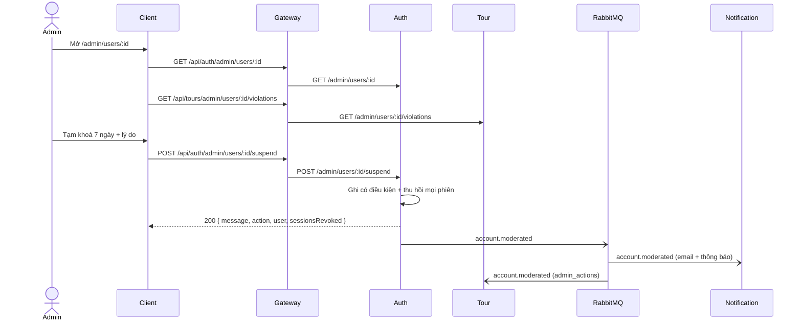

# UC21 – Quản lý tài khoản vi phạm

| Trường | Nội dung |
|---|---|
| **Use Case Number** | UC21 |
| **Use Case Name** | Quản lý tài khoản vi phạm |
| **Actor(s)** | Admin (Quản trị viên kiểm duyệt); Hệ thống: Auth service, Tour service, Notification service |
| **Priority** | P2 |
| **Maturity** | Implemented |
| **Summary** | Admin tìm một tài khoản, xem trạng thái, số phiên đang hoạt động và lịch sử vi phạm (tour bị ẩn / từ chối, báo cáo nhận được, hành động tài khoản trước đó), rồi cảnh báo, tạm khoá có thời hạn, cấm hẳn hoặc khôi phục tài khoản. Người bị khoá / cấm bị đăng xuất ngay trên mọi thiết bị và được báo qua email và thông báo trong app. |

## Basic Course of Events

| # | Actor Action | System Response |
|---|---|---|
| 1 | Admin mở trang **"Người dùng"** (`/admin/users`), tìm theo email hoặc họ tên, lọc theo vai trò / trạng thái. | |
| 2 | | Auth trả về danh sách tài khoản (mới nhất trước, mặc định 20, tối đa 50 mỗi trang) với `email`, `fullName`, `role`, `status` hiệu lực, `banReason`, `suspendedUntil`. *E2* `SearchUsers.execute()`, `PrismaUserRepository.search()` |
| 3 | Admin chọn một tài khoản (`/admin/users/:id`). | |
| 4 | | Auth trả về thông tin tài khoản và **số** phiên đang hoạt động (`activeSessions`); Tour trả về lịch sử vi phạm: số tour theo trạng thái, tour bị ẩn / bị từ chối (kèm lý do, liên kết hồ sơ UC20), số báo cáo nhận được (mở / bỏ qua / đã xử lý), 20 hành động tài khoản gần nhất. *E1* `GetUserForAdmin.execute()`, `GetUserViolations.execute()` |
| 5 | Admin chọn **Cảnh báo**, **Tạm khoá** (1, 7, 30 ngày hoặc ngày kết thúc) hoặc **Cấm**, nhập lý do và xác nhận. *A1, A2* | |
| 6 | | Auth kiểm tra quy tắc (không tự xử lý, không xử lý admin, chưa bị cấm). Cảnh báo không đổi trạng thái. Tạm khoá / cấm ghi trạng thái có điều kiện (`suspended` / `banned`, `ban_reason`, `suspended_until`) rồi thu hồi mọi phiên (`revoke_reason` = `suspended` / `banned`, `sid` đánh dấu trong Redis). *E3, E4, E5, E6* `WarnUser.execute()`, `SuspendUser.execute()`, `BanUser.execute()`, `AccountAction.write()` → `PrismaUserRepository.updateStatusIf()`, `RevokeAllSessions.execute()` |
| 7 | | Auth phát `account.moderated` (với cả bốn hành động). Notification lưu thông báo trong app trước, rồi gửi email tới `email` trong sự kiện. Tour ghi một dòng `admin_actions` (`warn_user`, `suspend_user`, `ban_user`, `restore_user`) cho UC22, bỏ qua nếu đã ghi. `AccountAction.publish()`, `handleEvent()` (Notification), `buildAccountModeratedHandler()` → `RecordAccountAction.execute()` → `PrismaAdminActionRepository.appendOnce()` (Tour) |
| 8 | | Client hiện thông báo thành công và tải lại trang. Use case kết thúc. |

## Alternative Path

**A1. Khôi phục tài khoản** → chỉ hiện khi tài khoản đang `suspended` hoặc `banned`; lý do không bắt buộc. Trạng thái về `active`, `ban_reason` và `suspended_until` bị xoá, phát `account.moderated` với `action: restore`. `RestoreUser.execute()`

**A2. Tạm khoá lại tài khoản đang bị tạm khoá** → ngày kết thúc mới thay ngày cũ; hoặc Admin cấm hẳn tài khoản đang tạm khoá. `SuspendUser.execute()`, `suspensionEnd()`

**A3. Hết hạn tạm khoá** → không ghi lại dòng nào: khi đăng nhập / làm mới phiên và khi hiển thị, tài khoản có `suspended_until` đã qua được tính là `active`. `Login.execute()`, `RefreshToken.execute()` (kiểm tra `user.isSuspended(now)`), `effectiveStatus()`

## Exception Path

- **E1.** Tài khoản không tồn tại → 404 `user_not_found` *"Không tìm thấy tài khoản"* (`AccountNotFoundError`, trong `AccountAction.loadTarget()`). Lịch sử vi phạm ở Tour trả về toàn số 0 cho id không biết.
- **E2.** Không có token hợp lệ → 401; không phải admin → 403; tham số tìm kiếm sai → 400.
- **E3.** Admin thao tác lên chính mình → 403 `self_action` *"Không thể xử lý chính tài khoản của bạn"* (`SelfActionError`); lên admin khác → 403 `target_is_admin` (`TargetIsAdminError`). Client không hiện các nút này.
- **E4.** Cảnh báo / tạm khoá / cấm tài khoản đã bị cấm → 409 `account_already_banned` (`AccountAlreadyBannedError`); khôi phục tài khoản đang hoạt động → 409 `account_not_restricted` (`AccountNotRestrictedError`).
- **E5.** Hai admin cùng thao tác → một người thắng, người kia nhận 409 `account_state_changed` *"Trạng thái tài khoản vừa được thay đổi, vui lòng tải lại"* (`AccountStateChangedError`).
- **E6.** Thiếu lý do, lý do quá 1000 ký tự, số ngày không phải 1 / 7 / 30, ngày kết thúc đã qua hoặc quá 365 ngày → 422 `validation_error` (`InvalidSuspensionError` trong `suspensionEnd()`).
- **E7.** Đăng xuất hoặc gửi sự kiện thất bại → chỉ ghi log, hành động vẫn thành công (`AccountAction.signOutEverywhere()`, `AccountAction.publish()`). Nếu RabbitMQ chưa kết nối, sự kiện bị mất: không có email, thông báo trong app hay dòng log UC22.
- **E8.** Notification: sự kiện không có `email` → bỏ qua email (thông báo trong app vẫn lưu); lỗi SMTP được ném lại như email tour, nhưng thông báo trong app đã lưu trước đó.

## Extension Points

- UC01 – Xác thực tài khoản (đăng nhập bị chặn); UC20 – Xử lý báo cáo & vi phạm (A3); UC22 – Dashboard thống kê & log; UC23 – Thiết bị đang đăng nhập (thu hồi phiên).

## Triggers

Tác giả vi phạm nhiều lần (tour bị ẩn / từ chối, nhiều báo cáo); Admin cần xử lý tài khoản.

## Assumptions

- Auth luôn kết nối RabbitMQ (không có cờ) và luôn phát `account.moderated`; Notification luôn đăng ký sự kiện này (queue `notification.events`, `startWorker()` trong `services/notification/src/index.js`).
- Tour chỉ ghi log hành động tài khoản khi nó tải broker, tức `MODERATION_EVENTS_ENABLED=true` **hoặc** `CHATBOT_EVENTS_ENABLED=true` (`brokerEnabled` trong `services/tour/src/index.js`; `accountModeratedHandler` chỉ được tạo trong `container.js` khi có `publish` và `validateEvent`). Cả hai cờ tắt: không có dòng `admin_actions` cho UC21.
- Tài khoản admin được tạo thủ công trong cơ sở dữ liệu Auth.

## Preconditions

- Admin đã đăng nhập; tài khoản mục tiêu tồn tại và không phải admin.

## Post Conditions

- `users.status` là `active`, `suspended` hoặc `banned` (cảnh báo không đổi trạng thái); `ban_reason` / `suspended_until` cập nhật.
- Tạm khoá / cấm: mọi phiên bị thu hồi, người dùng bị đăng xuất ngay.
- Đã phát `account.moderated`; người dùng có email và thông báo trong app; Tour có một dòng `admin_actions` (target `user`).

## Reference: Business Rules

- Lý do bắt buộc cho cảnh báo, tạm khoá, cấm (trim, 1..1000); khôi phục có lý do tùy chọn.
- Tạm khoá: 1, 7 hoặc 30 ngày, hoặc `until` (ISO 8601 có giờ và múi giờ) trong tương lai, tối đa 365 ngày; chỉ một trong hai.
- Đăng nhập / làm mới khi bị tạm khoá → 403 `account_suspended` *"Tài khoản đang bị tạm khoá đến <giờ Việt Nam>"*; khi bị cấm → 403 `account_banned` (UC01 E3).
- Cảnh báo **không tự động leo thang** thành khoá; đếm cảnh báo xem ở log UC22.
- Không cấm chính mình, không tác động admin khác.
- Ghi có điều kiện theo trạng thái và ngày kết thúc đã đọc.
- Email gửi thẳng tới `email` của tài khoản trong sự kiện (không dùng `SECURITY_ALERT_TO`, không tra Auth); thông báo trong app (type `account.moderated`, tiêu đề theo hành động, nội dung = lý do) có `sourceKey` nên không bị tạo trùng khi sự kiện gửi lại.
- Dòng log ở Tour có `source_key` = `account.moderated:<userId>:<action>:<at>`; không lưu email hay tên.

## Hiện thực trong hệ thống

- **Dịch vụ:**
  - Client: danh sách, chi tiết tài khoản, hộp thoại lý do.
  - Gateway: `/api/auth` → Auth, `/api/tours` → Tour.
  - Auth: tìm kiếm, hành động, thu hồi phiên, chặn đăng nhập, phát sự kiện.
  - Tour: lịch sử vi phạm, ghi log hành động từ sự kiện (queue `tour.admin-log`).
  - Notification: email và thông báo trong app.
- **Màn hình (client):** `/admin/users` (`UsersPage`), `/admin/users/:id` (`UserDetailPage`, `ReasonDialog`) trong `client/src/features/admin/`; API helper `client/src/lib/admin-users.js`.
- **API (qua gateway):**
  - `GET /api/auth/admin/users?q&role&status&page&limit`
  - `GET /api/auth/admin/users/:id`
  - `POST /api/auth/admin/users/:id/warn` `{ reason }`
  - `POST /api/auth/admin/users/:id/suspend` `{ reason, days }` hoặc `{ reason, until }`
  - `POST /api/auth/admin/users/:id/ban` `{ reason }`
  - `POST /api/auth/admin/users/:id/restore` `{ reason? }`
  - `GET /api/tours/admin/users/:userId/violations`
- **Sự kiện (RabbitMQ):** Auth publish `account.moderated` (`userId`, `action`, `reason?`, `until?`, `adminId`, `email`, `fullName`, `at`); consume bởi Notification và Tour.
- **Dữ liệu:** Auth `users.status`, `users.ban_reason`, `users.suspended_until`, `sessions.revoke_reason`; Tour `admin_actions` (`source_key` chống trùng); Notification bảng thông báo (type `account.moderated`).
- **Tài liệu thiết kế:** [uc21-account-actions.md](../../02-design/uc21-account-actions.md), [uc22-dashboard-log.md](../../02-design/uc22-dashboard-log.md), [device-sessions.md](../../02-design/device-sessions.md).
- **Mã nguồn chính:**

| Bước | Hàm / lớp | File |
|---|---|---|
| 1-2 | `UsersPage`, `searchUsers()` | `client/src/features/admin/UsersPage.jsx`, `client/src/lib/admin-users.js` |
| 3-5, A1 | `UserDetailPage`, `getUser()`, `getUserViolations()`, `warnUser()`, `suspendUser()`, `banUser()`, `restoreUser()` | `client/src/features/admin/UserDetailPage.jsx`, `client/src/lib/admin-users.js` |
| Route | `buildAuthRouter()` (`/admin/users...`, `requireAdmin`) | `services/auth/src/interfaces/http/routes/auth-routes.js` |
| Controller | `AdminUsersController.search/detail/warn/suspend/ban/restore` | `services/auth/src/interfaces/http/controllers/admin-users-controller.js` |
| 2, 4 | `SearchUsers`, `GetUserForAdmin` | `services/auth/src/application/use-cases/admin-users.js` |
| 6, A1, A2 | `WarnUser`, `SuspendUser`, `BanUser`, `RestoreUser`, `suspensionEnd()` (base `AccountAction`) | `services/auth/src/application/use-cases/account-actions.js` |
| 6 | `PrismaUserRepository.search()`, `updateStatusIf()` | `services/auth/src/infrastructure/persistence/prisma-user-repository.js` |
| 6 | `RevokeAllSessions` | `services/auth/src/application/use-cases/revoke-all-sessions.js` |
| A3 | `Login`, `RefreshToken` (`AccountSuspendedError`, `AccountBannedError`) | `services/auth/src/application/use-cases/login.js`, `services/auth/src/application/use-cases/refresh-token.js` |
| 7 | `EventPublisher` | `services/auth/src/infrastructure/messaging/event-publisher.js` |
| 7 | `handleEvent()` → `handleAccountModerated()`, `buildAccountActionEmail()` | `services/notification/src/notify.js`, `services/notification/src/services/account-email-template.js` |
| 7 | `buildInAppNotification()`, `createStoreInAppNotification()` | `services/notification/src/domain/in-app-notification.js`, `services/notification/src/application/store-in-app-notification.js` |
| 7 | `buildAccountModeratedHandler()` (queue `tour.admin-log`), `RecordAccountAction` | `services/tour/src/interfaces/events/account-moderated-handler.js`, `services/tour/src/application/use-cases/admin-insights.js` |
| 7 | `PrismaAdminActionRepository.appendOnce()` | `services/tour/src/infrastructure/persistence/prisma-admin-action-repository.js` |
| 4 | `GetUserViolations`, `AdminInsightController.violations` | `services/tour/src/application/use-cases/admin-insights.js`, `services/tour/src/interfaces/http/controllers/admin-insight-controller.js` |

## Author(s)

(điền sau)

## Date

Tạo: 2026-10-18 · Cập nhật theo hệ thống: 2026-11-08

## Activity Diagram

(bổ sung sau)

## Sequence Diagram

## Boundary

- Trang Người dùng (`/admin/users`): tìm kiếm, bộ lọc, phân trang.
- Trang Chi tiết tài khoản (`/admin/users/:id`): trạng thái, số phiên đang hoạt động, lịch sử vi phạm.
- Hộp thoại Cảnh báo, Tạm khoá (1 / 7 / 30 ngày hoặc ngày kết thúc), Cấm, Khôi phục.
