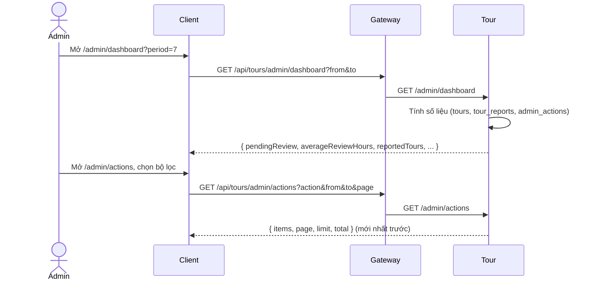

# UC22 – Dashboard thống kê và log

| Trường | Nội dung |
|---|---|
| **Use Case Number** | UC22 |
| **Use Case Name** | Dashboard thống kê và log |
| **Actor(s)** | Admin (Quản trị viên kiểm duyệt); Hệ thống: Tour service |
| **Priority** | P2 |
| **Maturity** | Implemented |
| **Summary** | Admin xem dashboard vận hành kiểm duyệt theo khoảng thời gian (tour đang chờ duyệt, thời gian duyệt trung bình, tour bị báo cáo, top contributor, số hành động theo loại) và xem nhật ký chỉ đọc của mọi hành động admin (UC19, UC20, UC21) với bộ lọc, để quản lý khối lượng công việc và minh bạch vận hành. |

## Basic Course of Events

| # | Actor Action | System Response |
|---|---|---|
| 1 | Admin mở **"Dashboard"** (`/admin/dashboard`). | |
| 2 | | Tour tính số liệu cho 7 ngày gần nhất (mặc định): số tour đang chờ duyệt (`pending_review`, `ai_warning`, tổng), thời gian duyệt trung bình (giờ), số tour bị báo cáo trong kỳ, số tour đang có báo cáo mở, top 5 contributor, số hành động admin theo loại. Client hiện các ô số liệu (có liên kết tới hàng chờ UC19 / UC20) và thanh ngang cho số hành động. *A1, E1, E2* `GetAdminDashboard.execute()`, `resolveDashboardPeriod()`, `PrismaAdminInsightRepository.countReviewQueue/averageReviewSeconds/countReportedTours/countOpenReportTours/topContributors/countActionsByType()` |
| 3 | Admin mở **"Nhật ký hành động"** (`/admin/actions`). | |
| 4 | | Tour trả về các dòng log mới nhất trước (mặc định 20 mỗi trang): thời gian, hành động, đối tượng (liên kết hồ sơ UC20 cho tour, trang tài khoản UC21 cho người dùng), admin, lý do. *E1* `ListAdminActions.execute()`, `PrismaAdminActionRepository.listRecent()` |
| 5 | Admin lọc log theo loại hành động, loại đối tượng, admin, khoảng ngày. *A2, A3* | |
| 6 | | Hệ thống hiển thị các dòng khớp, có phân trang. Use case kết thúc. *E3* `resolveLogPeriod()`, `ListAdminActions.execute()` |

## Alternative Path

**A1. Đổi khoảng thời gian dashboard** → chọn 7 ngày, 30 ngày hoặc "Tuỳ chọn" (từ ngày, đến ngày); khoảng nằm trên URL, hệ thống tính lại số liệu. `presetPeriod()`, `periodError()` (client), `GetAdminDashboard.execute()`

**A2. Xem chi tiết một dòng log** → `/admin/actions/:id` hiện đầy đủ dòng log (kể cả `data`). `GetAdminAction.execute()`, `PrismaAdminActionRepository.findById()`

**A3. Từ dashboard đi tiếp** → bấm contributor trong top để mở trang tài khoản (UC21), bấm ô chờ duyệt / báo cáo mở để mở hàng chờ UC19 / UC20.

## Exception Path

- **E1.** Chưa có dữ liệu → các số bằng 0, danh sách rỗng, hiện "Chưa có dữ liệu" (không vẽ biểu đồ rỗng).
- **E2.** Khoảng thời gian sai (`from` không trước `to`, quá 366 ngày, định dạng sai) → 400; client báo lỗi trước khi gọi API.
- **E3.** Bộ lọc sai (`action` không thuộc danh sách, `targetType` khác `tour` / `user`, `limit` ngoài 1..100) → 400; dòng log không tồn tại → 404 `admin_action_not_found` *"Không tìm thấy bản ghi nhật ký"* (`AdminActionNotFoundError`).
- **E4.** Không có token hợp lệ → 401; không phải admin → 403.
- **E5.** Gọi PUT / PATCH / DELETE / POST lên các đường dẫn này → 405 `method_not_allowed` *"Chỉ được xem, không thể sửa hoặc xoá dữ liệu này"* (`methodNotAllowed` trong `buildAdminInsightRouter()`).
- **E6.** Sự kiện `account.moderated` sai định dạng hoặc lỗi khi ghi → handler chỉ ghi log và ack, không ném lỗi; sự kiện gửi lại không thêm dòng (`buildAccountModeratedHandler()`, `PrismaAdminActionRepository.appendOnce()`).

## Extension Points

- UC19 – Duyệt / từ chối tour; UC20 – Xử lý báo cáo & vi phạm; UC21 – Quản lý tài khoản vi phạm (các nguồn sinh log).

## Triggers

Admin muốn theo dõi vận hành và kiểm tra nhật ký hành động.

## Assumptions

- Hành động tài khoản (UC21) chỉ vào log khi Tour tải broker: `MODERATION_EVENTS_ENABLED=true` **hoặc** `CHATBOT_EVENTS_ENABLED=true` (`brokerEnabled` trong `services/tour/src/index.js`, queue `tour.admin-log`). Cả hai cờ tắt: các hành động UC21 không có trong log và không được đếm trong `actionsByType`. Hành động UC19 / UC20 luôn được ghi (cùng giao dịch, không phụ thuộc cờ).
- Quyết định UC19 được ghi trước khi có `review_queued_at` không có thời điểm vào hàng chờ và không được tính vào thời gian duyệt trung bình.

## Preconditions

- Admin đã đăng nhập.

## Post Conditions

- Không có dữ liệu nào bị thay đổi; Admin nắm được số liệu vận hành và lịch sử hành động admin.

## Reference: Business Rules

- **Một log duy nhất** `admin_actions` cho UC19 (`approve_tour`, `reject_tour`, `request_tour_changes`), UC20 (`hide_tour`, `restore_tour`, `dismiss_reports`) và UC21 (`warn_user`, `suspend_user`, `ban_user`, `restore_user`); chỉ thêm, không sửa, không xoá.
- Dòng từ sự kiện `account.moderated` có `source_key` duy nhất: sự kiện gửi lại không tạo dòng mới; không lưu email hay tên.
- Khoảng thời gian `[from, to)`: mặc định 7 ngày gần nhất, tối đa 366 ngày; `YYYY-MM-DD` là cả ngày UTC (`to` gồm cả ngày đó).
- Thời gian duyệt trung bình = trung bình (thời điểm quyết định − `queuedAt`) của các quyết định UC19 trong kỳ, tính bằng giờ, 2 chữ số thập phân; 0 khi không có.
- Top contributor: tác giả có nhiều tour `public` có điểm trung bình >= 4 nhất (ít nhất một đánh giá), loại tác giả có tour bị `hide_tour` trong kỳ; lấy 5, hoà thì điểm cao hơn trước.
- Số liệu tức thời (không theo kỳ): tour đang chờ duyệt, tour đang có báo cáo mở. Số liệu theo kỳ: thời gian duyệt trung bình, tour bị báo cáo, top contributor, hành động theo loại.

## Hiện thực trong hệ thống

- **Dịch vụ:**
  - Client: dashboard, nhật ký, chi tiết dòng log; tên và ảnh contributor lấy từ API tác giả công khai (UC18).
  - Gateway: chuyển `/api/tours/...` sang Tour.
  - Tour: tính số liệu, đọc log, ghi log từ `account.moderated`; `verifyJwt(['admin'])`.
- **Màn hình (client):** `/admin/dashboard` (`DashboardPage`), `/admin/actions` (`ActionLogPage`), `/admin/actions/:id` (`ActionDetailPage`) trong `client/src/features/admin/`; API helper `client/src/lib/admin-dashboard.js`.
- **API (qua gateway):**
  - `GET /api/tours/admin/dashboard?from&to`
  - `GET /api/tours/admin/actions?adminId&action&targetType&targetId&from&to&page&limit`
  - `GET /api/tours/admin/actions/:id`
  - `GET /api/tours/admin/users/:userId/violations` (dùng ở UC21)
- **Sự kiện (RabbitMQ):** consume `account.moderated` (queue `tour.admin-log`); không phát sự kiện mới.
- **Dữ liệu (schema `tour`):** `admin_actions` (`admin_id`, `action`, `target_type`, `target_id`, `reason`, `data`, `source_key`, `created_at`); `tours.review_queued_at`; `tour_review_actions`; `tour_reports`; `tour_ratings`.
- **Tài liệu thiết kế:** [uc22-dashboard-log.md](../../02-design/uc22-dashboard-log.md), [uc20-report-handling.md](../../02-design/uc20-report-handling.md), [uc21-account-actions.md](../../02-design/uc21-account-actions.md).
- **Mã nguồn chính:**

| Bước | Hàm / lớp | File |
|---|---|---|
| 1-2, A1 | `DashboardPage`, `getDashboard()`, `presetPeriod()`, `periodError()` | `client/src/features/admin/DashboardPage.jsx`, `client/src/lib/admin-dashboard.js` |
| 3-6 | `ActionLogPage`, `listAdminActions()`, `targetHref()` | `client/src/features/admin/ActionLogPage.jsx`, `client/src/lib/admin-dashboard.js` |
| A2 | `ActionDetailPage`, `getAdminAction()` | `client/src/features/admin/ActionDetailPage.jsx`, `client/src/lib/admin-dashboard.js` |
| Route | `buildAdminInsightRouter()` (mount `/admin`, sau `/admin/reviews` và `/admin/reports`) | `services/tour/src/interfaces/http/routes/admin-insight-routes.js`, `services/tour/src/index.js` |
| Controller | `AdminInsightController.dashboard/actions/action/violations` | `services/tour/src/interfaces/http/controllers/admin-insight-controller.js` |
| 2, 4, A2 | `GetAdminDashboard`, `ListAdminActions`, `GetAdminAction`, `GetUserViolations` | `services/tour/src/application/use-cases/admin-insights.js` |
| 2, 6 | `resolveDashboardPeriod()`, `resolveLogPeriod()`, `accountActionSourceKey()` | `services/tour/src/domain/tour/admin-insights.js` |
| 2 | `PrismaAdminInsightRepository` (SQL tổng hợp) | `services/tour/src/infrastructure/persistence/prisma-admin-insight-repository.js` |
| 4, A2 | `PrismaAdminActionRepository.listRecent/findById/append/appendOnce()` | `services/tour/src/infrastructure/persistence/prisma-admin-action-repository.js` |
| Nguồn log UC19 | `PrismaTourRepository.applyReviewDecisionIf()` | `services/tour/src/infrastructure/persistence/prisma-tour-repository.js` |
| Nguồn log UC20 | `PrismaAdminReportRepository.hideIf/restoreIf/dismissIf()` | `services/tour/src/infrastructure/persistence/prisma-admin-report-repository.js` |
| Nguồn log UC21 | `buildAccountModeratedHandler()` → `RecordAccountAction.execute()` | `services/tour/src/interfaces/events/account-moderated-handler.js`, `services/tour/src/application/use-cases/admin-insights.js` |
| Wiring | `accountModeratedHandler` (chỉ khi có broker), `rabbit.consume(ADMIN_LOG_QUEUE, ...)` | `services/tour/src/container.js`, `services/tour/src/index.js` |

## Author(s)

(điền sau)

## Date

Tạo: 2026-10-18 · Cập nhật theo hệ thống: 2026-11-08

## Activity Diagram

[UC22-activity.xml](../../02-design/drawio/activity/UC22-activity.xml) (draw.io: File → Import from → Device). Nguồn: [specs/UC22.json](../../02-design/drawio/activity/specs/UC22.json).

## Sequence Diagram

## Boundary

- Trang Dashboard (`/admin/dashboard`): ô số liệu, top contributor, thanh số hành động theo loại, chọn khoảng thời gian.
- Trang Nhật ký hành động (`/admin/actions`): bảng log, bộ lọc, phân trang.
- Trang Chi tiết dòng log (`/admin/actions/:id`).
