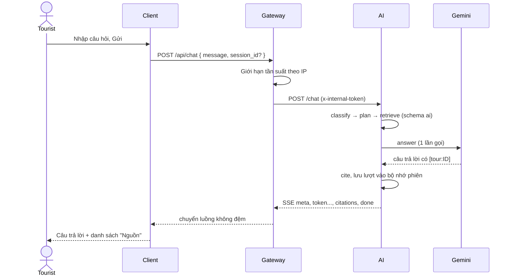

# UC24 – Hỏi đáp với trợ lý du lịch AI (chatbot)

| Trường | Nội dung |
|---|---|
| **Use Case Number** | UC24 |
| **Use Case Name** | Hỏi đáp với trợ lý du lịch AI (chatbot) |
| **Actor(s)** | Khách du lịch (Tourist, khách vãng lai hoặc đã đăng nhập); Hệ thống AI (AI service, Gemini với dự phòng Groq) |
| **Priority** | P1 |
| **Maturity** | Implemented |
| **Summary** | Tourist hỏi bằng tiếng Việt hoặc tiếng Anh về các tour và địa điểm công khai ("tour đi bộ ở Hội An", "quán ăn gần Phố cổ"). AI service tìm trong chỉ mục RAG (vector + đồ thị) chỉ chứa nội dung tour công khai, gọi LLM một lần, rồi trả câu trả lời dạng luồng (SSE) kèm trích dẫn tour / địa điểm để client hiện thành liên kết. Hội thoại được nhớ theo phiên. |

## Basic Course of Events

| # | Actor Action | System Response |
|---|---|---|
| 1 | Tourist bấm nút nổi **"Hỏi trợ lý"** trên các màn có thanh tab, hoặc mở trang `/chat`. *A1* | |
| 2 | | Client kiểm tra chatbot đang bật (một lần mỗi lần tải trang) và tải lịch sử của phiên lưu trong `localStorage` bằng `GET /api/chat/history?session_id=`. *E1, A2* `probeChat()`, `fetchChatHistory()` → `chat_history()` → `ChatService.history()` |
| 3 | | Client hiện lời chào *"Xin chào! Bạn muốn khám phá gì hôm nay?"* và các gợi ý (ví dụ "Gợi ý tour đi bộ ở Hội An"). `ChatView` |
| 4 | Tourist nhập câu hỏi (1–1000 ký tự) hoặc chọn một gợi ý, rồi gửi. *E2* | |
| 5 | | Client gọi `POST /api/chat { message, session_id?, location? }`. `location` {lat, lng} được gửi khi trình duyệt đã cho phép vị trí, hoặc khi câu hỏi nói về vị trí của người dùng ("gần tôi", "quanh đây", "near me"); lúc đó trình duyệt hỏi quyền, từ chối hoặc quá 6 giây thì gửi không kèm vị trí. `locationFor()`, `asksForLocation()`. Gateway áp giới hạn tần suất chat theo IP, thêm `x-internal-token` và chuyển tới AI `/chat`. *E3* `useChat()` → `streamChat()` → `createChatRateLimit()`, `mountChat()` |
| 6 | | AI service chạy một lượt LangGraph: `classify` (ngôn ngữ, ý định) → `plan` → `retrieve` (tìm lai vector + đồ thị, tối đa 5 mục) → `answer` (một lần gọi LLM: Gemini, dự phòng Groq) → `cite` (giữ trích dẫn hợp lệ, bỏ id bịa). *A3, E4* `chat()` → `ChatService.turn()` → `ChatAgent.run()` → `build_graph()` (`classify`, `plan`, `retrieve`, `answer`, `cite`) → `HybridRetriever.search_tours()` / `search_places()` / `nearby_places()`; LLM qua `GuardedChatModel.ainvoke()` |
| 7 | | AI trả luồng SSE: `meta` (`session_id`, `lang`), nhiều `token`, `citations`, `done`. Client hiện câu trả lời dần dần, biến các dấu `[tour:ID]` / `[place:ID]` thành liên kết đánh số và thêm danh sách **"Nguồn"**. *E5* `stream_turn()`, `split_tokens()` → `createSseParser()`, `splitMarkers()` |
| 8 | Tourist bấm một nguồn (tour, hoặc địa điểm có `tour_id`). | Client mở chi tiết tour `/tour/:id` (UC02); nguồn địa điểm mở tour chứa địa điểm đó. `citationHref()`, `rules._citation()` |
| 9 | | Lượt hỏi đáp được lưu vào bộ nhớ phiên; use case kết thúc tại đây. |

## Alternative Path

**A1. Mở toàn màn hình.** Từ bảng chat nổi, Tourist chọn "Mở toàn màn hình" → trang `/chat` với cùng phiên.

**A2. Cuộc trò chuyện mới.** Tourist chọn "Cuộc trò chuyện mới" → client quên `session_id`; lượt hỏi sau tạo phiên mới (server sinh id và trả trong `meta`). `useChat()` `reset()` → `clearChatSession()`

**A3. Câu hỏi ngoài phạm vi hoặc không có dữ liệu.**

| # | Actor Action | System Response |
|---|---|---|
| A3.1 | | Câu hỏi mà bộ phân loại (luật từ khóa) xếp là ngoài phạm vi (ví dụ đặt chỗ, giá, dữ liệu cá nhân) → câu trả lời soạn sẵn theo ngôn ngữ, `finish_reason = refused`, không gọi LLM. |
| A3.2 | | Không tìm thấy tour / địa điểm phù hợp → câu trả lời soạn sẵn, `finish_reason = no_data`, không gọi LLM. |
| A3.3 | | Câu chào hỏi xã giao → trả lời bằng một lần gọi LLM, không truy vấn chỉ mục. |

**A4. Dừng câu trả lời.** Tourist bấm "Dừng" khi đang nhận → client hủy luồng (gateway hủy luôn yêu cầu tới AI); phần đã nhận được giữ, ghi nhãn "Đã dừng". `useChat()` `stop()`, `mountChat()` (`proxyReq.destroy()`)

## Exception Path

- **E1.** Chatbot tắt (`CHATBOT_ENABLED=false`) → `/api/chat` trả 404: nút nổi bị ẩn; trang `/chat` hiện *"Chatbot đang tắt"* và *"Trợ lý tạm thời không hoạt động. Bạn vẫn có thể tìm tour ở màn Khám phá."*. Phiên hết hạn hoặc không tồn tại (404 `unknown session`) → client xóa phiên và bắt đầu trống. `require_chat_enabled()`, `probeChat()`, `ChatLauncher`
- **E2.** Câu hỏi rỗng hoặc quá 1000 ký tự → 422, *"Câu hỏi không hợp lệ. Vui lòng nhập từ 1 đến 1000 ký tự."* (client có bộ đếm ký tự). `ChatRequest._message_limits()`, `errorFromResponse()`
- **E3.** Vượt giới hạn của gateway (5 lượt / phút, 100 lượt / ngày mỗi IP) → 429 kèm `Retry-After`: *"Bạn đã hỏi quá nhiều trong thời gian ngắn, vui lòng thử lại sau …"*. `createChatRateLimit()`, `formatWait()`
- **E4.** AI bận (semaphore dùng chung với kiểm duyệt không còn chỗ hoặc kiểm duyệt đang chờ; hoặc vượt giới hạn Gemini toàn hệ thống mà không có Groq) → 429 kèm `Retry-After`: *"Trợ lý đang bận, vui lòng thử lại sau …"*. Mọi nhà cung cấp LLM đều lỗi → 503: *"Trợ lý tạm thời không phản hồi, vui lòng thử lại sau."*. Nội dung bị nhà cung cấp chặn → câu từ chối lịch sự (`refused`). `GuardedChatModel.ainvoke()` → `ChatBusyError`, `SlidingWindowLimiter.try_acquire()`
- **E5.** Lỗi giữa luồng → sự kiện `error`: *"Trợ lý gặp lỗi khi trả lời, vui lòng thử lại."*; mất kết nối giữa chừng → *"Mất kết nối, câu trả lời chưa đầy đủ."*; không có mạng → *"Không thể kết nối, vui lòng thử lại"*. Có nút "Thử lại". `stream_turn()`, `streamErrorMessage()`

## Extension Points

- UC02 – Tìm kiếm và xem chi tiết tour (mở tour từ trích dẫn).
- UC09 / UC19 – Tour được xuất bản là nguồn dữ liệu của chỉ mục (qua `tour.published`).

## Triggers

Tourist muốn được gợi ý hoặc giải thích về tour, địa điểm bằng ngôn ngữ tự nhiên thay vì tự lọc trên màn Khám phá.

## Assumptions

- Chỉ mục đã có dữ liệu: Tour phát `tour.published` / `tour.unpublished` (cờ `CHATBOT_EVENTS_ENABLED`) và bộ đánh chỉ mục của AI đang chạy (`CHATBOT_INDEXER_ENABLED`).
- Không cần đăng nhập; gateway chưa kiểm JWT cho chat nên giới hạn tính theo IP.

## Preconditions

- `CHATBOT_ENABLED=true` ở gateway và AI service.
- Thiết bị có mạng.

## Post Conditions

- Phiên chat (lượt hỏi, câu trả lời đã làm sạch, trích dẫn, thời điểm) được lưu trong bộ nhớ phiên của AI; `session_id` lưu ở `localStorage` của trình duyệt.
- Không thay đổi dữ liệu tour; không phát sự kiện nào từ lượt chat.

## Reference: Business Rules

| # | Quy tắc |
|---|---|
| R1 | Chỉ mục chỉ chứa tour `public` và các địa điểm của chúng; không có id tác giả, email, đánh giá, lịch trình hay ảnh |
| R2 | Bộ đánh chỉ mục tiêu thụ `tour.published` (bỏ qua nếu `status` khác `public` hoặc `revision` cũ hơn) và `tour.unpublished` / `tour.hidden` (xóa tour, điểm, chunk, cạnh đồ thị) |
| R3 | Tối đa 1 lần gọi LLM mỗi lượt (giới hạn cứng `MAX_LLM_CALLS_PER_TURN = 2`); Gemini `gemini-2.5-flash`, dự phòng Groq chỉ khi timeout, 429, 5xx (chat chỉ có văn bản) |
| R4 | Câu hỏi 1–1000 ký tự (`CHAT_MESSAGE_MAX_CHARS`), được làm sạch như nội dung kiểm duyệt; nội dung truy xuất được coi là dữ liệu, không phải lệnh |
| R5 | Giới hạn gateway: `CHAT_RATE_LIMIT_PER_MIN = 5`, `CHAT_RATE_LIMIT_PER_DAY = 100` mỗi IP (Redis; lỗi Redis thì cho qua); giới hạn toàn hệ thống `CHAT_GLOBAL_RATE_LIMIT_PER_MIN = 2` lượt / phút trên Gemini; vượt mức thì lượt đó chạy trên Groq (nếu có khóa), nếu không thì 429. Kiểm duyệt luôn được ưu tiên: chat không xếp hàng chờ semaphore |
| R6 | Truy xuất lai: 20 chunk hạt giống theo cosine, mở rộng đồ thị 1–2 bước, xếp hạng `0.6 * vector + 0.2 * đồ thị + 0.2 * khớp bộ lọc`, giữ tối đa 5 mục |
| R7 | Trích dẫn: chỉ giữ `[tour:ID]` / `[place:ID]` có trong kết quả truy xuất; id bịa bị xóa khỏi câu trả lời và khỏi lịch sử |
| R8 | Cả lượt chạy xong rồi mới bắt đầu luồng, nên lỗi trước luồng là JSON (422, 429, 503); token được tách theo khoảng trắng nên dấu trích dẫn không bị cắt đôi |
| R9 | Bộ nhớ: gửi cho LLM tối đa `CHAT_MEMORY_TURNS = 6` lượt gần nhất; phiên không hoạt động quá `CHAT_SESSION_TTL_HOURS = 24` giờ bị xóa |
| R10 | Trả lời bằng `vi` hoặc `en` theo ngôn ngữ phát hiện từ câu hỏi |

## Hiện thực trong hệ thống

- **Dịch vụ:**
  - Client: nút nổi và bảng chat, trang `/chat`, đọc luồng SSE, hiện trích dẫn.
  - Gateway: route `/api/chat` (giới hạn tần suất) và `/api/chat/history`, thêm `x-internal-token`, chuyển luồng không đệm.
  - AI: agent LangGraph, truy xuất lai, gọi Gemini / Groq, bộ nhớ phiên, bộ đánh chỉ mục RabbitMQ.
  - Tour: phát `tour.published` / `tour.unpublished` khi tour vào hoặc rời trạng thái `public`.
- **Màn hình (client):** `/chat` (`client/src/features/chat/ChatPage.jsx`); bảng chat nổi trên các màn có thanh tab, trừ `/admin`, `/studio`, `/chat` (`ChatLauncher.jsx`, `ChatView.jsx`, `useChat.js`). API helper `client/src/lib/chat.js`.
- **API (qua gateway):**
  - `POST /api/chat` → `text/event-stream` (sự kiện `meta`, `token`, `citations`, `done`, `error`)
  - `GET /api/chat/history?session_id=` → `{ session_id, messages: [{ role, content, citations?, at }] }`
- **Sự kiện (RabbitMQ):** AI tiêu thụ `tour.published`, `tour.unpublished`, `tour.hidden` (do Tour phát). Đây là ngoại lệ duy nhất AI service nghe RabbitMQ.
- **Dữ liệu:** schema `ai`: `nodes`, `edges`, `chunks` (embedding pgvector 384 chiều, model cục bộ `multilingual-e5-small`), `tour_index`, `index_meta`. Bộ nhớ phiên: `memory` (mặc định) hoặc schema `ai_chat` (`CHAT_MEMORY_BACKEND=postgres`).
- **Mã nguồn chính:**

| Bước | Hàm / lớp | File |
|---|---|---|
| 1, E1 | `ChatLauncher`, `ChatPage` | `client/src/features/chat/ChatLauncher.jsx`, `ChatPage.jsx` |
| 3, 7 | `ChatView` | `client/src/features/chat/ChatView.jsx` |
| 4–7, A2, A4 | `useChat()` | `client/src/features/chat/useChat.js` |
| 2, 5, 7, 8 | `probeChat()`, `fetchChatHistory()`, `locationFor()`, `asksForLocation()`, `streamChat()`, `createSseParser()`, `splitMarkers()`, `citationHref()` | `client/src/lib/chat.js` |
| 5, A4 | `mountChat()` | `gateway/src/chat.js` |
| 5, E3 | `createChatRateLimit()`, `createRedisStore()` | `gateway/src/chat-rate-limit.js` |
| 5–7, E2 | `chat()`, `chat_history()`, `stream_turn()`, `require_chat_enabled()`, `ChatRequest` | `services/ai/app/api/chat.py` |
| 6, 9 | `ChatService.turn()`, `ChatService.history()`, `GuardedChatModel` | `services/ai/app/chatbot/service.py` |
| 6 | `ChatAgent.run()` | `services/ai/app/chatbot/agent.py` |
| 6 | `build_graph()` (nút `classify`, `plan`, `retrieve`, `answer`, `cite`) | `services/ai/app/chatbot/graph/builder.py` |
| 6, 8 | `classify()`, `cite()`, `_citation()` (trích dẫn địa điểm kèm `tour_id`) | `services/ai/app/chatbot/graph/rules.py` |
| 6 | `build_tools()` (`search_tours`, `search_places`, `nearby_places`) | `services/ai/app/chatbot/tools/search.py` |
| 6, R6 | `HybridRetriever` (`search_tours`, `search_places`, `nearby_places`) | `services/ai/app/chatbot/rag/hybrid_retriever.py` |
| E4, R5 | `SlidingWindowLimiter`, `ChatBusyError` | `services/ai/app/chatbot/limits.py` |
| R2 | `start_indexer()`, `IndexEventDispatcher.dispatch()`, `handle_message()` | `services/ai/app/chatbot/rag/consumer.py` |
| R2 | `Indexer.handle_published()`, `Indexer.handle_unpublished()` | `services/ai/app/chatbot/rag/indexer.py` |
| R2 (nguồn) | `notifyTourPublished()`, `notifyTourUnpublished()` | `services/tour/src/application/use-cases/notify-tour-catalog.js` |
| R2 (nguồn) | `EventTourCatalogPublisher.publishTourPublished()`, `publishTourUnpublished()` | `services/tour/src/infrastructure/messaging/event-tour-catalog-publisher.js` |

- **Tài liệu thiết kế:** [chatbot-architecture.md](../../02-design/chatbot-architecture.md).
- **Giới hạn đã biết:**
  - "Luồng" là câu trả lời đầy đủ được tách theo từ sau khi lượt chạy xong, không phải token trực tiếp từ LLM.

## Author(s)

(điền sau)

## Date

Tạo: 2026-11-08 · Cập nhật theo hệ thống: 2026-11-08

## Activity Diagram

[UC24-activity.xml](../../02-design/drawio/activity/UC24-activity.xml) (draw.io: File → Import from → Device). Nguồn: [specs/UC24.json](../../02-design/drawio/activity/specs/UC24.json).

## Sequence Diagram

## Boundary

- Nút nổi **"Hỏi trợ lý"** và bảng chat (bottom sheet trên điện thoại, panel bên trên desktop) trên các màn có thanh tab, ví dụ `/`, `/itineraries`, `/account`.
- Trang chat toàn màn hình `/chat` ("Trợ lý GeoSound").
- Chi tiết tour `/tour/:tourId` (đích của trích dẫn tour).
