# UC25 – Mua tour có phí để tải về (thanh toán MoMo)

| Trường | Nội dung |
|---|---|
| **Use Case Number** | UC25 |
| **Use Case Name** | Mua tour có phí để tải về nghe offline |
| **Actor(s)** | Khách du lịch (Tourist, bất kỳ tài khoản đã đăng nhập); Người đăng nội dung (Contributor, tác giả tour); Cổng thanh toán MoMo (môi trường sandbox cho nhà phát triển) |
| **Priority** | P2 |
| **Maturity** | Implemented |
| **Summary** | Tác giả đặt giá tải về cho tour (0 = miễn phí). Nghe trực tuyến luôn miễn phí; muốn tải tour có phí về máy, khách đăng nhập và trả một lần qua MoMo. Sau khi MoMo xác nhận, khách tải tour như UC03. Tác giả xem số lượt bán và doanh thu ở Studio. |

## Basic Course of Events

| # | Actor Action | System Response |
|---|---|---|
| 1 | Tác giả mở bước Xuất bản (`/studio/tours/:id/publish`), khung **"Giá tải về offline"**, nhập giá và nhấn **"Lưu giá"**. *E1* | |
| 2 | | `PUT /api/tours/mine/:tourId/price { price }`: Tour kiểm giá (0, hoặc số nguyên 1 000 đến 50 000 000 VND), chỉ ghi cột `price`, **không** đổi `updated_at` hay trạng thái tour (không phải gửi duyệt lại). Trả `{ price, paidCount, revenue }`. `TourPricePanel`, `setTourPrice()` → `TourPaymentController.setPrice()` → `SetTourPrice.execute()` → `normalizePrice()`, `PrismaTourRepository.setPrice()` |
| 3 | Khách mở chi tiết một tour công khai có giá (`/tour/:tourId`). | |
| 4 | | Mục tải về được thay bằng khung **"Mua tour để tải về"**: giá, ghi chú "Nghe trực tuyến vẫn miễn phí". Khách đã đăng nhập: client gọi `GET /api/tours/:id/purchase/mine` → `{ price, purchased, owner }`. *A1, A2, A3* `PurchaseGate`, `getMyPurchase()` → `GetMyPurchase.execute()` |
| 5 | Khách nhấn **"Mua với MoMo"**. | |
| 6 | | `POST /api/tours/:id/purchase`: Tour tạo đơn `tour_purchases` (`pending`, `amount` = giá hiện tại, id đơn = `orderId` MoMo), gọi MoMo `POST /v2/gateway/api/create` có chữ ký HMAC SHA256, trả `201 { orderId, payUrl }`. *E2, E3, E4* `startPurchase()` → `StartTourPurchase.execute()` → `MomoClient.createPayment()` |
| 7 | | Trình duyệt chuyển sang trang thanh toán MoMo (`payUrl`). |
| 8 | Khách thanh toán trên trang MoMo (ví MoMo, ATM hoặc thẻ test của sandbox). *A4* | |
| 9 | | MoMo gửi IPN (`POST /api/tours/payments/momo/ipn`) tới Tour. Tour kiểm chữ ký và số tiền, đặt đơn `paid` (lưu `trans_id`, `paid_at`), trả 204. *E5* `HandleMomoIpn.execute()` → `MomoClient.verifyIpn()`, `PrismaTourPurchaseRepository.markPaidIf()` |
| 10 | | MoMo đưa khách về `/payment/momo?orderId=...`. Trang hỏi `GET /api/tours/payments/:orderId` mỗi 2 giây (tối đa 1 phút) cho tới khi đơn hết `pending`; khi đơn còn `pending`, Tour tự hỏi MoMo (`/v2/gateway/api/query`) nên vẫn chạy khi IPN không tới được máy (localhost). `PaymentReturnPage`, `getPaymentStatus()` → `GetPaymentStatus.execute()` → `MomoClient.queryPayment()` |
| 11 | | Đơn `paid`: "Thanh toán thành công", nút **"Về trang tour để tải"**. |
| 12 | Khách về trang tour và tải như UC03. | |
| 13 | | `GET /api/tours/:id/package?lang=` kèm token: Tour kiểm quyền (tác giả, hoặc có đơn `paid`) rồi trả gói như UC03. `fetchTourPackage()` → `GetTourPackage.execute()` → `assertPackageAccess()` |
| 14 | | Use case kết thúc. |

## Alternative Path

**A1. Tour miễn phí (giá 0)** → không có khung mua, mục **"Tải về để nghe offline"** như UC03; client không gọi API mua.

**A2. Chưa đăng nhập** → khung hiện giá và nút **"Đăng nhập để mua"** (`/login?next=/tour/:tourId`); sau khi đăng nhập khách quay lại trang tour.

**A3. Tác giả hoặc khách đã mua** → `purchased: true`: hiện "Tour của bạn" / "Bạn đã mua tour này" và mục tải về bình thường. Đã mua một lần là tải lại được bao nhiêu lần cũng được, kể cả khi tác giả đổi giá.

**A4. Thanh toán thất bại hoặc khách huỷ trên MoMo** → MoMo trả `resultCode` khác 0; đơn thành `failed`; trang `/payment/momo` báo "Thanh toán chưa thành công hoặc đã bị huỷ" và nút **"Quay lại tour"**. Khách có thể mua lại (đơn mới). Nếu MoMo báo thành công muộn sau khi đơn đã `failed`, đơn vẫn chuyển sang `paid`.

**A5. MoMo chưa xác nhận sau 1 phút** → trang báo "MoMo chưa xác nhận thanh toán" với nút **"Kiểm tra lại"**.

**A6. Lịch trình (UC07, UC08) có điểm thuộc tour có phí** → tải gói lịch trình bị từ chối 402 cho tới khi chủ lịch trình mua các tour đó. `GetItineraryPackage.execute()` → `PrismaTourPurchaseRepository.lockedTourIds()`

## Exception Path

- **E1.** Giá không hợp lệ (âm, lẻ, dưới 1 000 hoặc trên 50 000 000) → 400 `validation_error` (client kiểm cùng quy tắc trước khi gửi). Không phải tác giả → 403 `not_tour_owner`. `validatePrice()`, `normalizePrice()`
- **E2.** Tour miễn phí → 400 `tour_free`; tác giả tự mua tour của mình → 400 `own_tour`; tour không còn công khai → 404.
- **E3.** Đã mua rồi → 409 `already_purchased`; client tải lại trạng thái và hiện mục tải về.
- **E4.** Máy chủ chưa cấu hình khóa MoMo, hoặc MoMo từ chối / không phản hồi → 503 `payment_unavailable` ("Thanh toán đang tạm ngưng, vui lòng thử lại sau"); đơn vừa tạo được đánh dấu `failed`.
- **E5.** IPN sai chữ ký, sai `partnerCode` hoặc sai số tiền → 400 `invalid_signature`, đơn không đổi; đơn không tồn tại → 404.
- **E6.** Tải gói tour có phí khi chưa đăng nhập → 401 `login_required`; đã đăng nhập nhưng chưa mua → 402 `payment_required`.

## Extension Points

- UC03 – Tải tour về nghe offline (sau khi mua); UC09 – Quản lý tour (đặt giá ở Studio); UC07/UC08 – Lịch trình (gói offline kiểm quyền mua).

## Triggers

Khách muốn nghe một tour có phí khi không có mạng.

## Assumptions

- Dùng môi trường **MoMo developer sandbox** (`https://test-payment.momo.vn`), không có tiền thật. Khóa `MOMO_PARTNER_CODE`, `MOMO_ACCESS_KEY`, `MOMO_SECRET_KEY` nằm trong `.env` của máy chủ.
- Để MoMo gửi được IPN, `PAYMENT_RETURN_URL` / `MOMO_IPN_URL` phải là địa chỉ công khai (ví dụ ngrok); chạy localhost thì bước 10 (hỏi MoMo) thay cho IPN.

## Preconditions

- Tour ở `public` và có giá > 0. Khách đăng nhập (role bất kỳ).

## Post Conditions

- Một dòng `tour.tour_purchases` ở `paid` cho cặp (tour, khách); khách tải được gói offline của tour. Tác giả thấy thêm một lượt bán và doanh thu ở Studio.

## Reference: Business Rules

- Chỉ **gói offline** của tour có phí cần mua; xem chi tiết và nghe trực tuyến vẫn miễn phí.
- Giá là số nguyên VND: 0 (miễn phí) hoặc 1 000 đến 50 000 000 (giới hạn của MoMo). Đổi giá không đưa tour về Nháp, không gửi kiểm duyệt.
- Tác giả luôn tải được tour của mình; bản thử truy cập hạn chế (UC14) không cần mua.
- Số tiền của đơn là giá tại lúc mua; IPN và kết quả hỏi MoMo phải khớp số tiền này.
- Trạng thái đơn chỉ đi `pending → paid | failed` và `failed → paid` (thành công muộn); `paid` không bao giờ quay lại.
- Không có hoàn tiền, chi trả cho tác giả hay sự kiện / thông báo khi bán (ngoài phạm vi đợt này).

## Hiện thực trong hệ thống

- **Dịch vụ:** Client (khung mua, trang kết quả, khung giá Studio); Tour (giá, đơn mua, chữ ký MoMo, kiểm quyền gói offline; `verifyJwt` dùng chung từ `shared/middleware`); MoMo sandbox (bên ngoài).
- **Màn hình (client):** khung **"Mua tour để tải về"** trong `/tour/:tourId` (`features/payment/PurchaseGate.jsx`); `/payment/momo` (`features/payment/PaymentReturnPage.jsx`); khung **"Giá tải về offline"** ở `/studio/tours/:id/publish` (`features/studio/TourPricePanel.jsx`); API `client/src/lib/payment.js`.
- **API (qua gateway):**
  - Tác giả: `GET|PUT /api/tours/mine/:tourId/price`
  - Khách: `POST /api/tours/:id/purchase`, `GET /api/tours/:id/purchase/mine`, `GET /api/tours/:id/package?lang=` (kèm token khi đã đăng nhập)
  - Công khai: `GET /api/tours/payments/:orderId`, `POST /api/tours/payments/momo/ipn` (MoMo gọi, kiểm chữ ký)
- **Sự kiện:** không có.
- **Dữ liệu:** `tour.tours.price` (int, mặc định 0); `tour.tour_purchases` (`id` = orderId, `tour_id`, `user_id`, `amount`, `status`, `provider`, `trans_id`, `result_code`, `created_at`, `paid_at`; index `tour_id, user_id, status` và `user_id`). Migration `services/tour/prisma/migrations/20261118000000_tour_purchases`.
- **Tài liệu thiết kế:** [uc25-tour-payment.md](../../02-design/uc25-tour-payment.md), [offline-download.md](../../02-design/offline-download.md).
- **Mã nguồn chính:**

| Bước | Hàm / lớp | File |
|---|---|---|
| 1–2 | `TourPricePanel` | `client/src/features/studio/TourPricePanel.jsx` |
| 3–7, A1–A3 | `PurchaseGate` | `client/src/features/payment/PurchaseGate.jsx` |
| 10–11, A4, A5 | `PaymentReturnPage` | `client/src/features/payment/PaymentReturnPage.jsx` |
| 2–10 | `getTourPrice()`, `setTourPrice()`, `startPurchase()`, `getMyPurchase()`, `getPaymentStatus()`, `validatePrice()`, `formatVnd()` | `client/src/lib/payment.js` |
| 13 | `fetchTourPackage()` | `client/src/lib/offline-download.js` |
| 2–10 | `buildTourPaymentRouter()`, `TourPaymentController` | `services/tour/src/interfaces/http/routes/tour-payment-routes.js`, `controllers/tour-payment-controller.js` |
| 2, 6, 10 | `setPriceSchema`, `buyTourParamSchema`, `orderParamSchema` | `services/tour/src/application/dtos/payment-schemas.js` |
| 2–13 | `GetTourPrice`, `SetTourPrice`, `StartTourPurchase`, `GetMyPurchase`, `GetPaymentStatus`, `HandleMomoIpn`, `assertPackageAccess()` | `services/tour/src/application/use-cases/tour-payment.js` |
| 13, E6 | `GetTourPackage.execute()` | `services/tour/src/application/use-cases/get-tour-package.js` |
| A6 | `GetItineraryPackage.execute()` | `services/tour/src/application/use-cases/get-itinerary-package.js` |
| 2, 9 | `normalizePrice()`, `momoResultStatus()`, `PURCHASE_STATUS` | `services/tour/src/domain/tour/tour-price.js` |
| 6, 9, 10 | `MomoClient` (`createPayment`, `queryPayment`, `verifyIpn`, `fromEnv`) | `services/tour/src/infrastructure/payment/momo-client.js` |
| 2–13 | `PrismaTourPurchaseRepository` (`create`, `hasPaid`, `markPaidIf`, `markFailedIf`, `lockedTourIds`, `salesOf`), `PrismaTourRepository.setPrice()` | `services/tour/src/infrastructure/persistence/prisma-tour-purchase-repository.js`, `prisma-tour-repository.js` |

## Author(s)

(điền sau)

## Date

Tạo: 2026-11-18

## Sequence Diagram

```mermaid
sequenceDiagram
    actor K as Khách
    participant Client
    participant Gateway
    participant Tour
    participant MoMo
    K->>Client: "Mua với MoMo"
    Client->>Gateway: POST /api/tours/:id/purchase
    Gateway->>Tour: POST /:id/purchase
    Tour->>Tour: tạo đơn pending (amount = giá)
    Tour->>MoMo: POST /v2/gateway/api/create (chữ ký HMAC)
    MoMo-->>Tour: { payUrl }
    Tour-->>Client: 201 { orderId, payUrl }
    Client->>MoMo: chuyển trang tới payUrl
    K->>MoMo: Thanh toán
    MoMo->>Tour: IPN (khi có địa chỉ công khai): kiểm chữ ký, đơn = paid
    MoMo-->>Client: chuyển về /payment/momo?orderId=
    loop mỗi 2 giây khi còn pending
        Client->>Gateway: GET /api/tours/payments/:orderId
        Gateway->>Tour: GET /payments/:orderId
        Tour->>MoMo: POST /v2/gateway/api/query (nếu còn pending)
        Tour-->>Client: { status }
    end
    K->>Client: "Về trang tour để tải"
    Client->>Gateway: GET /api/tours/:id/package (kèm token)
    Gateway->>Tour: GET /:id/package
    Tour->>Tour: assertPackageAccess (tác giả hoặc đã mua)
    Tour-->>Client: gói offline (UC03)
```

## Boundary

Khung "Mua tour để tải về" trong chi tiết tour (`/tour/:tourId`); Trang thanh toán của MoMo (bên ngoài); Trang kết quả (`/payment/momo`); Khung "Giá tải về offline" ở bước Xuất bản (`/studio/tours/:id/publish`).
