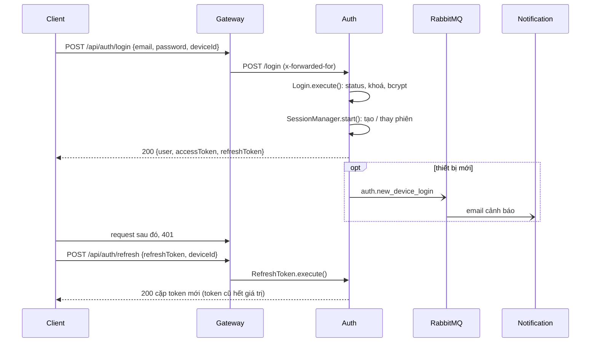

# UC01 – Xác thực tài khoản (Đăng ký / Đăng nhập)

| Trường | Nội dung |
|---|---|
| **Use Case Number** | UC01 |
| **Use Case Name** | Xác thực tài khoản (Đăng ký / Đăng nhập) |
| **Actor(s)** | Khách du lịch (Tourist), Người đăng nội dung (Contributor), Admin |
| **Priority** | P0 |
| **Maturity** | Implemented |
| **Summary** | Người dùng đăng ký tài khoản mới bằng **email** và mã OTP 6 số gửi qua email, hoặc đăng nhập tài khoản đã có. Auth cấp access token (JWT, 15 phút) và refresh token (7 ngày, xoay vòng mỗi lần làm mới) gắn với một phiên thiết bị (UC23). Người dùng có thể quên / đặt lại mật khẩu bằng OTP. Vai trò tự đăng ký: `tourist` hoặc `contributor`; tài khoản `admin` do nhóm tạo tay. |

## Basic Course of Events *(Đăng nhập)*

| # | Actor Action | System Response |
|---|---|---|
| 1 | Người dùng mở **"Đăng nhập"** (`/login`), hoặc bị chuyển tới đây từ một màn cần đăng nhập (`?next=`). Chưa có tài khoản → *A1*. | |
| 2 | | Client hiển thị form: Email, Mật khẩu, link "Quên mật khẩu". `LoginPage` |
| 3 | Người dùng nhập email, mật khẩu và nhấn **"Đăng nhập"**. *E1* | |
| 4 | | Client gửi `POST /api/auth/login` kèm `deviceId` ngẫu nhiên lưu trên máy. `login()` (`lib/auth.js`), `getDeviceId()` |
| 5 | | Auth chuẩn hoá email, kiểm tra trạng thái tài khoản và mật khẩu (bcrypt). *E2, E3, E4* `AuthController.login()` → `Login.execute()`, `BcryptHasher.compare()` |
| 6 | | Auth tạo (hoặc thay) phiên thiết bị trong bảng `sessions`, trả `{ user, accessToken, refreshToken }`; token mang `sid` của phiên. Thiết bị mới → phát `auth.new_device_login` (*UC23 A4*). `SessionManager.start()`, `JwtTokenService.issueTokens()` |
| 7 | | Client lưu phiên và điều hướng: có `?next=` → quay lại đó; Contributor → `/studio`; Tourist / Admin → `/` (Khám phá). `writeAuth()`, `destinationFor()` |
| 8 | | Use case kết thúc tại đây. |

## Alternative Path

**A1. Đăng ký (người dùng mới).**

| # | Actor Action | System Response |
|---|---|---|
| A1.1 | Người dùng chọn **"Đăng ký"** (`/register` hoặc tab Đăng ký ở `/login`). | |
| A1.2 | | Client hỏi vai trò (Khách du lịch / Tác giả), rồi hiện form: Họ tên, Email, Mật khẩu. `RegisterPage` |
| A1.3 | Người dùng nhập thông tin và nhấn tiếp tục. *E5, E6, E7* | |
| A1.4 | | Auth (`POST /api/auth/register`) kiểm tra email chưa tồn tại, băm mật khẩu, giữ thông tin đăng ký tạm trong Redis (TTL = thời hạn OTP) và gửi OTP 6 số qua email. **Chưa tạo tài khoản ở bước này.** `RegisterUser.execute()`, `RedisChallengeStore.save()`, `NodemailerMailer.sendOtp()` |
| A1.5 | Người dùng nhập OTP (client đếm ngược thời hạn còn lại). *A3* | |
| A1.6 | | Auth (`POST /api/auth/verify-otp`) so mã, tạo `users` và xoá dữ liệu tạm. *E8, E9* `VerifyRegistrationOtp.execute()`, `PrismaUserRepository.create()` |
| A1.7 | | Ở `/register`: client hiện *"Đăng ký thành công!"* và nút **Đăng nhập** (quay về bước 1). Ở tab Đăng ký của `/login`: client đăng nhập luôn rồi điều hướng như bước 7. `verifyOtp()`, `registerAndVerify()` |

**A2. Quên mật khẩu.**

| # | Actor Action | System Response |
|---|---|---|
| A2.1 | Người dùng chọn "Quên mật khẩu" (`/forgot-password`), nhập email. | |
| A2.2 | | Auth (`POST /api/auth/forgot-password`) luôn trả cùng một câu trả lời (không lộ email có tồn tại hay không); chỉ gửi OTP khi tài khoản có thật và chưa bị cấm. `ForgotPassword.execute()` |
| A2.3 | Người dùng nhập OTP và mật khẩu mới. *E6, E8, E9* | |
| A2.4 | | Auth (`POST /api/auth/reset-password`) đổi mật khẩu, gỡ tạm khoá đăng nhập và **đăng xuất mọi thiết bị** của tài khoản (lý do `password_reset`, UC23). Client quay về `/login` (endpoint không cấp token). `ResetPassword.execute()`, `SessionManager.revokeAll()` |

**A3. Gửi lại OTP.** Người dùng nhấn "Gửi lại mã OTP" (client chờ 30 giây giữa hai lần). Auth (`POST /api/auth/resend-otp`, `purpose` = `register` hoặc `reset`) sinh mã mới và gia hạn thêm 120 giây, chỉ khi phiên xác thực còn tồn tại (*E9*). `resendOtp()` → `ResendOtp.execute()`

**A4. Làm mới phiên (ngầm).** Khi một request cần đăng nhập nhận 401, client gọi `POST /api/auth/refresh` một lần (khoá giữa các tab), nhận cặp token mới rồi gọi lại request. Refresh token cũ hết giá trị (xoay vòng). Phiên đã kết thúc → `401 session_revoked`, client xoá token và đưa về `/login` với thông báo *"Phiên đăng nhập đã kết thúc trên thiết bị này"*. `refreshTokens()` (`lib/api.js`) → `RefreshToken.execute()`; `onSessionEnded()` → `SessionWatcher`

**A5. Đổi mật khẩu khi đang đăng nhập.** `POST /api/auth/change-password` (`currentPassword`, `newPassword`): sai mật khẩu hiện tại → `400 wrong_password`; mật khẩu mới phải khác mật khẩu cũ; thành công → đăng xuất mọi thiết bị khác, thiết bị hiện tại giữ nguyên (UC23). `ChangePassword.execute()`

**A6. Đăng xuất.** Nút "Đăng xuất" ở `/account` gọi `POST /api/auth/logout` (kết thúc phiên hiện tại) và xoá token trên máy. `logout()` (`lib/auth.js`) → `Logout.execute()`

## Exception Path

- **E1.** Bỏ trống trường → `400 validation_error` với thông báo theo trường (*"Vui lòng nhập email"*, *"Vui lòng nhập mật khẩu"*). `loginSchema`, `registerSchema` (zod)
- **E2.** Email hoặc mật khẩu sai → `401 invalid_credentials` *"Email hoặc mật khẩu không đúng"* (không cho biết email có tồn tại không). Sai 5 lần liên tiếp → `423 account_locked` *"Tài khoản tạm khóa do đăng nhập sai nhiều lần, vui lòng thử lại sau"* trong 15 phút; client gợi ý "Đặt lại mật khẩu". `InvalidCredentialsError`, `AccountLockedError`
- **E3.** Tài khoản bị cấm (UC21) → `403 account_banned` *"Tài khoản đã bị khóa, vui lòng liên hệ Admin"*. `AccountBannedError`
- **E4.** Tài khoản bị tạm khoá có thời hạn (UC21) → `403 account_suspended` *"Tài khoản đang bị tạm khoá đến <giờ ngày>"*. `AccountSuspendedError`
- **E5.** Email sai định dạng → `400` *"Email không hợp lệ"*. `Email` (value object)
- **E6.** Mật khẩu dưới 8 ký tự hoặc thiếu chữ/số → `400` *"Mật khẩu phải có tối thiểu 8 ký tự"* / *"Mật khẩu phải gồm cả chữ và số"*. `Password` (value object)
- **E7.** Email đã có tài khoản → `409 email_exists` *"Tài khoản đã được đăng ký"*. `EmailAlreadyExistsError`
- **E8.** OTP sai → `400 invalid_otp` *"OTP không hợp lệ, vui lòng thử lại"*. `InvalidOtpError`
- **E9.** Quá 120 giây (phiên xác thực trong Redis đã hết) → `410 challenge_expired` *"Phiên xác thực đã hết hạn, vui lòng thực hiện lại"*. `ChallengeNotFoundError`

## Extension Points

- UC23 – Quản lý thiết bị đăng nhập (mỗi lần đăng nhập tạo phiên; đặt lại / đổi mật khẩu đăng xuất thiết bị).
- Các use case theo vai trò sau khi đăng nhập: UC07, UC09, UC16, UC18, UC19 ... UC22.

## Triggers

Người dùng muốn dùng tính năng cần tài khoản (lịch trình, Studio, thông báo, quản trị) hoặc bị chuyển tới `/login` từ một màn được bảo vệ.

## Assumptions

- Người dùng có hộp thư email nhận được OTP. Không có đăng ký bằng số điện thoại / SMS.
- Khi môi trường chưa cấu hình SMTP (dev), Auth in OTP ra log (`ConsoleMailer`) thay vì gửi email.

## Preconditions

- Đăng nhập: tài khoản tồn tại, không bị cấm / tạm khoá.
- Đăng ký: chưa có tài khoản với email đó.

## Post Conditions

- Đăng ký: có dòng mới trong `app_auth.users` (`role` = `tourist` hoặc `contributor`, `status` = `active`).
- Đăng nhập: có một dòng `sessions` còn hiệu lực; client giữ access token + refresh token; bộ đếm sai mật khẩu được xoá.
- Đặt lại mật khẩu: `password_hash` mới, mọi phiên của tài khoản bị thu hồi.

## Reference: Business Rules

| Quy tắc | Giá trị (mặc định) |
|---|---|
| Một email = một tài khoản; email được trim + chữ thường | `users.email` unique |
| Mật khẩu | ≥ 8 ký tự, có cả chữ và số; lưu bcrypt (`BCRYPT_ROUNDS` 10) |
| OTP | 6 chữ số, hiệu lực 120 giây (`OTP_TTL_SECONDS`); client chờ 30 giây giữa hai lần gửi lại |
| Khoá do sai mật khẩu | 5 lần (`LOGIN_MAX_ATTEMPTS`), 15 phút (`LOGIN_LOCK_MINUTES`) |
| Access token / refresh token | 15 phút (`JWT_ACCESS_TTL`) / 7 ngày (`JWT_REFRESH_TTL`); refresh token xoay vòng, dùng lại token cũ = đăng xuất phiên đó (UC23) |
| Vai trò tự đăng ký | `tourist`, `contributor`; `admin` chỉ tạo tay trong cơ sở dữ liệu |
| Tài khoản không bắt buộc | Khách xem / tải / nghe tour không cần đăng nhập |

## Hiện thực trong hệ thống

- **Dịch vụ:**
  - Client: form đăng nhập / đăng ký / quên mật khẩu, lưu token, tự refresh khi 401 (`lib/api.js`).
  - Gateway: chuyển `/api/auth/*` tới Auth và thêm `x-forwarded-for` (IP cho phiên thiết bị).
  - Auth: kiểm tra dữ liệu, OTP trong Redis, tạo user, cấp JWT, quản lý phiên; **gửi email OTP trực tiếp** bằng Nodemailer (SMTP) hoặc in ra log khi chưa có SMTP.
- **Màn hình (client):** `/login`, `/register`, `/forgot-password`, nút Đăng xuất ở `/account` (`client/src/features/auth/`, `features/account/AccountPage.jsx`).
- **API (qua gateway):**
  - `POST /api/auth/register`, `POST /api/auth/verify-otp`, `POST /api/auth/resend-otp`
  - `POST /api/auth/login`, `POST /api/auth/refresh`, `POST /api/auth/logout`
  - `POST /api/auth/forgot-password`, `POST /api/auth/reset-password`, `POST /api/auth/change-password`
- **Sự kiện (RabbitMQ):** Auth phát `auth.new_device_login` khi đăng nhập trên thiết bị mới (Notification gửi email cảnh báo, UC23). Không có sự kiện cho OTP.
- **Dữ liệu:** `app_auth.users` (`email`, `password_hash`, `full_name`, `role`, `status`, `failed_attempts`, `locked_until`), `app_auth.sessions`; OTP và đăng ký tạm nằm trong Redis (không có bảng OTP).
- **Mã nguồn chính:**

| Bước | Hàm / lớp | File |
|---|---|---|
| 2, A1.2 | `LoginPage`, `RegisterPage`, `ForgotPasswordPage` | `client/src/features/auth/*.jsx` |
| 4, A1, A3 | `login()`, `register()`, `verifyOtp()`, `resendOtp()`, `registerAndVerify()`, `logout()` | `client/src/lib/auth.js` |
| 4 | `getDeviceId()` | `client/src/lib/device-id.js` |
| 7 | `destinationFor()` | `client/src/features/auth/redirect.js` |
| A4 | `refreshTokens()`, `request()` | `client/src/lib/api.js` |
| A4 | `writeAuth()`, `endSession()`, `onSessionEnded()` | `client/src/lib/token-store.js` |
| Route | `buildAuthRouter()` | `services/auth/src/interfaces/http/routes/auth-routes.js` |
| Controller | `AuthController.login()`, `.register()`, `.verifyOtp()`, `.refresh()` ... | `services/auth/src/interfaces/http/controllers/auth-controller.js` |
| 5 | `Login.execute()` | `services/auth/src/application/use-cases/login.js` |
| A1.4 | `RegisterUser.execute()` | `services/auth/src/application/use-cases/register-user.js` |
| A1.6 | `VerifyRegistrationOtp.execute()` | `services/auth/src/application/use-cases/verify-registration-otp.js` |
| A2 | `ForgotPassword.execute()`, `ResetPassword.execute()` | `services/auth/src/application/use-cases/forgot-password.js`, `reset-password.js` |
| A4 | `RefreshToken.execute()` | `services/auth/src/application/use-cases/refresh-token.js` |
| A5 | `ChangePassword.execute()` | `services/auth/src/application/use-cases/change-password.js` |
| 6 | `SessionManager.start()` | `services/auth/src/application/services/session-manager.js` |
| 6 | `JwtTokenService.issueTokens()`, `.verifyRefresh()` | `services/auth/src/infrastructure/security/jwt-token-service.js` |
| A1.4 | `RedisChallengeStore.save()`, `.get()`, `.delete()` | `services/auth/src/infrastructure/cache/redis-challenge-store.js` |
| A1.4 | `NodemailerMailer.sendOtp()`, `ConsoleMailer.sendOtp()` | `services/auth/src/infrastructure/mail/nodemailer-mailer.js`, `console-mailer.js` |
| 5, A1.6 | `PrismaUserRepository.findByEmail()`, `.create()`, `.save()` | `services/auth/src/infrastructure/persistence/prisma-user-repository.js` |
| E5, E6 | `Email`, `Password` | `services/auth/src/domain/value-objects/email.js`, `password.js` |

- **Tài liệu thiết kế:** [notification-otp-design.md](../../02-design/notification-otp-design.md), [device-sessions.md](../../02-design/device-sessions.md).
- **Giới hạn đã biết:**
  - Mẫu email OTP HTML của Notification (`send-otp-email.js`) chưa được nối với Auth; Auth gửi email văn bản thuần.
  - API đổi mật khẩu (A5) đã có nhưng client chưa có màn hình đổi mật khẩu.

## Author(s)

(điền sau)

## Date

Tạo: 2026-10-18 · Cập nhật theo hệ thống: 2026-11-08

## Activity Diagram

(bổ sung sau)

## Sequence Diagram

## Boundary

- Màn Đăng nhập `/login` (tab Đăng nhập / Đăng ký, thông báo phiên đã kết thúc).
- Màn Đăng ký `/register` (3 bước: Vai trò, Thông tin, Xác thực OTP, màn "Đăng ký thành công").
- Màn Quên mật khẩu `/forgot-password` (nhập email, nhập OTP + mật khẩu mới).
- Màn Tài khoản `/account` (nút Đăng xuất).
