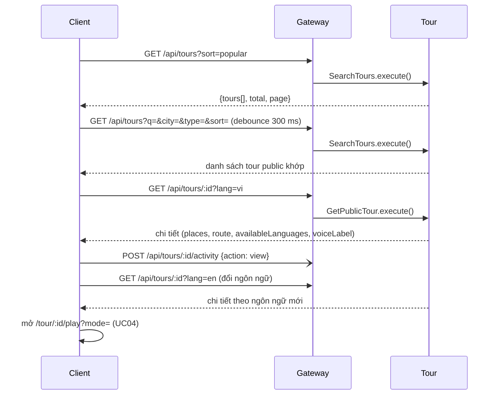

# UC02 – Tìm và xem tour

| Trường | Nội dung |
|---|---|
| **Use Case Number** | UC02 |
| **Use Case Name** | Tìm và xem tour |
| **Actor(s)** | Khách du lịch (Tourist), không cần đăng nhập |
| **Priority** | P0 |
| **Maturity** | Implemented |
| **Summary** | Màn **Khám phá** (`/`) cho khách tìm tour công khai theo từ khoá, thành phố, ngôn ngữ, loại tour và sắp xếp (phổ biến, đánh giá cao, mới nhất, gần tôi), xem dạng danh sách hoặc bản đồ; tab **Địa điểm** tìm các điểm dừng lẻ. Khách mở **chi tiết tour** (ảnh, mô tả, số điểm, thời lượng, route trên bản đồ, đánh giá, nhãn giọng, tác giả), chọn ngôn ngữ nghe rồi nghe thử, bắt đầu đi tour (UC04) hoặc tải offline (UC03). |

## Basic Course of Events

| # | Actor Action | System Response |
|---|---|---|
| 1 | Tourist mở app (màn **Khám phá** `/`). | |
| 2 | | Client hiện ô tìm kiếm, chuyển tab [Tour \| Địa điểm], chip thành phố, mục "Gần bạn" (nếu đã có quyền vị trí), "Mở gần đây" (lưu trên máy) và danh sách **Phổ biến** (`GET /api/tours?sort=popular`). `DiscoverPage`, `searchTours()` |
| 3 | Tourist gõ từ khoá / chọn thành phố / mở "Lọc" để chọn ngôn ngữ, loại tour. *A1, A2* | |
| 4 | | Client tự tìm sau 300 ms (không cần nút "Tìm"), gọi `GET /api/tours?q=&city=&language=&type=&sort=`; toàn bộ tiêu chí nằm trên URL. `useDebounced()`, `searchTours()` |
| 5 | | Tour trả danh sách tour **`public`** khớp: ảnh bìa, tên, thành phố, loại, thời lượng, số điểm, điểm đánh giá, nhãn giọng (`human` / `tts`), tác giả. *E1, E2* `PublicTourController.search()` → `SearchTours.execute()`, `PrismaTourRepository.searchPublicPage()`, `voiceLabelFor()` |
| 6 | Tourist chọn một tour. | |
| 7 | | Client mở `/tour/:id`, gọi `GET /api/tours/:id?lang=`; hiển thị ảnh bìa, mô tả, số điểm, thời lượng, bản đồ route + điểm dừng, điểm đánh giá, nhãn giọng, link trang tác giả (UC18) và phần đánh giá (UC05). Client gửi beacon thống kê `view` (UC17). *E3* `fetchTourDetail()`, `PublicTourController.detail()` → `GetPublicTour.execute()` → `buildTourDetailView()`; `recordTourActivity()` |
| 8 | Tourist chọn **ngôn ngữ** nghe. *A3* | |
| 9 | | Tour trả lại chi tiết theo ngôn ngữ đó: text từng điểm, audio và nhãn giọng mới. `buildTourDetailView()`, `resolveVoiceLabel()` |
| 10 | Tourist chọn **"Nghe thử"** hoặc **"Bắt đầu đi tour"** ở thanh hành động dưới. *A4, A5* | |
| 11 | | Client mở trình phát `/tour/:id/play?mode=remote\|gps&lang=` (UC04). `ModePicker` |
| 12 | | Use case kết thúc tại đây. |

## Alternative Path

**A1. Sắp xếp.** Tourist chọn chip *Phổ biến* (mặc định), *Đánh giá cao*, *Mới nhất* hoặc *Gần tôi*. *Gần tôi* xin quyền vị trí rồi gửi `lat`, `lng`; Tour xếp theo khoảng cách từ người dùng tới điểm đầu của tour. Quay về bước 5. `useCoords()`; `PrismaTourRepository.orderBy()`, `PrismaTourRepository.listPublicIds()` + `PrismaPlaceRepository.anchorsByTours()` + `haversineMeters()`

**A2. Xem dạng bản đồ.** Tourist chuyển sang *Bản đồ* (`?view=map`): tour được ghim tại điểm xuất phát (`anchor`), địa điểm ghim tại chỗ. Chạm ghim để mở chi tiết. `DiscoverMap`

**A3. Đổi ngôn ngữ nghe.** Chỉ ngôn ngữ mà **mọi điểm** đã có bản dịch mới được chọn (`availableLanguages`); ngôn ngữ chưa dịch xong nằm ở `pendingLanguages`. Quay về bước 9. `splitLanguagesByReadiness()`

**A4. Tab Địa điểm.** Tourist chuyển sang tab *Địa điểm*: client gọi `GET /api/places?q=&city=&type=&lat=&lng=`; chạm thẻ mở sheet chi tiết (mô tả, ảnh, nghe thử), nút "＋" thêm điểm vào lịch trình (UC07, cần đăng nhập). `explorePlaces()` → `ExploreController.places()` → `ExplorePlaces.execute()`, `PrismaPlaceRepository.searchPublicPlaces()`; `PlaceDetailSheet`, `addItem()`

**A5. Hành động khác ở chi tiết tour.**
- Nghe thử một điểm (▶) ngay trong danh sách điểm; chạm điểm → mở trình phát tại điểm đó (`?stop=`).
- "Tải về để nghe offline" → UC03 (`OfflineDownload`).
- "Báo cáo" → UC06 (`ReportTour`); đánh giá → UC05 (`RatingsSection`); tên tác giả → UC18 (`/authors/:id`).

## Exception Path

- **E1.** Không có kết quả → *"Không tìm thấy tour phù hợp"* (hoặc *"... địa điểm ..."*), gợi ý *"Thử từ khoá khác, bỏ bớt bộ lọc, hoặc dùng “Gần tôi”"* và nút *"Xoá tìm kiếm & bộ lọc"*. `Empty` (`DiscoverPage.jsx`)
- **E2.** Mất mạng → *"Mất kết nối mạng"*; tour đã tải vẫn mở được ở `/offline` (UC03).
- **E3.** Tour không còn công khai (nháp, ẩn, hạn chế, đã xoá) → `404` *"Tour không còn khả dụng"*, nút quay lại danh sách. Mã tour sai định dạng → `400`. `PrismaTourRepository.findPublicById()`, `TourNotFoundError`, `detailParamSchema`
- **E4.** Chọn *Gần tôi* nhưng không có / từ chối quyền vị trí → không sắp theo khoảng cách; thiếu `lat`, `lng` thì Tour trả `400` *"Sắp xếp \"gần tôi\" cần vị trí (lat, lng)"*. `searchQuerySchema`

## Extension Points

- UC03 – Quản lý tour offline; UC04 – Nghe tour; UC05 – Đánh giá; UC06 – Báo cáo tour; UC07 – Lịch trình cá nhân (tab Địa điểm); UC18 – Trang tác giả.

## Triggers

Tourist muốn tìm tour hoặc địa điểm tại nơi mình đến.

## Assumptions

- Có mạng khi tìm / xem tour online. Vị trí chỉ cần cho "Gần bạn" / "Gần tôi".

## Preconditions

- Có ít nhất một tour ở trạng thái `public`. Không cần đăng nhập.

## Post Conditions

- Tourist đã xem chi tiết tour với ngôn ngữ chọn; có thể nghe (UC04) hoặc tải (UC03). Một beacon `view` được ghi vào thống kê tour (UC17, có lọc trùng theo ngày).

## Reference: Business Rules

| Quy tắc | Giá trị |
|---|---|
| Chỉ hiển thị tour `public` | `draft`, `ai_checking`, `ai_warning`, `pending_review`, `rejected`, `changes_requested`, `restricted`, `hidden` không xuất hiện |
| Từ khoá | Tìm trong tên và mô tả, không phân biệt hoa thường, tối đa 200 ký tự |
| Thành phố | So khớp đúng tên (không phân biệt hoa thường) |
| Loại tour | `walking`, `driving`, `cycling`, `indoor` |
| Sắp xếp `popular` | Số lượt đánh giá, rồi điểm trung bình, rồi mới nhất |
| Phân trang | `limit` tối đa 50 (client dùng 12) |
| Nhãn giọng | `human` khi ngôn ngữ chọn = ngôn ngữ gốc và có audio người thật; còn lại `tts` (máy đọc bằng giọng của thiết bị) |
| Route chưa cấu hình | Tour tự sinh route và vùng kích hoạt tròn 50 m cho mỗi điểm |

## Hiện thực trong hệ thống

- **Dịch vụ:**
  - Client: màn Khám phá và chi tiết tour, debounce 300 ms, lưu tiêu chí trên URL.
  - Gateway: `/api/tours` và `/api/places` → Tour.
  - Tour: tìm kiếm, chi tiết, khám phá địa điểm (không cần JWT).
- **Màn hình (client):** `/` (`features/discover/DiscoverPage.jsx`, `DiscoverMap.jsx`, `PlaceDetailSheet.jsx`), `/tour/:tourId` (`features/tours/TourDetailPage.jsx`); `/tours` và `/explore` chuyển hướng về `/`.
- **API (qua gateway):**
  - `GET /api/tours?q=&city=&language=&type=&authorId=&sort=&lat=&lng=&page=&limit=`
  - `GET /api/tours/:id?lang=`
  - `GET /api/places?q=&city=&type=&lat=&lng=&page=&pageSize=`
  - `POST /api/tours/:id/activity` (beacon `view`, UC17)
- **Dữ liệu:** `tours` (`status`, `city`, `type`, `original_language`, `duration`, `average_rating`, `rating_count`), `places` (`images`, `audio_url`, `audio_source`), `route_configs`, `tour_languages`, `place_translations`.
- **Mã nguồn chính:**

| Bước | Hàm / lớp | File |
|---|---|---|
| 2–5 | `DiscoverPage`, `useDebounced()`, `useCoords()`, `Empty` | `client/src/features/discover/DiscoverPage.jsx` |
| 4 | `searchTours()`, `SORT_OPTIONS` | `client/src/lib/tours.js` |
| 7 | `TourDetailPage` | `client/src/features/tours/TourDetailPage.jsx` |
| 7 | `fetchTourDetail()` | `client/src/lib/api.js` |
| A4 | `explorePlaces()`, `addItem()` | `client/src/lib/itineraries.js` |
| 7 | `recordTourActivity()` | `client/src/lib/tour-stats.js` |
| Route | `buildPublicTourRouter()` | `services/tour/src/interfaces/http/routes/public-tour-routes.js` |
| Route | `buildExploreRouter()` | `services/tour/src/interfaces/http/routes/explore-routes.js` |
| Controller | `PublicTourController.search()`, `.detail()` | `services/tour/src/interfaces/http/controllers/public-tour-controller.js` |
| Controller | `ExploreController.places()` | `services/tour/src/interfaces/http/controllers/explore-controller.js` |
| 5, A1 | `SearchTours.execute()` | `services/tour/src/application/use-cases/search-tours.js` |
| 7 | `GetPublicTour.execute()` | `services/tour/src/application/use-cases/get-public-tour.js` |
| 7, 9 | `buildTourDetailView()` | `services/tour/src/application/use-cases/build-tour-detail.js` |
| A4 | `ExplorePlaces.execute()` | `services/tour/src/application/use-cases/explore-places.js` |
| 5, E3 | `PrismaTourRepository.searchPublicPage()`, `.countPublic()`, `.listPublicIds()`, `.findPublicById()` | `services/tour/src/infrastructure/persistence/prisma-tour-repository.js` |
| 5, A4 | `PrismaPlaceRepository.statsByTours()`, `.anchorsByTours()`, `.searchPublicPlaces()` | `services/tour/src/infrastructure/persistence/prisma-place-repository.js` |
| 5, 9 | `voiceLabelFor()`, `resolveVoiceLabel()` | `services/tour/src/domain/value-objects/voice.js` |
| 7 | `effectiveRoute()` | `services/tour/src/domain/route/effective-route.js` |
| 7 | `TourStatsController.record()` → `RecordTourActivity.execute()` | `services/tour/src/interfaces/http/controllers/tour-stats-controller.js`, `application/use-cases/tour-stats.js` |

- **Tài liệu thiết kế:** [uc05-ratings.md](../../02-design/uc05-ratings.md), [uc17-tour-stats.md](../../02-design/uc17-tour-stats.md), [uc18-author-page.md](../../02-design/uc18-author-page.md).

## Author(s)

(điền sau)

## Date

Tạo: 2026-10-18 · Cập nhật theo hệ thống: 2026-11-08

## Activity Diagram

[UC02-activity.xml](../../02-design/drawio/activity/UC02-activity.xml) (draw.io: File → Import from → Device). Nguồn: [specs/UC02.json](../../02-design/drawio/activity/specs/UC02.json).

## Sequence Diagram

## Boundary

- Màn Khám phá `/` (ô tìm, tab Tour / Địa điểm, chip thành phố, sheet "Lọc", danh sách ⇄ bản đồ, trạng thái rỗng).
- Sheet chi tiết địa điểm (tab Địa điểm).
- Màn Chi tiết tour `/tour/:tourId` (bản đồ route, chọn ngôn ngữ, danh sách điểm, đánh giá, thanh hành động "Nghe thử" / "Bắt đầu đi tour", mục tải offline).
