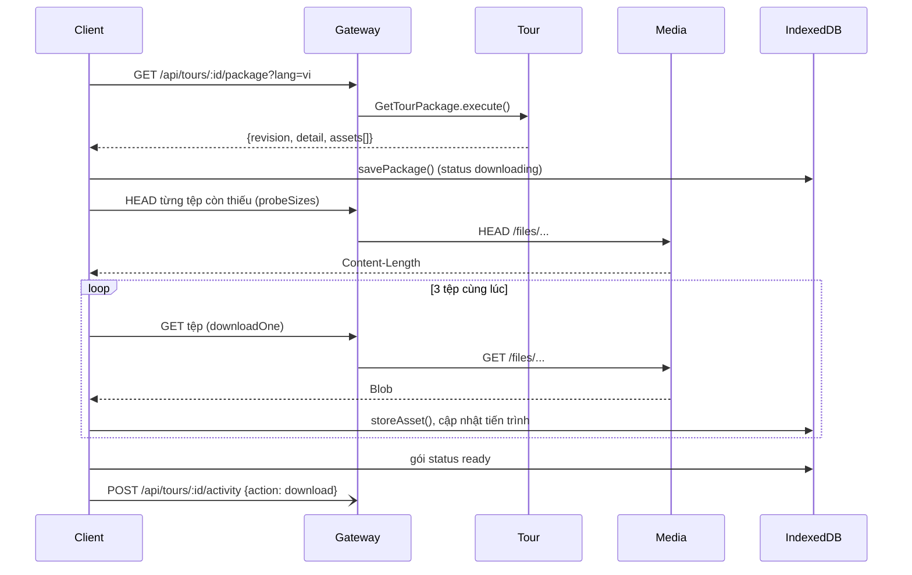

# UC03 – Quản lý tour offline (tải / xem / xóa)

| Trường | Nội dung |
|---|---|
| **Use Case Number** | UC03 |
| **Use Case Name** | Quản lý tour offline (tải / xem / xóa) |
| **Actor(s)** | Khách du lịch (Tourist), không cần tài khoản |
| **Priority** | P0 |
| **Maturity** | Implemented |
| **Summary** | Khách tải một tour công khai về máy theo một hoặc nhiều ngôn ngữ (mỗi ngôn ngữ là một gói), xem tiến trình, tạm dừng / tiếp tục / huỷ, rồi nghe tour không cần mạng. Màn **Tour đã tải** (`/offline`) liệt kê các gói, dung lượng thật, báo khi có bản mới và cho xoá từng ngôn ngữ. Dữ liệu nằm trong IndexedDB của trình duyệt, thuộc về thiết bị chứ không thuộc tài khoản. |

## Basic Course of Events

| # | Actor Action | System Response |
|---|---|---|
| 1 | Tourist ở chi tiết tour (UC02), mục **"Tải về để nghe offline"**, chọn một hoặc nhiều ngôn ngữ và nhấn **"Tải xuống (n ngôn ngữ)"**. | |
| 2 | | Client kiểm tra mạng. *E1* `useDownloadActions()` |
| 3 | | Client gọi `GET /api/tours/:id/package?lang=` cho từng ngôn ngữ; Tour trả manifest: `revision`, `detail` (dữ liệu trình phát cần) và `assets[]` (ảnh bìa, ảnh điểm, audio điểm, audio chỉ đường). *E2* `startDownload()`, `fetchTourPackage()` → `PublicTourController.package()` → `GetTourPackage.execute()`, `buildPackageAssets()` |
| 4 | | Client gửi `HEAD` cho từng tệp còn thiếu để cộng `Content-Length`, so với dung lượng trống của trình duyệt. *E3* `probeSizes()`, `storageEstimate()` |
| 5 | | Client tải tệp (3 tệp cùng lúc), lưu từng tệp vào IndexedDB, cập nhật tiến trình thật (số tệp, số byte). *A1, E4, E5* `transfer()`, `downloadOne()`, `storeAsset()` |
| 6 | | Khi **mọi** tệp của manifest đã lưu, gói chuyển `ready`; client xin `navigator.storage.persist()` và gửi beacon `download` (UC17) một lần cho mỗi gói. `requestPersistence()`, `recordTourActivity()` |
| 7 | | Mục tải hiện dung lượng gói và nút **"Mở bản offline"**. `OfflineDownload`, `PackageProgress` |
| 8 | Tourist mở **Tài khoản → Tour đã tải** (`/offline`). *A2, A3, A4* | |
| 9 | | Client hiện các tour đã tải: ngôn ngữ, dung lượng thật, ngày nội dung và ngày tải; khi có mạng thì so `revision` để báo *"Có bản mới"* hoặc *"Tour không còn công khai"*. *E6* `OfflineLibraryPage`, `useOfflineLibrary()`, `readLibrary()` |
| 10 | | Use case kết thúc tại đây. |

## Alternative Path

**A1. Tạm dừng / tiếp tục / huỷ.**

| # | Actor Action | System Response |
|---|---|---|
| A1.1 | Tourist nhấn **Tạm dừng**, **Tiếp tục** hoặc **Huỷ** khi đang tải. | |
| A1.2 | | Tạm dừng giữ mọi tệp đã lưu; tiếp tục chỉ tải các tệp còn thiếu (tệp đang dở được tải lại từ đầu). Huỷ xoá gói tải dở. Tải lại trang hoặc app bị tắt giữa chừng → lần sau gói hiện *"Bị gián đoạn"* và tiếp tục được như trên. `pauseDownload()`, `resumeDownload()`, `cancelDownload()`, `effectiveStatus()` |

**A2. Xoá một ngôn ngữ của tour đã tải.**

| # | Actor Action | System Response |
|---|---|---|
| A2.1 | Tourist chọn **Xoá** một ngôn ngữ. | |
| A2.2 | | Hộp xác nhận nêu số byte thật sẽ được giải phóng (ảnh dùng chung với ngôn ngữ khác thì không tính). `releasableBytes()` |
| A2.3 | Tourist xác nhận. | |
| A2.4 | | Client xoá gói và các tệp không còn gói nào dùng, cập nhật dung lượng. Lỗi → toast báo lỗi. `deletePackage()` |

**A3. Nghe tour đã tải.** Tourist chọn **Nghe** hoặc **Đi tour** → client mở `/offline/:tourId/play`: trình phát UC04 đọc dữ liệu và tệp từ IndexedDB (`blob:` URL), không gọi mạng, chỉ cho chọn các ngôn ngữ đã tải, không gửi thống kê và không có nút báo cáo. `PlayOfflineRoute` (`App.jsx`), `loadOfflineDetail()`

**A4. Cập nhật bản mới.** Khi có *"Có bản mới"*, Tourist chọn **Cập nhật**: client tải lại manifest, giữ các tệp có URL không đổi, chỉ tải tệp mới; gói chưa `ready` lại cho tới khi đủ tệp. `startDownload()`, `savePackage()`

## Exception Path

- **E1.** Không có mạng khi bắt đầu tải → *"Cần kết nối mạng (Wi-Fi hoặc dữ liệu di động) để tải tour"*. `useDownloadActions()`
- **E2.** Manifest lỗi: `404 tour_not_found` (tour không còn công khai), `400 language_not_available` (ngôn ngữ chưa có trong `availableLanguages`: chưa dịch đủ, hoặc chưa được dịch tự động cho khách — client gọi `POST /api/tours/:id/translations/:lang` trước, UC12 A5). `TourNotFoundError`, `LanguageNotAvailableError` (`get-tour-package.js`)
- **E3.** Không đủ dung lượng (ước tính trước, hoặc `QuotaExceededError` khi đang ghi) → dừng tải, *"Không đủ dung lượng trên thiết bị."* kèm dung lượng cần / còn trống (nếu biết) và link *"Quản lý tour đã tải"*; gói khác không bị ảnh hưởng. `storageEstimate()`, `isQuotaError()`
- **E4.** Mất mạng giữa chừng → *"Mất kết nối mạng. Phần đã tải được giữ lại."*; gói tạm dừng, tiếp tục khi có mạng. `PackageProgress`
- **E5.** Một tệp lỗi (ví dụ máy chủ ảnh không gửi CORS) → tệp đó hiện **"Thử lại"**; gói không được đánh dấu `ready`. `downloadOne()`
- **E6.** Chưa tải tour nào → danh sách rỗng, nút **"Tìm tour"** (UC02). Lỗi đọc IndexedDB → thông báo kèm **"Thử lại"**. Gói thiếu tệp → thông báo tệp bị thiếu. `OfflineLibraryPage`

## Extension Points

- UC14 – Truy cập hạn chế (A5: người thử đã mở khóa tải bản thử qua `GET /api/tours/:id/restricted/package`, gói có `restricted: true`, không gửi beacon).
- UC07 – Lịch trình (A3: gói `itinerary:<id>` từ `GET /api/itineraries/:id/package`, cùng thư viện và trình phát offline, không gửi beacon).
- UC02 – Tìm & xem tour (nơi bắt đầu tải); UC04 – Nghe tour (bản offline); UC17 – Thống kê tour (beacon `download`).

## Triggers

Tourist muốn chuẩn bị tour để dùng khi không có mạng, hoặc muốn giải phóng dung lượng.

## Assumptions

- Lần tải cần có mạng. Để mở app hoàn toàn không mạng, app phải là **bản production** (service worker) và đã được mở ít nhất một lần khi có mạng.

## Preconditions

- Tour ở trạng thái `public` và ngôn ngữ chọn có trong `availableLanguages` của tour (kể cả ngôn ngữ đã dịch tự động cho khách).

## Post Conditions

- Mỗi ngôn ngữ đã tải là một dòng trong store `packages` (`status` = `ready`) và các tệp trong store `assets` của IndexedDB `geosound-offline`.
- Xoá: gói và các tệp không còn dùng bị xoá khỏi máy.
- Một dòng hoạt động `download` cho tour trong thống kê UC17.

## Reference: Business Rules

| Quy tắc | Giá trị |
|---|---|
| Gói | Một tour + một ngôn ngữ: chi tiết (text, route, vùng kích hoạt), ảnh và audio thu âm của ngôn ngữ đó |
| Không có TTS dựng sẵn | Server không tạo tệp TTS; điểm không có audio được đọc bằng giọng của thiết bị (Web Speech) khi nghe offline |
| "Sẵn sàng" | Chỉ khi mọi tệp trong manifest đã lưu |
| Tiến trình | Chỉ số thật: tệp xong / tổng, byte đã lưu, ước tính từ `Content-Length`; tệp không có `Content-Length` = "chưa rõ dung lượng" |
| Tệp dùng chung | Ảnh chung giữa các ngôn ngữ lưu một lần (đếm tham chiếu `owners`) |
| Tải song song | 3 tệp cùng lúc (`CONCURRENCY`) |
| `revision` | Mốc `updatedAt` mới nhất của tour, điểm, cấu hình route và bản dịch ngôn ngữ đó |
| Tài khoản | Không cần; gói thuộc về hồ sơ trình duyệt |

## Hiện thực trong hệ thống

- **Dịch vụ:**
  - Client: tải, lưu IndexedDB, thư viện offline, trình phát offline; service worker (vite-plugin-pwa) chỉ cache vỏ app, không cache dữ liệu tour.
  - Gateway: `/api/tours` → Tour; `/api/media` → Media (tệp ảnh, audio).
  - Tour: dựng manifest `GetTourPackage` (cùng dữ liệu với chi tiết tour).
  - Media: phục vụ tệp ảnh / audio.
- **Màn hình (client):** mục tải trong `/tour/:tourId` (`features/offline/OfflineDownload.jsx`, `PackageProgress.jsx`), `/offline` (`OfflineLibraryPage.jsx`), `/offline/:tourId/play`; logic trong `client/src/lib/offline-download.js` và `offline-store.js`.
- **API (qua gateway):**
  - `GET /api/tours/:id/package?lang=` (công khai)
  - `HEAD` / `GET` các URL tệp trong `assets` (thường là `/api/media/files/...`)
  - `POST /api/tours/:id/activity` (beacon `download`, UC17)
- **Dữ liệu:** phía server không có bảng mới; phía client IndexedDB `geosound-offline` v1, store `packages` (khoá `"<tourId>|<language>"`) và `assets` (khoá = URL tệp).
- **Mã nguồn chính:**

| Bước | Hàm / lớp | File |
|---|---|---|
| 1, 7 | `OfflineDownload`, `PackageProgress` | `client/src/features/offline/OfflineDownload.jsx`, `PackageProgress.jsx` |
| 2, A1 | `useDownloadActions()` | `client/src/features/offline/useDownloadActions.js` |
| 3–6 | `startDownload()`, `fetchTourPackage()`, `probeSizes()`, `storageEstimate()` | `client/src/lib/offline-download.js` |
| 5–6 | `transfer()`, `downloadOne()`, `requestPersistence()` | `client/src/lib/offline-download.js` |
| A1 | `pauseDownload()`, `resumeDownload()`, `cancelDownload()`, `effectiveStatus()` | `client/src/lib/offline-download.js` |
| 5, A2 | `openDb()`, `savePackage()`, `storeAsset()`, `releasableBytes()`, `deletePackage()` | `client/src/lib/offline-store.js` |
| 9 | `OfflineLibraryPage`, `useOfflineLibrary()`, `readLibrary()` | `client/src/features/offline/OfflineLibraryPage.jsx`, `useOfflineLibrary.js`, `client/src/lib/offline-store.js` |
| A3 | `PlayOfflineRoute`, `loadOfflineDetail()` | `client/src/App.jsx`, `client/src/lib/offline-store.js` |
| 4–5 | `fetchAsset()` | `client/src/lib/api.js` |
| 6 | `recordTourActivity()` | `client/src/lib/tour-stats.js` |
| Route | `buildPublicTourRouter()` (`/:id/package`) | `services/tour/src/interfaces/http/routes/public-tour-routes.js` |
| Controller | `PublicTourController.package()` | `services/tour/src/interfaces/http/controllers/public-tour-controller.js` |
| 3 | `GetTourPackage.execute()`, `buildPackageAssets()`, `isDownloadableUrl()` | `services/tour/src/application/use-cases/get-tour-package.js` |
| 3 | `buildTourDetailView()` | `services/tour/src/application/use-cases/build-tour-detail.js` |
| 3 | `PrismaTourRepository.findPublicById()`, `PrismaPlaceRepository.listByTour()` | `services/tour/src/infrastructure/persistence/prisma-tour-repository.js`, `prisma-place-repository.js` |
| 6 | `RecordTourActivity.execute()` | `services/tour/src/application/use-cases/tour-stats.js` |

- **Tài liệu thiết kế:** [offline-download.md](../../02-design/offline-download.md), [uc17-tour-stats.md](../../02-design/uc17-tour-stats.md).
- **Giới hạn đã biết:**
  - Chạy thật sự không mạng cần bản production (service worker); máy chủ dev Vite trong Docker không chạy service worker.
  - Bản đồ offline không có lớp nền (tile): chỉ hiện route và điểm dừng; chế độ GPS vẫn chạy.
  - Gói chỉ có text, ảnh và audio thu âm; không có tệp TTS dựng sẵn.

## Author(s)

(điền sau)

## Date

Tạo: 2026-10-18 · Cập nhật theo hệ thống: 2026-11-09

## Activity Diagram

[UC03-activity.xml](../../02-design/drawio/activity/UC03-activity.xml) (draw.io: File → Import from → Device). Nguồn: [specs/UC03.json](../../02-design/drawio/activity/specs/UC03.json).

## Sequence Diagram

## Boundary

- Mục "Tải về để nghe offline" trong Chi tiết tour `/tour/:tourId` (chọn ngôn ngữ, tiến trình, Tạm dừng / Tiếp tục / Huỷ, tệp lỗi "Thử lại", "Mở bản offline").
- Màn Tour đã tải `/offline` (link trong Tài khoản; danh sách, dung lượng, "Có bản mới", hộp xác nhận xoá).
- Trình phát offline `/offline/:tourId/play`.
