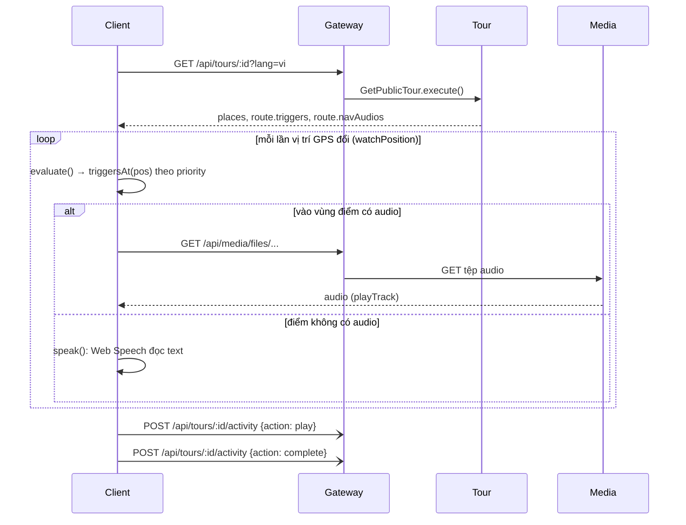

# UC04 – Nghe tour (tại chỗ theo GPS / nghe thử từ xa)

| Trường | Nội dung |
|---|---|
| **Use Case Number** | UC04 |
| **Use Case Name** | Nghe tour (tại chỗ theo GPS / nghe thử từ xa) |
| **Actor(s)** | Khách du lịch (Tourist), không cần đăng nhập |
| **Priority** | P0 |
| **Maturity** | Implemented |
| **Summary** | Trình phát (`/tour/:id/play`) có hai chế độ: **Đi theo GPS** — trình duyệt theo dõi vị trí, tự phát nội dung khi vào vùng kích hoạt của một điểm, phát audio chỉ đường ở ngã rẽ và gợi ý "đi tiếp"; **Nghe thử từ xa** — chọn điểm thủ công, không cần GPS. Điểm có audio thu âm thì phát tệp; điểm không có audio được đọc bằng **giọng của thiết bị** (Web Speech). Tiến độ lưu trên máy. Toàn bộ logic chạy trên client nên tour đã tải (UC03) nghe được không cần mạng. |

## Basic Course of Events *(Đi theo GPS)*

| # | Actor Action | System Response |
|---|---|---|
| 1 | Tourist ở chi tiết tour (UC02) nhấn **"Bắt đầu đi tour"** (muốn nghe trước khi đến → *A5*). | |
| 2 | | Client mở `/tour/:id/play?mode=gps&lang=`, tải chi tiết tour (`GET /api/tours/:id?lang=`): điểm dừng, text, audio, route, vùng kích hoạt, `navAudios`. Vùng thiếu được Tour tự sinh. *E4* `TourPlayerPage`, `fetchTourDetail()` → `GetPublicTour.execute()`, `effectiveRoute()` |
| 3 | | Client xin quyền vị trí và hiện bản đồ: vị trí hiện tại, route, các điểm (đã nghe / đang phát). *E1, E2* `useGeolocation().start()` (`watchPosition`), `TourMap` |
| 4 | Tourist di chuyển theo route. | |
| 5 | | Mỗi lần vị trí đổi, client kiểm tra vị trí có nằm trong vùng kích hoạt nào (tròn hoặc đa giác). `usePlaybackEngine` `evaluate()`, `triggersAt()`, `pointInZone()` |
| 6 | Tourist bước vào **vùng kích hoạt** của một điểm. | |
| 7 | | Client **tự phát** điểm đó: audio thu âm nếu có, nếu không thì giọng thiết bị đọc text. Gửi beacon `play` (UC17) ở điểm đầu tiên. *A1, A2, E3* `playPlace()`, `useAudioController.playTrack()` / `speak()`; `recordTourActivity()` |
| 8 | | Sheet điểm hiện tên, text và ảnh. `PlaceSheet` |
| 9 | Tourist bước vào **vùng chỉ đường** (ngã rẽ). | |
| 10 | | Nếu không đang phát gì, client phát audio chỉ đường của vùng đó. `navAudiosAt()`, `playNav()` |
| 11 | | Phát xong một điểm (không phải chọn tay), client phát **gợi ý "đi tiếp"** (`nextHint`) nếu tác giả đã cấu hình; banner cho biết điểm tiếp theo và khoảng cách. `endedHandler` → `afterContentDone()` (`usePlaybackEngine.js`) |
| 12 | Tourist điều khiển: phát / tạm dừng, tua ±15 giây, điểm trước / sau, đổi ngôn ngữ, mở danh sách điểm. *A3* | `useAudioController.toggle()`, `.seekBy()`, `usePlaybackEngine` `step()`, `changeLang()` |
| 13 | Tourist đến và nghe xong điểm cuối. *A4* | |
| 14 | | Client đánh dấu hoàn thành, gửi beacon `complete` (UC17) và hiện hộp hoàn thành với link **Đánh giá tour** (UC05) và **Khám phá tour khác**. `allVisited()`, `onComplete()`, `CompletionDialog` |
| 15 | | Use case kết thúc tại đây. |

## Alternative Path

**A1. Vào nhiều vùng cùng lúc** → client phát điểm có **độ ưu tiên** (`priority`, tác giả đặt ở UC11) cao nhất, quay về bước 8. `triggersAt()` (sắp theo ưu tiên giảm)

**A2. Đang phát thì vào vùng điểm khác** → ưu tiên cao hơn điểm đang phát thì chen ngang ngay; bằng hoặc thấp hơn thì hoãn, phát sau khi xong nếu Tourist vẫn đứng trong vùng đó. Quay về bước 7. `evaluate()` (`pendingRef`), `afterContentDone()`

**A3. Chọn điểm thủ công** → Tourist chạm điểm trên bản đồ hoặc trong danh sách; client phát ngay điểm đó (không phát gợi ý "đi tiếp"), quay về bước 8. `usePlaybackEngine` `selectPlace()`, `PlaceList`

**A4. Tạm rời và quay lại** → tiến độ (điểm đã nghe, điểm cuối, ngôn ngữ) lưu trong `localStorage` theo tour; mở lại thì banner *"Bạn đã nghe x/n điểm"* cho nghe tiếp, quay về bước 5. `useTourProgress()` `markVisited()`, `setLang()`

**A5. Nghe thử từ xa (không cần GPS).**

| # | Actor Action | System Response |
|---|---|---|
| A5.1 | Tourist nhấn **"Nghe thử"** ở chi tiết tour (hoặc chạm một điểm, `?stop=<id>`). | |
| A5.2 | | Client mở `/tour/:id/play?mode=remote`: bản đồ + danh sách điểm + thanh phát, không dùng GPS. `TourPlayerPage`, `PlayerBar` |
| A5.3 | Tourist chọn một điểm, chuyển điểm trước / sau, đổi ngôn ngữ. | |
| A5.4 | | Client phát điểm (audio thu âm hoặc giọng thiết bị) và hiện text / ảnh. Nghe hết các điểm → hộp hoàn thành như bước 14. `selectPlace()`, `step()`, `useAudioController.playTrack()` |

**A6. Báo cáo tour** → nút "Báo cáo tour" trên thanh trên của trình phát (UC06, chỉ tour công khai). `ReportTour`

## Exception Path

- **E1.** Chưa có / bị từ chối quyền vị trí → *"Chưa có quyền vị trí. Hãy cấp quyền vị trí, hoặc chuyển sang nghe thử từ xa."* kèm nút **Nghe thử** (A5). Thiết bị không có GPS → *"Thiết bị không hỗ trợ GPS"*. `useGeolocation()` `permission`, `switchToRemote()`
- **E2.** GPS yếu (sai số > 50 m) → *"GPS yếu (±x m). Bạn có thể chọn điểm thủ công."*; vị trí không cập nhật quá 12 giây → *"Tín hiệu vị trí chưa cập nhật. Đang chờ GPS…"*. `LOW_ACCURACY_M` (`useGeolocation.js`), `STALE_MS` (`TourPlayerPage.jsx`)
- **E3.** Tệp audio thiếu hoặc lỗi → client chuyển sang giọng thiết bị đọc text; vẫn lỗi → mở sheet điểm, hiện text kèm thông báo lỗi. `useAudioController.playTrack()` (`onerror`) → `speak()`; `retry()`
- **E4.** Không tải được tour: mất mạng → *"Mất kết nối mạng"*, *"Tour chưa tải về sẽ cần có mạng..."* + **Thử lại**; tour không công khai → `404` *"Tour không tồn tại hoặc chưa công khai."*. Tour đã tải thì mở bản offline `/offline/:tourId/play` (UC03 A3). `TourPlayerPage` (màn lỗi), `loadOfflineDetail()`

## Extension Points

- UC02 – Tìm & xem tour (mở trình phát); UC03 – bản offline; UC05 – Đánh giá (từ bước 14); UC06 – Báo cáo; UC17 – Thống kê (beacon `play`, `complete`).
- Cùng trình phát được dùng lại cho UC08 (đi theo lịch trình), UC13 (xem thử của tác giả, có đi bộ mô phỏng) và UC14 (bản truy cập hạn chế).

## Triggers

Tourist bắt đầu đi tour tại hiện trường, hoặc muốn nghe thử trước khi đến.

## Assumptions

- Thiết bị có GPS và trình duyệt hỗ trợ Geolocation (chế độ GPS) và Web Speech (đọc điểm không có audio). Trang mở qua HTTPS hoặc `localhost` để trình duyệt cho dùng vị trí.

## Preconditions

- Tour `public` (hoặc đã tải về máy, UC03). Có ít nhất một điểm dừng. Vùng kích hoạt lấy từ UC11; nếu tác giả chưa cấu hình, Tour tự sinh.

## Post Conditions

- Các điểm đã nghe được lưu trong `localStorage` của máy; thống kê tour có thêm `play` / `complete` (chỉ tour công khai online).

## Reference: Business Rules

| Quy tắc | Giá trị |
|---|---|
| Nguồn âm thanh | Audio thu âm (`audioSource` = `human`) khi ngôn ngữ chọn = ngôn ngữ gốc; còn lại giọng thiết bị đọc text đã dịch. Server không tạo tệp TTS |
| Vùng kích hoạt mặc định | Tròn bán kính 50 m (`DEFAULT_ZONE_RADIUS_METERS`) quanh mỗi điểm, `priority` 0, khi tác giả chưa cấu hình |
| Giới hạn cấu hình (UC11) | Bán kính > 0 và ≤ 100 km; `priority` số nguyên 0 đến 1000 |
| Chồng vùng | Ưu tiên cao nhất thắng; ưu tiên cao hơn chen ngang, bằng / thấp hơn thì chờ |
| Audio chỉ đường | Chỉ phát khi không đang phát nội dung khác |
| Gợi ý "đi tiếp" | Chỉ ở chế độ GPS và khi điểm được kích hoạt tự động |
| GPS yếu | Sai số > 50 m; vị trí cũ hơn 12 giây = chưa cập nhật |
| Beacon thống kê | `play`, `complete` mỗi loại một lần mỗi lượt mở; server lọc trùng theo ngày; không gửi ở bản offline, xem thử, hạn chế |

## Hiện thực trong hệ thống

- **Dịch vụ:**
  - Client: toàn bộ logic phát (`hooks/usePlaybackEngine.js`, `useAudioController.js`, `useGeolocation.js`, `useTourProgress.js`, `lib/zones.js`).
  - Gateway: `/api/tours` → Tour; `/api/media` → Media (tệp audio, ảnh).
  - Tour: trả chi tiết tour kèm route và vùng kích hoạt (tự sinh phần thiếu); ghi beacon thống kê.
- **Màn hình (client):** `/tour/:tourId/play` (`features/player/TourPlayerPage.jsx`, `TourMap.jsx`, `PlayerBar.jsx`, `PlaceSheet.jsx`, `PlaceList.jsx`, `LanguageMenu.jsx`, `CompletionDialog.jsx`), `/offline/:tourId/play`.
- **API (qua gateway):**
  - `GET /api/tours/:id?lang=`
  - `GET /api/media/files/...` (audio, ảnh)
  - `POST /api/tours/:id/activity` (`play`, `complete`, UC17)
- **Dữ liệu:** `places` (`audio_url`, `audio_source`, `images`), `place_translations` (text theo ngôn ngữ), `route_configs` (`path`, `triggers`, `nav_audios`); phía client `localStorage` tiến độ.
- **Mã nguồn chính:**

| Bước | Hàm / lớp | File |
|---|---|---|
| 2, E4 | `PlayTourRoute`, `PlayOfflineRoute` | `client/src/App.jsx` |
| 2, 12, E1 | `TourPlayerPage`, `changeLang()`, `switchToRemote()`, `sendStat()` | `client/src/features/player/TourPlayerPage.jsx` |
| 2 | `fetchTourDetail()` | `client/src/lib/api.js` |
| 3, E1, E2 | `useGeolocation()` `start()`, `stop()`, `LOW_ACCURACY_M` | `client/src/hooks/useGeolocation.js` |
| 5–11, A1–A3 | `usePlaybackEngine()` `evaluate()`, `playPlace()`, `playNav()`, `afterContentDone()`, `selectPlace()`, `step()` | `client/src/hooks/usePlaybackEngine.js` |
| 5, A1 | `triggersAt()`, `navAudiosAt()`, `pointInZone()` | `client/src/lib/zones.js` |
| 7, 12, E3 | `useAudioController()` `playTrack()`, `speak()`, `toggle()`, `seekBy()`, `retry()` | `client/src/hooks/useAudioController.js` |
| A4 | `useTourProgress()` `markVisited()`, `setLang()` | `client/src/hooks/useTourProgress.js` |
| 3, 8, 12 | `TourMap`, `PlaceSheet`, `PlayerBar`, `PlaceList` | `client/src/features/player/*.jsx` |
| 14 | `CompletionDialog` | `client/src/features/player/CompletionDialog.jsx` |
| 7, 14 | `recordTourActivity()` | `client/src/lib/tour-stats.js` |
| 2 | `PublicTourController.detail()` → `GetPublicTour.execute()` | `services/tour/src/interfaces/http/controllers/public-tour-controller.js`, `application/use-cases/get-public-tour.js` |
| 2 | `buildTourDetailView()` | `services/tour/src/application/use-cases/build-tour-detail.js` |
| 2 | `effectiveRoute()`, `defaultTrigger()` | `services/tour/src/domain/route/effective-route.js` |
| 7, 14 | `TourStatsController.record()` → `RecordTourActivity.execute()` | `services/tour/src/interfaces/http/controllers/tour-stats-controller.js`, `application/use-cases/tour-stats.js` |

- **Tài liệu thiết kế:** [uc17-tour-stats.md](../../02-design/uc17-tour-stats.md), [offline-download.md](../../02-design/offline-download.md).
- **Giới hạn đã biết:**
  - Không có TTS phía server: chất lượng giọng đọc phụ thuộc giọng có sẵn trên thiết bị.
  - Bản đồ khi offline không có lớp nền.

## Author(s)

(điền sau)

## Date

Tạo: 2026-10-18 · Cập nhật theo hệ thống: 2026-11-08

## Activity Diagram

[UC04-activity.xml](../../02-design/drawio/activity/UC04-activity.xml) (draw.io: File → Import from → Device). Nguồn: [specs/UC04.json](../../02-design/drawio/activity/specs/UC04.json).

## Sequence Diagram

## Boundary

- Trình phát `/tour/:tourId/play` (thanh trên: thoát, chế độ, ngôn ngữ, danh sách điểm, báo cáo; bản đồ GPS + route + điểm; băng cảnh báo GPS; thanh phát; sheet nội dung điểm).
- Danh sách điểm (nghe thử từ xa), hộp hoàn thành tour.
- Trình phát offline `/offline/:tourId/play`.
