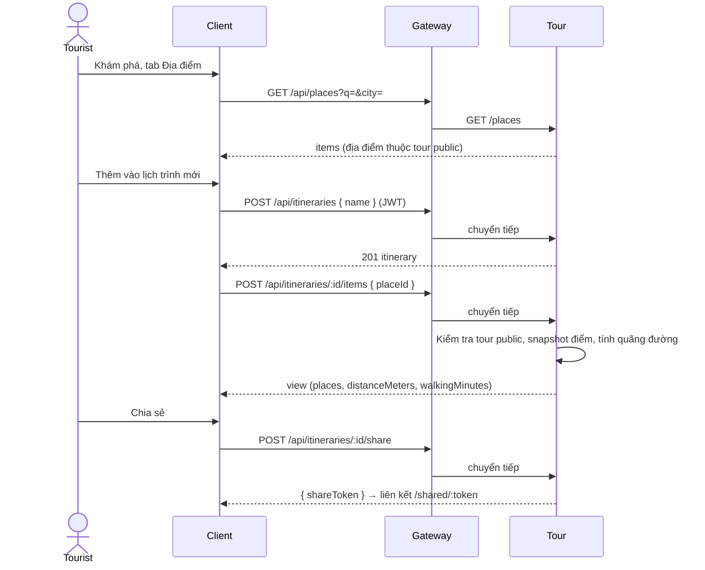

# UC07 – Tạo và quản lý lịch trình cá nhân

| Trường | Nội dung |
|---|---|
| **Use Case Number** | UC07 |
| **Use Case Name** | Tạo và quản lý lịch trình cá nhân |
| **Actor(s)** | Khách du lịch (Tourist, đã đăng nhập; mọi vai trò). Người nhận liên kết chia sẻ (không cần đăng nhập) ở A4 |
| **Priority** | P2 |
| **Maturity** | Implemented |
| **Summary** | Tourist tìm các địa điểm lẻ thuộc tour công khai, gom chúng vào lịch trình cá nhân có tên, sắp xếp thứ tự, thêm hoặc xóa điểm, xem lịch trình trên bản đồ với tổng quãng đường và thời gian đi bộ ước tính, rồi chia sẻ bằng liên kết chỉ đọc. Mỗi điểm được lưu dạng ảnh chụp (snapshot) để lịch trình không vỡ khi tác giả sửa tour gốc. |

## Basic Course of Events

| # | Actor Action | System Response |
|---|---|---|
| 1 | Tourist mở màn **Khám phá** (`/`), tab Địa điểm (`?tab=places`). *A1* | |
| 2 | | Client gọi `GET /api/places` (công khai): danh sách địa điểm thuộc tour `public`, lọc theo từ khóa, thành phố, loại; có tọa độ người dùng thì sắp theo khoảng cách. *E1* `explorePlaces()` → `ExplorePlaces.execute()` → `searchPublicPlaces()` |
| 3 | Tourist chọn một địa điểm để xem chi tiết (tên, loại, mô tả, ảnh, audio người thật nếu có, tên tour gốc). | |
| 4 | Tourist chọn **"Thêm vào lịch trình"** (trên màn Khám phá hoặc nút ＋ ở điểm dừng trong chi tiết tour). *E2* | |
| 5 | | Client mở bảng "Thêm vào…": danh sách lịch trình của tôi (`GET /api/itineraries`) và ô "Lịch trình mới". *E3* `AddToItinerarySheet`, `listMyItineraries()` → `ListMyItineraries.execute()` |
| 6 | Tourist chọn một lịch trình hoặc đặt tên để tạo lịch trình mới. | |
| 7 | | Client gọi `POST /api/itineraries` (nếu tạo mới) rồi `POST /api/itineraries/:id/items { placeId }`. Tour kiểm tra địa điểm thuộc tour `public`, chụp snapshot điểm và gán thứ tự cuối. *E4* `createItinerary()` → `CreateItinerary.execute()`; `addItem()` → `AddItineraryItem.execute()` → `snapshotPlace()`, `Itinerary.addItem()` |
| 8 | Tourist mở lịch trình (`/itineraries/:id`) để sắp xếp, đổi tên, xóa điểm. *A2* | |
| 9 | | Hệ thống hiển thị bản đồ và danh sách điểm kèm **tổng quãng đường, thời gian đi bộ ước tính và khoảng cách từng chặng**. `getItinerary()` → `GetItinerary.execute()` → `buildItineraryView()`, `itineraryMetrics()` |
| 10 | Tourist chia sẻ lịch trình hoặc bắt đầu đi theo (UC08). *A4* | |
| 11 | | Use case kết thúc tại đây. |

## Alternative Path

**A1. Tìm / lọc địa điểm.** Tourist nhập từ khóa hoặc chọn thành phố, loại; client gọi lại `GET /api/places?q=&city=&type=&lat=&lng=&page=&pageSize=` (tối đa 50 mỗi trang). `explorePlaces()` → `ExplorePlaces.execute()`

**A2. Sắp xếp / đổi tên / xóa.**

| # | Actor Action | System Response |
|---|---|---|
| A2.1 | Tourist đổi thứ tự điểm bằng nút lên / xuống (thay cho kéo thả, để dễ truy cập). | `PATCH /api/itineraries/:id/items { orderedIds }`; thứ tự được đánh lại 0..n-1, quãng đường được tính lại. `reorderItems()` → `ReorderItineraryItems.execute()` → `Itinerary.reorder()` |
| A2.2 | Tourist bỏ một điểm. | `DELETE /api/itineraries/:id/items/:itemId` ngay, không hỏi lại; thông báo có nút "Hoàn tác" (thêm lại điểm rồi đưa về vị trí cũ). `removeItem()` → `RemoveItineraryItem.execute()` → `Itinerary.removeItem()` |
| A2.3 | Tourist đổi tên lịch trình. | `PATCH /api/itineraries/:id { name }`. `renameItinerary()` → `RenameItinerary.execute()` |
| A2.4 | Tourist xóa cả lịch trình (từ "Lịch trình của tôi"). | `DELETE /api/itineraries/:id`. `deleteItinerary()` → `DeleteItinerary.execute()` |

**A3. Dùng khi không có mạng.** Lịch trình **không** có gói tải offline riêng; tải offline chỉ có cho tour (UC03). Lịch trình luôn được tải từ server.

**A4. Chia sẻ lịch trình.**

| # | Actor Action | System Response |
|---|---|---|
| A4.1 | Tourist mở hộp thoại "Chia sẻ lịch trình" và tạo liên kết. | `POST /api/itineraries/:id/share { enabled: true }` sinh `shareToken` (dùng lại nếu đã có); client hiện liên kết `/shared/:token` và nút Copy. `ShareDialog`, `shareItinerary()` → `ShareItinerary.execute()` → `Itinerary.ensureShareToken()` |
| A4.2 | Tourist tắt chia sẻ. | `POST .../share { enabled: false }` xóa `shareToken`; liên kết cũ không còn mở được. `ShareItinerary.execute()` → `Itinerary.revokeShare()` |
| A4.3 | Người nhận mở `/shared/:token`. | `GET /api/itineraries/shared/:token` (công khai, chỉ đọc); người nhận có thể "Đi theo lịch trình này" (UC08). `getSharedItinerary()` → `GetSharedItinerary.execute()` → `PrismaItineraryRepository.findByShareToken()` |

## Exception Path

- **E1.** Không có địa điểm phù hợp → API trả danh sách rỗng; client hiện *"Không tìm thấy địa điểm phù hợp"*, gợi ý đổi từ khóa, bỏ bớt bộ lọc hoặc dùng "Gần tôi", và nút "Xoá tìm kiếm & bộ lọc".
- **E2.** Chưa đăng nhập → bảng "Thêm vào…" hiện *"Đăng nhập để lưu địa điểm vào lịch trình và mở lại trên mọi thiết bị."*; thao tác thêm được giữ lại qua bước đăng nhập (UC01). API trả 401 nếu không có token. `usePendingAdd()`, `nextWithPendingAdd()`
- **E3.** Thiếu tên lịch trình → *"Vui lòng đặt tên lịch trình"*; quá 120 ký tự → *"Tên lịch trình tối đa 120 ký tự"* (400). `createItinerarySchema`, `Itinerary.normalizeName()`
- **E4.** Địa điểm không tồn tại hoặc tour gốc không còn `public` → 404 `place_not_addable` *"Địa điểm không khả dụng để thêm vào lịch trình"*. `AddItineraryItem.execute()` → `PlaceNotAddableError`
- **E5.** Lịch trình không tồn tại → 404 `itinerary_not_found`; không phải chủ sở hữu → 403 `not_itinerary_owner`; danh sách sắp xếp không khớp các điểm hiện có → 400. `loadOwnedItinerary()`, `Itinerary.reorder()`

## Extension Points

- UC01 – Xác thực tài khoản.
- UC02 – Chi tiết tour (nút ＋ thêm điểm dừng vào lịch trình).
- UC08 – Đi theo lịch trình cá nhân.

## Triggers

Tourist muốn tự lên kế hoạch chuyến đi từ các địa điểm quan tâm, có thể thuộc nhiều tour khác nhau.

## Assumptions

- Lịch trình gắn với tài khoản (`owner_id` lấy từ JWT), mở lại được trên mọi thiết bị.

## Preconditions

- Tourist đã đăng nhập (UC01) để tạo và sửa lịch trình. Xem liên kết chia sẻ không cần đăng nhập.
- Có địa điểm thuộc tour `public`.

## Post Conditions

- Dòng `itineraries` và các dòng `itinerary_items` (snapshot) được lưu với thứ tự liên tục.
- Nếu chia sẻ: `itineraries.share_token` có giá trị; nếu thu hồi: `share_token = null`.
- Không phát sự kiện nào.

## Reference: Business Rules

| # | Quy tắc |
|---|---|
| R1 | Chỉ chủ sở hữu được xem, sửa, xóa, chia sẻ lịch trình của mình |
| R2 | Tên bắt buộc, cắt khoảng trắng, tối đa 120 ký tự |
| R3 | Chỉ thêm được địa điểm thuộc tour `public` |
| R4 | Mỗi điểm là snapshot lúc thêm: tọa độ, ảnh, văn bản và audio theo từng ngôn ngữ (`audio_by_lang`), bán kính kích hoạt (mặc định 50 m); tác giả sửa tour gốc không làm đổi lịch trình |
| R5 | Quãng đường = tổng khoảng cách haversine giữa các điểm liên tiếp; thời gian đi bộ = quãng đường / 1,25 m/s (khoảng 4,5 km/h) |
| R6 | Mã chia sẻ sinh một lần và dùng lại; liên kết chia sẻ chỉ đọc |
| R7 | Ngôn ngữ của lịch trình = hợp các ngôn ngữ có ở các điểm; chọn bằng `?lang=` |

## Hiện thực trong hệ thống

- **Dịch vụ:**
  - Client: màn Khám phá, bảng "Thêm vào…", danh sách và trình sửa lịch trình, hộp thoại chia sẻ, màn xem chia sẻ.
  - Gateway: chuyển `/api/places` và `/api/itineraries` sang Tour.
  - Tour: tìm địa điểm công khai, lưu lịch trình và snapshot, tính quãng đường, cấp mã chia sẻ.
- **Màn hình (client):** `/` (tab Địa điểm, `client/src/features/discover/`), `/tour/:tourId` (nút ＋), `/itineraries`, `/itineraries/:id`, `/shared/:token` (`client/src/features/itineraries/`). API helper `client/src/lib/itineraries.js`.
- **API (qua gateway):**
  - `GET /api/places` (công khai)
  - `POST /api/itineraries`, `GET /api/itineraries`, `GET /api/itineraries/:id?lang=`
  - `PATCH /api/itineraries/:id`, `DELETE /api/itineraries/:id`
  - `POST /api/itineraries/:id/items`, `PATCH /api/itineraries/:id/items`, `DELETE /api/itineraries/:id/items/:itemId`
  - `POST /api/itineraries/:id/share`
  - `GET /api/itineraries/shared/:token?lang=` (công khai)
- **Sự kiện (RabbitMQ):** không có.
- **Dữ liệu:** `tour.itineraries` (`owner_id`, `name`, `share_token`); `tour.itinerary_items` (`place_id`, `tour_id`, `name`, `type`, `lat`, `lng`, `images`, `radius_meters`, `source_language`, `available_languages`, `audio_by_lang`, `sequence`).
- **Mã nguồn chính:**

| Bước | Hàm / lớp | File |
|---|---|---|
| 1–3 | `DiscoverPage`, `PlaceDetailSheet` | `client/src/features/discover/` |
| 4–7, E2 | `AddToItinerarySheet` | `client/src/features/itineraries/AddToItinerarySheet.jsx` |
| E2 | `usePendingAdd()`, `nextWithPendingAdd()` | `client/src/hooks/usePendingAdd.js` |
| 8–9, A2 | `ItineraryEditorPage` | `client/src/features/itineraries/ItineraryEditorPage.jsx` |
| A4 | `ShareDialog` | `client/src/features/itineraries/ShareDialog.jsx` |
| Tất cả | `explorePlaces()`, `createItinerary()`, `addItem()`, `reorderItems()`, `removeItem()`, `shareItinerary()`, `getSharedItinerary()` | `client/src/lib/itineraries.js` |
| Route | `buildExploreRouter()`, `buildItineraryRouter()`, `buildPublicItineraryRouter()` | `services/tour/src/interfaces/http/routes/explore-routes.js`, `itinerary-routes.js`, `public-itinerary-routes.js` |
| Controller | `ExploreController` (`places`, `shared`), `ItineraryController` | `services/tour/src/interfaces/http/controllers/explore-controller.js`, `itinerary-controller.js` |
| 2, A1 | `ExplorePlaces.execute()` | `services/tour/src/application/use-cases/explore-places.js` |
| 7 | `CreateItinerary.execute()` | `services/tour/src/application/use-cases/create-itinerary.js` |
| 7, E4 | `AddItineraryItem.execute()`, `snapshotPlace()` | `services/tour/src/application/use-cases/add-itinerary-item.js`, `snapshot-place.js` |
| A2 | `ReorderItineraryItems`, `RemoveItineraryItem`, `RenameItinerary`, `DeleteItinerary` (`execute()`) | `services/tour/src/application/use-cases/` |
| A4 | `ShareItinerary.execute()`, `GetSharedItinerary.execute()` | `services/tour/src/application/use-cases/share-itinerary.js`, `get-shared-itinerary.js` |
| 9 | `buildItineraryView()`, `summarizeItinerary()` | `services/tour/src/application/use-cases/build-itinerary-view.js` |
| 9, R5 | `itineraryMetrics()` | `services/tour/src/domain/geo/itinerary-metrics.js` |
| R1–R6 | `Itinerary` (`addItem`, `removeItem`, `reorder`, `ensureShareToken`, `revokeShare`), `ItineraryItem` | `services/tour/src/domain/entities/itinerary.js`, `itinerary-item.js` |
| Lưu trữ | `PrismaItineraryRepository` (`create`, `findById`, `findByShareToken`, `listByOwner`, `save`, `delete`) | `services/tour/src/infrastructure/persistence/prisma-itinerary-repository.js` |
| 2 | `searchPublicPlaces()`, `countPublicPlaces()` | `services/tour/src/infrastructure/persistence/prisma-place-repository.js` |

- **Giới hạn đã biết:** chưa có tải offline cho lịch trình (chỉ tour có, UC03).

## Author(s)

(điền sau)

## Date

Tạo: 2026-10-18 · Cập nhật theo hệ thống: 2026-11-08

## Activity Diagram

(bổ sung sau)

## Sequence Diagram

## Boundary

- Khám phá `/` (tab Địa điểm, `?tab=places`): danh sách, bộ lọc, sheet chi tiết địa điểm.
- Bảng "Thêm vào…" (trên Khám phá và chi tiết tour `/tour/:tourId`).
- Lịch trình của tôi `/itineraries`; trình sửa lịch trình `/itineraries/:id` (bản đồ, danh sách điểm, quãng đường, thời gian).
- Hộp thoại "Chia sẻ lịch trình"; màn xem lịch trình được chia sẻ `/shared/:token`.
