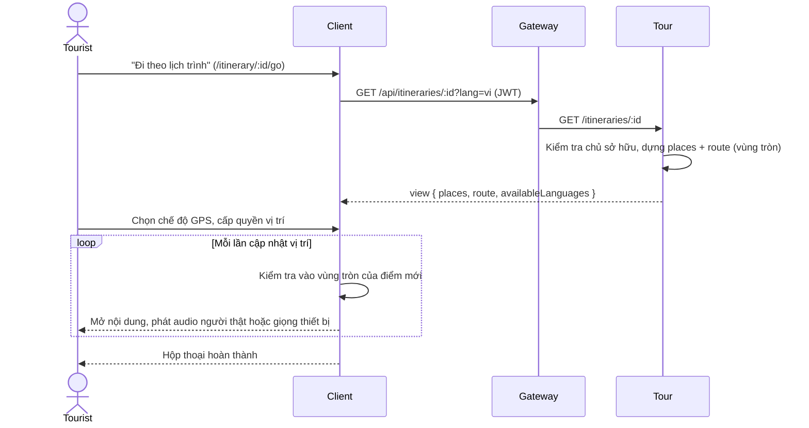

# UC08 – Đi theo lịch trình cá nhân

| Trường | Nội dung |
|---|---|
| **Use Case Number** | UC08 |
| **Use Case Name** | Đi theo lịch trình cá nhân |
| **Actor(s)** | Khách du lịch (Tourist, đã đăng nhập, với lịch trình của mình); người nhận liên kết chia sẻ (không cần đăng nhập) |
| **Priority** | P2 |
| **Maturity** | Implemented |
| **Summary** | Tourist đi theo lịch trình cá nhân (UC07) bằng chính trình phát của UC04: bản đồ với vị trí GPS, nội dung tự mở khi vào vùng tròn quanh từng điểm, hoặc chọn điểm thủ công. Audio người thật được ưu tiên; điểm không có audio được đọc bằng giọng của thiết bị (Web Speech). Người nhận liên kết chia sẻ cũng đi theo được, ở chế độ chỉ đọc. |

## Basic Course of Events

| # | Actor Action | System Response |
|---|---|---|
| 1 | Tourist mở lịch trình (`/itineraries/:id`) và chọn **"Đi theo lịch trình"**, hoặc người nhận mở `/shared/:token` và chọn đi theo. *A2* | |
| 2 | | Client mở trình phát `/itinerary/:id/go` và gọi `GET /api/itineraries/:id?lang=`. Tour trả view cùng dạng chi tiết tour: các điểm theo thứ tự, `route.path` nối các điểm, mỗi điểm một vùng kích hoạt hình tròn (bán kính snapshot, mặc định 50 m). *E3* `ItineraryPlayerPage` → `getItinerary()` → `GetItinerary.execute()` → `buildItineraryView()` |
| 3 | Tourist chọn chế độ **"Đi theo lịch trình"** (GPS). *A1* | |
| 4 | | Client xin quyền vị trí, hiện bản đồ với vị trí hiện tại, các điểm và điểm tiếp theo chưa nghe kèm khoảng cách. *E1, E2* `TourPlayerPage`, `useGeolocation()` |
| 5 | Tourist di chuyển ngoài thực địa. | |
| 6 | | Khi vào vùng của một điểm mới, client tự mở nội dung điểm và phát audio người thật; nếu không có audio (hoặc audio lỗi), đọc văn bản bằng giọng thiết bị. `usePlaybackEngine()`, `useAudioController()` |
| 7 | Tourist tạm dừng, tua, chuyển điểm hoặc đổi ngôn ngữ (trong các ngôn ngữ có ở lịch trình). | |
| 8 | | Khi nghe hết các điểm, client hiện hộp thoại hoàn thành. `CompletionDialog`, `useTourProgress()` |
| 9 | | Use case kết thúc tại đây. |

## Alternative Path

**A1. Nghe thử từng điểm (không cần GPS).**

| # | Actor Action | System Response |
|---|---|---|
| A1.1 | Tourist chọn chế độ **"Nghe thử từng điểm"** hoặc bấm một điểm trên danh sách / bản đồ. | |
| A1.2 | | Client phát nội dung điểm đó mà không cần đến gần, không dùng GPS. `usePlaybackEngine()` (mode `remote`) |

**A2. Đi theo lịch trình được chia sẻ.**

| # | Actor Action | System Response |
|---|---|---|
| A2.1 | Người nhận mở `/shared/:token/go`. | |
| A2.2 | | Client gọi `GET /api/itineraries/shared/:token?lang=` (công khai) và dùng cùng trình phát; người nhận không sửa được lịch trình. *E4* `SharedItineraryPlayerPage` → `getSharedItinerary()` → `GetSharedItinerary.execute()` |

## Exception Path

- **E1.** Chưa cấp quyền vị trí hoặc thiết bị không hỗ trợ → băng cảnh báo *"Chưa có quyền vị trí"* / *"Thiết bị không hỗ trợ GPS"*: *"Hãy cấp quyền vị trí, hoặc chuyển sang nghe thử từ xa."* (A1). `useGeolocation()`
- **E2.** GPS yếu → *"GPS yếu (±… m). Bạn có thể chọn điểm thủ công."*; vị trí không cập nhật → *"Tín hiệu vị trí chưa cập nhật. Đang chờ GPS…"*.
- **E3.** Lịch trình không tồn tại → 404 `itinerary_not_found`; không phải chủ sở hữu → 403 `not_itinerary_owner`; chưa đăng nhập ở `/itinerary/:id/go` → chuyển tới `/login`. `loadOwnedItinerary()`, `RequireAuth`
- **E4.** Liên kết chia sẻ đã bị thu hồi hoặc sai → 404, client hiện lỗi tải.
- **E5.** Mất mạng khi mở trình phát → không tải được lịch trình (không có bản offline cho lịch trình).

## Extension Points

- UC07 – Tạo và quản lý lịch trình cá nhân (nguồn dữ liệu, liên kết chia sẻ).
- UC04 – Nghe tour (dùng lại trình phát, cùng cách xử lý GPS và audio).

## Triggers

Tourist bắt đầu đi theo lịch trình đã lập, hoặc mở liên kết lịch trình được bạn bè chia sẻ.

## Assumptions

- Thiết bị có GPS để dùng chế độ "Đi theo lịch trình"; chế độ nghe thử không cần GPS.
- Lịch trình có ít nhất một điểm.

## Preconditions

- Lịch trình đã được tạo (UC07) và có điểm.
- Với `/itinerary/:id/go`: Tourist đã đăng nhập và là chủ sở hữu. Với `/shared/:token/go`: lịch trình đang được chia sẻ.
- Thiết bị có mạng khi mở trình phát.

## Post Conditions

- Tourist đã đi và nghe nội dung các điểm theo lịch trình.
- Tiến độ nghe lưu tạm trên thiết bị theo khóa `itin:<id>` hoặc `shared:<token>`; không ghi gì lên server (không thống kê, không đánh giá, không báo cáo).

## Reference: Business Rules

| # | Quy tắc |
|---|---|
| R1 | Cùng trải nghiệm với UC04, nguồn điểm là lịch trình cá nhân (snapshot của UC07) |
| R2 | Vùng kích hoạt: hình tròn quanh mỗi điểm, bán kính `radius_meters` của snapshot (mặc định 50 m), ưu tiên 0, không có audio dẫn đường |
| R3 | Audio: ưu tiên audio người thật; không có audio thì đọc văn bản bằng giọng thiết bị (Web Speech). Không có TTS dựng trên server |
| R4 | Chỉ chủ sở hữu đi theo `/itinerary/:id/go`; liên kết chia sẻ là chỉ đọc |
| R5 | Không có chế độ offline cho lịch trình |

## Hiện thực trong hệ thống

- **Dịch vụ:**
  - Client: trình phát UC04 (`TourPlayerPage`) với nguồn dữ liệu là lịch trình; GPS, bản đồ, phát audio, giọng thiết bị.
  - Gateway: chuyển `/api/itineraries` sang Tour.
  - Tour: dựng view lịch trình cùng dạng chi tiết tour (điểm, `route.path`, vùng tròn, quãng đường).
- **Màn hình (client):** `/itinerary/:id/go` (`client/src/features/itineraries/ItineraryPlayerPage.jsx`), `/shared/:token/go` (`SharedItineraryPlayerPage.jsx`), dùng `client/src/features/player/TourPlayerPage.jsx`. API helper `client/src/lib/itineraries.js`.
- **API (qua gateway):**
  - `GET /api/itineraries/:id?lang=` (đăng nhập, chủ sở hữu)
  - `GET /api/itineraries/shared/:token?lang=` (công khai)
- **Sự kiện (RabbitMQ):** không có.
- **Dữ liệu:** đọc `tour.itineraries` và `tour.itinerary_items` (`lat`, `lng`, `radius_meters`, `audio_by_lang`, `available_languages`, `sequence`).
- **Mã nguồn chính:**

| Bước | Hàm / lớp | File |
|---|---|---|
| 1 | `ItineraryEditorPage` (nút "Đi theo lịch trình") | `client/src/features/itineraries/ItineraryEditorPage.jsx` |
| 2 | `ItineraryPlayerPage` | `client/src/features/itineraries/ItineraryPlayerPage.jsx` |
| A2 | `SharedItineraryPlayerPage` | `client/src/features/itineraries/SharedItineraryPlayerPage.jsx` |
| 2, A2 | `getItinerary()`, `getSharedItinerary()` | `client/src/lib/itineraries.js` |
| 3–8 | `TourPlayerPage` | `client/src/features/player/TourPlayerPage.jsx` |
| 4, E1, E2 | `useGeolocation()` | `client/src/hooks/useGeolocation.js` |
| 6, A1 | `usePlaybackEngine()` | `client/src/hooks/usePlaybackEngine.js` |
| 6, R3 | `useAudioController()` (audio + `speechSynthesis`) | `client/src/hooks/useAudioController.js` |
| 8 | `useTourProgress()`, `CompletionDialog` | `client/src/hooks/useTourProgress.js`, `client/src/features/player/CompletionDialog.jsx` |
| Route | `buildItineraryRouter()`, `buildPublicItineraryRouter()` | `services/tour/src/interfaces/http/routes/itinerary-routes.js`, `public-itinerary-routes.js` |
| Controller | `ItineraryController.getOne()`, `ExploreController.shared()` | `services/tour/src/interfaces/http/controllers/itinerary-controller.js`, `explore-controller.js` |
| 2 | `GetItinerary.execute()`, `loadOwnedItinerary()` | `services/tour/src/application/use-cases/get-itinerary.js`, `load-owned-itinerary.js` |
| A2 | `GetSharedItinerary.execute()` | `services/tour/src/application/use-cases/get-shared-itinerary.js` |
| 2, R2 | `buildItineraryView()` (vùng tròn, `route.path`) | `services/tour/src/application/use-cases/build-itinerary-view.js` |
| R2 | `ItineraryItem`, `DEFAULT_RADIUS_METERS` | `services/tour/src/domain/entities/itinerary-item.js` |
| Lưu trữ | `PrismaItineraryRepository.findById()`, `findByShareToken()` | `services/tour/src/infrastructure/persistence/prisma-itinerary-repository.js` |

- **Giới hạn đã biết:** không có gói tải offline cho lịch trình; cần mạng để mở trình phát.

## Author(s)

(điền sau)

## Date

Tạo: 2026-10-18 · Cập nhật theo hệ thống: 2026-11-08

## Activity Diagram

(bổ sung sau)

## Sequence Diagram

## Boundary

- Trình sửa lịch trình `/itineraries/:id` (nút "Đi theo lịch trình"); màn chia sẻ `/shared/:token`.
- Trình phát lịch trình `/itinerary/:id/go` và `/shared/:token/go`: chọn chế độ ("Đi theo lịch trình" / "Nghe thử từng điểm"), bản đồ GPS, sheet nội dung điểm, điều khiển audio, băng cảnh báo GPS, hộp thoại hoàn thành.
