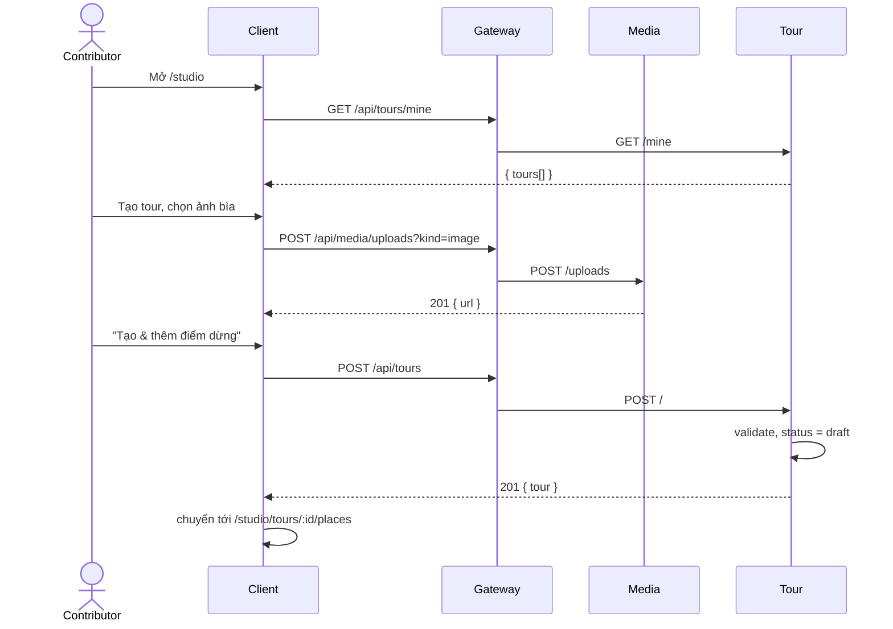

# UC09 – Quản lý tour của mình (tạo / sửa / xóa)

| Trường | Nội dung |
|---|---|
| **Use Case Number** | UC09 |
| **Use Case Name** | Quản lý tour của mình (tạo / sửa / xóa) |
| **Actor(s)** | Người đăng nội dung (Contributor) |
| **Priority** | P0 |
| **Maturity** | Implemented |
| **Summary** | Contributor xem danh sách tour của mình kèm trạng thái, tạo tour mới (tên, ngôn ngữ gốc, loại, thành phố, thời lượng, mô tả, ảnh bìa), sửa hoặc xóa tour (kể cả tour đã công khai) và từ đây đi tiếp sang gửi duyệt / xuất bản. |

## Basic Course of Events *(Tạo tour mới)*

| # | Actor Action | System Response |
|---|---|---|
| 1 | Contributor mở **Studio** (`/studio`). | |
| 2 | | Hệ thống gọi `GET /api/tours/mine`, hiển thị "Tour của tôi": thẻ tour với trạng thái (Nháp, Đang kiểm duyệt AI, Cảnh báo AI, Chờ duyệt, Công khai, Bị từ chối, Cần chỉnh sửa, Truy cập hạn chế, Đang ẩn), số điểm, tiến độ n/4 bước, bộ lọc trạng thái và ô tìm kiếm. *E1, E5* `listMyTours()` → `TourController.listMine()` → `ListMyTours.execute()` |
| 3 | Contributor chọn **"Tạo tour"** (hoặc *A1 Sửa / A2 Xóa / A3 Gửi duyệt* một tour có sẵn). | |
| 4 | | Hệ thống mở form tạo tour (`/studio/tours/new`): tên, **ngôn ngữ gốc (bắt buộc)**, loại tour, thành phố, thời lượng, mô tả, ảnh bìa, kèm khung xem trước bản nháp. `TourCreatePage`, `TourForm` |
| 5 | Contributor nhập thông tin; (tùy chọn) tải ảnh bìa lên. | |
| 6 | | (Ảnh bìa) Client kiểm định dạng / dung lượng, rồi gửi file tới Media service (`POST /api/media/uploads?kind=image`); Media kiểm lại magic bytes và trả URL. *E3* `checkFile()`, `uploadMedia()` → `UploadMedia.execute()` (`MediaFile`) |
| 7 | Contributor nhấn **"Tạo & thêm điểm dừng"**. *A4* | |
| 8 | | Tour kiểm dữ liệu (zod + value object `Language`), tạo tour với `status = draft`, `author_id = sub` của JWT. *E2* `createTour()` → `TourController.create()` → `CreateTour.execute()` → `PrismaTourRepository.create()` |
| 9 | | Client chuyển tới bước Điểm dừng (`/studio/tours/:id/places`, **UC10**). Use case kết thúc. |

## Alternative Path

**A1. Sửa tour.**

| # | Actor Action | System Response |
|---|---|---|
| A1.1 | Contributor mở tour (`/studio/tours/:id`), sửa thông tin và lưu. | |
| A1.2 | | Client chỉ gửi trường thay đổi (`PATCH /api/tours/mine/:id`). Tour đang `public` → về `draft` (`requiresResubmit: true`, "Tour công khai đã chuyển về Nháp — cần xuất bản lại"). Tour đang `ai_checking` / `ai_warning` / `pending_review` mà đổi trường AI đọc → rút khỏi hàng chờ, về `draft`. `updateTour()` → `UpdateTour.execute()` → `Tour.applyEdits()`, `withdrawTourFromModeration()` |
| A1.3 | | Nếu tour vừa rời trạng thái công khai và `CHATBOT_EVENTS_ENABLED=true`: phát `tour.unpublished` (reason `edited`). `notifyTourUnpublished()` → `EventTourCatalogPublisher.publishTourUnpublished()` |

**A2. Xóa tour.**

| # | Actor Action | System Response |
|---|---|---|
| A2.1 | Contributor chọn "Xoá tour" trong trình chỉnh sửa, xác nhận ở hộp thoại. | |
| A2.2 | | `DELETE /api/tours/mine/:id` xóa tour cùng điểm, route, ngôn ngữ, bản dịch (cascade). Tour công khai biến mất khỏi tìm kiếm (UC02); nếu bật cờ chatbot thì phát `tour.unpublished` (reason `deleted`). Client về `/studio`. `deleteTour()` → `DeleteTour.execute()` → `PrismaTourRepository.delete()` |

**A3. Gửi duyệt / xuất bản.** Contributor mở bước Xuất bản (`/studio/tours/:id/publish`) → xem checklist `GET .../readiness` (`GetPublishReadiness.execute()`, `checkPublishReadiness()`) → `POST .../publish` (`PublishTour.execute()`). Khi `MODERATION_EVENTS_ENABLED=true`: tour sang `ai_checking` và phát `tour.submitted` (`submitTourForModeration()` → `EventModerationGateway.submitTour()`, **UC15**). Khi cờ tắt: xuất bản thẳng sang `public` (quyết định D1, `Tour.publish()`, `notifyTourPublished()`). `POST .../unpublish` gỡ tour công khai về `draft` (`UnpublishTour.execute()`).

**A4. Lưu nháp & thoát** → tour được tạo ở `draft`, client quay về `/studio` (`TourCreatePage`, nút "Lưu nháp & thoát").

## Exception Path

- **E1.** Chưa có tour nào → ô trống "Chưa có tour nào" và nút "Tạo tour" (`StudioToursPage`).
- **E2.** Thiếu tên / ngôn ngữ gốc, ngôn ngữ ngoài tập hỗ trợ, loại tour sai → 400 `validation_error` ("Vui lòng nhập tên tour", "Vui lòng chọn ngôn ngữ gốc", "Ngôn ngữ không hỗ trợ: xx"). `createTourSchema`, `Language`
- **E3.** Ảnh bìa sai định dạng → 415 `unsupported_media` ("Chỉ nhận ảnh JPG, PNG, WebP hoặc GIF"); quá 8 MB → 413 `media_too_large`; lưu trữ lỗi → 503 `storage_unavailable`. `MediaFile`, `UnsupportedMediaError`, `MediaSizeError`, `StorageUnavailableError`
- **E4.** Tour không tồn tại → 404 `tour_not_found`; tour của người khác → 403 `not_tour_owner`. `TourNotFoundError`, `NotTourOwnerError`
- **E5.** Lỗi tải danh sách → cảnh báo và nút "Thử lại danh sách" (`StudioToursPage`).
- **E6.** Xuất bản khi chưa đủ điều kiện → 422 `tour_not_ready` kèm `missing[]`; trạng thái không cho phép (ví dụ `hidden`) → 409 `invalid_status_transition`; tour `restricted` → 409 `tour_restricted`. `PublishTour.execute()` (`TourNotReadyError`, `TourStatusTransitionError`, `TourRestrictedError`)

## Extension Points

- UC10 – Thêm & quản lý địa điểm; UC11 – Route & kích hoạt; UC12 – Đa ngôn ngữ & TTS; UC13 – Xem thử; UC14 – Truy cập hạn chế; UC15 – Gửi tour đi duyệt; UC17 – Thống kê tour (`/studio/tours/:id/stats`).

## Triggers

Contributor muốn tạo tour mới hoặc quản lý / chỉnh sửa tour của mình.

## Assumptions

- Contributor đã đăng nhập với role `contributor` (client chặn `/studio` bằng `RequireContributor`).

## Preconditions

- Tài khoản hợp lệ, đã đăng nhập (UC01); JWT có `role = contributor`.

## Post Conditions

- Một dòng mới trong `tour.tours` với `status = draft`, hoặc tour hiện có được sửa (có thể về `draft`), xóa (cascade), gửi duyệt (`ai_checking` + `tour.submitted`) hay xuất bản (`public`).

## Reference: Business Rules

- Tour mới luôn `draft`; chỉ tác giả (`author_id`) thao tác tour của mình.
- Tên 1–200 ký tự, mô tả tối đa 2000, thành phố tối đa 120, thời lượng là số phút nguyên dương.
- Ngôn ngữ hỗ trợ: `vi, en, fr, ja, ko, zh`. Loại tour: `walking, driving, cycling, indoor`.
- Ảnh: JPG/PNG/WebP/GIF tối đa 8 MB; Media kiểm magic bytes, không tin `Content-Type`. Ảnh bìa không nằm trong `tour.submitted` nên không qua kiểm duyệt AI.
- Sửa tour `public` → về `draft` (phải gửi duyệt / xuất bản lại). Sửa tour `restricted` vẫn giữ `restricted` (UC14).
- Checklist xuất bản bắt buộc: có tên, ngôn ngữ gốc, ít nhất 1 điểm, mọi điểm có mô tả; khi bật kiểm duyệt thêm: không điểm nào `checking` / `rejected`, tối đa 50 điểm. Ảnh bìa và mô tả tour chỉ là khuyến nghị.

## Hiện thực trong hệ thống

- **Dịch vụ:** Client (Studio); Gateway (chuyển tiếp, xác thực JWT ở service); Tour (CRUD, trạng thái, readiness, phát sự kiện); Media (lưu ảnh bìa).
- **Màn hình (client):** `/studio` (`StudioToursPage`), `/studio/tours/new` (`TourCreatePage`, `TourForm`), `/studio/tours/:id` (`TourEditorPage` trong `StudioTourLayout`), `/studio/tours/:id/publish` (`PublishStepPage`); thư mục `client/src/features/studio/`, API `client/src/lib/studio.js`, `lib/media.js`.
- **API (qua gateway):**
  - `GET /api/tours/mine`, `POST /api/tours`, `GET|PATCH|DELETE /api/tours/mine/:id`
  - `GET /api/tours/mine/:id/readiness`, `POST /api/tours/mine/:id/publish`, `POST /api/tours/mine/:id/unpublish`
  - `POST /api/media/uploads?kind=image`
- **Sự kiện (RabbitMQ):** `tour.submitted` (gửi duyệt, `MODERATION_EVENTS_ENABLED`); `tour.published` / `tour.unpublished` (`CHATBOT_EVENTS_ENABLED`). Cả hai cờ tắt thì Tour không kết nối RabbitMQ.
- **Dữ liệu:** `tour.tours` (`title, description, cover_image_url, original_language, type, status, author_id, city, duration, moderation_reasons, moderation_revision, review_reason`).
- **Tài liệu thiết kế:** [moderation-architecture.md](../../02-design/moderation-architecture.md), [chatbot-architecture.md](../../02-design/chatbot-architecture.md).
- **Mã nguồn chính:**

| Bước | Hàm / lớp | File |
|---|---|---|
| 2 | `StudioToursPage` | `client/src/features/studio/StudioToursPage.jsx` |
| 2, 8, A1, A2 | `listMyTours()`, `createTour()`, `updateTour()`, `deleteTour()` | `client/src/lib/studio.js` |
| 4 | `TourCreatePage`, `TourForm` | `client/src/features/studio/TourCreatePage.jsx`, `TourForm.jsx` |
| 6 | `checkFile()`, `uploadMedia()` | `client/src/lib/media.js` |
| 6 | `buildMediaRouter()`, `UploadMedia.execute()`, `MediaFile` | `services/media/src/interfaces/http/media-routes.js`, `application/use-cases/upload-media.js`, `domain/value-objects/media-file.js` |
| 2, 8, A1–A3 | `buildTourRouter()`, `TourController` | `services/tour/src/interfaces/http/routes/tour-routes.js`, `controllers/tour-controller.js` |
| 8 | `createTourSchema`, `updateTourSchema` | `services/tour/src/application/dtos/schemas.js` |
| 2 | `ListMyTours.execute()` | `services/tour/src/application/use-cases/list-my-tours.js` |
| 8 | `CreateTour.execute()` | `services/tour/src/application/use-cases/create-tour.js` |
| A1 | `UpdateTour.execute()`, `Tour.applyEdits()` | `services/tour/src/application/use-cases/update-tour.js`, `domain/entities/tour.js` |
| A2 | `DeleteTour.execute()` | `services/tour/src/application/use-cases/delete-tour.js` |
| A3 | `GetPublishReadiness`, `PublishTour`, `UnpublishTour` | `services/tour/src/application/use-cases/publish-tour.js` |
| A3 | `checkPublishReadiness()` | `services/tour/src/domain/tour/publish-readiness.js` |
| A1, A3 | `submitTourForModeration()`, `withdrawTourFromModeration()` | `services/tour/src/application/use-cases/submit-for-moderation.js` |
| 8, A1, A2 | `PrismaTourRepository` (`create`, `save`, `delete`) | `services/tour/src/infrastructure/persistence/prisma-tour-repository.js` |
| A3 | `EventModerationGateway.submitTour()` | `services/tour/src/infrastructure/messaging/event-moderation-gateway.js` |
| A1–A3 | `notifyTourPublished()`, `notifyTourUnpublished()`, `EventTourCatalogPublisher` | `services/tour/src/application/use-cases/notify-tour-catalog.js`, `infrastructure/messaging/event-tour-catalog-publisher.js` |

## Author(s)

(điền sau)

## Date

Tạo: 2026-10-18 · Cập nhật theo hệ thống: 2026-11-08

## Activity Diagram

[UC09-activity.xml](../../02-design/drawio/activity/UC09-activity.xml) (draw.io: File → Import from → Device). Nguồn: [specs/UC09.json](../../02-design/drawio/activity/specs/UC09.json).

## Sequence Diagram

## Boundary

"Tour của tôi" (`/studio`), Form tạo tour (`/studio/tours/new`), Trình chỉnh sửa tour (`/studio/tours/:id`) với hộp thoại xác nhận xóa, Bước Xuất bản (`/studio/tours/:id/publish`).
