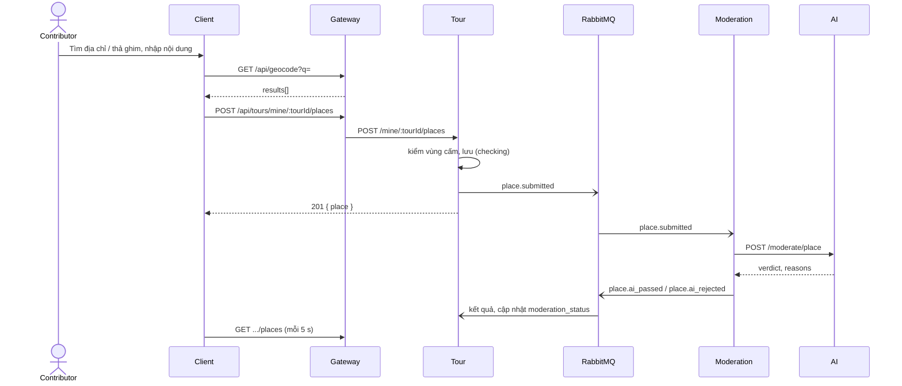

# UC10 – Thêm và quản lý địa điểm trên tour

| Trường | Nội dung |
|---|---|
| **Use Case Number** | UC10 |
| **Use Case Name** | Thêm và quản lý địa điểm trên tour |
| **Actor(s)** | Người đăng nội dung (Contributor); Hệ thống: Moderation service, AI service (khi bật kiểm duyệt) |
| **Priority** | P0 |
| **Maturity** | Implemented |
| **Summary** | Contributor thêm điểm dừng lên bản đồ (tìm địa chỉ hoặc chạm bản đồ thả ghim), nhập nội dung (tên, loại, mô tả bắt buộc, ảnh có chú thích, audio người thật tùy chọn), sắp xếp / sửa / xóa điểm. Tour kiểm vùng cấm khi lưu; khi bật kiểm duyệt, mỗi điểm được gửi cho AI quét nội dung và ảnh. |

## Basic Course of Events

| # | Actor Action | System Response |
|---|---|---|
| 1 | Contributor mở bước **Điểm dừng** (`/studio/tours/:id/places`) và chọn thêm điểm. | |
| 2 | | Hệ thống hiển thị bản đồ (bản đồ trước, form bên cạnh / bên dưới) và danh sách điểm hiện có. |
| 3 | Contributor tìm địa chỉ. *A1, E1* | |
| 4 | | Client gọi `GET /api/geocode?q=` (gateway proxy Nominatim), đặt ghim tại kết quả được chọn; ghim kéo được để chỉnh. |
| 5 | Contributor nhập tên, loại địa điểm, **mô tả (bắt buộc)**; tải ảnh (kèm chú thích) và tùy chọn audio người thật. *E3, E4* | |
| 6 | | Mỗi file được gửi tới Media (`POST /api/media/uploads?kind=image|audio`), Media trả URL. |
| 7 | Contributor lưu điểm. | |
| 8 | | Tour kiểm vị trí với các vùng cấm đang bật (`PolygonZoneChecker`, ray casting). *E2* |
| 9 | | Tour lưu điểm ở cuối danh sách (`sequence` kế tiếp); `audio_source = human` nếu có audio, ngược lại `tts`. |
| 10 | | Khi `MODERATION_EVENTS_ENABLED=true`: điểm ở `moderation_status = checking`, Tour phát `place.submitted`; Moderation gọi AI `POST /moderate/place` và trả `place.ai_passed` / `place.ai_rejected`; Tour cập nhật `approved` / `warning` / `rejected`. Client làm mới chip trạng thái mỗi 5 s khi còn điểm đang quét. *A4* |
| 11 | | Điểm hiện trên bản đồ và trong danh sách. |
| 12 | Contributor lặp lại; sắp xếp / sửa / xóa điểm. *A2, A3* | |
| 13 | | Use case kết thúc. |

## Alternative Path

**A1. Thả ghim thủ công** → chạm bản đồ đặt ghim (hoặc nhập tọa độ trong form, phương án phụ), tiếp tục bước 5.

**A2. Sắp xếp lại** → nút lên / xuống; `PATCH .../places/reorder { order: [placeId...] }` cập nhật `sequence`.

**A3. Sửa / Xóa điểm** → `PATCH .../places/:placeId` chỉ gửi trường đổi (đổi tọa độ thì kiểm lại vùng cấm; `audioUrl: null` gỡ audio người thật → về `tts`). Xóa qua hộp thoại xác nhận, `DELETE .../places/:placeId` xóa luôn bản dịch của điểm.

**A4. Ảnh hưởng tới tour đang kiểm duyệt.** Thêm / sửa nội dung AI đọc / xóa / sắp xếp điểm khi tour ở `ai_checking`, `ai_warning`, `pending_review` → tour rút về `draft`. Sửa `name`, `description`, `images` → điểm được gửi `place.submitted` lại. Tour `public` vẫn giữ `public`; khi bật cờ chatbot, Tour phát lại `tour.published`.

## Exception Path

- **E1.** Không tìm thấy địa chỉ → "Không tìm thấy địa chỉ phù hợp", gợi ý thả ghim (A1).
- **E2.** Vị trí trong vùng cấm → 422 `forbidden_zone` ("Vị trí nằm trong vùng cấm (<tên>), vui lòng dời ra ngoài"); client vẽ vùng cấm màu đỏ, hiện tên và loại vùng, gợi ý kéo ghim ra ngoài.
- **E3.** Thiếu tên hoặc mô tả → 400 `validation_error` ("Vui lòng nhập tên địa điểm", "Mô tả là bắt buộc").
- **E4.** File sai định dạng → 415 `unsupported_media`; quá giới hạn → 413 `media_too_large`.
- **E5.** AI từ chối điểm (`place.ai_rejected`) → chip "bị từ chối" kèm lý do; checklist xuất bản chặn cho tới khi sửa (UC15).
- **E6.** Điểm không thuộc tour → 404 `place_not_found`; tour của người khác → 403 `not_tour_owner`.

## Extension Points

- UC11 – Route & kích hoạt; UC12 – Đa ngôn ngữ & TTS; UC13 – Xem thử; UC15 – Gửi tour đi duyệt.

## Triggers

Contributor cần tạo nội dung các điểm dừng cho tour.

## Assumptions

- Dịch vụ geocoding (qua gateway) khả dụng; nếu không, contributor vẫn thả ghim được.

## Preconditions

- Tour đã tạo (UC09) và thuộc contributor đang đăng nhập (role `contributor`).

## Post Conditions

- Dòng mới / cập nhật trong `tour.places` (tọa độ, nội dung, ảnh, audio, `sequence`); khi bật kiểm duyệt có `moderation_status`, `moderation_reasons`, `moderation_revision` và một sự kiện `place.submitted`.

## Reference: Business Rules

- Tên 1–200 ký tự; **mô tả bắt buộc**, tối đa 5000 ký tự (sự kiện `place.submitted` cắt còn 2000).
- Tối đa 20 ảnh mỗi điểm, chú thích tối đa 300 ký tự; `place.submitted` mang 5 ảnh đầu. Upload: ảnh JPG/PNG/WebP/GIF tối đa 8 MB, audio MP3/M4A/AAC/WAV/OGG/WebM tối đa 25 MB.
- Loại địa điểm: `landmark, museum, historical, nature, food, shopping, entertainment, other`.
- Vùng cấm (quân sự, trường học, bệnh viện, lãnh sự quán...) do **Tour** kiểm khi lưu điểm, không phải Moderation.
- Kiểm duyệt điểm (UC15): AI quét text và ảnh bằng Gemini (ảnh: tối đa 5, 3 MB, jpeg/png/webp); `policy.py`: severity ≥ 0.8 Reject, ≥ 0.4 Warning. Warning không chặn xuất bản; `checking` / `rejected` thì chặn.
- Không có audio người thật → trình phát đọc mô tả bằng giọng của thiết bị (UC12).

## Hiện thực trong hệ thống

- **Dịch vụ:** Client (bản đồ, form, chip kiểm duyệt); Gateway (`/api/geocode` tự xử lý); Tour (lưu điểm, vùng cấm, phát `place.submitted`, nhận kết quả); Media (ảnh, audio); Moderation + AI (quét điểm khi bật cờ).
- **Màn hình (client):** `/studio/tours/:id/places` (`PlacesManagerPage`, `PlaceForm`, `AddressSearch`, `ForbiddenZoneDetails`, `PlaceModerationChip`); API `client/src/lib/studio.js`, `lib/geocode.js`, `lib/media.js`.
- **API (qua gateway):**
  - `GET|POST /api/tours/mine/:tourId/places`
  - `PATCH /api/tours/mine/:tourId/places/reorder`
  - `PATCH|DELETE /api/tours/mine/:tourId/places/:placeId`
  - `GET /api/geocode?q=`, `POST /api/media/uploads?kind=image|audio`
- **Sự kiện (RabbitMQ):** phát `place.submitted`; nhận `place.ai_passed` / `place.ai_rejected` (cờ `MODERATION_EVENTS_ENABLED`); `tour.published` khi tour công khai đổi nội dung (cờ `CHATBOT_EVENTS_ENABLED`).
- **Dữ liệu:** `tour.places` (`name, type, description, lat, lng, sequence, images, audio_url, audio_source, moderation_status, moderation_reasons, moderation_revision`); `tour.forbidden_zones` (`name, type, geometry` GeoJSON Polygon, `active`).
- **Tài liệu thiết kế:** [moderation-architecture.md](../../02-design/moderation-architecture.md).
- **Giới hạn đã biết:** vùng cấm là dữ liệu seed, chưa có màn hình admin để sửa.

## Author(s)

(điền sau)

## Date

Tạo: 2026-10-18 · Cập nhật theo hệ thống: 2026-11-08

## Activity Diagram

(bổ sung sau)

## Sequence Diagram

## Boundary

Bước Điểm dừng (`/studio/tours/:id/places`): bản đồ thêm điểm (tìm địa chỉ / thả ghim), form nội dung điểm, danh sách điểm (lên / xuống, sửa, xóa), chi tiết vùng cấm, chip trạng thái kiểm duyệt AI.
