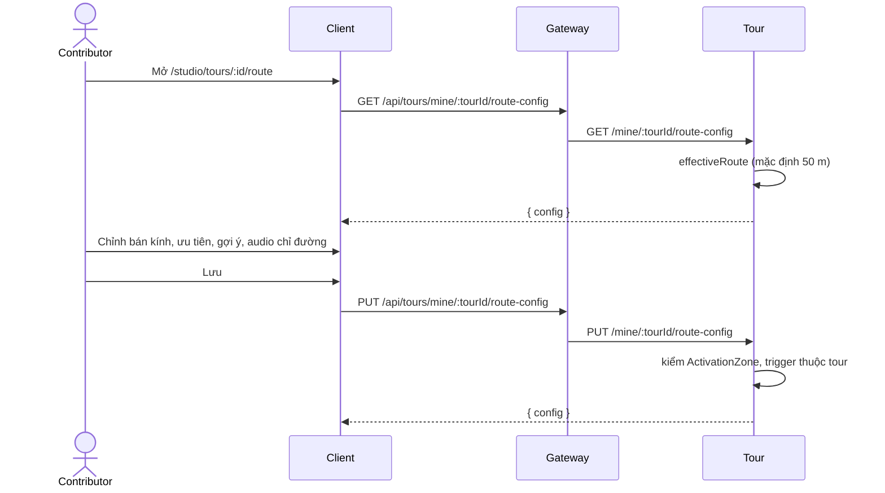

# UC11 – Vẽ route và cấu hình kích hoạt audio

| Trường | Nội dung |
|---|---|
| **Use Case Number** | UC11 |
| **Use Case Name** | Vẽ route và cấu hình kích hoạt audio |
| **Actor(s)** | Người đăng nội dung (Contributor) |
| **Priority** | P0 |
| **Maturity** | Implemented |
| **Summary** | Contributor tùy chỉnh lộ trình và vùng kích hoạt của tour: bán kính vùng tròn của từng điểm, độ ưu tiên khi các vùng chồng nhau, gợi ý "đi tiếp đến đâu" và audio chỉ đường tại ngã rẽ. Khi chưa cấu hình, hệ thống tự sinh mặc định (route nối các điểm theo thứ tự, vùng tròn 50 m) nên bước này không bắt buộc. |

## Basic Course of Events

| # | Actor Action | System Response |
|---|---|---|
| 1 | Contributor mở bước **Vùng kích hoạt** (`/studio/tours/:id/route`). | |
| 2 | | Client gọi `GET .../route-config` và danh sách điểm. Tour trả cấu hình **hiệu lực**: phần đã lưu, phần thiếu điền mặc định (`isDefault = true` nếu chưa từng lưu). Bản đồ vẽ route, các điểm và vòng tròn kích hoạt. |
| 3 | Contributor chọn một điểm (chạm ghim hoặc danh sách) và kéo thanh **bán kính** (10–300 m); vòng tròn trên bản đồ đổi theo. | |
| 4 | Contributor đặt **độ ưu tiên** khi chồng vùng: Bình thường / Cao / Rất cao. *A2* | |
| 5 | Contributor (tùy chọn) nhập **gợi ý "đi tiếp"** (lời nhắc và/hoặc tải audio). | |
| 6 | Contributor (tùy chọn) thêm **audio chỉ đường**: chạm bản đồ đặt tâm (ghim kéo được), bán kính 10–150 m, nhãn, lời nhắc đọc bằng giọng máy hoặc file audio. *A3* | |
| 7 | Contributor (tùy chọn) bấm **"Nối lại theo thứ tự điểm"** để dựng lại lộ trình. *A1* | |
| 8 | Contributor nhấn **Lưu** (thanh lưu dính đáy chỉ hiện khi có thay đổi). | |
| 9 | | Client gửi toàn bộ cấu hình một lần (`PUT .../route-config`). Tour kiểm từng vùng (`ActivationZone`), kiểm mỗi trigger trỏ tới điểm của tour và mỗi điểm chỉ một vùng, rồi upsert `route_configs`. *E1, E2* |
| 10 | | Use case kết thúc; cấu hình được dùng khi khách nghe tour (UC04) và khi xem thử (UC13). |

## Alternative Path

**A1. Dựng lại route** → path = các tọa độ điểm theo `sequence`. Client không có công cụ vẽ tự do; nếu path rỗng thì Tour tự nối các điểm.

**A2. Điều chỉnh độ ưu tiên** → lưu giá trị 0 / 10 / 20; lúc chạy (UC04) client sắp các vùng chứa vị trí theo ưu tiên giảm dần và phát điểm ưu tiên cao nhất.

**A3. Thêm / sửa / xóa audio chỉ đường** → cập nhật `navAudios`; mỗi mục nhận `id` (UUID) khi lưu.

**A4. Rời màn khi chưa lưu** → client hỏi lại trước khi rời (dirty guard).

## Exception Path

- **E1.** Vùng không hợp lệ → 400 `validation_error`: "Bán kính vùng kích hoạt phải lớn hơn 0", "Đa giác chưa khép kín (cần ít nhất 3 đỉnh)", "Loại vùng kích hoạt không hợp lệ (tròn hoặc đa giác)".
- **E2.** Trigger trỏ tới điểm không thuộc tour → "Vùng kích hoạt trỏ tới điểm không thuộc tour"; hai vùng cho một điểm → "Mỗi điểm chỉ có một vùng kích hoạt". Gợi ý trống → "Gợi ý cần có text hoặc audio".
- **E3.** Tour không tồn tại → 404 `tour_not_found`; tour của người khác → 403 `not_tour_owner`.

## Extension Points

- UC12 – Đa ngôn ngữ & TTS; UC13 – Xem thử tour; UC04 – Nghe tour (dùng cấu hình này).

## Triggers

Contributor muốn chỉnh cách audio tự phát theo vị trí cho tour.

## Assumptions

- Các điểm đã có tọa độ hợp lệ (UC10).

## Preconditions

- Tour có ít nhất 1 điểm (UC10); contributor là tác giả và đã đăng nhập.

## Post Conditions

- Một dòng trong `tour.route_configs` (1-1 với tour) chứa `path`, `triggers`, `nav_audios`. Lưu cấu hình không đổi trạng thái tour và không gửi sự kiện kiểm duyệt.

## Reference: Business Rules

- Mặc định khi chưa cấu hình: route nối các điểm theo thứ tự; mỗi điểm một vùng tròn **50 m**, ưu tiên 0, không gợi ý.
- Vùng kích hoạt: tròn (`center`, `radiusMeters` > 0, tối đa 100 km ở API) hoặc đa giác (GeoJSON Polygon khép kín, ≥ 3 đỉnh phân biệt). Studio chỉ chỉnh vùng tròn; vùng đa giác đã lưu được giữ nguyên.
- Độ ưu tiên: số nguyên 0–1000 (Studio dùng 0 / 10 / 20); số lớn thắng khi chồng vùng.
- Giới hạn: path tối đa 5000 đỉnh, tối đa 500 trigger và 500 audio chỉ đường; gợi ý và lời nhắc tối đa 500 ký tự, nhãn tối đa 200.
- Audio chỉ đường không có file → trình phát đọc lời nhắc (hoặc nhãn) bằng giọng của thiết bị.

## Hiện thực trong hệ thống

- **Dịch vụ:** Client (bản đồ, thanh bán kính, ưu tiên); Tour (cấu hình hiệu lực, kiểm hình học, lưu); Media (audio gợi ý / chỉ đường).
- **Màn hình (client):** `/studio/tours/:id/route` (`RouteConfigPage`, dùng `TourMap` của player); API `client/src/lib/studio.js`; lúc chạy `client/src/lib/zones.js` (`triggersAt`, `navAudiosAt`).
- **API (qua gateway):**
  - `GET /api/tours/mine/:tourId/route-config`
  - `PUT /api/tours/mine/:tourId/route-config`
  - `POST /api/media/uploads?kind=audio`
- **Dữ liệu:** `tour.route_configs` (`tour_id` unique, `path` Json, `triggers` Json `[{placeId, zone, priority, nextHint}]`, `nav_audios` Json `[{id, label, audioUrl, text, zone}]`).
- **Tài liệu thiết kế:** (chưa có note riêng; logic ở `services/tour/src/domain/route/effective-route.js` và `domain/value-objects/activation-zone.js`).

## Author(s)

(điền sau)

## Date

Tạo: 2026-10-18 · Cập nhật theo hệ thống: 2026-11-08

## Activity Diagram

(bổ sung sau)

## Sequence Diagram

## Boundary

Bước Vùng kích hoạt (`/studio/tours/:id/route`): bản đồ có vòng tròn kích hoạt, danh sách điểm với thanh bán kính và mức ưu tiên, ô gợi ý "đi tiếp", mục Lộ trình ("Nối lại theo thứ tự điểm"), mục Audio chỉ đường, thanh Lưu.
