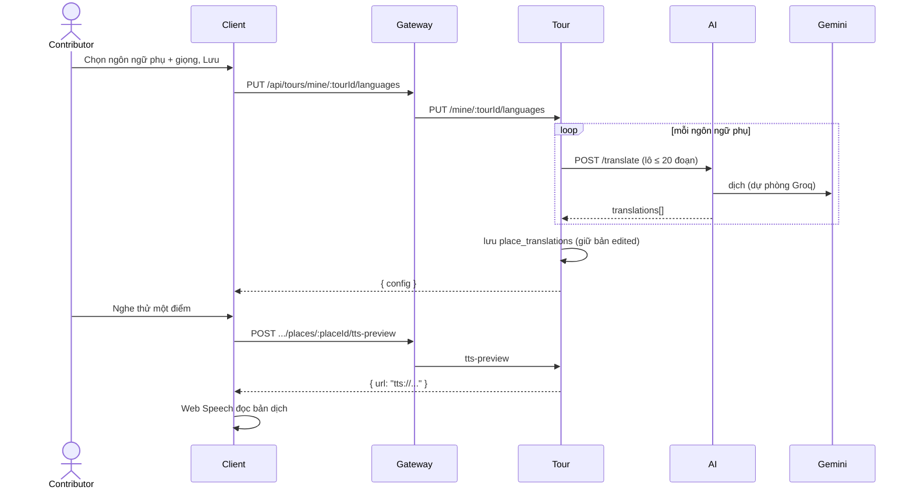

# UC12 – Cấu hình đa ngôn ngữ và TTS

| Trường | Nội dung |
|---|---|
| **Use Case Number** | UC12 |
| **Use Case Name** | Cấu hình đa ngôn ngữ và TTS |
| **Actor(s)** | Người đăng nội dung (Contributor); Hệ thống: AI service (dịch) |
| **Priority** | P1 |
| **Maturity** | Implemented |
| **Summary** | Contributor chọn các ngôn ngữ phụ và giọng đọc cho tour. Tour service tự dịch mô tả từng điểm qua AI service (`/translate`, Gemini, dự phòng Groq), lưu bản dịch; contributor nghe thử từng điểm theo từng ngôn ngữ bằng giọng đọc của thiết bị và chỉnh tay bản dịch sai. |

## Basic Course of Events

| # | Actor Action | System Response |
|---|---|---|
| 1 | Contributor mở bước **Ngôn ngữ** (`/studio/tours/:id/languages`). | |
| 2 | | Client gọi `GET .../languages`: ngôn ngữ gốc, ngôn ngữ phụ đã chọn, giọng, bản dịch từng điểm và tiến độ ("n/n điểm đã dịch"). `getLanguageConfig()` → `LanguageController.get()` → `GetLanguageConfig.execute()` → `buildLanguageConfig()` |
| 3 | Contributor chọn các ngôn ngữ phụ và giọng (nam / nữ, vùng miền tùy chọn), nhấn **Lưu**. | |
| 4 | | `PUT .../languages { secondary, voice }`: Tour chuẩn hóa mã ngôn ngữ (bỏ trùng, bỏ ngôn ngữ gốc), đồng bộ `tour_languages`, xóa ngôn ngữ bị gỡ cùng bản dịch của nó. `setTourLanguages()` → `LanguageController.set()` → `SetTourLanguages.execute()` → `PrismaTourLanguageRepository.upsertMany()`, `deleteLanguages()` |
| 5 | | Tour dịch theo lô: mỗi ngôn ngữ phụ một lượt gọi AI `POST /translate` (tối đa 20 đoạn mỗi request, ngữ cảnh = tên tour và thành phố), **chỉ các điểm chưa có bản dịch hoặc bản dịch đã cũ** (mô tả đổi sau lần dịch trước, so bằng `source_hash`); bản còn đúng và bản đã chỉnh tay được giữ. *E1* `EnsureTranslations.execute()` → `AiTranslator.translateMany()` → AI `translate()` |
| 6 | | Tour lưu `place_translations` cho mọi điểm × mọi ngôn ngữ (`text_source = source | machine | edited`, `source_hash`), render lại TTS theo giọng đã chọn và trả cấu hình mới. `PlaceholderTtsSynthesizer.synthesize()`, `PrismaPlaceTranslationRepository.upsert()` |
| 7 | Contributor chọn tab một ngôn ngữ phụ, nhấn nghe thử một điểm. *A1* | |
| 8 | Contributor sửa bản dịch sai tên riêng / thuật ngữ và lưu dòng đó. *A2* | |
| 9 | | Use case kết thúc. |

## Alternative Path

**A1. Nghe thử** → `POST .../places/:placeId/tts-preview { lang }` trả `{ url, prerendered }` (`previewTts()` → `LanguageController.preview()` → `PreviewTts.execute()`). URL hiện là định danh nội bộ `tts://...` (không phải file âm thanh), nên client đọc văn bản bằng **giọng của thiết bị** (Web Speech `SpeechSynthesisUtterance`) (`createLanguagePreview().play()`). Nhãn trên dòng: "Nghe thử bằng giọng trên thiết bị · chưa có tệp âm thanh" (`audioReadiness()`).

**A2. Chỉnh bản dịch** → `PATCH .../places/:placeId/translations/:lang { text }`: bản dịch thành `edited` và được giữ ở các lần Lưu sau (`updateTranslation()` → `LanguageController.updateTranslation()` → `UpdateTranslation.execute()`). Văn bản gốc chỉ sửa ở bước Điểm dừng (UC10).

**A4. Mô tả gốc đổi (UC10 A5).** Thêm điểm hoặc sửa mô tả → Tour dịch ngay điểm đó sang các ngôn ngữ đã bật (`refreshPlaceTranslations()`). Bản `machine` làm từ mô tả cũ không còn được tính là đã dịch (ngôn ngữ về "chờ dịch" nếu AI lỗi). Bản `edited` được giữ và đánh dấu `outdated`: trang hiện chip "Cần xem lại" và "n bản chỉnh tay cần xem lại (mô tả gốc đã đổi)"; tác giả sửa lại dòng đó (A2) thì hết cờ.

**A3. Gỡ một ngôn ngữ phụ** → lưu lại không có ngôn ngữ đó: Tour xóa dòng `tour_languages` và các bản dịch tương ứng (`PrismaTourLanguageRepository.deleteLanguages()`, `PrismaPlaceTranslationRepository.deleteByLanguages()`).

**A5. Ngôn ngữ khách yêu cầu dịch tự động (UC04).** Khách có thể yêu cầu một ngôn ngữ hỗ trợ mà tác giả chưa bật; Tour dịch một lần và lưu với `text_source = auto` (`TranslateTourForVisitor`). Bước Ngôn ngữ liệt kê các ngôn ngữ này ("Khách đã yêu cầu dịch tự động: Deutsch (2/2)"). Tác giả bật một ngôn ngữ trong số đó → Tour dùng lại các bản `auto` (đổi thành `machine`, không gọi AI lại). `GetLanguageConfig` (`autoLanguages`), `SetTourLanguages`

**A6. Tắt / bật dịch tự động cho khách** → công tắc "Cho khách yêu cầu dịch tự động": `PUT .../languages/auto-translate { enabled }` ghi `tours.auto_translate` (không đổi trạng thái tour, không đổi `updated_at`). Tắt: khách không yêu cầu được ngôn ngữ ngoài danh sách tác giả bật, và các bản `auto` đã có bị ẩn với khách. `SetAutoTranslate.execute()`, `PrismaTourRepository.setAutoTranslate()`

## Exception Path

- **E1.** AI dịch lỗi (timeout, 5xx, sai số lượng bản dịch) → 503 `translation_unavailable` ("Dịch tự động thất bại, vui lòng thử lại"); lỗi tạo TTS → 503 `tts_unavailable`. `TranslationError`, `TtsError`
- **E2.** Mã ngôn ngữ ngoài tập hỗ trợ → 400 "Ngôn ngữ không hỗ trợ: xx"; nghe thử / sửa bản dịch cho ngôn ngữ chưa cấu hình → 400 "Ngôn ngữ chưa được cấu hình cho tour"; sửa bản ngôn ngữ gốc → 400 "Sửa nội dung ngôn ngữ gốc ở phần quản lý điểm (UC10)". `Language`, `PreviewTts.execute()`, `UpdateTranslation.execute()`
- **E3.** Trình duyệt không phát được → "Không phát được bản nghe thử. Nội dung bản dịch vẫn được giữ; bạn có thể thử lại." `createLanguagePreview()`

## Extension Points

- UC10 – Thêm & quản lý địa điểm (nguồn văn bản gốc); UC13 – Xem thử; UC04 – Nghe tour theo ngôn ngữ đã chọn.

## Triggers

Contributor muốn tour phục vụ khách quốc tế mà không phải tự thu nhiều audio.

## Assumptions

- AI service khả dụng và có khóa Gemini. Không có khóa (hoặc `TRANSLATOR=echo`) thì Tour dùng `EchoTranslator` (chép nguyên văn, chọn ở `selectTranslator()`), và ngôn ngữ đó chưa được coi là đã dịch.

## Preconditions

- Tour đã có điểm với mô tả (UC10); contributor là tác giả và đã đăng nhập.

## Post Conditions

- `tour.tour_languages` có ngôn ngữ gốc (`is_source = true`) và các ngôn ngữ phụ cùng giọng đã chọn; `tour.place_translations` có bản dịch từng điểm. Nếu tour đang `public` và bật `CHATBOT_EVENTS_ENABLED`, Tour phát lại `tour.published` (bản dịch mới).

## Reference: Business Rules

- Ngôn ngữ hỗ trợ: `vi, en, fr, ja, ko, zh, es, de, th, ru` (cùng danh sách với AI service và client); tối đa 20 ngôn ngữ phụ; bản dịch 1–5000 ký tự.
- Ba tầng bản dịch: `source` (bản gốc), `machine` / `edited` (ngôn ngữ tác giả bật), `auto` (khách yêu cầu, tác giả chưa xem). Bản `auto` luôn có nhãn "Bản dịch tự động" và nút "Xem bản gốc" ở trình phát (UC04); không được gửi trong `tour.published` (chatbot không index).
- `tours.auto_translate` (mặc định bật) cho phép khách yêu cầu ngôn ngữ ngoài danh sách tác giả bật.
- Ngôn ngữ gốc là nguồn: văn bản = mô tả điểm, không dịch.
- Lưu lại cấu hình **giữ** bản dịch `edited` và bản `machine` còn đúng; chỉ dịch điểm thiếu bản dịch, bản trùng văn bản gốc (Echo) hoặc bản làm từ mô tả cũ.
- Mỗi bản dịch lưu `source_hash` (sha1 của mô tả đã chuẩn hóa khoảng trắng, 16 ký tự). Bản `machine` có hash khác mô tả hiện tại là bản cũ: không được phát, được dịch lại. Bản cũ hơn cột này (`source_hash` rỗng) vẫn được phát và được dịch lại ở lần làm mới sau. Bản `edited` có hash khác là `outdated` (vẫn phát, cần tác giả xem lại).
- Khách chỉ chọn được một ngôn ngữ phụ khi **mọi** điểm đã có bản dịch thật (khác văn bản gốc, hoặc đã chỉnh tay) (`splitLanguagesByReadiness()`, `isRealTranslation()`).
- Khi phát (UC04): ưu tiên audio người thật của điểm; không có thì đọc văn bản đúng ngôn ngữ bằng giọng của thiết bị.

## Hiện thực trong hệ thống

- **Dịch vụ:** Client (chọn ngôn ngữ, nghe thử bằng Web Speech); Tour (đồng bộ ngôn ngữ, gọi dịch, lưu bản dịch); AI (`POST /translate`, Gemini với dự phòng Groq; module dịch do thành viên khác viết).
- **Màn hình (client):** `/studio/tours/:id/languages` (`LanguagesPage`, `language-preview.js`); API `client/src/lib/studio.js`; giọng đọc `client/src/lib/speech.js`.
- **API (qua gateway):**
  - `GET|PUT /api/tours/mine/:tourId/languages`
  - `POST /api/tours/mine/:tourId/places/:placeId/tts-preview`
  - `PATCH /api/tours/mine/:tourId/places/:placeId/translations/:lang`
  - `PUT /api/tours/mine/:tourId/languages/auto-translate { enabled }` (A6)
  - Khách (UC04, A5): `POST /api/tours/:id/translations/:lang` (công khai), `POST /api/tours/:id/restricted/translations/:lang` (tour hạn chế, người đã mở khoá); giới hạn theo IP (`TRANSLATE_RATE_MAX`, `TRANSLATE_RATE_WINDOW_MS`, mặc định 10 lần / 10 phút).
  - Tour → AI (nội bộ, không qua gateway): `POST /translate` (snake_case: `source_lang`, `target_lang`, `texts`, `context`).
- **Sự kiện (RabbitMQ):** `tour.published` khi tour công khai đổi bản dịch (cờ `CHATBOT_EVENTS_ENABLED`).
- **Dữ liệu:** `tour.tour_languages` (`language_code, is_source, tts_voice_gender, tts_voice_region`); `tour.place_translations` (`language_code, text, text_source = source | machine | edited | auto, source_hash, tts_url, tts_prerendered`); `tour.tours.auto_translate`.
- **Tài liệu thiết kế:** [ai-service-spec.md](../../02-design/ai-service-spec.md).
- **Giới hạn đã biết:** chưa có TTS phía máy chủ: `PlaceholderTtsSynthesizer` chỉ sinh URL `tts://...`, `tts_prerendered` luôn `false`; client đọc bằng giọng của thiết bị nên giọng nam / nữ, vùng miền chỉ được lưu, chưa áp dụng. Gói offline (UC03) chỉ chứa văn bản, ảnh và audio người thật.
- **Mã nguồn chính:**

| Bước | Hàm / lớp | File |
|---|---|---|
| 1–8 | `LanguagesPage` | `client/src/features/studio/LanguagesPage.jsx` |
| 2, 4, A1, A2 | `getLanguageConfig()`, `setTourLanguages()`, `previewTts()`, `updateTranslation()` | `client/src/lib/studio.js` |
| A1, E3 | `createLanguagePreview()`, `audioReadiness()` | `client/src/features/studio/language-preview.js` |
| UC04 (phát) | `makeUtterance()`, `pickVoice()` (giọng thiết bị theo ngôn ngữ, không theo nam / nữ) | `client/src/lib/speech.js` |
| 2, 4, A1, A2 | `buildLanguageRouter()`, `LanguageController` | `services/tour/src/interfaces/http/routes/language-routes.js`, `controllers/language-controller.js` |
| 4 | `setLanguagesSchema`, `previewTtsSchema`, `updateTranslationSchema` | `services/tour/src/application/dtos/language-schemas.js` |
| 2 | `GetLanguageConfig.execute()`, `buildLanguageConfig()` | `services/tour/src/application/use-cases/get-language-config.js` |
| 4–6 | `SetTourLanguages.execute()` | `services/tour/src/application/use-cases/set-tour-languages.js` |
| 5, A4 | `EnsureTranslations.execute()`, `refreshPlaceTranslations()` | `services/tour/src/application/use-cases/ensure-translations.js` |
| A5 | `TranslateTourForVisitor` (`publicTour()`, `restrictedTour()`), `rateLimit()` | `services/tour/src/application/use-cases/translate-for-visitor.js`, `interfaces/http/middleware/rate-limit.js` |
| A6 | `SetAutoTranslate.execute()` | `services/tour/src/application/use-cases/set-auto-translate.js` |
| A1 | `PreviewTts.execute()` | `services/tour/src/application/use-cases/preview-tts.js` |
| A2 | `UpdateTranslation.execute()` | `services/tour/src/application/use-cases/update-translation.js` |
| 5 | `selectTranslator()`, `AiTranslator.translateMany()`, `EchoTranslator` | `services/tour/src/container.js`, `infrastructure/i18n/ai-translator.js`, `echo-translator.js` |
| 5 | `translate()` (`POST /translate`) | `services/ai/app/api/translation.py` |
| 6 | `PlaceholderTtsSynthesizer.synthesize()` | `services/tour/src/infrastructure/i18n/placeholder-tts.js` |
| 4, 6 | `PrismaTourLanguageRepository`, `PrismaPlaceTranslationRepository` | `services/tour/src/infrastructure/persistence/prisma-tour-language-repository.js`, `prisma-place-translation-repository.js` |
| Rules | `splitLanguagesByReadiness()`, `isRealTranslation()`, `needsTranslation()`, `isOutdatedEdit()`, `sourceHash()` | `services/tour/src/domain/i18n/translation-status.js`, `source-hash.js` |

## Author(s)

(điền sau)

## Date

Tạo: 2026-10-18 · Cập nhật theo hệ thống: 2026-11-09

## Activity Diagram

[UC12-activity.xml](../../02-design/drawio/activity/UC12-activity.xml) (draw.io: File → Import from → Device). Nguồn: [specs/UC12.json](../../02-design/drawio/activity/specs/UC12.json).

## Sequence Diagram

## Boundary

Bước Ngôn ngữ (`/studio/tours/:id/languages`): bộ chọn ngôn ngữ phụ, bộ chọn giọng (Giọng nữ / Giọng nam, vùng miền), danh sách "Khách đã yêu cầu dịch tự động" (nút "Bật ngôn ngữ này"), công tắc "Cho khách yêu cầu dịch tự động", tab bản dịch theo ngôn ngữ (bản gốc ↔ bản dịch, trạng thái Máy dịch / Đã sửa / Cần xem lại / Chưa dịch), nút nghe thử và lưu từng dòng.
