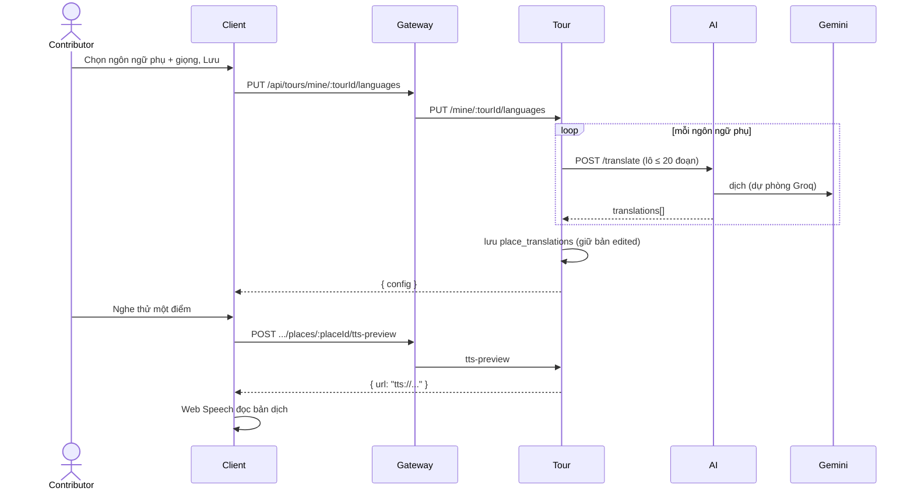

# UC12 – Cấu hình đa ngôn ngữ và TTS

| Trường | Nội dung |
|---|---|
| **Use Case Number** | UC12 |
| **Use Case Name** | Cấu hình đa ngôn ngữ và TTS |
| **Actor(s)** | Người đăng nội dung (Contributor); Hệ thống: AI service (dịch) |
| **Priority** | P1 |
| **Maturity** | Implemented |
| **Summary** | Contributor chọn các ngôn ngữ phụ và giọng đọc cho tour. Tour service tự dịch mô tả từng điểm qua AI service (`/translate`, Gemini, dự phòng Groq), lưu bản dịch; contributor nghe thử từng điểm theo từng ngôn ngữ bằng giọng đọc của thiết bị và chỉnh tay bản dịch sai. |

## Basic Course of Events

| # | Actor Action | System Response |
|---|---|---|
| 1 | Contributor mở bước **Ngôn ngữ** (`/studio/tours/:id/languages`). | |
| 2 | | Client gọi `GET .../languages`: ngôn ngữ gốc, ngôn ngữ phụ đã chọn, giọng, bản dịch từng điểm và tiến độ ("n/n điểm đã dịch"). |
| 3 | Contributor chọn các ngôn ngữ phụ và giọng (nam / nữ, vùng miền tùy chọn), nhấn **Lưu**. | |
| 4 | | `PUT .../languages { secondary, voice }`: Tour chuẩn hóa mã ngôn ngữ (bỏ trùng, bỏ ngôn ngữ gốc), đồng bộ `tour_languages`, xóa ngôn ngữ bị gỡ cùng bản dịch của nó. |
| 5 | | Tour dịch theo lô: mỗi ngôn ngữ phụ một lượt gọi AI `POST /translate` (tối đa 20 đoạn mỗi request, ngữ cảnh = tên tour và thành phố), bỏ qua bản đã chỉnh tay. *E1* |
| 6 | | Tour lưu `place_translations` cho mọi điểm × mọi ngôn ngữ (`text_source = source | machine | edited`) và trả cấu hình mới. |
| 7 | Contributor chọn tab một ngôn ngữ phụ, nhấn nghe thử một điểm. *A1* | |
| 8 | Contributor sửa bản dịch sai tên riêng / thuật ngữ và lưu dòng đó. *A2* | |
| 9 | | Use case kết thúc. |

## Alternative Path

**A1. Nghe thử** → `POST .../places/:placeId/tts-preview { lang }` trả `{ url, prerendered }`. URL hiện là định danh nội bộ `tts://...` (không phải file âm thanh), nên client đọc văn bản bằng **giọng của thiết bị** (Web Speech, thẻ ngôn ngữ đầy đủ như `vi-VN`). Nhãn trên dòng: "Nghe thử bằng giọng trên thiết bị · chưa có tệp âm thanh".

**A2. Chỉnh bản dịch** → `PATCH .../places/:placeId/translations/:lang { text }`: bản dịch thành `edited` và được giữ ở các lần Lưu sau. Văn bản gốc chỉ sửa ở bước Điểm dừng (UC10).

**A3. Gỡ một ngôn ngữ phụ** → lưu lại không có ngôn ngữ đó: Tour xóa dòng `tour_languages` và các bản dịch tương ứng.

## Exception Path

- **E1.** AI dịch lỗi (timeout, 5xx, sai số lượng bản dịch) → 503 `translation_unavailable` ("Dịch tự động thất bại, vui lòng thử lại"); lỗi tạo TTS → 503 `tts_unavailable`.
- **E2.** Mã ngôn ngữ ngoài tập hỗ trợ → 400 "Ngôn ngữ không hỗ trợ: xx"; nghe thử / sửa bản dịch cho ngôn ngữ chưa cấu hình → 400 "Ngôn ngữ chưa được cấu hình cho tour"; sửa bản ngôn ngữ gốc → 400 "Sửa nội dung ngôn ngữ gốc ở phần quản lý điểm (UC10)".
- **E3.** Trình duyệt không phát được → "Không phát được bản nghe thử. Nội dung bản dịch vẫn được giữ; bạn có thể thử lại."

## Extension Points

- UC10 – Thêm & quản lý địa điểm (nguồn văn bản gốc); UC13 – Xem thử; UC04 – Nghe tour theo ngôn ngữ đã chọn.

## Triggers

Contributor muốn tour phục vụ khách quốc tế mà không phải tự thu nhiều audio.

## Assumptions

- AI service khả dụng và có khóa Gemini. Không có khóa (hoặc `TRANSLATOR=echo`) thì Tour dùng `EchoTranslator` (chép nguyên văn), và ngôn ngữ đó chưa được coi là đã dịch.

## Preconditions

- Tour đã có điểm với mô tả (UC10); contributor là tác giả và đã đăng nhập.

## Post Conditions

- `tour.tour_languages` có ngôn ngữ gốc (`is_source = true`) và các ngôn ngữ phụ cùng giọng đã chọn; `tour.place_translations` có bản dịch từng điểm. Nếu tour đang `public` và bật `CHATBOT_EVENTS_ENABLED`, Tour phát lại `tour.published` (bản dịch mới).

## Reference: Business Rules

- Ngôn ngữ hỗ trợ: `vi, en, fr, ja, ko, zh`; tối đa 20 ngôn ngữ phụ; bản dịch 1–5000 ký tự.
- Ngôn ngữ gốc là nguồn: văn bản = mô tả điểm, không dịch.
- Lưu lại cấu hình **giữ** bản dịch `edited`, dịch lại các bản `machine`.
- Khách chỉ chọn được một ngôn ngữ phụ khi **mọi** điểm đã có bản dịch thật (khác văn bản gốc, hoặc đã chỉnh tay).
- Khi phát (UC04): ưu tiên audio người thật của điểm; không có thì đọc văn bản đúng ngôn ngữ bằng giọng của thiết bị.

## Hiện thực trong hệ thống

- **Dịch vụ:** Client (chọn ngôn ngữ, nghe thử bằng Web Speech); Tour (đồng bộ ngôn ngữ, gọi dịch, lưu bản dịch); AI (`POST /translate`, Gemini với dự phòng Groq; module dịch do thành viên khác viết).
- **Màn hình (client):** `/studio/tours/:id/languages` (`LanguagesPage`, `language-preview.js`); API `client/src/lib/studio.js`; giọng đọc `client/src/lib/speech.js`.
- **API (qua gateway):**
  - `GET|PUT /api/tours/mine/:tourId/languages`
  - `POST /api/tours/mine/:tourId/places/:placeId/tts-preview`
  - `PATCH /api/tours/mine/:tourId/places/:placeId/translations/:lang`
  - Tour → AI (nội bộ, không qua gateway): `POST /translate` (snake_case: `source_lang`, `target_lang`, `texts`, `context`).
- **Sự kiện (RabbitMQ):** `tour.published` khi tour công khai đổi bản dịch (cờ `CHATBOT_EVENTS_ENABLED`).
- **Dữ liệu:** `tour.tour_languages` (`language_code, is_source, tts_voice_gender, tts_voice_region`); `tour.place_translations` (`language_code, text, text_source, tts_url, tts_prerendered`).
- **Tài liệu thiết kế:** [ai-service-spec.md](../../02-design/ai-service-spec.md).
- **Giới hạn đã biết:** chưa có TTS phía máy chủ: `PlaceholderTtsSynthesizer` chỉ sinh URL `tts://...`, `tts_prerendered` luôn `false`; client đọc bằng giọng của thiết bị nên giọng nam / nữ, vùng miền chỉ được lưu, chưa áp dụng. Gói offline (UC03) chỉ chứa văn bản, ảnh và audio người thật.

## Author(s)

(điền sau)

## Date

Tạo: 2026-10-18 · Cập nhật theo hệ thống: 2026-11-08

## Activity Diagram

(bổ sung sau)

## Sequence Diagram

## Boundary

Bước Ngôn ngữ (`/studio/tours/:id/languages`): bộ chọn ngôn ngữ phụ, bộ chọn giọng (Giọng nữ / Giọng nam, vùng miền), tab bản dịch theo ngôn ngữ (bản gốc ↔ bản dịch, trạng thái Máy dịch / Đã sửa / Chưa dịch), nút nghe thử và lưu từng dòng.
