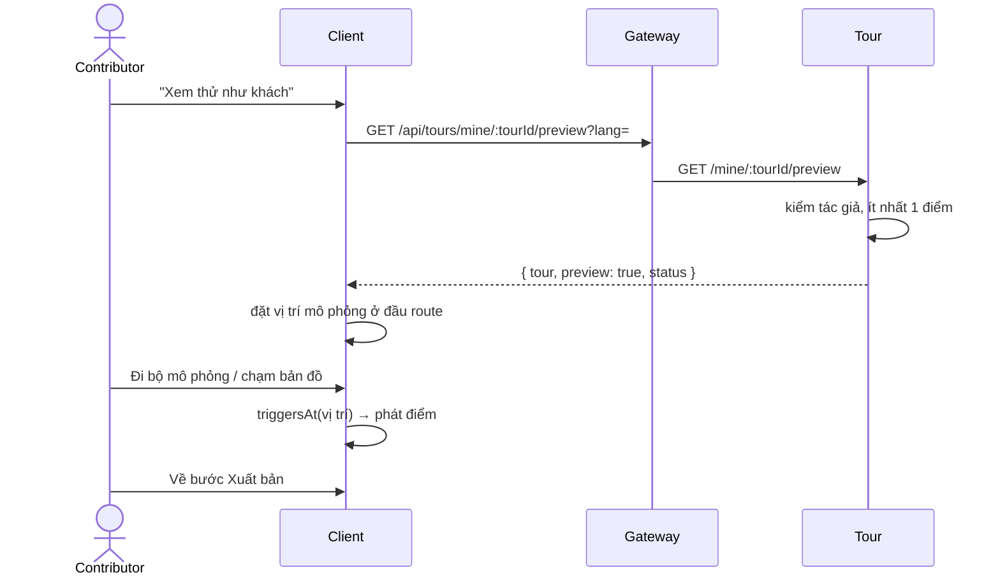

# UC13 – Xem thử tour (preview)

| Trường | Nội dung |
|---|---|
| **Use Case Number** | UC13 |
| **Use Case Name** | Xem thử tour (preview) |
| **Actor(s)** | Người đăng nội dung (Contributor) |
| **Priority** | P1 |
| **Maturity** | Implemented |
| **Summary** | Contributor mở tour của mình trong đúng trình phát của khách (UC04), ở mọi trạng thái, với GPS mô phỏng (đi bộ dọc route hoặc chạm bản đồ) hoặc nghe từng điểm, để kiểm tra nội dung, audio và vùng kích hoạt trước khi gửi duyệt / xuất bản. |

## Basic Course of Events

| # | Actor Action | System Response |
|---|---|---|
| 1 | Ở bước Xuất bản (`/studio/tours/:id/publish`), contributor nhấn **"Xem thử như khách"**. | |
| 2 | | Client mở `/studio/tours/:tourId/preview?mode=gps` và gọi `GET /api/tours/mine/:tourId/preview?lang=`. *E1* |
| 3 | | Tour kiểm quyền tác giả, dựng view giống chi tiết công khai (`buildTourDetailView`: điểm, ảnh, bản dịch, route và vùng hiệu lực) kèm `preview: true` và `status`. |
| 4 | | Trình phát mở ở chế độ "Xem thử — đi bộ mô phỏng": vị trí mô phỏng đặt ở đầu route, không cần GPS thật. |
| 5 | Contributor bấm **đi bộ mô phỏng** (chọn tốc độ) hoặc chạm bản đồ để dời vị trí. *A1* | |
| 6 | | Khi vị trí vào vùng kích hoạt, trình phát tự phát điểm đó như UC04 (ưu tiên vùng cao hơn khi chồng nhau; audio người thật hoặc giọng của thiết bị), hiện văn bản, ảnh, gợi ý "đi tiếp" và audio chỉ đường. |
| 7 | Contributor kiểm tra nội dung; khi xong nhấn "Về bước Xuất bản" hoặc "Về trình chỉnh sửa". *A2* | |
| 8 | | Use case kết thúc. |

## Alternative Path

**A1. Xem thử từng điểm** → chế độ "Xem thử từng điểm" (remote): chọn điểm trong danh sách để nghe, không dùng vị trí.

**A2. Phát hiện lỗi → sửa ngay** → nút sửa trên một điểm mở `/studio/tours/:id/places?edit=<placeId>` (UC10); route / vùng sửa ở UC11, bản dịch ở UC12.

**A3. Đổi ngôn ngữ nghe** → client gọi lại preview với `?lang=` khác.

## Exception Path

- **E1.** Tour chưa có điểm nào → 422 `tour_not_previewable` ("Chưa thể xem thử: tour cần có ít nhất một điểm dừng"); client hiện nút "Thêm điểm dừng". Route và vùng chưa cấu hình **không** chặn (được tự sinh).
- **E2.** Tour của người khác → 403 `not_tour_owner`; tour không tồn tại → 404 `tour_not_found`.
- **E3.** Trình duyệt chặn âm thanh / không có giọng cho ngôn ngữ → trình phát báo và cho phát lại (như UC04).

## Extension Points

- UC10 – Địa điểm; UC11 – Route & kích hoạt; UC12 – Đa ngôn ngữ & TTS; UC15 – Gửi tour đi duyệt.

## Triggers

Contributor muốn kiểm tra trải nghiệm tour trước khi gửi duyệt / xuất bản.

## Assumptions

- Trình duyệt hỗ trợ phát audio và Web Speech; không cần quyền định vị.

## Preconditions

- Tour có ít nhất 1 điểm (UC10); contributor là tác giả, đã đăng nhập với role `contributor`.

## Post Conditions

- Không có thay đổi dữ liệu: preview chỉ đọc, không đổi trạng thái tour, không ghi vào "mở gần đây" (`remember = false`), luôn bắt đầu tiến độ mới (`freshProgress`), không gửi lượt nghe vào thống kê UC17 (`recordStats` tắt).

## Reference: Business Rules

- Preview chạy với **mọi** trạng thái (draft, ai_checking, rejected, hidden...) nhưng chỉ tác giả xem được; không công khai.
- Dùng chung dữ liệu và trình phát của khách nên kết quả giống UC04: route mặc định nối các điểm, vùng tròn 50 m nếu chưa cấu hình.
- Công cụ mô phỏng GPS chỉ bật sẵn trong preview (khách thường cần `?debug=1`).

## Hiện thực trong hệ thống

- **Dịch vụ:** Client (trình phát UC04 với mô phỏng); Tour (dựng view preview, kiểm quyền).
- **Màn hình (client):** `/studio/tours/:tourId/preview` (`PreviewTourRoute` trong `client/src/App.jsx` → `features/player/TourPlayerPage.jsx` với `allowSimulation`, `SimBar`, `TourMap`); lối vào ở `features/studio/PublishPanel.jsx`; API `client/src/lib/studio.js` (`previewTour`).
- **API (qua gateway):** `GET /api/tours/mine/:tourId/preview?lang=`
- **Dữ liệu:** chỉ đọc `tour.tours`, `tour.places`, `tour.route_configs`, `tour.tour_languages`, `tour.place_translations`.
- **Tài liệu thiết kế:** (chưa có note riêng; xem `services/tour/src/application/use-cases/preview-tour.js`).

## Author(s)

(điền sau)

## Date

Tạo: 2026-10-18 · Cập nhật theo hệ thống: 2026-11-08

## Activity Diagram

(bổ sung sau)

## Sequence Diagram

## Boundary

Trình phát xem thử (`/studio/tours/:tourId/preview`): bản đồ với vị trí mô phỏng, thanh mô phỏng (đi bộ, tốc độ), danh sách điểm (chế độ từng điểm), khung nội dung điểm, nút sửa điểm, nút "Về trình chỉnh sửa" / "Về bước Xuất bản".
