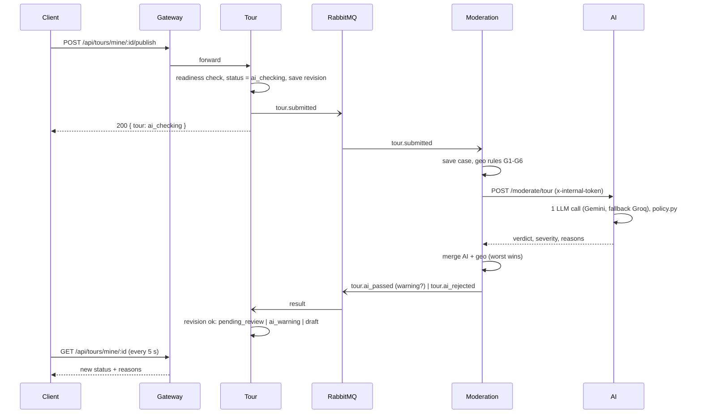

# UC15 – Gửi tour đi duyệt (Kiểm duyệt AI)

| Trường | Nội dung |
|---|---|
| **Use Case Number** | UC15 |
| **Use Case Name** | Gửi tour đi duyệt (Kiểm duyệt AI – Tầng 1) |
| **Actor(s)** | Người đăng nội dung (Contributor); Hệ thống: Moderation service, AI service (Gemini, dự phòng Groq) |
| **Priority** | P0 |
| **Maturity** | Implemented |
| **Summary** | Contributor nhấn "Gửi duyệt" ở bước Xuất bản của Studio. Tour kiểm tra điều kiện, chuyển tour sang `ai_checking` và phát sự kiện `tour.submitted`. Moderation chạy luật vị trí G1–G6, gọi AI kiểm duyệt văn bản, gộp kết quả và trả về **Pass / Warning / Reject** kèm lý do qua RabbitMQ (bất đồng bộ). Pass → `pending_review`, Warning → `ai_warning` (cả hai vào hàng chờ Admin, UC19); Reject → tour về `draft` kèm lý do. Mỗi điểm dừng đã được kiểm duyệt riêng (văn bản + ảnh) ngay khi lưu điểm. |

## Basic Course of Events

| # | Actor Action | System Response |
|---|---|---|
| 1 | Contributor mở bước **"Gửi duyệt"** (`/studio/tours/:id/publish`). | Client gọi `GET /api/tours/mine/:id/readiness` và hiển thị checklist (bắt buộc / khuyến nghị). *A3* `getPublishReadiness()` → `GetPublishReadiness.execute()`, `checkPublishReadiness()` |
| 2 | Contributor nhấn **"Gửi duyệt"** và xác nhận trong hộp thoại. | Client gọi `POST /api/tours/mine/:id/publish`. `PublishPanel`, `publishTour()` → `TourController.publish()` |
| 3 | | Tour kiểm tra quyền sở hữu, trạng thái và điều kiện: có tên, ngôn ngữ gốc, ≥1 điểm dừng, mọi điểm có mô tả, không điểm nào `checking` / `rejected`, tối đa 50 điểm. *E1, E2, E3, E4* `PublishTour.execute()`, `checkPublishReadiness()` |
| 4 | | Tour đặt `status = ai_checking`, lưu `moderationRevision` (= `updatedAt`) rồi phát `tour.submitted` (nội dung tour + các điểm có `lat`, `lng`, `sequence`). Trả ngay tour ở `ai_checking`. *E5* `Tour.submitForModeration()`, `submitTourForModeration()`, `EventModerationGateway.submitTour()` |
| 5 | | Client hiển thị *"AI đang kiểm duyệt tour"* kèm thời gian đã chờ và hỏi lại `GET /api/tours/mine/:id` mỗi 5 giây khi trang đang mở. `SubmissionStatus`, `useVisiblePoll()`, `getMyTour()` |
| 6 | | Moderation nhận sự kiện, lưu case theo `(tour, tourId, revision)`, chạy luật vị trí G1–G6 (không gọi LLM). `createTourSubmittedHandler()`, `RunTourReview.execute()` → `ReviewCaseFlow.execute()`, `evaluateTourGeo()` |
| 7 | | Moderation gọi `POST /moderate/tour` của AI (header `x-internal-token`). AI kiểm tra đầu vào, gọi **một** lần LLM (Gemini; Groq khi Gemini timeout / 429 / 5xx), áp `policy.py`: severity ≥ 0.8 Reject, ≥ 0.4 Warning, còn lại Pass. *E6, E7* `HttpAiReviewer.reviewTour()`, `toTourRequest()`; AI: `moderate_tour()` (api) → `run_moderation()` → `TourModerator.moderate_tour()`, `FallbackLLM`, `policy.decide()` |
| 8 | | Moderation gộp kết quả AI và luật vị trí (kết quả xấu nhất thắng, severity lớn nhất, lý do có `source: ai \| geo`) và phát `tour.ai_passed` hoặc `tour.ai_rejected`. *A1, A2* `RunTourReview.check()`, `mergeVerdicts()`, `buildTourResultEvent()`, `EventPublisher.publish()` |
| 9 | | (**Pass**) Tour chỉ áp dụng kết quả khi tour còn `ai_checking` và `revision` khớp: đặt `status = pending_review`, lưu lý do, `reviewQueuedAt = now`. Tour vào hàng chờ Admin (UC19). `buildModerationResultHandler()`, `ApplyModerationResult.applyTour()` |
| 10 | | Client thấy trạng thái mới: *"Đang chờ Admin duyệt"*. Use case kết thúc. `submissionResult()` |

## Alternative Path

**A1. Kết quả = Warning** (`tour.ai_passed` với `warning: true`) → Tour đặt `status = ai_warning` và lưu lý do; tour vẫn vào hàng chờ Admin và được xếp **đầu hàng chờ**. Client hiển thị *"Đang chờ Admin duyệt — có cảnh báo AI"* kèm danh sách lý do. Quay về bước 10. `ApplyModerationResult.applyTour()`, `ModerationReasons`

**A2. Kết quả = Reject** (`tour.ai_rejected`) → Tour đưa tour về `draft`, lưu `moderationReasons`; không vào hàng chờ Admin. Client hiển thị *"AI đã từ chối lần gửi duyệt trước"* kèm lý do (trường, loại vi phạm, nguồn AI / Kiểm tra vị trí), nút đổi thành **"Gửi duyệt lại"**. Notification lưu một thông báo trong app (UC16) **và** gửi email *"Tour không qua kiểm duyệt tự động"* kèm lý do tới email của tác giả (lấy từ sự kiện, nếu thiếu thì tra Auth theo `contributorId`). Use case kết thúc. `ApplyModerationResult.applyTour()`; Notification: `handleEvent()`, `buildTourEmail()`

**A3. Xem thử trước khi gửi** → contributor chọn "Xem thử", hệ thống mở UC13 (`/studio/tours/:tourId/preview`), sau đó quay lại bước 1.

**A4. Sửa tour khi đang duyệt** → sửa thông tin tour hoặc thêm / sửa / xoá / sắp xếp điểm khi tour ở `ai_checking`, `ai_warning` hoặc `pending_review` đưa tour về `draft` và xoá `moderationRevision`; kết quả AI đến muộn bị bỏ qua (revision cũ). Contributor phải gửi duyệt lại. `withdrawTourFromModeration()`

**A5. Kiểm duyệt điểm dừng (trước UC15, khi lưu điểm ở UC10)** → mỗi lần thêm / sửa điểm, Tour kiểm tra vùng cấm, đặt `moderationStatus = checking` và phát `place.submitted`. Moderation gọi `POST /moderate/place` (văn bản + tối đa 5 ảnh, Gemini) và trả `place.ai_passed` / `place.ai_rejected`; Tour đặt điểm `approved`, `warning` hoặc `rejected`. Điểm `warning` không chặn gửi duyệt. `AddPlace.execute()` / `UpdatePlace.execute()`, `PolygonZoneChecker.assertAllowed()`, `submitPlaceForModeration()`, `EventModerationGateway.submitPlace()`; Moderation: `RunPlaceReview`, `HttpAiReviewer.reviewPlace()`; AI: `PlaceModerator.moderate_place()`; Tour: `ApplyModerationResult.applyPlace()`

**A6. Máy chủ tắt kiểm duyệt** (`MODERATION_EVENTS_ENABLED=false`, mặc định) → nút là "Xuất bản", tour chuyển thẳng sang `public` (UC09 A3), không có Tầng 1. `PublishTour.execute()` (nhánh không có `moderation`), `Tour.publish()`

## Exception Path

- **E1.** Thiếu điều kiện bắt buộc → 422 `tour_not_ready` *"Tour chưa đủ điều kiện xuất bản"* kèm `missing[{key, label}]` (ví dụ *"Điểm chưa có mô tả: …"*); checklist có liên kết tới chỗ cần sửa. `TourNotReadyError`
- **E2.** Còn điểm đang kiểm duyệt hoặc bị AI từ chối → mục `placesModeration` không đạt: *"Điểm đang được AI kiểm duyệt: …"* / *"Điểm bị AI từ chối, cần sửa: …"*. Quá 50 điểm → mục `placesLimit`: *"Tour có N điểm dừng, tối đa 50 để gửi duyệt"*. `checkPublishReadiness()`
- **E3.** Tour đang ở chế độ truy cập hạn chế (UC14) → 409 `tour_restricted`; tour bị Admin ẩn → 409 `invalid_status_transition`. `TourRestrictedError`, `TourStatusTransitionError`
- **E4.** Không phải tác giả → 403 `not_tour_owner`; tour không tồn tại → 404. `NotTourOwnerError`, `TourNotFoundError`
- **E5.** Không phát được `tour.submitted` (RabbitMQ lỗi) → lỗi chỉ được ghi log, tour vẫn `ai_checking`; contributor có thể gửi lại. `submitTourForModeration()`
- **E6.** AI lỗi tạm thời (timeout, 429, 503, mạng) sau 3 lần thử, hoặc 401 (lỗi cấu hình) → case `ai_failed`, **không phát kết quả**; tour vẫn `ai_checking`, sweeper của Moderation thử lại mỗi 60 giây. `withRetry()`, `classifyStatus()`, `startRetrySweeper()` → `RetryFailedCases.execute()` → `ReviewCaseFlow.retry()`
- **E7.** AI trả 422 (đầu vào không hợp lệ, lỗi vĩnh viễn) hoặc sự kiện thiếu nội dung → Moderation phát Warning "cần người xem" (tour vào `ai_warning`); nếu G1 đã Reject thì Reject vẫn thắng. Văn bản bị nhà cung cấp chặn (`LLMBlockedError`) → Reject, loại `other`. `RunTourReview.permanentResult()`, `isTourComplete()`
- **E8.** Client hỏi trạng thái thất bại → *"Chưa cập nhật được trạng thái: …"* kèm nút "Thử lại"; không bao giờ báo kết quả sớm. `SubmissionStatus`

## Extension Points

- UC13 – Xem thử tour (A3); UC10 – Thêm & quản lý địa điểm (A5, vùng cấm); UC19 – Duyệt / từ chối tour (sau bước 9); UC16 – Theo dõi trạng thái và nhận thông báo (A2); UC14 – Truy cập hạn chế (E3).

## Triggers

Contributor hoàn tất nội dung tour và muốn công khai.

## Assumptions

- Máy chủ chạy với `MODERATION_EVENTS_ENABLED=true`; RabbitMQ, Moderation và AI hoạt động (nếu AI tạm lỗi, kết quả đến muộn nhờ sweeper).
- Mọi điểm dừng đã được kiểm duyệt khi lưu (A5).

## Preconditions

- Contributor đã đăng nhập, là tác giả tour; tour ở `draft`, `rejected` hoặc `changes_requested` (không `restricted`, không `hidden`).

## Post Conditions

- Ngay sau bước 4: tour `ai_checking`, `moderation_revision` được đặt, `moderation_reasons` rỗng; có `tour.submitted` trên RabbitMQ.
- Sau kết quả: tour `pending_review` (Pass) / `ai_warning` (Warning) / `draft` + `moderation_reasons` (Reject); có một bản ghi `moderation_cases` (trạng thái `done`, `failed_permanent` hoặc `ai_failed`).
- Reject: tác giả có một thông báo trong app và một email.
- Tour chưa hiện ở Khám phá cho đến khi Admin duyệt (UC19).

## Reference: Business Rules

- Mô hình kiểm duyệt nhiều tầng; UC này là **Tầng 1 – AI tự động**. Mọi nghi ngờ chuyển cho người (Admin), không tự Pass.
- Một lần gọi LLM cho mỗi điểm và một cho mỗi tour; quét tour **không** quét lại điểm (chỉ đọc tên + 300 ký tự đầu mô tả điểm để xét tính nhất quán).
- Ngưỡng `policy.py`: Reject khi severity ≥ 0.8, Warning khi ≥ 0.4 (`MODERATION_REJECT_THRESHOLD`, `MODERATION_WARNING_THRESHOLD`).
- Loại vi phạm: `hate, violence, sexual, scam, misleading, irrelevant, other` (AI) và `route` (luật vị trí).
- Luật vị trí G1–G6 trong Moderation (G1 toạ độ sai, G2 điểm trùng < 10 m, G3 chặng quá dài, G4 quá phân tán, G5 thời lượng, G6 lộ trình zig-zag; giới hạn theo `type`). **Chỉ G1 Reject**, còn lại Warning. Tour `indoor` chỉ chạy G1, G2.
- Vùng cấm do Tour kiểm tra khi lưu điểm (UC10), không phải ở UC15.
- Ảnh điểm: tối đa 5 ảnh, mỗi ảnh 3 MB, jpeg/png/webp, chỉ https và host cho phép; chỉ Gemini kiểm ảnh (Groq chỉ dùng cho văn bản). Điểm có ảnh không kiểm được không bao giờ Pass.
- Giới hạn: tên tour 200, mô tả tour 5000, tên điểm 200, mô tả điểm 2000 ký tự, tối đa 50 điểm.
- Kết quả có `revision` cũ hoặc đến khi tour không còn `ai_checking` bị bỏ qua.

## Hiện thực trong hệ thống

- **Dịch vụ:**
  - Client: checklist, nút "Gửi duyệt", trạng thái và lý do kiểm duyệt, hỏi lại mỗi 5 giây.
  - Gateway: chuyển `/api/tours` tới Tour.
  - Tour: kiểm tra điều kiện, đổi trạng thái, phát `*.submitted`, nhận kết quả (queue `tour.moderation-results`), lưu lý do; kiểm tra vùng cấm khi lưu điểm.
  - Moderation: lưu case, luật vị trí G1–G6, gọi AI, thử lại, gộp tín hiệu, phát kết quả. Không gọi LLM trực tiếp.
  - AI: `POST /moderate/place`, `POST /moderate/tour` (stateless, Gemini, dự phòng Groq).
  - Notification: với `tour.ai_rejected`, lưu thông báo trong app (UC16) rồi gửi email kèm lý do cho tác giả.
- **Màn hình (client):** `/studio/tours/:id/publish` (`features/studio/PublishStepPage.jsx`, `PublishPanel.jsx`, `SubmissionStatus.jsx`, `ModerationReasons.jsx`), `/studio/tours/:id/places` (chip kiểm duyệt từng điểm), `/studio/tours/:tourId/preview`.
- **API (qua gateway):**
  - `GET /api/tours/mine/:id/readiness`
  - `POST /api/tours/mine/:id/publish`
  - `GET /api/tours/mine/:id`
  - Nội bộ (không qua gateway): `POST /moderate/place`, `POST /moderate/tour` (Moderation → AI, JSON snake_case).
- **Sự kiện (RabbitMQ):** Tour phát `place.submitted`, `tour.submitted`; Moderation phát `place.ai_passed`, `place.ai_rejected`, `tour.ai_passed`, `tour.ai_rejected` (Warning = `ai_passed` với `warning: true`).
- **Dữ liệu:** `tour.tours` (`status`, `moderation_reasons`, `moderation_revision`, `review_queued_at`), `tour.places` (`moderation_status`, `moderation_reasons`, `moderation_revision`), `tour.forbidden_zones`; `moderation.moderation_cases`.
- **Mã nguồn chính:**

| Bước | Hàm / lớp | File |
|---|---|---|
| 1 | `PublishStepPage`, `PublishPanel` | `client/src/features/studio/PublishStepPage.jsx`, `client/src/features/studio/PublishPanel.jsx` |
| 1–2 | `getPublishReadiness()`, `publishTour()`, `getMyTour()` | `client/src/lib/studio.js` |
| 5, 10 | `SubmissionStatus`, `useVisiblePoll()` | `client/src/features/studio/SubmissionStatus.jsx`, `client/src/hooks/useVisiblePoll.js` |
| 5, 10 | `submissionResult()`, `isModerationMode()`, `blockingPlaces()` | `client/src/lib/submission.js` |
| 1–2 | `buildTourRouter()` (`/mine/:id/readiness`, `/mine/:id/publish`) | `services/tour/src/interfaces/http/routes/tour-routes.js` |
| 1–2 | `TourController.readiness()`, `TourController.publish()` | `services/tour/src/interfaces/http/controllers/tour-controller.js` |
| 3 | `GetPublishReadiness`, `PublishTour` | `services/tour/src/application/use-cases/publish-tour.js` |
| 3 | `checkPublishReadiness()` | `services/tour/src/domain/tour/publish-readiness.js` |
| 4, A4, A5 | `submitTourForModeration()`, `submitPlaceForModeration()`, `withdrawTourFromModeration()` | `services/tour/src/application/use-cases/submit-for-moderation.js` |
| 4, A5 | `EventModerationGateway.submitTour()`, `.submitPlace()` | `services/tour/src/infrastructure/messaging/event-moderation-gateway.js` |
| A5 | `PolygonZoneChecker.assertAllowed()` | `services/tour/src/infrastructure/zone/polygon-zone-checker.js` |
| 6 | `createTourSubmittedHandler()` | `services/moderation/src/interfaces/events/tour-submitted-consumer.js` |
| A5 | `createPlaceSubmittedHandler()` | `services/moderation/src/interfaces/events/place-submitted-consumer.js` |
| 6–8 | `ReviewCaseFlow.execute()`, `.retry()` | `services/moderation/src/application/use-cases/review-case-flow.js` |
| 6–8 | `RunTourReview.check()`, `buildTourResultEvent()` | `services/moderation/src/application/use-cases/run-tour-review.js` |
| A5 | `RunPlaceReview`, `buildPlaceResultEvent()` | `services/moderation/src/application/use-cases/run-place-review.js` |
| 6 | `evaluateTourGeo()` | `services/moderation/src/domain/geo/tour-geo-rules.js` |
| 8 | `mergeVerdicts()` | `services/moderation/src/domain/moderation/merge-verdicts.js` |
| 7 | `toTourRequest()`, `fromAiResponse()` | `services/moderation/src/application/dtos/ai-mapping.js` |
| 7, E6 | `HttpAiReviewer.reviewTour()`, `withRetry()` | `services/moderation/src/infrastructure/ai/http-ai-reviewer.js`, `services/moderation/src/infrastructure/retry/with-retry.js` |
| E6 | `startRetrySweeper()`, `RetryFailedCases.execute()` | `services/moderation/src/interfaces/jobs/retry-sweeper.js`, `services/moderation/src/application/use-cases/retry-failed-cases.js` |
| 8 | `EventPublisher.publish()` | `services/moderation/src/infrastructure/messaging/event-publisher.js` |
| 7 | `moderate_tour()`, `moderate_place()` (routes), `run_moderation()` | `services/ai/app/api/moderation.py`, `services/ai/app/moderation/pipeline.py` |
| 7 | `TourModerator.scan_tour()`, `.moderate_tour()`; `FallbackLLM` | `services/ai/app/moderation/tour_service.py`, `services/ai/app/llm/fallback.py` |
| 7 | `decide()` | `services/ai/app/moderation/policy.py` |
| 9 | `buildModerationResultHandler()`, `ApplyModerationResult` | `services/tour/src/interfaces/events/moderation-result-handler.js`, `services/tour/src/application/use-cases/apply-moderation-result.js` |

- **Tài liệu thiết kế:** [moderation-architecture.md](../../02-design/moderation-architecture.md), [admin-review-api.md](../../02-design/admin-review-api.md).
- **Giới hạn đã biết:** vùng cấm là dữ liệu seed, chưa có màn hình Admin để sửa.

## Author(s)

(điền sau)

## Date

Tạo: 2026-10-18 · Cập nhật theo hệ thống: 2026-11-08

## Activity Diagram

[UC15-activity.xml](../../02-design/drawio/activity/UC15-activity.xml) (draw.io: File → Import from → Device). Nguồn: [specs/UC15.json](../../02-design/drawio/activity/specs/UC15.json).

## Sequence Diagram

## Boundary

- Bước "Gửi duyệt" của Studio (`/studio/tours/:id/publish`): checklist, hộp xác nhận "Gửi duyệt", khung trạng thái và lý do kiểm duyệt.
- Trang quản lý điểm dừng (`/studio/tours/:id/places`): chip trạng thái kiểm duyệt và lý do của từng điểm.
- Xem thử tour (`/studio/tours/:tourId/preview`).
