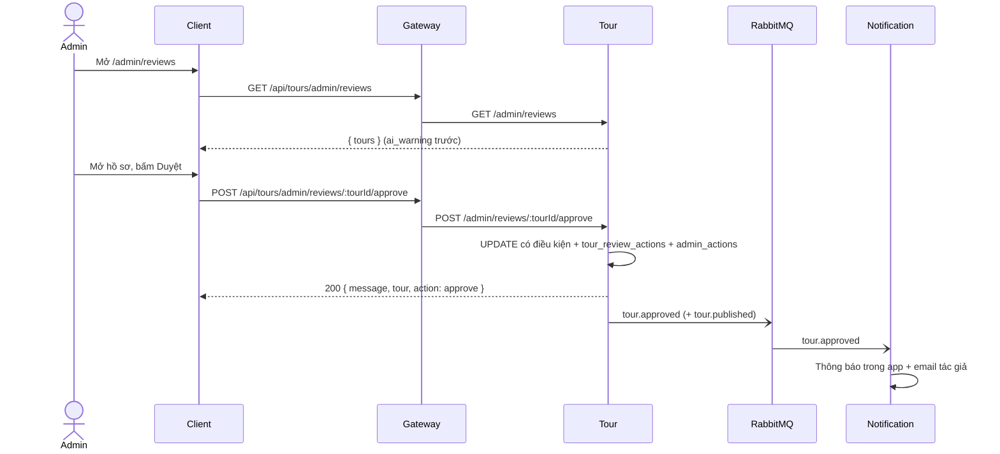

# UC19 – Duyệt / từ chối tour

| Trường | Nội dung |
|---|---|
| **Use Case Number** | UC19 |
| **Use Case Name** | Duyệt / từ chối tour (Kiểm duyệt Admin – Tầng 2) |
| **Actor(s)** | Admin (Quản trị viên kiểm duyệt); Hệ thống: Tour service, Notification service |
| **Priority** | P0 |
| **Maturity** | Implemented |
| **Summary** | Admin xem hàng chờ các tour đã qua bước AI (tour có AI Warning lên đầu), mở hồ sơ chỉ đọc của tour (nội dung, các điểm, ảnh, audio, cấu hình lộ trình, lý do AI / kiểm tra vị trí, lịch sử quyết định), rồi duyệt công khai, từ chối kèm lý do, hoặc yêu cầu tác giả chỉnh sửa và gửi lại. |

## Basic Course of Events

| # | Actor Action | System Response |
|---|---|---|
| 1 | Admin mở trang **"Hàng chờ kiểm duyệt"** (`/admin/reviews`). | |
| 2 | | Tour service trả về các tour ở trạng thái `ai_warning` hoặc `pending_review`: `ai_warning` lên đầu, sau đó tour chờ lâu nhất trước (theo thời điểm kết quả AI về). Mỗi dòng có tên, chip trạng thái (AI Warning / Chờ duyệt), thành phố, số lý do AI / vị trí, thời điểm gửi. Danh sách không phân trang. *E1, E2* `ListReviewQueue.execute()`, `sortReviewQueue()` |
| 3 | Admin chọn một tour. | |
| 4 | | Hệ thống hiển thị hồ sơ chỉ đọc (`/admin/reviews/:tourId`): thông tin tour, lý do kiểm duyệt (trường, loại, nguồn `AI` / `Kiểm tra vị trí`, mức độ), các điểm theo thứ tự (mô tả, ảnh, audio thu âm hoặc ghi chú "Giọng đọc máy (TTS) từ mô tả", vùng kích hoạt, trạng thái kiểm duyệt từng điểm), cấu hình lộ trình và audio chỉ đường, lịch sử quyết định. *A1, E3* `GetReviewDossier.execute()` |
| 5 | Admin chọn **Duyệt** và xác nhận trong hộp thoại "Duyệt tour này?". *A2, A3* | |
| 6 | | Tour service đổi trạng thái sang `public` bằng câu lệnh cập nhật có điều kiện (chỉ khi tour còn ở `ai_warning` / `pending_review`), xoá `reviewReason`, ghi một dòng `tour_review_actions` và một dòng `admin_actions` (`approve_tour`) trong cùng giao dịch. *E4* `ApproveTour.execute()`, `PrismaTourRepository.applyReviewDecisionIf()` |
| 7 | | Sau khi commit, Tour phát `tour.approved` (và `tour.published` nếu bật `CHATBOT_EVENTS_ENABLED`). Notification tạo thông báo trong app và gửi email cho tác giả (UC16). `EventTourReviewPublisher.approved()`, `handleEvent()` (Notification) |
| 8 | | Client hiện thông báo "Đã duyệt tour, tour đã công khai" và quay về hàng chờ. Tour xuất hiện trong tìm kiếm (UC02) và tải được (UC03). Use case kết thúc. |

## Alternative Path

**A1. Xem trước nội dung** → Admin nghe audio, mở ảnh và xem cấu hình lộ trình ngay trong hồ sơ. Hồ sơ chỉ đọc: không có nút sửa nội dung, đánh giá, báo cáo. Quay về bước 5.

**A2. Từ chối tour** → Admin nhập lý do (bắt buộc, 1 đến 1000 ký tự, nhập tự do) trong hộp thoại "Từ chối tour này?". Tour chuyển sang `rejected`, lý do lưu vào `reviewReason`, ghi log (`reject`, `reject_tour`), phát `tour.rejected`; tác giả nhận thông báo và email kèm lý do. Tác giả có thể sửa và gửi lại (UC15). Use case kết thúc. `RejectTour.execute()`, `EventTourReviewPublisher.rejected()`

**A3. Yêu cầu chỉnh sửa** → Admin nhập ghi chú chung và ghi chú cho từng điểm; client ghép thành một lý do ("Điểm 2 – <tên>: <ghi chú>"). Tour chuyển sang `changes_requested` (không công khai), ghi log (`request_changes`, `request_tour_changes`), phát `tour.changes_requested`; tác giả nhận "Tour cần chỉnh sửa" kèm lý do, sửa rồi gửi lại (UC15). Use case kết thúc. `joinChangeRequest()` (client), `RequestTourChanges.execute()`, `EventTourReviewPublisher.changesRequested()`

## Exception Path

- **E1.** Không có tour nào chờ duyệt → danh sách rỗng.
- **E2.** Không có token hợp lệ → 401; tài khoản không phải admin → 403.
- **E3.** `tourId` không phải UUID → 400; tour không tồn tại → 404 (`TourNotFoundError`).
- **E4.** Tour không còn ở `ai_warning` / `pending_review` (hoặc admin khác đã quyết định trước) → 409 (`TourNotReviewableError`, ném trong `ReviewDecision.decide()`); client hiện "Tour không còn ở trạng thái chờ duyệt" và tải lại hồ sơ.
- **E5.** Từ chối / yêu cầu chỉnh sửa thiếu lý do hoặc lý do quá 1000 ký tự → 422, lỗi hiện trong hộp thoại.
- **E6.** Gửi sự kiện thất bại → chỉ ghi log ở Tour, quyết định vẫn thành công (`ReviewDecision.emit()`).

## Extension Points

- UC15 – Gửi tour đi duyệt (đầu vào hàng chờ, và gửi lại sau A2 / A3); UC16 – Theo dõi trạng thái & thông báo; UC22 – Dashboard thống kê & log.

## Triggers

Moderation phát `tour.ai_passed` cho một tour; Tour chuyển tour sang `pending_review` (hoặc `ai_warning` khi có `warning: true`) và ghi `reviewQueuedAt`.

## Assumptions

- Tài khoản admin được tạo thủ công (đổi `role` thành `admin` trong cơ sở dữ liệu Auth).
- Notification tra email tác giả qua Auth (`/internal/users/:id/contact`); nếu tra cứu thất bại thì bỏ qua email.

## Preconditions

- Admin đã đăng nhập; có ít nhất một tour ở `ai_warning` hoặc `pending_review`.

## Post Conditions

- Tour ở `public`, `rejected` hoặc `changes_requested`; `review_reason` lưu lý do cuối (null khi duyệt).
- Một dòng `tour_review_actions` (`action`, `reason`, `from_status`, `admin_id`) và một dòng `admin_actions` được ghi trong cùng giao dịch.
- Đã phát `tour.approved` / `tour.rejected` / `tour.changes_requested` (và `tour.published` khi duyệt, nếu bật cờ chatbot); tác giả có thông báo trong app và email.

## Reference: Business Rules

- Đây là **Tầng 2** của mô hình kiểm duyệt (sau AI ở UC15, trước báo cáo cộng đồng ở UC20).
- Chỉ quyết định được từ `ai_warning` hoặc `pending_review`; tour bị AI Reject không vào hàng chờ.
- Hàng chờ: `ai_warning` trước, sau đó cũ nhất trước (theo `updatedAt`).
- Từ chối và yêu cầu chỉnh sửa **bắt buộc có lý do** (trim, 1..1000 ký tự); duyệt không cần lý do.
- Ghi có điều kiện: hai admin cùng quyết định thì chỉ một người thắng, người kia nhận 409.
- Admin **không sửa nội dung** tour, chỉ quyết định trạng thái.
- `changes_requested` nằm trong nhóm trạng thái tác giả được gửi duyệt lại, giống `rejected`.
- `tour_review_actions.tour_id` không có khoá ngoại: log còn lại khi tour bị xoá.

## Hiện thực trong hệ thống

- **Dịch vụ:**
  - Client: hàng chờ, hồ sơ, hộp thoại xác nhận / lý do.
  - Gateway: chuyển `/api/tours/...` sang Tour.
  - Tour: hàng chờ, hồ sơ, quyết định, log, phát sự kiện; kiểm tra quyền bằng `verifyJwt(['admin'])`.
  - Notification: thông báo trong app và email cho tác giả.
  - AI (chatbot indexer): nhận `tour.published` khi bật cờ.
- **Màn hình (client):** `/admin/reviews` (`ReviewQueuePage`), `/admin/reviews/:tourId` (`ReviewDossierPage`, `ReasonDialog`, `RequestChangesDialog`) trong `client/src/features/admin/`; API helper `client/src/lib/admin-reviews.js`.
- **API (qua gateway):**
  - `GET /api/tours/admin/reviews`
  - `GET /api/tours/admin/reviews/:tourId`
  - `POST /api/tours/admin/reviews/:tourId/approve`
  - `POST /api/tours/admin/reviews/:tourId/reject` `{ reason }`
  - `POST /api/tours/admin/reviews/:tourId/request-changes` `{ reason }`
- **Sự kiện (RabbitMQ):** consume `tour.ai_passed` (vào hàng chờ); publish `tour.approved`, `tour.rejected`, `tour.changes_requested`, `tour.published`. Không gửi gì khi cả `MODERATION_EVENTS_ENABLED` và `CHATBOT_EVENTS_ENABLED` đều tắt.
- **Dữ liệu (schema `tour`):** `tours.status`, `tours.review_reason`, `tours.review_queued_at`; `tour_review_actions`; `admin_actions`.
- **Tài liệu thiết kế:** [admin-review-api.md](../../02-design/admin-review-api.md), [uc22-dashboard-log.md](../../02-design/uc22-dashboard-log.md), [uc16-notifications.md](../../02-design/uc16-notifications.md), [moderation-architecture.md](../../02-design/moderation-architecture.md).
- **Mã nguồn chính:**

| Bước | Hàm / lớp | File |
|---|---|---|
| 1-2 | `ReviewQueuePage`, `listReviewQueue()` | `client/src/features/admin/ReviewQueuePage.jsx`, `client/src/lib/admin-reviews.js` |
| 3-4 | `ReviewDossierPage`, `getReviewDossier()` | `client/src/features/admin/ReviewDossierPage.jsx`, `client/src/lib/admin-reviews.js` |
| 5, A2, A3 | `approveTour()`, `rejectTour()`, `requestTourChanges()`, `joinChangeRequest()` | `client/src/lib/admin-reviews.js` |
| A3 | `RequestChangesDialog`, `ReasonDialog` | `client/src/features/admin/RequestChangesDialog.jsx`, `client/src/features/admin/ReasonDialog.jsx` |
| Route | `buildAdminReviewRouter()` (mount `/admin/reviews`) | `services/tour/src/interfaces/http/routes/admin-review-routes.js`, `services/tour/src/index.js` |
| Controller | `AdminReviewController.queue/dossier/approve/reject/requestChanges` | `services/tour/src/interfaces/http/controllers/admin-review-controller.js` |
| 2, 4 | `ListReviewQueue`, `sortReviewQueue()`, `GetReviewDossier` | `services/tour/src/application/use-cases/review-tour.js` |
| 6, A2, A3 | `ApproveTour`, `RejectTour`, `RequestTourChanges` (base `ReviewDecision.decide()`) | `services/tour/src/application/use-cases/review-tour.js` |
| 6 | `PrismaTourRepository.applyReviewDecisionIf()` (status + `tour_review_actions` + `admin_actions`) | `services/tour/src/infrastructure/persistence/prisma-tour-repository.js` |
| 4 | `PrismaTourReviewActionRepository` (lịch sử) | `services/tour/src/infrastructure/persistence/prisma-tour-review-action-repository.js` |
| 7 | `EventTourReviewPublisher.approved/rejected/changesRequested()` | `services/tour/src/infrastructure/messaging/event-tour-review-publisher.js` |
| 7 | `handleEvent()` (in-app trước, rồi email; email tác giả tra qua `createContributorLookup()`) | `services/notification/src/notify.js`, `services/notification/src/services/contributor-lookup.js` |
| 7 | `createStoreInAppNotification()`, `buildTourEmail()` | `services/notification/src/application/store-in-app-notification.js`, `services/notification/src/services/tour-email-template.js` |

## Author(s)

(điền sau)

## Date

Tạo: 2026-10-18 · Cập nhật theo hệ thống: 2026-11-08

## Activity Diagram

[UC19-activity.xml](../../02-design/drawio/activity/UC19-activity.xml) (draw.io: File → Import from → Device). Nguồn: [specs/UC19.json](../../02-design/drawio/activity/specs/UC19.json).

## Sequence Diagram

## Boundary

- Trang Hàng chờ kiểm duyệt (`/admin/reviews`).
- Trang Hồ sơ tour chờ duyệt (`/admin/reviews/:tourId`): lý do AI / vị trí, các điểm, lộ trình, lịch sử.
- Hộp thoại Duyệt, Từ chối (lý do), Yêu cầu chỉnh sửa (ghi chú chung và từng điểm).
- Trang chủ quản trị (`/admin`) với thanh điều hướng admin.
