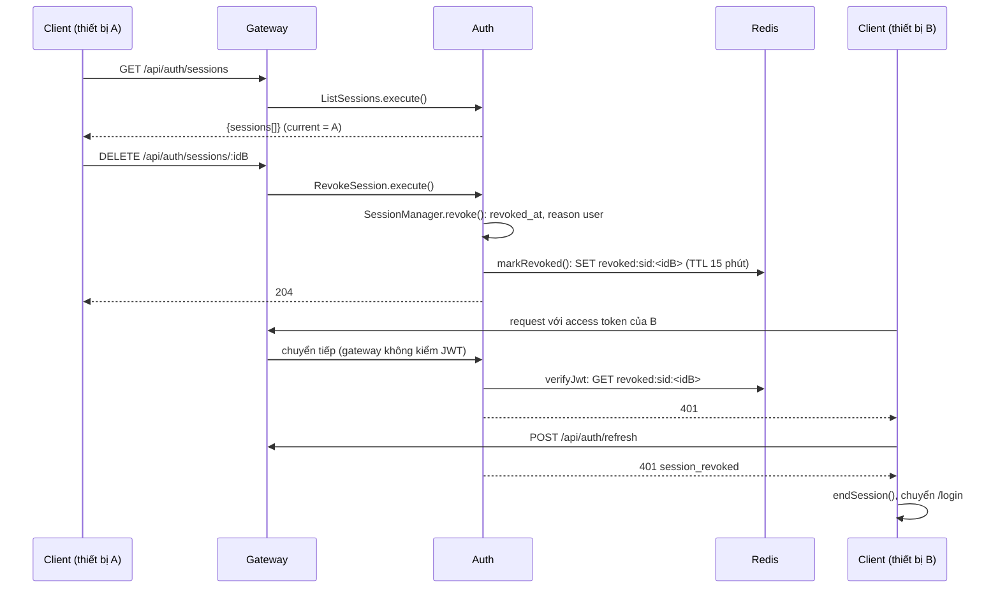
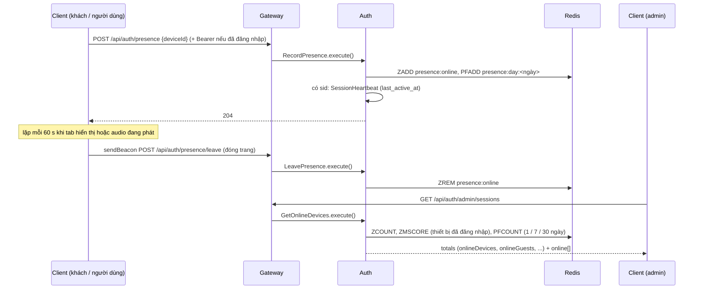

# UC23 – Quản lý thiết bị đang đăng nhập

| Trường | Nội dung |
|---|---|
| **Use Case Number** | UC23 |
| **Use Case Name** | Quản lý thiết bị đang đăng nhập |
| **Actor(s)** | Khách du lịch (Tourist), Người đăng nội dung (Contributor), Admin (người dùng đã đăng nhập); Khách chưa đăng nhập (chỉ gửi tín hiệu online, A5); Hệ thống: Auth service, Notification service |
| **Priority** | P1 |
| **Maturity** | Implemented |
| **Summary** | Mỗi lần đăng nhập trên một trình duyệt là một **phiên thiết bị** lưu ở Auth. Người dùng xem danh sách thiết bị đang đăng nhập (thiết bị hiện tại có nhãn "Thiết bị này"), đăng xuất từ xa một thiết bị hoặc tất cả thiết bị khác; việc đăng xuất có hiệu lực ngay. Hệ thống tự đăng xuất thiết bị khi đặt lại / đổi mật khẩu, khi tài khoản bị tạm khoá / cấm, khi phiên hết hạn hoặc refresh token bị dùng lại, và gửi email cảnh báo khi đăng nhập trên thiết bị mới. Admin xem số thiết bị đang online, gồm cả khách chưa đăng nhập (đa số người nghe tour không đăng nhập). |

## Basic Course of Events

| # | Actor Action | System Response |
|---|---|---|
| 1 | Người dùng vào **Tài khoản → "Thiết bị đang đăng nhập"** (`/account/devices`). | |
| 2 | | Client gọi `GET /api/auth/sessions`; Auth trả các phiên còn hiệu lực của tài khoản: `deviceName` (vd *"Chrome trên Windows"*), `location`, `createdAt`, `lastActiveAt`, `current`. `listSessions()` → `AuthController.listSessions()` → `ListSessions.execute()`, `PrismaSessionRepository.listActiveByUser()`, `Session.toPublic()` |
| 3 | | Client hiển thị: thiết bị hiện tại đứng đầu với nhãn **"Thiết bị này"**, các thiết bị khác theo hoạt động gần nhất; mỗi dòng có vị trí (hoặc *"Không xác định"*), *"Đăng nhập lúc ..."* và *"Đang hoạt động"* / *"5 phút trước"*. *E1, E4* `DevicesPage`, `sortSessions()`, `formatLastActive()` |
| 4 | Người dùng nhấn **"Đăng xuất thiết bị"** ở một thiết bị khác. *A1, A2* | |
| 5 | | Client hỏi *"Đăng xuất khỏi <tên thiết bị>?"* — *"Thiết bị đó sẽ cần đăng nhập lại để tiếp tục dùng tài khoản."* `ConfirmDialog` |
| 6 | Người dùng xác nhận. | |
| 7 | | Client gọi `DELETE /api/auth/sessions/:id`; Auth đặt `revoked_at`, `revoke_reason = user` và ghi khoá `revoked:sid:<sid>` vào Redis. Client bỏ dòng đó và báo *"Đã đăng xuất <tên thiết bị>"*. *E2, E3* `revokeSession()` → `RevokeSession.execute()` → `SessionManager.revoke()`, `RedisRevocationStore.markRevoked()` |
| 8 | | Trên thiết bị bị đăng xuất, request kế tiếp bị `verifyJwt` từ chối (401); refresh trả `401 session_revoked`; client xoá token và chuyển tới `/login` với thông báo *"Phiên đăng nhập đã kết thúc trên thiết bị này"*. `verifyJwt()` + `createRedisRevocationCheck()`; `RefreshToken.execute()`; `endSession()` → `SessionWatcher` |
| 9 | | Use case kết thúc tại đây. |

## Alternative Path

**A1. Đăng xuất tất cả thiết bị khác.**

| # | Actor Action | System Response |
|---|---|---|
| A1.1 | Người dùng nhấn **"Đăng xuất tất cả thiết bị khác"**. | |
| A1.2 | | Client hỏi *"Đăng xuất N thiết bị khác?"* — *"N thiết bị sẽ bị đăng xuất. Thiết bị này vẫn giữ đăng nhập."* `ConfirmDialog` |
| A1.3 | Người dùng xác nhận. | |
| A1.4 | | `POST /api/auth/sessions/revoke-others` thu hồi mọi phiên trừ phiên hiện tại (`user_all`), trả `{ revoked: n }`; danh sách chỉ còn "Thiết bị này"; toast *"Đã đăng xuất n thiết bị"*. `revokeOtherSessions()` → `RevokeOtherSessions.execute()` → `SessionManager.revokeAll()` |

**A2. Đăng xuất chính thiết bị đang dùng.** Nút **"Đăng xuất"** ở `/account` gọi `POST /api/auth/logout` (thu hồi phiên hiện tại) và xoá token. Thiết bị hiện tại không có nút đăng xuất trong danh sách; gọi `DELETE` cho chính nó trả `409 current_session`. `logout()` (`lib/auth.js`) → `Logout.execute()`; `CurrentSessionError`

**A3. Hệ thống tự đăng xuất** (không cần mở danh sách).

| Tình huống | Phạm vi | `revoke_reason` | Hàm |
|---|---|---|---|
| Đặt lại mật khẩu qua OTP (UC01 A2) | Tất cả thiết bị | `password_reset` | `ResetPassword.execute()` |
| Đổi mật khẩu khi đang đăng nhập (UC01 A5) | Tất cả trừ thiết bị hiện tại | `password_change` | `ChangePassword.execute()` |
| Admin tạm khoá / cấm tài khoản (UC21) | Tất cả thiết bị | `suspended` / `banned` | `SuspendUser`, `BanUser` → `signOutEverywhere()` → `RevokeAllSessions.execute()` |
| Đăng nhập lại trên cùng `deviceId` | Phiên cũ của thiết bị đó | `user` | `SessionManager.start()` |
| Quá 7 ngày không hoạt động hoặc quá 30 ngày từ lúc đăng nhập (phát hiện khi refresh) | Phiên đó | `expired` | `RefreshToken.execute()`, `Session.isExpired()` |
| Refresh token cũ bị dùng lại (dấu hiệu bị đánh cắp) | Phiên đó | `reuse` | `RefreshToken.execute()`, `JwtTokenService.hashRefresh()` |
| Vượt 100 phiên còn hiệu lực | Phiên lâu không hoạt động nhất | `limit` | `SessionManager.start()` (`#enforceCap`) |

**A4. Cảnh báo đăng nhập trên thiết bị mới.** Khi đăng nhập trên một `deviceId` chưa từng có phiên, Auth phát `auth.new_device_login` (`userId`, `email`, `deviceName`, `location?`, `at`); Notification gửi email *"Đăng nhập mới trên <thiết bị>"* tới email tài khoản (hoặc tới hộp thư thử nghiệm `SECURITY_ALERT_TO` nếu có cấu hình). Đăng xuất rồi đăng nhập lại trên cùng trình duyệt không gửi email. `SessionManager.start()` (`#alert`) → `EventPublisher.publish()`; Notification `handleEvent()` → `handleNewDeviceLogin()`, `securityAlertRecipient()`, `buildNewDeviceEmail()`

**A5. Admin xem thiết bị online (gồm cả khách chưa đăng nhập, #329).** GeoSound phục vụ cả người không đăng nhập, nên "online" được đo theo thiết bị (`deviceId` của trình duyệt), không theo phiên đăng nhập.

| # | Actor Action | System Response |
|---|---|---|
| A5.1 | Khách hoặc người dùng mở GeoSound (đăng nhập hay chưa). | |
| A5.2 | | Client gửi ngay `POST /api/auth/presence { deviceId }`. Khi đã đăng nhập, request kèm access token và Auth cập nhật luôn `last_active_at` của phiên (tối đa mỗi 30 giây). Auth ghi thiết bị vào Redis: `presence:online` (thời điểm thấy cuối) và `presence:day:<ngày>` (thiết bị khác nhau trong ngày). *E6, E7* `SessionWatcher` `usePresence()` → `beatPresence()` → `AuthController.presence()` → `RecordPresence.execute()`, `RedisPresenceStore.touch()`, `SessionHeartbeat.execute()` |
| A5.3 | Người dùng tiếp tục dùng app hoặc nghe tour (kể cả khi khoá màn hình). | |
| A5.4 | | Client gửi lại mỗi 60 giây khi tab đang hiển thị **hoặc audio đang phát**, khi quay lại tab và khi bắt đầu phát; tab ẩn mà không phát audio thì ngừng gửi. `usePresence()`, `useAudioController` → `setMediaPlaying()`, `beatPresence()` |
| A5.5 | Người dùng đóng trang. | |
| A5.6 | | Client gửi `navigator.sendBeacon` tới `POST /api/auth/presence/leave`; thiết bị rời danh sách online ngay. Nếu beacon không tới (mất mạng, tắt máy), thiết bị rời danh sách khi tín hiệu cuối cũ hơn 120 giây. `leavePresence()` → `AuthController.leavePresence()` → `LeavePresence.execute()`, `RedisPresenceStore.leave()` |
| A5.7 | Admin mở `/admin/devices` (menu Tài khoản). | |
| A5.8 | | `GET /api/auth/admin/sessions` trả: thiết bị đang online (đã đăng nhập + khách, mỗi `deviceId` tính một lần), khách chưa đăng nhập đang online, tài khoản online, phiên đang đăng nhập, thiết bị truy cập hôm nay / 7 ngày / 30 ngày, thiết bị đã đăng nhập trong 30 ngày, và danh sách thiết bị đã đăng nhập đang online kèm tài khoản (email, họ tên, vai trò). *E5, E7* `getOnlineDevices()` → `AuthController.onlineDevices()` → `GetOnlineDevices.execute()`, `RedisPresenceStore.countOnline()`, `.countActive()`, `PrismaSessionRepository.countStats()`, `.listOnline()`, `.listOnlineDeviceIds()` |
| A5.9 | | Client hiển thị 6 ô số, bảng thiết bị đã đăng nhập đang online và dòng *"+ N khách chưa đăng nhập đang online"* (khách không có dòng trong bảng vì không gắn với tài khoản); trang tự làm mới mỗi 30 giây. Admin không đăng xuất thiết bị của người khác ở đây. `OnlineDevicesPage` |

## Exception Path

- **E1.** Chỉ có thiết bị hiện tại → một dòng "Thiết bị này", ẩn nút "Đăng xuất tất cả thiết bị khác". `DevicesPage`
- **E2.** Thiết bị đã bị đăng xuất / hết hạn trước đó, hoặc không phải của mình → `404 session_not_found`; client báo *"Thiết bị này đã đăng xuất"* và tải lại danh sách. `SessionNotFoundError` (`RevokeSession.execute()`)
- **E3.** Mất mạng → *"Không thể kết nối, vui lòng thử lại"*; phiên của thiết bị kia không đổi. `DevicesPage` `errorMessage()`
- **E4.** Không tải được danh sách → *"Chưa tải được danh sách thiết bị"* kèm nút **Thử lại**. `DevicesPage` `load()`
- **E5.** Không phải admin gọi `GET /api/auth/admin/sessions` → `403`. `verifyJwt(['admin'])`
- **E6.** `deviceId` không phải UUID → `400`. Gửi kèm access token sai, hết hạn hoặc đã bị đăng xuất → `401`; client refresh rồi gửi lại như mọi request cần đăng nhập (không có token thì đi tiếp như khách). `presenceSchema`, `optionalAuth()`
- **E7.** Redis không phản hồi → `/presence` vẫn trả `204` (tín hiệu bị bỏ qua, chỉ ghi log một lần); admin vẫn nhận số liệu phiên, các số presence là `null`: ô "Đang online" chỉ tính thiết bị đã đăng nhập và trang ghi *"Chưa đếm được khách chưa đăng nhập (máy chủ không phản hồi), số online chỉ gồm thiết bị đã đăng nhập."* `RecordPresence.execute()`, `GetOnlineDevices.execute()`, `OnlineDevicesPage`

## Extension Points

- UC01 – Xác thực (đăng nhập tạo phiên; đặt lại / đổi mật khẩu đăng xuất thiết bị); UC16 – Thông báo (email cảnh báo); UC21 – Quản lý tài khoản vi phạm (tạm khoá / cấm đăng xuất tất cả).

## Triggers

Người dùng muốn biết tài khoản đang đăng nhập ở đâu, nghi ngờ người khác dùng tài khoản, hoặc mất / bán / cho mượn thiết bị.

## Assumptions

- Client giữ một `deviceId` ngẫu nhiên (UUID) trong `localStorage` (`getDeviceId()`) và gửi kèm khi đăng nhập / refresh, nên đăng nhập lại trên cùng trình duyệt không sinh thêm dòng. Cùng `deviceId` đó được gửi trong tín hiệu online (A5), nên một trình duyệt đã đăng nhập chỉ được tính một thiết bị.
- Tên thiết bị suy ra từ User-Agent (`deviceNameFromUserAgent()`); vị trí hiện luôn là *"Không xác định"* (xem Giới hạn đã biết).

## Preconditions

- Người dùng đã đăng nhập (UC01) và tài khoản không bị cấm / tạm khoá (trừ A5.1–A5.6: mọi khách đều gửi tín hiệu online, không cần đăng nhập).
- A5.7–A5.9: tài khoản có vai trò `admin`.

## Post Conditions

- Phiên bị đăng xuất có `revoked_at`, `revoke_reason`; khoá `revoked:sid:<sid>` trong Redis làm access token của phiên đó hết hiệu lực ngay ở Auth, Tour, Media và Notification; refresh token không dùng được nữa.
- Danh sách chỉ còn các phiên chưa bị thu hồi và chưa hết hạn.

## Reference: Business Rules

| Quy tắc | Giá trị (mặc định, biến cấu hình) |
|---|---|
| Một thiết bị | Một phiên trên một `(user, deviceId)` còn hiệu lực |
| Hết hạn phiên | 7 ngày không hoạt động (`AUTH_SESSION_IDLE_DAYS`), tối đa 30 ngày từ lúc đăng nhập (`AUTH_SESSION_MAX_DAYS`) |
| Giới hạn kỹ thuật | 100 phiên còn hiệu lực mỗi tài khoản (`AUTH_MAX_SESSIONS`) |
| Online | Thiết bị (đăng nhập hay chưa) gửi tín hiệu trong 120 giây gần nhất (`AUTH_ONLINE_WINDOW_SECONDS`); client gửi mỗi 60 giây khi tab đang hiển thị hoặc audio đang phát, gửi `leave` khi đóng trang; `last_active_at` của phiên được ghi tối đa mỗi 30 giây (`AUTH_HEARTBEAT_MIN_SECONDS`) |
| Đếm thiết bị | Theo `deviceId` (1 trình duyệt = 1 thiết bị), là ước lượng: 2 trình duyệt của một người = 2 thiết bị, xoá dữ liệu trình duyệt = thiết bị mới. Redis giữ tối đa 10000 thiết bị online (`AUTH_PRESENCE_MAX_DEVICES`), bỏ thiết bị cũ nhất trước |
| Truy cập theo ngày | Số thiết bị khác nhau mỗi ngày theo giờ Việt Nam (`AUTH_PRESENCE_DAY_OFFSET_MINUTES` = 420), giữ 32 ngày; admin xem hôm nay / 7 ngày / 30 ngày |
| Đăng xuất ngay | Khoá Redis sống bằng `JWT_ACCESS_TTL` (15 phút); Redis lỗi hoặc chậm quá 300 ms thì request vẫn qua (fail open) |
| Refresh token | Xoay vòng mỗi lần dùng; chỉ lưu sha-256; token cũ dùng lại = đăng xuất phiên |
| Riêng tư | Không hiển thị IP hay token; IP và User-Agent giữ thêm 30 ngày sau khi phiên kết thúc (`AUTH_SESSION_RETENTION_DAYS`), job dọn chạy mỗi giờ |

## Hiện thực trong hệ thống

- **Dịch vụ:**
  - Client: màn thiết bị, màn admin, `SessionWatcher` (chuyển về `/login` khi phiên kết thúc, gửi tín hiệu online cho mọi khách), trình phát audio báo đang phát, refresh tuần tự giữa các tab.
  - Gateway: `/api/auth/*` → Auth, thêm `x-forwarded-for`.
  - Auth: bảng `sessions`, `SessionManager`, các use case liệt kê / thu hồi / heartbeat / tín hiệu online / xem online, presence trong Redis, job dọn dữ liệu, phát `auth.new_device_login`.
  - `shared/middleware` `verifyJwt`: kiểm tra khoá thu hồi trong Redis (được bật ở Auth, Tour, Media, Notification).
  - Notification: nhận `auth.new_device_login`, gửi email cảnh báo.
- **Màn hình (client):** `/account/devices` (`features/account/DevicesPage.jsx`), `/admin/devices` (`features/admin/OnlineDevicesPage.jsx`), `client/src/auth/SessionWatcher.jsx`, `client/src/lib/sessions.js`, `client/src/lib/presence.js`.
- **API (qua gateway):**
  - `GET /api/auth/sessions`
  - `DELETE /api/auth/sessions/:id`
  - `POST /api/auth/sessions/revoke-others`
  - `POST /api/auth/logout`
  - `POST /api/auth/sessions/heartbeat` (giữ cho client cũ; client hiện dùng `/presence`)
  - `POST /api/auth/presence` (không cần đăng nhập; có token thì token phải hợp lệ)
  - `POST /api/auth/presence/leave` (`sendBeacon`, body JSON gửi dạng `text/plain`)
  - `POST /api/auth/change-password`
  - `GET /api/auth/admin/sessions` (chỉ `admin`)
- **Sự kiện (RabbitMQ):** Auth phát `auth.new_device_login`; Notification tiêu thụ.
- **Dữ liệu:** `app_auth.sessions` (`user_id`, `device_id`, `device_name`, `user_agent`, `ip_address`, `location`, `refresh_hash`, `created_at`, `last_active_at`, `expires_at`, `revoked_at`, `revoke_reason`); Redis `revoked:sid:<sid>`, `presence:online` (sorted set `deviceId` → thời điểm thấy cuối), `presence:day:<YYYY-MM-DD>` (HyperLogLog, hết hạn sau 32 ngày). Presence chỉ lưu `deviceId`, không lưu IP hay tài khoản.
- **Mã nguồn chính:**

| Bước | Hàm / lớp | File |
|---|---|---|
| 1–7, E1–E4 | `DevicesPage`, `sortSessions()`, `load()` | `client/src/features/account/DevicesPage.jsx` |
| 2, 7, A1, A5 | `listSessions()`, `revokeSession()`, `revokeOtherSessions()`, `getOnlineDevices()` | `client/src/lib/sessions.js` |
| 8, A5 | `SessionWatcher`, `usePresence()` | `client/src/auth/SessionWatcher.jsx` |
| A5 | `beatPresence()`, `leavePresence()`, `setMediaPlaying()`, `isMediaPlaying()` | `client/src/lib/presence.js` |
| A5 | `useAudioController` (báo đang phát) | `client/src/hooks/useAudioController.js` |
| 8 | `endSession()`, `onSessionEnded()` | `client/src/lib/token-store.js` |
| A5 | `OnlineDevicesPage` | `client/src/features/admin/OnlineDevicesPage.jsx` |
| Route | `buildAuthRouter()` | `services/auth/src/interfaces/http/routes/auth-routes.js` |
| Controller | `AuthController.listSessions()`, `.revokeSession()`, `.revokeOtherSessions()`, `.logout()`, `.heartbeat()`, `.presence()`, `.leavePresence()`, `.onlineDevices()` | `services/auth/src/interfaces/http/controllers/auth-controller.js` |
| A5, E6 | `optionalAuth()`, `beaconBody()`, `presenceSchema` | `services/auth/src/interfaces/http/middleware/optional-auth.js`, `beacon-body.js`, `services/auth/src/application/dtos/schemas.js` |
| 2, 7, A1, A2 | `ListSessions`, `RevokeSession`, `RevokeOtherSessions`, `Logout` (`.execute()`) | `services/auth/src/application/use-cases/list-sessions.js`, `revoke-session.js`, `revoke-other-sessions.js`, `logout.js` |
| A5 | `SessionHeartbeat.execute()`, `GetOnlineDevices.execute()`, `RecordPresence.execute()`, `LeavePresence.execute()` | `services/auth/src/application/use-cases/session-heartbeat.js`, `get-online-devices.js`, `record-presence.js` |
| A5 | `RedisPresenceStore.touch()`, `.leave()`, `.countOnline()`, `.countActive()` | `services/auth/src/infrastructure/cache/redis-presence-store.js` |
| 7, A3, A4 | `SessionManager.start()`, `.revoke()`, `.revokeAll()` | `services/auth/src/application/services/session-manager.js` |
| A3 | `RevokeAllSessions.execute()`, `PurgeEndedSessions.execute()` | `services/auth/src/application/use-cases/revoke-all-sessions.js`, `purge-ended-sessions.js` |
| 2, A3 | `Session` (`isExpired()`, `revoke()`, `touch()`, `toPublic()`), `REVOKE_REASONS` | `services/auth/src/domain/entities/session.js` |
| 2 | `deviceNameFromUserAgent()` | `services/auth/src/domain/value-objects/device-name.js` |
| 2, A5 | `PrismaSessionRepository.listActiveByUser()`, `.countStats()`, `.listOnline()`, `.listOnlineDeviceIds()`, `.deleteEndedBefore()` | `services/auth/src/infrastructure/persistence/prisma-session-repository.js` |
| 7 | `RedisRevocationStore.markRevoked()` | `services/auth/src/infrastructure/cache/redis-revocation-store.js` |
| 8 | `verifyJwt()`, `createRedisRevocationCheck()`, `setSessionRevocationCheck()` | `shared/middleware/index.js` |
| A4 | `EventPublisher.publish()` | `services/auth/src/infrastructure/messaging/event-publisher.js` |
| A4 | `handleEvent()`, `handleNewDeviceLogin()`, `securityAlertRecipient()` | `services/notification/src/notify.js` |
| A4 | `buildNewDeviceEmail()` | `services/notification/src/services/security-email-template.js` |

- **Tài liệu thiết kế:** [device-sessions.md](../../02-design/device-sessions.md) (R13, mục 5.4 và 5.6: presence #329), [notification-otp-design.md](../../02-design/notification-otp-design.md) (tra email người đóng góp, #258), [uc21-account-actions.md](../../02-design/uc21-account-actions.md).
- **Giới hạn đã biết:**
  - Vị trí theo IP chưa làm (`NullLocationResolver`): `location` luôn rỗng, hiển thị *"Không xác định"*; email cảnh báo cũng không có vị trí.
  - Access token cũ không có `sid` (trước UC23) không bị kiểm tra thu hồi, hết hạn sau tối đa 15 phút.
  - Số khách online là ước lượng theo trình duyệt (xem quy tắc "Đếm thiết bị"); tab ẩn danh hoặc chặn `localStorage` tạo `deviceId` mới mỗi lần mở.
  - Đóng một tab trong khi tab khác của cùng trình duyệt vẫn mở: thiết bị rời danh sách cho tới tín hiệu kế tiếp của tab còn lại (tối đa 60 giây).
  - Trên điện thoại, trình duyệt có thể làm chậm bộ đếm giờ khi khoá màn hình; khi audio đang phát, client gửi thêm tín hiệu từ sự kiện phát (`timeupdate`), nhưng chưa kiểm chứng trên mọi máy.

## Author(s)

(điền sau)

## Date

Tạo: 2026-10-30 · Cập nhật theo hệ thống: 2026-11-09 (A5 đếm cả khách chưa đăng nhập, #329)

## Activity Diagram

[UC23-activity.xml](../../02-design/drawio/activity/UC23-activity.xml) (draw.io: File → Import from → Device). Nguồn: [specs/UC23.json](../../02-design/drawio/activity/specs/UC23.json).

## Sequence Diagram

**A5 – tín hiệu online (đăng nhập hay chưa) và màn admin:**

## Boundary

- Màn Tài khoản `/account` (mục "Thiết bị đang đăng nhập", nút Đăng xuất, mục "Thiết bị online" cho admin).
- Màn Thiết bị đang đăng nhập `/account/devices` (danh sách, hộp xác nhận đăng xuất một thiết bị / tất cả thiết bị khác).
- Màn Thiết bị online `/admin/devices` (chỉ admin).
- Mọi trang của client: tín hiệu online chạy nền cho mọi khách (không có giao diện riêng).
- Màn Đăng nhập `/login` với thông báo phiên đã kết thúc; email cảnh báo đăng nhập mới.
